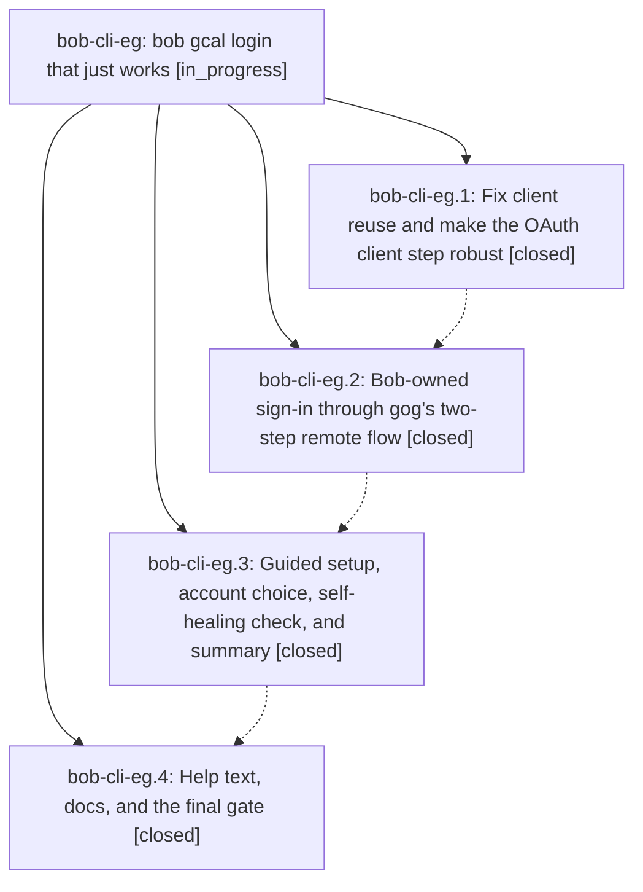

# Bead: bob-cli-eg — bob gcal login that just works

[Bead Pages](../README.md) / bob-cli-eg

**Status:** ◐ in_progress · **Type:** ▸ plan · **Tier:** epic
**Owner:** `bryanbugyi34@gmail.com` · **Created by:** [bbugyi200.athena.165](https://github.com/bobs-org/bob-cli--agents/blob/main/sessions/bbugyi200.athena.165.md) · **Assignee:** `bob-cli-eg.land`
**Created:** 2026-10-30 09:42:40 EDT
**Plan:** [202610/gcal\_login\_redesign.md](https://github.com/bobs-org/bob-cli--plans/blob/main/202610/gcal_login_redesign.md)

<!-- sase:links:start -->

## Links

| Relation | Artifact | Why |
| --- | --- | --- |
| implemented-by | [plan:202610/gcal_login_redesign.md][1] | derived from the plan's `bead_id:` frontmatter field |

_Plus 2 automatic references — see [Referenced By](#referenced-by)._

[1]: https://github.com/bobs-org/bob-cli--plans/blob/main/202610/gcal_login_redesign.md

<!-- sase:links:end -->

## Description

`bob gcal login` connects Google Calendar in one command on any host (Mac with a browser, athena over SSH): it fixes the gog-client reuse failure, owns a sign-in flow that cannot hang, explains every Google screen in plain words, recovers from the usual Cloud Console mistakes in place, and renders a calm, beautiful step transcript.

## Notes

[2026-10-30T15:36:59Z · bryanbugyi34@gmail.com] I'm getting a 'sign-in link is out of date' error message when I try to login at the moment. See the 🔒 20261030\_113553.png screenshot for context. The Epic Lenard agent should ensure this is fixed before landing the epic.

## Attachments

- 🔒 20261030\_113553.png · image/png · 2854×1686 · 402.271 KiB (private attachment)

## Phases

| Bead | Title | Status | Size | Created | Agents | Commits |
|---|---|---|---|---|---:|---:|
| [bob-cli-eg.1](bob-cli-eg.1.md) | Fix client reuse and make the OAuth client step robust | ✓ closed | medium | 2026-10-30 | 1 | 1 |
| [bob-cli-eg.2](bob-cli-eg.2.md) | Bob-owned sign-in through gog's two-step remote flow | ✓ closed | medium | 2026-10-30 | 1 | 1 |
| [bob-cli-eg.3](bob-cli-eg.3.md) | Guided setup, account choice, self-healing check, and summary | ✓ closed | medium | 2026-10-30 | 1 | 1 |
| [bob-cli-eg.4](bob-cli-eg.4.md) | Help text, docs, and the final gate | ✓ closed | small | 2026-10-30 | 1 | 1 |

## Lineage

## Agents

| Agent | Bead | Commits |
|---|---|---:|
| [bbugyi200.athena.bob-cli-eg.1](https://github.com/bobs-org/bob-cli--agents/blob/main/agents/bbugyi200.athena.bob-cli-eg.1/README.md) | [bob-cli-eg.1](bob-cli-eg.1.md) | 1 |
| [bbugyi200.athena.bob-cli-eg.2](https://github.com/bobs-org/bob-cli--agents/blob/main/sessions/bbugyi200.athena.bob-cli-eg.2.md) | [bob-cli-eg.2](bob-cli-eg.2.md) | 1 |
| [bbugyi200.athena.bob-cli-eg.3](https://github.com/bobs-org/bob-cli--agents/blob/main/sessions/bbugyi200.athena.bob-cli-eg.3.md) | [bob-cli-eg.3](bob-cli-eg.3.md) | 1 |
| [bbugyi200.athena.bob-cli-eg.4](https://github.com/bobs-org/bob-cli--agents/blob/main/agents/bbugyi200.athena.bob-cli-eg.4/README.md) | [bob-cli-eg.4](bob-cli-eg.4.md) | 1 |
| [bbugyi200.athena.bob-cli-eg.land](https://github.com/bobs-org/bob-cli--agents/blob/main/agents/bbugyi200.athena.bob-cli-eg.land/README.md) | [bob-cli-eg](README.md) | 0 |

## Commits

| Repo | Commit | Subject | Bead | Committed |
|---|---|---|---|---|
| bob-cli | [`2ca76ca`](https://github.com/bobs-org/bob-cli/commit/2ca76ca05a1bc544f16a3686774ac4a6538a9550) | fix(gcal): reuse gog clients by piping normalized client JSON | [bob-cli-eg.1](bob-cli-eg.1.md) | 2026-10-30 10:13:17 EDT |
| bob-cli | [`00c44ab`](https://github.com/bobs-org/bob-cli/commit/00c44ab4b481ecc00f4a882ae873a6fc6d28fde6) | feat(gcal): bob-owned login sign-in with browser and paste flows | [bob-cli-eg.2](bob-cli-eg.2.md) | 2026-10-30 11:17:32 EDT |
| bob-cli | [`18d3f97`](https://github.com/bobs-org/bob-cli/commit/18d3f97a36059ae331d4529f380c847e3dcab5d1) | feat(gcal): guide Calendar login setup and recovery | [bob-cli-eg.3](bob-cli-eg.3.md) | 2026-10-30 12:15:22 EDT |
| bob-cli | [`7254e10`](https://github.com/bobs-org/bob-cli/commit/7254e106795ee56425456f07a95c7756aca284bd) | docs(gcal): update login guidance and help | [bob-cli-eg.4](bob-cli-eg.4.md) | 2026-10-30 12:31:26 EDT |

<!-- sase:referenced-by:start -->

## Referenced By

| Relation | Artifact | Why | Uses |
| --- | --- | --- | ---: |
| read-by | [agent:bob-cli-eg.1][1] | Need epic DECISIONS and plan context | 1 |
| read-by | [agent:bob-cli-eg.2--1][2] | Need epic DECISIONS and plan | 1 |

[1]: https://github.com/bobs-org/bob-cli--agents/blob/main/agents/bbugyi200.athena.bob-cli-eg.1/README.md
[2]: https://github.com/bobs-org/bob-cli--agents/blob/main/sessions/bbugyi200.athena.bob-cli-eg.2.md

<!-- sase:referenced-by:end -->
