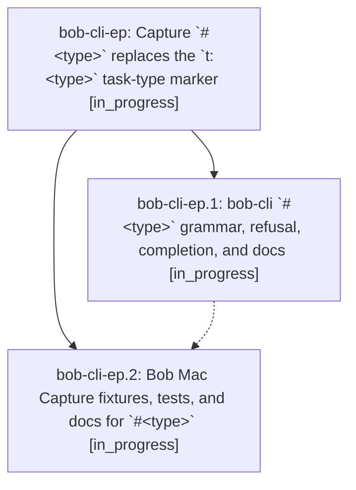

# Bead: bob-cli-ep — Capture \`#\<type\>\` replaces the \`t:\<type\>\` task-type marker

[Bead Pages](../README.md) / bob-cli-ep

**Status:** ◐ in_progress · **Type:** ▸ plan · **Tier:** epic
**Owner:** `bryanbugyi34@gmail.com` · **Created by:** [bbugyi200.apollo.be](https://github.com/bobs-org/bob-cli--agents/blob/main/sessions/bbugyi200.apollo.be.md) · **Assignee:** `bob-cli-ep.land`
**Created:** 2026-10-30 15:04:29 EDT
**Plan:** [202610/capture\_hash\_type\_marker.md](https://github.com/bobs-org/bob-cli--plans/blob/main/202610/capture_hash_type_marker.md)

<!-- sase:links:start -->

## Links

| Relation | Artifact | Why |
| --- | --- | --- |
| implemented-by | [plan:202610/capture_hash_type_marker.md][1] | derived from the plan's `bead_id:` frontmatter field |

[1]: https://github.com/bobs-org/bob-cli--plans/blob/main/202610/capture_hash_type_marker.md

<!-- sase:links:end -->

## Description

Typing `#fix` at either edge of any capture line, or right after `@route^id` or a marker-only `@route+id`, types the task the item creates or targets. The same Task type menu that `t:` opens today appears. An unconfigured type name is refused before any write with a clear, teaching message, and `t:` is retired.

## Phases

| Bead | Title | Status | Size | Created | Agents | Commits |
|---|---|---|---|---|---:|---:|
| [bob-cli-ep.1](bob-cli-ep.1.md) | bob-cli \`#\<type\>\` grammar, refusal, completion, and docs | ◐ in_progress | large | 2026-10-30 | 1 | 1 |
| [bob-cli-ep.2](bob-cli-ep.2.md) | Bob Mac Capture fixtures, tests, and docs for \`#\<type\>\` | ◐ in_progress | medium | 2026-10-30 | 1 | 0 |

## Lineage

## Agents

| Agent | Bead | Commits |
|---|---|---:|
| [bbugyi200.apollo.bob-cli-ep.1](https://github.com/bobs-org/bob-cli--agents/blob/main/sessions/bbugyi200.apollo.bob-cli-ep.1.md) | [bob-cli-ep.1](bob-cli-ep.1.md) | 1 |
| [bbugyi200.apollo.bob-cli-ep.2](https://github.com/bobs-org/bob-cli--agents/blob/main/agents/bbugyi200.apollo.bob-cli-ep.2/README.md) | [bob-cli-ep.2](bob-cli-ep.2.md) | 0 |
| [bbugyi200.apollo.bob-cli-ep.land](https://github.com/bobs-org/bob-cli--agents/blob/main/agents/bbugyi200.apollo.bob-cli-ep.land/README.md) | [bob-cli-ep](README.md) | 0 |

## Commits

| Repo | Commit | Subject | Bead | Committed |
|---|---|---|---|---|
| bob-cli | [`4a95e5b`](https://github.com/bobs-org/bob-cli/commit/4a95e5b78cba78d2b1c13201ccda8736087b7f4a) | feat(capture)!: replace t: type markers with #\<type\> | [bob-cli-ep.1](bob-cli-ep.1.md) | 2026-10-30 19:05:00 EDT |
