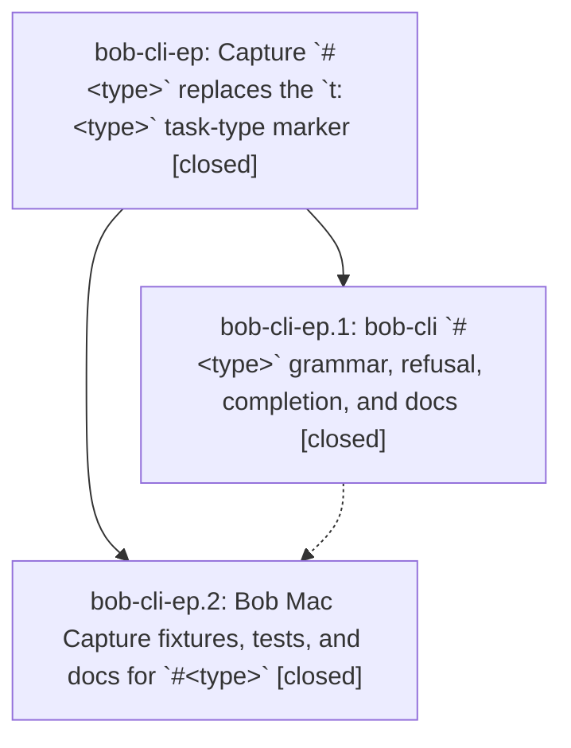

# Bead: bob-cli-ep — Capture \`#\<type\>\` replaces the \`t:\<type\>\` task-type marker

[Bead Pages](../README.md) / bob-cli-ep

**Status:** ✓ closed · **Resolution:** done · **Type:** ▸ plan · **Tier:** epic
**Owner:** `bryanbugyi34@gmail.com` · **Created by:** [bbugyi200.apollo.be](https://github.com/bobs-org/bob-cli--agents/blob/main/sessions/bbugyi200.apollo.be.md) · **Assignee:** `bob-cli-ep.land`
**Created:** 2026-10-30 15:04:29 EDT · **Closed:** 2026-10-31 10:23:03 EDT
**Plan:** [202610/capture\_hash\_type\_marker.md](https://github.com/bobs-org/bob-cli--plans/blob/main/202610/capture_hash_type_marker.md)

<!-- sase:links:start -->

## Links

| Relation | Artifact | Why |
| --- | --- | --- |
| implemented-by | [plan:202610/capture_hash_type_marker.md][1] | derived from the plan's `bead_id:` frontmatter field |

[1]: https://github.com/bobs-org/bob-cli--plans/blob/main/202610/capture_hash_type_marker.md

<!-- sase:links:end -->

## Description

Typing `#fix` at either edge of any capture line, or right after `@route^id` or a marker-only `@route+id`, types the task the item creates or targets. The same Task type menu that `t:` opens today appears. An unconfigured type name is refused before any write with a clear, teaching message, and `t:` is retired.

## Notes

[2026-10-31T14:04:11Z · bob-cli-ep.land] Land review: phases bob-cli-ep.1 (4a95e5b7, d1dd23e2) and bob-cli-ep.2 (bob-mac-capture 9d023bb) verified against the plan and DECISIONS (bare_hash_menu=letter, retire_t=prose, memory_record=no; no memory edited). just check passed on d1dd23e2; spot checks of capture/capture-parse/capture-complete matched the contract. Follow-up triage: no PROPOSED FOLLOW-UP notes on either phase, so nothing was filed. Integration: post-epic commits (gcal, glossary, guides, promotion, wikilink ranker, task-tag-marks) add no t:, legacy #tag, or named @r+id#NAME usage, so nothing to integrate. Remaining epic-caused work: stale completion docs/help for the no-body @route+id# (docs/capture.md ~6463-6467 and ~6530-6533 still describe Pomodoro-name completion there; ~3161 lists toggles as #name literal positions; capture-complete clap help omits the body-text qualifier on task-section completion and the attached @route^id#/@route+id# task_type forms; docs/completion.md omits @route^id#). Planned as a tale that also closes the epic.

[2026-10-31T14:23:03Z · bob-cli-ep.land] Verified phases bob-cli-ep.1 (4a95e5b7, d1dd23e2) and bob-cli-ep.2 (bob-mac-capture 9d023bb) against the plan and DECISIONS (bare_hash_menu=letter, retire_t=prose, memory_record=no); just check passed; capture/capture-parse/capture-complete spot checks matched the contract. No PROPOSED FOLLOW-UP notes, so nothing filed. Post-epic commits needed no integration. Lander tale fixed the stale @route+id# / @route^id# completion docs and help; just docs-check and just check passed.

## Phases

| Bead | Title | Status | Size | Created | Agents | Commits |
|---|---|---|---|---|---:|---:|
| [bob-cli-ep.1](bob-cli-ep.1.md) | bob-cli \`#\<type\>\` grammar, refusal, completion, and docs | ✓ closed | large | 2026-10-30 | 1 | 2 |
| [bob-cli-ep.2](bob-cli-ep.2.md) | Bob Mac Capture fixtures, tests, and docs for \`#\<type\>\` | ✓ closed | medium | 2026-10-30 | 1 | 1 |

## Lineage

## Agents

| Agent | Bead | Commits |
|---|---|---:|
| [bbugyi200.apollo.bob-cli-ep.1](https://github.com/bobs-org/bob-cli--agents/blob/main/sessions/bbugyi200.apollo.bob-cli-ep.1.md) | [bob-cli-ep.1](bob-cli-ep.1.md) | 2 |
| [bbugyi200.apollo.bob-cli-ep.2](https://github.com/bobs-org/bob-cli--agents/blob/main/agents/bbugyi200.apollo.bob-cli-ep.2/README.md) | [bob-cli-ep.2](bob-cli-ep.2.md) | 1 |
| [bbugyi200.apollo.bob-cli-ep.land](https://github.com/bobs-org/bob-cli--agents/blob/main/sessions/bbugyi200.apollo.bob-cli-ep.land.md) | [bob-cli-ep](README.md) | 1 |

## Commits

| Repo | Commit | Subject | Bead | Committed |
|---|---|---|---|---|
| bob-cli | [`4a95e5b`](https://github.com/bobs-org/bob-cli/commit/4a95e5b78cba78d2b1c13201ccda8736087b7f4a) | feat(capture)!: replace t: type markers with #\<type\> | [bob-cli-ep.1](bob-cli-ep.1.md) | 2026-10-30 19:05:00 EDT |
| bob-cli | [`d1dd23e`](https://github.com/bobs-org/bob-cli/commit/d1dd23e26711a9d80d9591c9ae6c1fd0eeaa5ec8) | fix(capture): finish attached #\<type\> forms, refusal hints, and docs | [bob-cli-ep.1](bob-cli-ep.1.md) | 2026-10-31 09:13:37 EDT |
| bob-mac-capture | [`bob-mac-capture@9d023bb`](https://github.com/bobs-org/bob-mac-capture/commit/9d023bb34a39bbf9ced0144e114eec9b1d6498b8) | feat(mac-capture): type tasks with #\<type\> fixtures, tests, and docs | [bob-cli-ep.2](bob-cli-ep.2.md) | 2026-10-31 09:48:14 EDT |
| bob-cli | [`c7e1f62`](https://github.com/bobs-org/bob-cli/commit/c7e1f62a4e79cbeeb8210d4e751c9e40ed78f70c) | docs(capture): fix stale @route+id# completion help after #\<type\> | [bob-cli-ep](README.md) | 2026-10-31 10:23:28 EDT |
