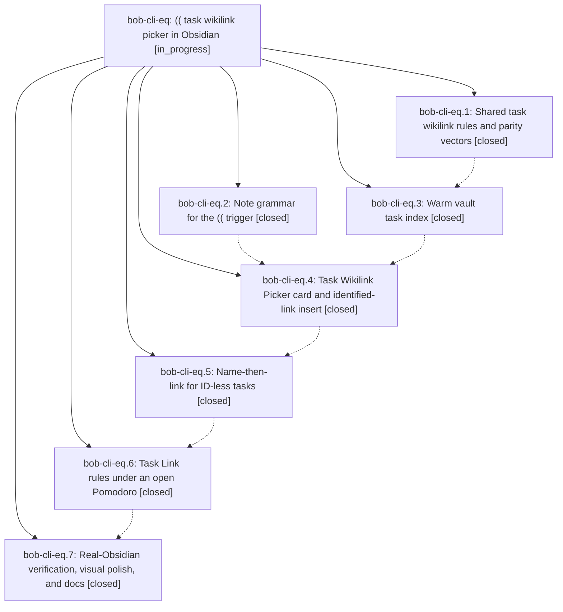

# Bead: bob-cli-eq — (( task wikilink picker in Obsidian

[Bead Pages](../README.md) / bob-cli-eq

**Status:** ◐ in_progress · **Type:** ▸ plan · **Tier:** epic
**Owner:** `bryanbugyi34@gmail.com` · **Created by:** [bbugyi200.apollo.b5](https://github.com/bobs-org/bob-cli--agents/blob/main/sessions/bbugyi200.apollo.b5.md) · **Assignee:** `bob-cli-eq.land`
**Created:** 2026-10-30 16:10:20 EDT
**Plan:** [202610/obsidian\_task\_wikilinks.md](https://github.com/bobs-org/bob-cli--plans/blob/main/202610/obsidian_task_wikilinks.md)

<!-- sase:links:start -->

## Links

| Relation | Artifact | Why |
| --- | --- | --- |
| implemented-by | [plan:202610/obsidian_task_wikilinks.md][1] | derived from the plan's `bead_id:` frontmatter field |

_Plus 3 automatic references — see [Referenced By](#referenced-by)._

[1]: https://github.com/bobs-org/bob-cli--plans/blob/main/202610/obsidian_task_wikilinks.md

<!-- sase:links:end -->

## Description

Typing (( anywhere prose is allowed in an Obsidian note opens a fast, calm, keyboard-first picker over every task in the vault. Choosing a task replaces the token with the same [[note#^id]] block link Bob Mac Capture would insert, naming an ID-less task first. Under an open Pomodoro the link obeys Task Link rules. Nothing else ever changes by surprise.

## Notes

[2026-10-30T23:58:27Z · bob-cli-es.land] DISCOVERED ISSUE: Routed by bob-cli-es lander from bob-cli-es.2 PROPOSED FOLLOW-UP note #1. scripts/test-block-id-prompt-task-wikilink-index-performance.cjs::one keystroke rank of 5,000 rows takes at most 12 ms failed on clean bob-plugins 4e31220 at 13.1 ms in a four-file focused run, then passed 5/5 in isolation on the unchanged tree. The proposing phase saw 14 ms under npm test load and a clean-tree pass. Root node introduced by eq.3 commit 4ef761a, already uses warmup and best-of-five; causal active epic eq should resolve remaining stability or performance work. Distinct from closed bob-cli-3w, which covers a different dependencyStageRank 16 ms node and is fixed. Evidence: file:explicit:78360ee1c9c0ed50f7648b3a and file:explicit:ce587d56b66df46f0b04012a. No duplicate task created.

[2026-10-31T00:26:32Z · bob-cli-er.land] DISCOVERED ISSUE: bob-cli-er land triages PROPOSED FOLLOW-UP note #1 from bob-cli-er.2 (12 ms keystroke rank), er.3 (warm snapshot and cold-build growth under suite load), and er.4 (warm snapshot/order and 5,000-row rank). Clean bob-plugins af35d48 npm test reproduces cold chunk 17.0 ms >16, warm snapshot/order 131.2 ms >50, and rank 28.1 ms >12; near-linear growth passes in this run. Isolated rerun on unchanged tree is 3/5: cold chunk and growth pass, snapshot 84.2 ms and rank 16.0 ms fail. scripts/test-block-id-prompt-task-wikilink-index-performance.cjs was introduced by eq.3 commit 4ef761a and is untouched by er. This expands the existing rank report to the other index budgets; evaluate whether product performance or measurement stability needs repair in the owning epic. No separate task; bob-cli-3w is a different fixed dependency-stage node and is not reopened. Full log file:explicit:e36d5e43c260c84cd22570ce; isolated log file:explicit:c74e72c69664b05e05280be8.

## Phases

| Bead | Title | Status | Size | Created | Agents | Commits |
|---|---|---|---|---|---:|---:|
| [bob-cli-eq.1](bob-cli-eq.1.md) | Shared task wikilink rules and parity vectors | ✓ closed | medium | 2026-10-30 | 1 | 2 |
| [bob-cli-eq.2](bob-cli-eq.2.md) | Note grammar for the (( trigger | ✓ closed | small | 2026-10-30 | 1 | 1 |
| [bob-cli-eq.3](bob-cli-eq.3.md) | Warm vault task index | ✓ closed | medium | 2026-10-30 | 1 | 1 |
| [bob-cli-eq.4](bob-cli-eq.4.md) | Task Wikilink Picker card and identified-link insert | ✓ closed | medium | 2026-10-30 | 1 | 1 |
| [bob-cli-eq.5](bob-cli-eq.5.md) | Name-then-link for ID-less tasks | ✓ closed | small | 2026-10-30 | 1 | 1 |
| [bob-cli-eq.6](bob-cli-eq.6.md) | Task Link rules under an open Pomodoro | ✓ closed | medium | 2026-10-30 | 1 | 1 |
| [bob-cli-eq.7](bob-cli-eq.7.md) | Real-Obsidian verification, visual polish, and docs | ✓ closed | medium | 2026-10-30 | 1 | 2 |

## Lineage

## Agents

| Agent | Bead | Commits |
|---|---|---:|
| [bbugyi200.apollo.bob-cli-eq.1](https://github.com/bobs-org/bob-cli--agents/blob/main/agents/bbugyi200.apollo.bob-cli-eq.1/README.md) | [bob-cli-eq.1](bob-cli-eq.1.md) | 2 |
| [bbugyi200.apollo.bob-cli-eq.2](https://github.com/bobs-org/bob-cli--agents/blob/main/agents/bbugyi200.apollo.bob-cli-eq.2/README.md) | [bob-cli-eq.2](bob-cli-eq.2.md) | 1 |
| [bbugyi200.apollo.bob-cli-eq.3](https://github.com/bobs-org/bob-cli--agents/blob/main/agents/bbugyi200.apollo.bob-cli-eq.3/README.md) | [bob-cli-eq.3](bob-cli-eq.3.md) | 1 |
| [bbugyi200.apollo.bob-cli-eq.4](https://github.com/bobs-org/bob-cli--agents/blob/main/agents/bbugyi200.apollo.bob-cli-eq.4/README.md) | [bob-cli-eq.4](bob-cli-eq.4.md) | 1 |
| [bbugyi200.apollo.bob-cli-eq.5](https://github.com/bobs-org/bob-cli--agents/blob/main/agents/bbugyi200.apollo.bob-cli-eq.5/README.md) | [bob-cli-eq.5](bob-cli-eq.5.md) | 1 |
| [bbugyi200.apollo.bob-cli-eq.6](https://github.com/bobs-org/bob-cli--agents/blob/main/sessions/bbugyi200.apollo.bob-cli-eq.6.md) | [bob-cli-eq.6](bob-cli-eq.6.md) | 1 |
| [bbugyi200.apollo.bob-cli-eq.7](https://github.com/bobs-org/bob-cli--agents/blob/main/agents/bbugyi200.apollo.bob-cli-eq.7/README.md) | [bob-cli-eq.7](bob-cli-eq.7.md) | 2 |
| [bbugyi200.apollo.bob-cli-eq.land](https://github.com/bobs-org/bob-cli--agents/blob/main/agents/bbugyi200.apollo.bob-cli-eq.land/README.md) | [bob-cli-eq](README.md) | 0 |

## Commits

| Repo | Commit | Subject | Bead | Committed |
|---|---|---|---|---|
| bob-plugins | [`bob-plugins@27acd61`](https://github.com/bobs-org/bob-plugins/commit/27acd61630e576e9964ab9639fe09b5c96762fc3) | feat(block-id-prompt): pure (( trigger grammar with vectors and tests | [bob-cli-eq.2](bob-cli-eq.2.md) | 2026-10-30 16:27:23 EDT |
| bob-cli | [`ebd74b7`](https://github.com/bobs-org/bob-cli/commit/ebd74b7b7a21b3888623651a54997fbe9cea2550) | feat(capture): add task-wikilink ranker vectors and candidates tests | [bob-cli-eq.1](bob-cli-eq.1.md) | 2026-10-30 16:51:08 EDT |
| bob-plugins | [`bob-plugins@9dd0374`](https://github.com/bobs-org/bob-plugins/commit/9dd0374e2d19dd5397a9887d2e7b07561d146bdc) | feat(block-id-prompt): mirror task-wikilink rank model with vectors and tests | [bob-cli-eq.1](bob-cli-eq.1.md) | 2026-10-30 17:04:25 EDT |
| bob-plugins | [`bob-plugins@4ef761a`](https://github.com/bobs-org/bob-plugins/commit/4ef761a6ec491e607c405ee4d7bf0a1867c1a145) | feat(block-id-prompt): warm vault task index for the (( picker | [bob-cli-eq.3](bob-cli-eq.3.md) | 2026-10-30 17:40:44 EDT |
| bob-plugins | [`bob-plugins@145ea37`](https://github.com/bobs-org/bob-plugins/commit/145ea37d4abec37d017affc4dc6c490667c389f8) | feat(block-id-prompt): Task Wikilink Picker card and identified (( insert | [bob-cli-eq.4](bob-cli-eq.4.md) | 2026-10-30 18:23:25 EDT |
| bob-plugins | [`bob-plugins@458907b`](https://github.com/bobs-org/bob-plugins/commit/458907b3aa6f8030503fa4d70dbd2693da513c0b) | feat(block-id-prompt): name-then-link for ID-less tasks | [bob-cli-eq.5](bob-cli-eq.5.md) | 2026-10-30 18:43:07 EDT |
| bob-plugins | [`bob-plugins@4bb8821`](https://github.com/bobs-org/bob-plugins/commit/4bb88219de009fb72aefad952f7fdae5dc617e2e) | feat(block-id-prompt)!: open-Pomodoro Task Link rules and ^^ parity | [bob-cli-eq.6](bob-cli-eq.6.md) | 2026-10-30 19:55:27 EDT |
| bob-cli | [`3ca356c`](https://github.com/bobs-org/bob-cli/commit/3ca356c654c459137a3e667f5536c21a0461484b) | docs(guides): name (( as the fastest task wikilink path | [bob-cli-eq.7](bob-cli-eq.7.md) | 2026-10-30 20:51:43 EDT |
| bob-plugins | [`bob-plugins@8ef763a`](https://github.com/bobs-org/bob-plugins/commit/8ef763a8914b6784de534a88b92c57c7044bcc53) | feat(block-id-prompt): polish (( picker layout and add Obsidian e2e | [bob-cli-eq.7](bob-cli-eq.7.md) | 2026-10-30 20:52:09 EDT |

<!-- sase:referenced-by:start -->

## Referenced By

| Relation | Artifact | Why | Uses |
| --- | --- | --- | ---: |
| read-by | [agent:bob-cli-eq.1][1] | Need epic scope for eq.1 phase work | 1 |
| read-by | [agent:bob-cli-eq.2][2] | epic scope and decisions | 1 |
| read-by | [agent:bob-cli-eq.3][3] | need full scope notes and epic decisions | 1 |

[1]: https://github.com/bobs-org/bob-cli--agents/blob/main/agents/bbugyi200.apollo.bob-cli-eq.1/README.md
[2]: https://github.com/bobs-org/bob-cli--agents/blob/main/agents/bbugyi200.apollo.bob-cli-eq.2/README.md
[3]: https://github.com/bobs-org/bob-cli--agents/blob/main/agents/bbugyi200.apollo.bob-cli-eq.3/README.md

<!-- sase:referenced-by:end -->
