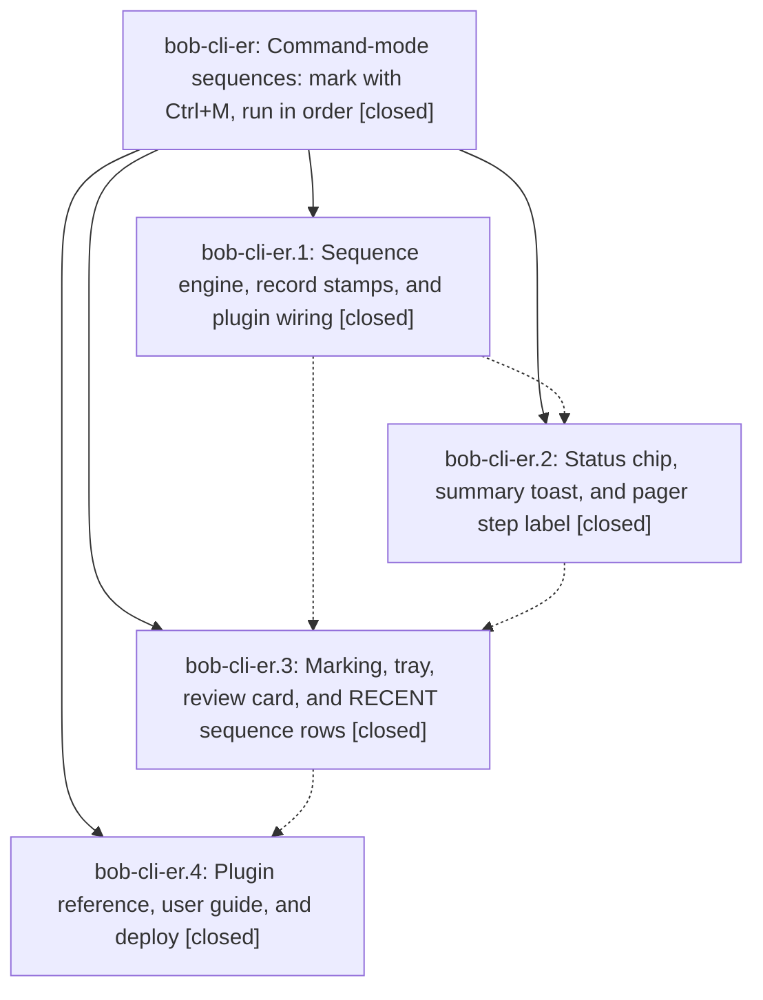

# Bead: bob-cli-er — Command-mode sequences: mark with Ctrl+M, run in order

[Bead Pages](../README.md) / bob-cli-er

**Status:** ✓ closed · **Resolution:** done · **Type:** ▸ plan · **Tier:** epic
**Owner:** `bryanbugyi34@gmail.com` · **Created by:** [bbugyi200.athena.16k](https://github.com/bobs-org/bob-cli--agents/blob/main/sessions/bbugyi200.athena.16k.md) · **Assignee:** `bob-cli-er.land`
**Created:** 2026-10-30 17:30:05 EDT · **Closed:** 2026-10-30 21:07:02 EDT
**Plan:** [202610/command\_mode\_sequences.md](https://github.com/bobs-org/bob-cli--plans/blob/main/202610/command_mode_sequences.md)

<!-- sase:links:start -->

## Links

| Relation | Artifact | Why |
| --- | --- | --- |
| implemented-by | [plan:202610/command_mode_sequences.md][1] | derived from the plan's `bead_id:` frontmatter field |
| related | file:explicit:a0f49d2561ee189f6902ef4a | attached via sase artifact create --bead |
| related | file:explicit:c74e72c69664b05e05280be8 | attached via sase artifact create --bead |
| related | file:explicit:e36d5e43c260c84cd22570ce | attached via sase artifact create --bead |

_Plus 2 automatic references — see [Referenced By](#referenced-by)._

[1]: https://github.com/bobs-org/bob-cli--plans/blob/main/202610/command_mode_sequences.md

<!-- sase:links:end -->

## Description

In Bob Command Mode, Ctrl+M marks commands into an ordered sequence that Enter or Ctrl+Enter runs one at a time. The status-bar bob chip shows how many steps there are and which command is running. RECENT shows each past sequence as one row that runs it again.

## Notes

[2026-10-31T00:26:58Z · bob-cli-er.land] LAND AUDIT / FOLLOW-UP TRIAGE before remaining-work tale: Read the epic, all four children and every note, approved plan plan:202610/command_mode_sequences.md, plugins commits cdd61a4/a8f33a2/38da67d/af35d48 and CLI 3965f749, and actual engine/runner/plugin/chip/toast/pager/sheet source and tests. All three final decisions are implemented: attention continues, Escape clears marks, rerun-last replays the full sequence. Fetched origin/master matches CLI 3965f749 and plugins af35d48. Reviewed concurrent plugins 145ea37/458907b/4bb8821 (wikilinks), c391a0d (type ink), 4e31220 (Events caption), and CLI 4a95e5b7/e08f859f/4f29a824: no extra sequence caller, duplicate driver, or incompatible catalog/API change; Calendar stamp JSON is additive. Remaining epic defects: 177-sheet-sequence renderRow depends on ElementStub .classes/children.find/_listeners; real Chromium confirms plain click activates twice, Ctrl-click activates as well as marking, pending-mark clicks activate, badges/tint and RECENT separators/durations are missing. No-mark argument Shift+Enter incorrectly warns about sequences; marked Ctrl+Enter with a highlighted completion runs a single command and leaves marks. A RECENT sequence reduced to one mark uses row=null and bypasses report/preview/confirm UI. rebuildRows omits activeSequenceIds, so a running sequence is shown interrupted. Docs omit required summary actions, sequence chip/pager/record details and retain contradictory Escape/rerun-last text. These remain er work, not tasks. Repro artifact file:explicit:a0f49d2561ee189f6902ef4a. Fresh 158/158 command-mode tests, build:check, and validate 8/8 pass; full npm test 4544/4549, unrelated failures logged in file:explicit:e36d5e43c260c84cd22570ce. All PROPOSED FOLLOW-UP note #1 entries triaged with sase_new_task: er.1 startup pair -> existing bob-cli-eh +1; er.2 startup pair -> same corroboration, keystroke perf -> causal active bob-cli-eq note; er.3 startup pair -> eh, snapshot/cold-growth perf -> eq note; er.4 startup pair -> eh, snapshot/rank -> eq note, unspecified nonrecurring fifth failure declined as a separate task for lack of node/reproduction. eq note also records current cold-chunk failure; isolated log file:explicit:c74e72c69664b05e05280be8 (3/5 passing, snapshot and rank still fail). Same-type/all-type searches and last-week task sweep found no matching perf task; closed bob-cli-3w is a different fixed dependency-stage node, not reopened. No new tasks. epic-symbols empty; no symvision recipe. No parent_bead. Epic remains open pending validated medium tale sase_plan_command_mode_sequence_closeout.md; coder must repair, run required gates including just check (never check-full), deploy, and close er plus mark original plan done in the same turn without waiting for its own commit. Full CLI/docs gates and repaired deploy remain with that coder.

[2026-10-31T01:07:02Z · bob-cli-er.land] Verified close of bob-cli-er. All four phases remain closed (er.1–er.4) with their notes and commits (plugins cdd61a4, a8f33a2, 38da67d, af35d48; CLI 3965f749). All three decisions remain implemented: attention continues, Escape clears pending marks before closing, Rerun last replays the whole stamped sequence. Catalog protocol 1, record schema 1 with optional stamp, and api.commandMode v1 are unchanged.

Concurrent drift rechecked at closeout: plugins origin advanced to 8ef763a (block-id-prompt picker layout/e2e; no command-mode file overlap; workspace fast-forwarded onto that SHA). CLI origin advanced through 45b8346d (gcal stamp spacing) and 3ca356c6 (task wikilink guide); neither touched docs/guides/run-bob-from-obsidian.md.

Repairs landed in 170-sheet.js and 177-sheet-sequence.js: a base handleRowClick hook with real-DOM classList/Array.from(children) rendering (no production _listeners); no-mark argument keys delegate to the original handler; marked Ctrl+Enter with a highlighted completion accepts then add-and-run; incomplete arguments leave marks and show Needs; a RECENT sequence reduced to one mark reconstructs via cmReplayRun and uses the original activateRow chain; rebuildRows passes live activeSequenceIds so a running sequence shows ⟳. Fragments stay under 1000 lines (170=912, 177=860). Chromium production-DOM coverage (TMPDIR=/tmp) plus 162/162 command-mode tests pass. Preview frames show marked rows, tray, review card, and RECENT sequences in light and dark.

Docs: plugin reference Sequences section after Command sheet; Escape clears marks then closes; chip N/M with title and sequence clock; pager step i of n; optional sequence stamp schema 1; CLI guide chip/summary and Rerun-last sequence sentence.

Gates: npm run build, build:check, command-mode 162/162, npm test 4558/4560, validate 8/8, npm run docs:check, just docs-check, sase tool run check af9ae8787cc20f122e77177b54a072e4 pass. The two npm test failures are the known ledger startup pair (note-ready linear storm; relationIndex layout-ready), corroborating bob-cli-eh, not sequence defects. Wikilink index performance remains bob-cli-eq. epic-symbols empty. just symvision recipe absent from the primary justfile.

Deploy: bob plugins sync --repo this checkout --no-pull -p bob-command-mode copied main.js from the uncommitted 8ef763a build. Unrelated overwrite refusals recorded and not forced: block-id-prompt, bob-ledger-tools, bob-navigation-hotkeys, task-status-cycler (other workspace uncommitted deploys). Live Obsidian was not reachable; Chromium production render/click coverage and preview frames were used instead.

Follow-up outcomes from the lander stand: er.1–er.4 startup pair -> bob-cli-eh; index/wikilink perf -> bob-cli-eq; unspecified er.4 transient declined (no node/reproduction). No parent_bead.

## Phases

| Bead | Title | Status | Size | Created | Agents | Commits |
|---|---|---|---|---|---:|---:|
| [bob-cli-er.1](bob-cli-er.1.md) | Sequence engine, record stamps, and plugin wiring | ✓ closed | medium | 2026-10-30 | 1 | 1 |
| [bob-cli-er.2](bob-cli-er.2.md) | Status chip, summary toast, and pager step label | ✓ closed | medium | 2026-10-30 | 1 | 1 |
| [bob-cli-er.3](bob-cli-er.3.md) | Marking, tray, review card, and RECENT sequence rows | ✓ closed | medium | 2026-10-30 | 1 | 1 |
| [bob-cli-er.4](bob-cli-er.4.md) | Plugin reference, user guide, and deploy | ✓ closed | small | 2026-10-30 | 1 | 2 |

## Lineage

## Agents

| Agent | Bead | Commits |
|---|---|---:|
| [bbugyi200.athena.bob-cli-er.1](https://github.com/bobs-org/bob-cli--agents/blob/main/agents/bbugyi200.athena.bob-cli-er.1/README.md) | [bob-cli-er.1](bob-cli-er.1.md) | 1 |
| [bbugyi200.athena.bob-cli-er.2](https://github.com/bobs-org/bob-cli--agents/blob/main/sessions/bbugyi200.athena.bob-cli-er.2.md) | [bob-cli-er.2](bob-cli-er.2.md) | 1 |
| [bbugyi200.athena.bob-cli-er.3](https://github.com/bobs-org/bob-cli--agents/blob/main/agents/bbugyi200.athena.bob-cli-er.3/README.md) | [bob-cli-er.3](bob-cli-er.3.md) | 1 |
| [bbugyi200.athena.bob-cli-er.4](https://github.com/bobs-org/bob-cli--agents/blob/main/sessions/bbugyi200.athena.bob-cli-er.4.md) | [bob-cli-er.4](bob-cli-er.4.md) | 2 |
| [bbugyi200.athena.bob-cli-er.land](https://github.com/bobs-org/bob-cli--agents/blob/main/sessions/bbugyi200.athena.bob-cli-er.land.md) | [bob-cli-er](README.md) | 1 |

## Commits

| Repo | Commit | Subject | Bead | Committed |
|---|---|---|---|---|
| bob-plugins | [`bob-plugins@cdd61a4`](https://github.com/bobs-org/bob-plugins/commit/cdd61a4cb32bb9e9ec7ac2269d77716fe2d30483) | feat(command-mode): add sequence engine, stamps, and plugin wiring | [bob-cli-er.1](bob-cli-er.1.md) | 2026-10-30 17:50:26 EDT |
| bob-plugins | [`bob-plugins@a8f33a2`](https://github.com/bobs-org/bob-plugins/commit/a8f33a2f27a06b3d29ffb76518ba0eea0abbffa0) | feat(command-mode): status chip sequence step, summary toast, and pager step label | [bob-cli-er.2](bob-cli-er.2.md) | 2026-10-30 18:36:04 EDT |
| bob-plugins | [`bob-plugins@38da67d`](https://github.com/bobs-org/bob-plugins/commit/38da67dccdf0632ab003c9d7517a08f54976e290) | feat(command-mode): sheet sequence marking, tray, review card, and RECENT rows | [bob-cli-er.3](bob-cli-er.3.md) | 2026-10-30 19:01:13 EDT |
| bob-cli | [`3965f74`](https://github.com/bobs-org/bob-cli/commit/3965f749a22f1bccd12f1c03afed80bb739d29f3) | docs: document command mode sequences in guide | [bob-cli-er.4](bob-cli-er.4.md) | 2026-10-30 20:10:17 EDT |
| bob-plugins | [`bob-plugins@af35d48`](https://github.com/bobs-org/bob-plugins/commit/af35d4814fbe651d76d8e00a8560a7d50439e314) | docs: document command mode sequences in plugin reference | [bob-cli-er.4](bob-cli-er.4.md) | 2026-10-30 20:10:36 EDT |
| bob-cli | [`d81f778`](https://github.com/bobs-org/bob-cli/commit/d81f778b66f81759fafb7829209ec5da2b99b493) | docs(guides): document sequence chip, summary, and rerun-last | [bob-cli-er](README.md) | 2026-10-30 21:08:50 EDT |

<!-- sase:referenced-by:start -->

## Referenced By

| Relation | Artifact | Why | Uses |
| --- | --- | --- | ---: |
| read-by | [agent:bob-cli-er.1][1] | Need parent epic DECISIONS and overall scope | 1 |
| read-by | [agent:bob-cli-er.3][2] | epic context for phase 3 | 1 |

[1]: https://github.com/bobs-org/bob-cli--agents/blob/main/agents/bbugyi200.athena.bob-cli-er.1/README.md
[2]: https://github.com/bobs-org/bob-cli--agents/blob/main/agents/bbugyi200.athena.bob-cli-er.3/README.md

<!-- sase:referenced-by:end -->
