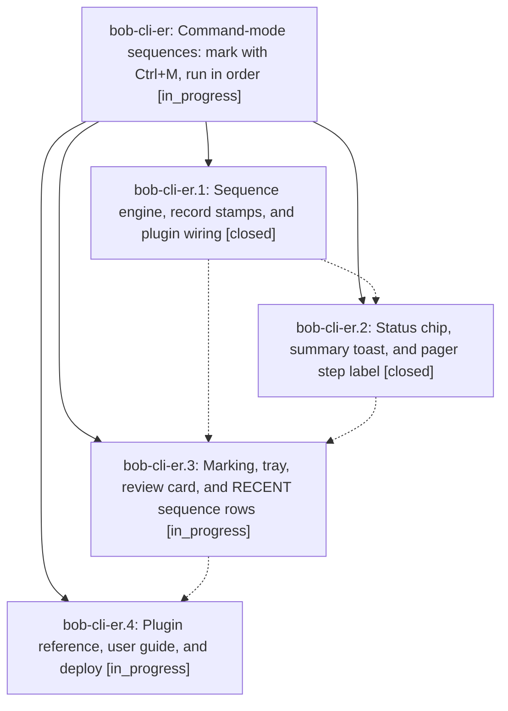

# Bead: bob-cli-er — Command-mode sequences: mark with Ctrl+M, run in order

[Bead Pages](../README.md) / bob-cli-er

**Status:** ◐ in_progress · **Type:** ▸ plan · **Tier:** epic
**Owner:** `bryanbugyi34@gmail.com` · **Created by:** [bbugyi200.athena.16k](https://github.com/bobs-org/bob-cli--agents/blob/main/sessions/bbugyi200.athena.16k.md) · **Assignee:** `bob-cli-er.land`
**Created:** 2026-10-30 17:30:05 EDT
**Plan:** [202610/command\_mode\_sequences.md](https://github.com/bobs-org/bob-cli--plans/blob/main/202610/command_mode_sequences.md)

<!-- sase:links:start -->

## Links

| Relation | Artifact | Why |
| --- | --- | --- |
| implemented-by | [plan:202610/command_mode_sequences.md][1] | derived from the plan's `bead_id:` frontmatter field |

_Plus 1 automatic references — see [Referenced By](#referenced-by)._

[1]: https://github.com/bobs-org/bob-cli--plans/blob/main/202610/command_mode_sequences.md

<!-- sase:links:end -->

## Description

In Bob Command Mode, Ctrl+M marks commands into an ordered sequence that Enter or Ctrl+Enter runs one at a time. The status-bar bob chip shows how many steps there are and which command is running. RECENT shows each past sequence as one row that runs it again.

## Phases

| Bead | Title | Status | Size | Created | Agents | Commits |
|---|---|---|---|---|---:|---:|
| [bob-cli-er.1](bob-cli-er.1.md) | Sequence engine, record stamps, and plugin wiring | ✓ closed | medium | 2026-10-30 | 1 | 1 |
| [bob-cli-er.2](bob-cli-er.2.md) | Status chip, summary toast, and pager step label | ✓ closed | medium | 2026-10-30 | 1 | 1 |
| [bob-cli-er.3](bob-cli-er.3.md) | Marking, tray, review card, and RECENT sequence rows | ◐ in_progress | medium | 2026-10-30 | 1 | 0 |
| [bob-cli-er.4](bob-cli-er.4.md) | Plugin reference, user guide, and deploy | ◐ in_progress | small | 2026-10-30 | 1 | 0 |

## Lineage

## Agents

| Agent | Bead | Commits |
|---|---|---:|
| [bbugyi200.athena.bob-cli-er.1](https://github.com/bobs-org/bob-cli--agents/blob/main/agents/bbugyi200.athena.bob-cli-er.1/README.md) | [bob-cli-er.1](bob-cli-er.1.md) | 1 |
| [bbugyi200.athena.bob-cli-er.2](https://github.com/bobs-org/bob-cli--agents/blob/main/sessions/bbugyi200.athena.bob-cli-er.2.md) | [bob-cli-er.2](bob-cli-er.2.md) | 1 |
| [bbugyi200.athena.bob-cli-er.3](https://github.com/bobs-org/bob-cli--agents/blob/main/agents/bbugyi200.athena.bob-cli-er.3/README.md) | [bob-cli-er.3](bob-cli-er.3.md) | 0 |
| [bbugyi200.athena.bob-cli-er.4](https://github.com/bobs-org/bob-cli--agents/blob/main/agents/bbugyi200.athena.bob-cli-er.4/README.md) | [bob-cli-er.4](bob-cli-er.4.md) | 0 |
| [bbugyi200.athena.bob-cli-er.land](https://github.com/bobs-org/bob-cli--agents/blob/main/agents/bbugyi200.athena.bob-cli-er.land/README.md) | [bob-cli-er](README.md) | 0 |

## Commits

| Repo | Commit | Subject | Bead | Committed |
|---|---|---|---|---|
| bob-plugins | [`bob-plugins@cdd61a4`](https://github.com/bobs-org/bob-plugins/commit/cdd61a4cb32bb9e9ec7ac2269d77716fe2d30483) | feat(command-mode): add sequence engine, stamps, and plugin wiring | [bob-cli-er.1](bob-cli-er.1.md) | 2026-10-30 17:50:26 EDT |
| bob-plugins | [`bob-plugins@a8f33a2`](https://github.com/bobs-org/bob-plugins/commit/a8f33a2f27a06b3d29ffb76518ba0eea0abbffa0) | feat(command-mode): status chip sequence step, summary toast, and pager step label | [bob-cli-er.2](bob-cli-er.2.md) | 2026-10-30 18:36:04 EDT |

<!-- sase:referenced-by:start -->

## Referenced By

| Relation | Artifact | Why | Uses |
| --- | --- | --- | ---: |
| read-by | [agent:bob-cli-er.1][1] | Need parent epic DECISIONS and overall scope | 1 |

[1]: https://github.com/bobs-org/bob-cli--agents/blob/main/agents/bbugyi200.athena.bob-cli-er.1/README.md

<!-- sase:referenced-by:end -->
