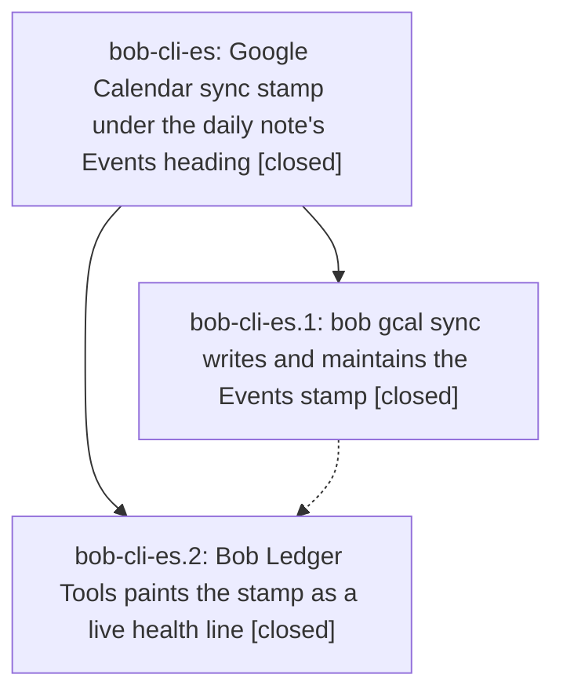

# Bead: bob-cli-es — Google Calendar sync stamp under the daily note's Events heading

[Bead Pages](../README.md) / bob-cli-es

**Status:** ✓ closed · **Resolution:** done · **Type:** ▸ plan · **Tier:** epic
**Owner:** `bryanbugyi34@gmail.com` · **Created by:** [bbugyi200.apollo.bh](https://github.com/bobs-org/bob-cli--agents/blob/main/sessions/bbugyi200.apollo.bh.md) · **Assignee:** `bob-cli-es.land`
**Created:** 2026-10-30 18:30:34 EDT · **Closed:** 2026-10-30 20:31:28 EDT
**Plan:** [202610/gcal\_events\_sync\_stamp.md](https://github.com/bobs-org/bob-cli--plans/blob/main/202610/gcal_events_sync_stamp.md)

<!-- sase:links:start -->

## Links

| Relation | Artifact | Why |
| --- | --- | --- |
| implemented-by | [plan:202610/gcal_events_sync_stamp.md][1] | derived from the plan's `bead_id:` frontmatter field |

_Plus 1 automatic references — see [Referenced By](#referenced-by)._

[1]: https://github.com/bobs-org/bob-cli--plans/blob/main/202610/gcal_events_sync_stamp.md

<!-- sase:links:end -->

## Description

Every daily-note `## Events` section that `bob gcal sync` reconciles carries one quiet, Bob-owned line showing which Google account it was synced with and when; the line stays honest without churning the note, cannot be silently taken over by another account, and Bob Ledger Tools paints it as a live health light that turns amber when sync has stopped.

## Notes

[2026-10-30T23:59:03Z · bob-cli-es.land] LAND AUDIT / FOLLOW-UP TRIAGE: Reviewed every note on es.1 and es.2, approved plan plan:202610/gcal_events_sync_stamp.md, bob-cli 4f29a824 and bob-plugins 4e31220 source/tests/docs. Decisions honored: on_change, account_guard=yes, decision_record=no; no memory edits. Later/concurrent non-epic drift reviewed: CLI 4a95e5b7/e08f859f, plugins a8f33a2/458907b/38da67d/c391a0d and newly fetched 4bb8821; task-line/type markers and separate Command Mode UI do not consume the plain Events caption, CSS selectors remain separate, and gcal sync decoder ignores additive stamp. No further integration change identified. Fresh plugin build:check passes, Calendar suite 8/8 passes at 4bb8821. Remaining epic defects by source audit: stamp::is_due does not inspect the following paragraph separator, so canonical stamp immediately followed by prose stays unchanged and renders as one paragraph; plan_stamp removes the old stamp before finding canonical_slot, so an existing blank below the stamp becomes part of the heading gap, and refreshing above prose inserts another separator, growing the gap by one on every refresh. Plan a bounded tale with regression tests and final closeout; do not close es yet. es.2 PROPOSED FOLLOW-UP #1 fully triaged via sase_new_task: startup storm 1!==2 and relationIndex layout-ready failure independently reproduced and corroborated existing bob-cli-eh (+1, file:explicit:78360ee1c9c0ed50f7648b3a), no new task. Distinct task-wikilink 12 ms rank node failed at 13.1 ms and passed unchanged alone (file:explicit:ce587d56b66df46f0b04012a); routed as DISCOVERED ISSUE to causal active epic bob-cli-eq (eq.3 introduced it), no separate task. Declined reopening bob-cli-3w because it covers the fixed, different dependencyStageRank 16 ms node. All proposals have outcomes; no remaining follow-up triage. epic-symbols es is empty; no symvision recipe in current bob-cli justfile. No parent_bead. Full CLI just check remains for the repair coder; no check-full was run.

[2026-10-31T00:31:28Z · bob-cli-es.land] Verified both phase notes and implementation commits 4f29a824/4e31220 against on_change, account_guard=yes, and no memory edits. Audited concurrent capture, task-wikilink, Command Mode, and task-ink changes through plugin 4bb8821 plus subsequent drift (3965f749 docs-only command-mode guide, no stamp files touched). Repaired missing paragraph separation and separator migration during stamp refresh; focused gcal tests passed (97 lib incl. 3 new spacing regressions, 25 gcal_sync incl. new paragraph-gap end-to-end), sase tool run check succeeded. Plugin build check and eight Calendar tests from audit remain sufficient (no plugin edits). es.2 follow-up outcomes: existing bob-cli-eh corroborated for both startup harness failures; the distinct 12ms ranking flake routed to causal active epic bob-cli-eq; bob-cli-3w reopening declined because it covers another fixed node. All epic-symbol entries resolved.

## Phases

| Bead | Title | Status | Size | Created | Agents | Commits |
|---|---|---|---|---|---:|---:|
| [bob-cli-es.1](bob-cli-es.1.md) | bob gcal sync writes and maintains the Events stamp | ✓ closed | medium | 2026-10-30 | 1 | 1 |
| [bob-cli-es.2](bob-cli-es.2.md) | Bob Ledger Tools paints the stamp as a live health line | ✓ closed | small | 2026-10-30 | 1 | 1 |

## Lineage

## Agents

| Agent | Bead | Commits |
|---|---|---:|
| [bbugyi200.apollo.bob-cli-es.1](https://github.com/bobs-org/bob-cli--agents/blob/main/sessions/bbugyi200.apollo.bob-cli-es.1.md) | [bob-cli-es.1](bob-cli-es.1.md) | 1 |
| [bbugyi200.apollo.bob-cli-es.2](https://github.com/bobs-org/bob-cli--agents/blob/main/agents/bbugyi200.apollo.bob-cli-es.2/README.md) | [bob-cli-es.2](bob-cli-es.2.md) | 1 |
| [bbugyi200.apollo.bob-cli-es.land](https://github.com/bobs-org/bob-cli--agents/blob/main/sessions/bbugyi200.apollo.bob-cli-es.land.md) | [bob-cli-es](README.md) | 1 |

## Commits

| Repo | Commit | Subject | Bead | Committed |
|---|---|---|---|---|
| bob-cli | [`4f29a82`](https://github.com/bobs-org/bob-cli/commit/4f29a8246e737d0ca39d9455e749943a13f4646c) | feat(gcal): stamp each Events section with account and last change | [bob-cli-es.1](bob-cli-es.1.md) | 2026-10-30 19:34:07 EDT |
| bob-plugins | [`bob-plugins@4e31220`](https://github.com/bobs-org/bob-plugins/commit/4e3122080f6b1c1f9413b29c63e4df50373eef90) | feat(ledger-tools): paint the Events sync stamp as a muted caption | [bob-cli-es.2](bob-cli-es.2.md) | 2026-10-30 19:50:39 EDT |
| bob-cli | [`45b8346`](https://github.com/bobs-org/bob-cli/commit/45b8346ddbf0d21c698bdf52ce9f8731c4f631de) | fix(gcal): repair Events stamp spacing and finish landing | [bob-cli-es](README.md) | 2026-10-30 20:33:02 EDT |

<!-- sase:referenced-by:start -->

## Referenced By

| Relation | Artifact | Why | Uses |
| --- | --- | --- | ---: |
| read-by | [agent:bob-cli-es.2][1] | Need parent epic scope, notes, and whether earlier work already landed | 1 |

[1]: https://github.com/bobs-org/bob-cli--agents/blob/main/agents/bbugyi200.apollo.bob-cli-es.2/README.md

<!-- sase:referenced-by:end -->
