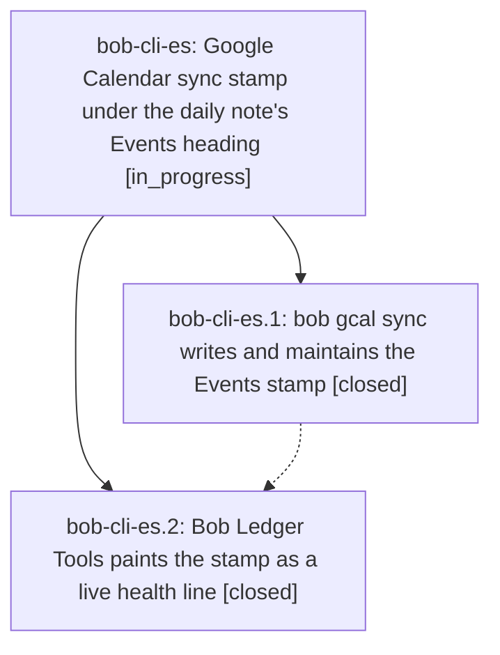

# Bead: bob-cli-es — Google Calendar sync stamp under the daily note's Events heading

[Bead Pages](../README.md) / bob-cli-es

**Status:** ◐ in_progress · **Type:** ▸ plan · **Tier:** epic
**Owner:** `bryanbugyi34@gmail.com` · **Created by:** [bbugyi200.apollo.bh](https://github.com/bobs-org/bob-cli--agents/blob/main/sessions/bbugyi200.apollo.bh.md) · **Assignee:** `bob-cli-es.land`
**Created:** 2026-10-30 18:30:34 EDT
**Plan:** [202610/gcal\_events\_sync\_stamp.md](https://github.com/bobs-org/bob-cli--plans/blob/main/202610/gcal_events_sync_stamp.md)

<!-- sase:links:start -->

## Links

| Relation | Artifact | Why |
| --- | --- | --- |
| implemented-by | [plan:202610/gcal_events_sync_stamp.md][1] | derived from the plan's `bead_id:` frontmatter field |

[1]: https://github.com/bobs-org/bob-cli--plans/blob/main/202610/gcal_events_sync_stamp.md

<!-- sase:links:end -->

## Description

Every daily-note `## Events` section that `bob gcal sync` reconciles carries one quiet, Bob-owned line showing which Google account it was synced with and when; the line stays honest without churning the note, cannot be silently taken over by another account, and Bob Ledger Tools paints it as a live health light that turns amber when sync has stopped.

## Phases

| Bead | Title | Status | Size | Created | Agents | Commits |
|---|---|---|---|---|---:|---:|
| [bob-cli-es.1](bob-cli-es.1.md) | bob gcal sync writes and maintains the Events stamp | ✓ closed | medium | 2026-10-30 | 1 | 1 |
| [bob-cli-es.2](bob-cli-es.2.md) | Bob Ledger Tools paints the stamp as a live health line | ✓ closed | small | 2026-10-30 | 1 | 1 |

## Lineage

## Agents

| Agent | Bead | Commits |
|---|---|---:|
| [bbugyi200.apollo.bob-cli-es.1](https://github.com/bobs-org/bob-cli--agents/blob/main/sessions/bbugyi200.apollo.bob-cli-es.1.md) | [bob-cli-es.1](bob-cli-es.1.md) | 1 |
| [bbugyi200.apollo.bob-cli-es.2](https://github.com/bobs-org/bob-cli--agents/blob/main/agents/bbugyi200.apollo.bob-cli-es.2/README.md) | [bob-cli-es.2](bob-cli-es.2.md) | 1 |
| [bbugyi200.apollo.bob-cli-es.land](https://github.com/bobs-org/bob-cli--agents/blob/main/agents/bbugyi200.apollo.bob-cli-es.land/README.md) | [bob-cli-es](README.md) | 0 |

## Commits

| Repo | Commit | Subject | Bead | Committed |
|---|---|---|---|---|
| bob-cli | [`4f29a82`](https://github.com/bobs-org/bob-cli/commit/4f29a8246e737d0ca39d9455e749943a13f4646c) | feat(gcal): stamp each Events section with account and last change | [bob-cli-es.1](bob-cli-es.1.md) | 2026-10-30 19:34:07 EDT |
| bob-plugins | [`bob-plugins@4e31220`](https://github.com/bobs-org/bob-plugins/commit/4e3122080f6b1c1f9413b29c63e4df50373eef90) | feat(ledger-tools): paint the Events sync stamp as a muted caption | [bob-cli-es.2](bob-cli-es.2.md) | 2026-10-30 19:50:39 EDT |
