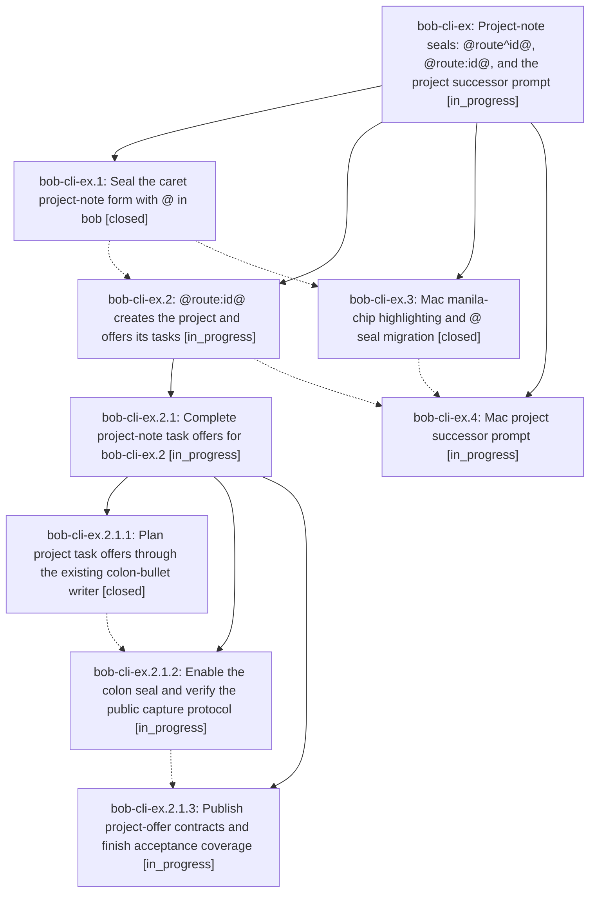

# Bead: bob-cli-ex — Project-note seals: @route^id@, @route:id@, and the project successor prompt

[Bead Pages](../README.md) / bob-cli-ex

**Status:** ◐ in_progress · **Type:** ▸ plan · **Tier:** epic
**Owner:** `bryanbugyi34@gmail.com` · **Created by:** [bbugyi200.apollo.bp.f0](https://github.com/bobs-org/bob-cli--agents/blob/main/sessions/bbugyi200.apollo.bp.f0.md) · **Assignee:** `bob-cli-ex.land`
**Created:** 2026-10-31 12:01:11 EDT
**Plan:** [202610/project\_note\_seals.md](https://github.com/bobs-org/bob-cli--plans/blob/main/202610/project_note_seals.md)

<!-- sase:links:start -->

## Links

| Relation | Artifact | Why |
| --- | --- | --- |
| implemented-by | [plan:202610/project_note_seals.md][1] | derived from the plan's `bead_id:` frontmatter field |

[1]: https://github.com/bobs-org/bob-cli--plans/blob/main/202610/project_note_seals.md

<!-- sase:links:end -->

## Description

A project note is sealed with `@`. `@route^id@` creates it, and `@route:id@` creates it and then lets Bryan pick which of its tasks get Pomodoro Task Links in the existing successor choice card. `+` typed after `@route^id` now switches to `@route+id`, like every other separator. Bob Mac Capture draws both sealed markers as one "manila chip" so a project note is easy to spot in a draft.

## Phases

| Bead | Title | Status | Size | Created | Agents | Commits |
|---|---|---|---|---|---:|---:|
| [bob-cli-ex.1](bob-cli-ex.1.md) | Seal the caret project-note form with @ in bob | ✓ closed | medium | 2026-10-31 | 1 | 1 |
| [bob-cli-ex.2](bob-cli-ex.2.md) | @route:id@ creates the project and offers its tasks | ◐ in_progress | large | 2026-10-31 | 1 | 0 |
| [bob-cli-ex.3](bob-cli-ex.3.md) | Mac manila-chip highlighting and @ seal migration | ✓ closed | medium | 2026-10-31 | 1 | 0 |
| [bob-cli-ex.4](bob-cli-ex.4.md) | Mac project successor prompt | ◐ in_progress | medium | 2026-10-31 | 1 | 0 |

## Lineage

## Agents

| Agent | Bead | Commits |
|---|---|---:|
| [bbugyi200.apollo.bob-cli-ex.1](https://github.com/bobs-org/bob-cli--agents/blob/main/agents/bbugyi200.apollo.bob-cli-ex.1/README.md) | [bob-cli-ex.1](bob-cli-ex.1.md) | 1 |
| [bbugyi200.apollo.bob-cli-ex.2](https://github.com/bobs-org/bob-cli--agents/blob/main/sessions/bbugyi200.apollo.bob-cli-ex.2.md) | [bob-cli-ex.2](bob-cli-ex.2.md) | 0 |
| [bbugyi200.apollo.bob-cli-ex.2.1.1](https://github.com/bobs-org/bob-cli--agents/blob/main/agents/bbugyi200.apollo.bob-cli-ex.2.1.1/README.md) | [bob-cli-ex.2.1.1](bob-cli-ex.2.1.1.md) | 1 |
| [bbugyi200.apollo.bob-cli-ex.2.1.2](https://github.com/bobs-org/bob-cli--agents/blob/main/agents/bbugyi200.apollo.bob-cli-ex.2.1.2/README.md) | [bob-cli-ex.2.1.2](bob-cli-ex.2.1.2.md) | 0 |
| [bbugyi200.apollo.bob-cli-ex.2.1.3](https://github.com/bobs-org/bob-cli--agents/blob/main/agents/bbugyi200.apollo.bob-cli-ex.2.1.3/README.md) | [bob-cli-ex.2.1.3](bob-cli-ex.2.1.3.md) | 0 |
| [bbugyi200.apollo.bob-cli-ex.2.1.land](https://github.com/bobs-org/bob-cli--agents/blob/main/agents/bbugyi200.apollo.bob-cli-ex.2.1.land/README.md) | [bob-cli-ex.2.1](bob-cli-ex.2.1.md) | 0 |
| [bbugyi200.apollo.bob-cli-ex.3](https://github.com/bobs-org/bob-cli--agents/blob/main/agents/bbugyi200.apollo.bob-cli-ex.3/README.md) | [bob-cli-ex.3](bob-cli-ex.3.md) | 0 |
| [bbugyi200.apollo.bob-cli-ex.4](https://github.com/bobs-org/bob-cli--agents/blob/main/agents/bbugyi200.apollo.bob-cli-ex.4/README.md) | [bob-cli-ex.4](bob-cli-ex.4.md) | 0 |
| [bbugyi200.apollo.bob-cli-ex.land](https://github.com/bobs-org/bob-cli--agents/blob/main/agents/bbugyi200.apollo.bob-cli-ex.land/README.md) | [bob-cli-ex](README.md) | 0 |

## Commits

| Repo | Commit | Subject | Bead | Committed |
|---|---|---|---|---|
| bob-cli | [`76f2347`](https://github.com/bobs-org/bob-cli/commit/76f234719fd756a2808434a65dcd0268468d3285) | feat(capture)!: seal project notes with @ instead of + | [bob-cli-ex.1](bob-cli-ex.1.md) | 2026-10-31 13:48:00 EDT |
| bob-cli | [`9a30ec4`](https://github.com/bobs-org/bob-cli/commit/9a30ec4ca268753820366554cd58fa5f0c006e71) | feat(capture): plan project-note task offers through the colon-bullet writer | [bob-cli-ex.2.1.1](bob-cli-ex.2.1.1.md) | 2026-10-31 14:52:17 EDT |
