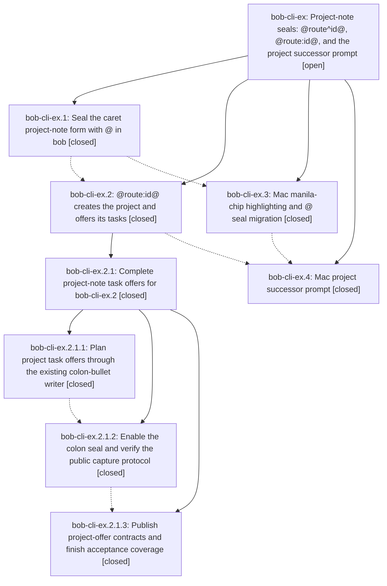

# Bead: bob-cli-ex — Project-note seals: @route^id@, @route:id@, and the project successor prompt

[Bead Pages](../README.md) / bob-cli-ex

**Status:** ○ open · **Type:** ▸ plan · **Tier:** epic · **↺ Reopened:** ↺1
**Owner:** `bryanbugyi34@gmail.com` · **Created by:** [bbugyi200.apollo.bp.f0](https://github.com/bobs-org/bob-cli--agents/blob/main/sessions/bbugyi200.apollo.bp.f0.md) · **Assignee:** `bob-cli-ex.land`
**Created:** 2026-10-31 12:01:11 EDT
**Plan:** [202610/project\_note\_seals.md](https://github.com/bobs-org/bob-cli--plans/blob/main/202610/project_note_seals.md)

## Previously Closed

> ↺ Closed 2026-11-01T01:10:10Z · done
>
> (none)
>
> Reopened 2026-11-01T14:04:34Z by `sase bead open`

<!-- sase:links:start -->

## Links

| Relation | Artifact | Why |
| --- | --- | --- |
| implemented-by | [plan:202610/project_note_seals.md][1] | derived from the plan's `bead_id:` frontmatter field |
| related | [bead:bob-cli-f3][2] | Found by bob-cli-ex's landing-repair snapshot run 41257836794; the repair fixed the compile break that masked these seven and is not their cause |

_Plus 1 automatic references — see [Referenced By](#referenced-by)._

[1]: https://github.com/bobs-org/bob-cli--plans/blob/main/202610/project_note_seals.md
[2]: https://github.com/bobs-org/bob-cli--beads/blob/main/pages/bob-cli-f3/README.md

<!-- sase:links:end -->

## Description

A project note is sealed with `@`. `@route^id@` creates it, and `@route:id@` creates it and then lets Bryan pick which of its tasks get Pomodoro Task Links in the existing successor choice card. `+` typed after `@route^id` now switches to `@route+id`, like every other separator. Bob Mac Capture draws both sealed markers as one "manila chip" so a project note is easy to spot in a draft.

## Notes

[2026-10-31T23:18:33Z · bob-cli-ex.land] LAND AUDIT / FOLLOW-UP TRIAGE (2026-10-31): Read ex itself (no prior notes), every note on ex.1/.2/.3/.4, child epic ex.2.1, and ex.2.1.1/.2/.3; audited project_note_seals and project_note_offer_form plans; reviewed actual grammar/rewrite, offer planner, renderer/placement, final net pass, shared output/pull-in plumbing, acceptance tests, Mac decoder/presentation/card/notification/highlighting and fixtures, and epic commits 76f23471, 9a30ec4c, e9b9cd1d, e8dd3b65, 42dd92bc, e2838ac3 plus Mac 6b94f06/891fe11. Initial marks are empty; git diff limits memory changes to the two authorized glossary strands, whose audited bodies contain the required creation/freshness contract. No version or changelog edits. Descendants closed, parent_id null. Fetched origin/master equals e2838ac3. Non-epic drift since first epic implementation: ecffd6fa/efe2ebe0/17702dca Keep cache/status/docs are independent; 36c48075 removes draft-global task destinations while preserving item-local seals; 6ae5df00 adds %c and preserves project-note clipboard refusal. Mac has no intervening non-epic commits since 6b94f06. No epic-symbol entries; no symvision recipe.

FOLLOW-UP DISPOSITIONS: ex.1 note #1 article completion flakes -> new ready small flake bob-cli-f2, related to closed aliases-only bob-cli-b9. Same-type/all-type searches and last-week sweeps found no article-node report. Source independently confirms tests/cli/articles.rs complete() still calls bob_command instead of bob_completion_command (10000 ms); production deadline is 150 ms. Helper originates in ff97c620 / closed article epic bob-cli-8g.4, so active shell-completion epic 3j is topical context rather than the author of this omitted pin. Named ex.1/ex.2.1 fail/pass observations are recorded honestly; no fresh lander failure was claimed. ex.3 note #1 Mac compilation and visual acceptance remains epic verification, not an unrelated task: Mac SSH still times out, but CI 41251130345 proves app Build succeeds and exposes epic-caused test compile errors below. ex.3 note #2 remains epic work: fake-bob still has hand-authored offer parse and sealed toggle responses; real-Bob comparison shows toggles match but the named parse omits themes metadata. ex.2.1.3 note #1 trailing #hide exception is declined as previously audited by the child lander: edge #type rules predate this epic, escaped or mid-text #hide already expresses the literal tag. No new feature/bug bead for that deliberate grammar. These four proposal outcomes must be carried into the final close note.

REMAINING EPIC WORK: (1) Fresh cargo build --bin bob succeeded. Scratch-vault reproduction Finish packet @cash:pkt@ with two identical - Draft memo bullets: no picks reports 2 offers (cash_pkt.md@c0084bb3 and ~2, lines 13/14); -p 1 wrongly reports offer_count=1 and loses the unpicked second row; -p 2/all report 2. Frozen ordinal is resolved among only still-ID-less tasks after the earlier selected duplicate was minted (task_complete.rs successor_task_lookup), shrinking the lookup population. Preserve original identity across minting/line shifts. (2) Mac CaptureProjectNotePresentation removes picked IDs from task_links while pulledInSummary excludes project successors too: picked links vanish from both notification summaries, violating the original count-once contract. Existing new tests encode this wrong count and need correction. (3) Mac CI https://github.com/bobs-org/bob-mac-capture/actions/runs/41251130345 on 891fe111f61a40af9917480184e7260588bb3967 passed Build, failed Test compilation: NotificationServiceTests.swift:1590/:1595 miss required CaptureProjectTaskLink.blockLink. New CapturePullInChoiceModelTests fixture context expects an exclamation mark absent from generated unblocked_by.text. (4) Complete real-Bob fixture generation for parse/toggles and project-specific Skip/Escape/selection coverage. One medium tale covers these repairs, verification, post-audit drift, and this epic closeout. Keep ex open; do not mark its plan done yet. No just check-full was run; repaired files must pass just check and relevant Swift/macOS checks. Both worktrees passed git diff --check before the plan was authored.

[2026-11-01T01:10:10Z · bob-cli-ex.land--2] LANDED (project_seals_landing_repairs). Original audit is note #1; this closes the REMAINING EPIC WORK it listed.

INTEGRATION REVIEW: re-fetched both repos. bob-mac-capture origin/master is still 891fe11. bob-cli origin/master moved from e2838ac3 to 95278934 (non-epic capture commits 4c011cd7 %n/%l directives, d7f683a1 bare edge # incomplete type marker, 95278934 %t template framing). None of them touch the repaired files. The repair was applied to a throwaway worktree on 95278934: cargo test --test cli capture::project_note 40 passed, whole cli binary 2595 passed 0 failed. git diff --check clean in both repos.

THREE REPAIRS:
1. bob-cli (src/native/capture/{output,project_note,pull_in,task_complete}.rs): an ID-less project offer's frozen duplicate ordinal counted the pre-pick render, so after an earlier pick minted its ID the net pass resolved among a shrunken ID-less population; with two identical "Draft memo" rows, -p 1 reported offer_count=1 and lost the unpicked row. The planner now records a crate-private settled_ordinal (never a JSON field) and successor_task_lookup resolves by it, falling back to the key ordinal. No JSON or CLI contract change.
2. Mac CaptureProjectNotePresentation: Bob reports a pick as an ordinary project_note.task_links row and again in successors, and the model removed picked IDs from task_links while pulledInSummary excluded project successors, so picked links vanished from both notification summaries. It now counts every task_links row exactly once and the pulled-in count never includes project successors. The tests that encoded the wrong count were corrected.
3. Mac tests, fixtures and docs: NotificationServiceTests now supplies the required CaptureProjectTaskLink.blockLink (the test-compile break on 891fe11, run 41251130345); CapturePullInChoiceModelTests fixture/argv expectations fixed (the real-Bob fixture advertises inbox_route.supported, so the submit carries --require-inbox-route-choice before --refuse-override, as CaptureInboxRouteChoiceModelTests already assert) and new project-offer Skip (explicit none), Escape (keeps the draft, never submits) and marked-key (submits once with open intent) coverage; CaptureEditorHighlightTests now asserts the real-bob generated offer parse washes only the marker and leaves the Pomodoro name plain. Scripts/generate-project-note-offer-fixtures.sh now generates the offer parse and both sealed-toggle fixtures from a real built bob (capture-parse-project-note-offer.json, capture-rewrite-project-note-{offer,create}-seal.json) and verifies dry-run, a required-choice refusal that writes nothing (no project note, no day-note link), -p none and -p all; Tests/Fixtures/fake-bob serves those files verbatim. docs/capture-previews.md and docs/protocol.md updated.

VERIFICATION: bob-cli just check exit 0 (26 test binaries; the clippy warnings in capture_task_toggle/ledger.rs, links.rs and event_task.rs are pre-existing and unrelated). The new tests in tests/cli/capture/project_note_offer.rs fail without the fix (5 of 24) and pass with it. Mac portable-check on athena: swift build --build-tests ok, swift test 1828 tests 0 failures, swift format lint clean on changed lines (only pre-existing LineLength warnings on untouched CapturePullInChoiceModelTests lines). Mac just docs-check with BOB_CLI_DIR set to the bob-cli workspace: all implemented gates passed. python3 -B Scripts/test_macos_ci_check.py: 42 ok. The generator ran against the repaired bob binary and its assertions passed. just symvision has no recipe in either repo; sase bead epic-symbols bob-cli-ex lists none. No Cargo.toml version, CHANGELOG.md or memory edits.

macOS CI (Mac SSH still times out, so verified through Scripts/macos-ci-check precommit snapshots, which push a create-only ci/precommit branch and delete it): run 41256657305 had 10 failures: my two CapturePullInChoiceModelTests argv expectations (fixed), seven pre-existing master failures, and CaptureTemplateStartTests.testTypingAllThreeAtSignsAtEndOfLineStartsTemplate, which passed in the next run with no change to any Sources file (recorded as a flake). Final run 41257836794 on snapshot fa3170d: Lint Swift formatting ok, Build ok, Test FAILED with exactly the seven pre-existing failures and nothing else; Bundle, Verify plist and signature, Launch smoke test and Install and reinstall were SKIPPED because Test failed. The Mac gate is therefore NOT green, and the Mac bundle, launch and install steps are unverified on this repair. The seven (CaptureEditorLeaderTests.testToggleLineCaseUndoRestoresOriginalLine; CapturePanelModelTests.testTaskTypeRetypeMoveKeepsDraftAndUsesEnsureNextAction; CaptureSeparatorToggleTests.testPlusAfterCaretIDSwitchesToSubBulletInOneUndoStep, testPlusToggleUndoRestoresLiteralPostKeyDraftOnce, testTypedPlusAsWholeItemOpensActiveTaskPickerThroughKeyIntent; CaptureTaskTypeHostedTests.testBareLeadingTrailingAndChildMarkersOpenTaskTypeMenu, testTypedRowDoesNotWriteVisibility) fail identically on master runs 41218430244 (027bf44) and 41228541365 (6b94f06), before any bob-cli-ex Mac commit, and descend from standalone commits ec3fff5/027bf44 and the closed type-marker work, so they are kept out of this repair and filed as ci task bob-cli-f3.

FOLLOW-UP DISPOSITIONS: ex.1 note #1 article completion flakes became ready flake bob-cli-f2. ex.3 note #1 Mac compilation: the app Build and test compile are now proven by CI; the visual chip tuning (manila chip in light, dark and increased contrast) could not be inspected because this is a Linux host and the Mac is unreachable, so that visual acceptance remains unperformed. ex.3 note #2 fake-bob contract completed via the generator above. ex.2.1.3 note #1 trailing #hide exception deliberately declined: edge #t

… and 108 more characters

## Phases

| Bead | Title | Status | Size | Created | Agents | Commits |
|---|---|---|---|---|---:|---:|
| [bob-cli-ex.1](bob-cli-ex.1.md) | Seal the caret project-note form with @ in bob | ✓ closed | medium | 2026-10-31 | 1 | 1 |
| [bob-cli-ex.2](bob-cli-ex.2.md) | @route:id@ creates the project and offers its tasks | ✓ closed | large | 2026-10-31 | 1 | 0 |
| [bob-cli-ex.3](bob-cli-ex.3.md) | Mac manila-chip highlighting and @ seal migration | ✓ closed | medium | 2026-10-31 | 1 | 0 |
| [bob-cli-ex.4](bob-cli-ex.4.md) | Mac project successor prompt | ✓ closed | medium | 2026-10-31 | 1 | 1 |

## Lineage

## Agents

| Agent | Bead | Commits |
|---|---|---:|
| [bbugyi200.apollo.bob-cli-ex.1](https://github.com/bobs-org/bob-cli--agents/blob/main/agents/bbugyi200.apollo.bob-cli-ex.1/README.md) | [bob-cli-ex.1](bob-cli-ex.1.md) | 1 |
| [bbugyi200.apollo.bob-cli-ex.2](https://github.com/bobs-org/bob-cli--agents/blob/main/sessions/bbugyi200.apollo.bob-cli-ex.2.md) | [bob-cli-ex.2](bob-cli-ex.2.md) | 0 |
| [bbugyi200.apollo.bob-cli-ex.2.1.1](https://github.com/bobs-org/bob-cli--agents/blob/main/agents/bbugyi200.apollo.bob-cli-ex.2.1.1/README.md) | [bob-cli-ex.2.1.1](bob-cli-ex.2.1.1.md) | 1 |
| [bbugyi200.apollo.bob-cli-ex.2.1.2](https://github.com/bobs-org/bob-cli--agents/blob/main/agents/bbugyi200.apollo.bob-cli-ex.2.1.2/README.md) | [bob-cli-ex.2.1.2](bob-cli-ex.2.1.2.md) | 1 |
| [bbugyi200.apollo.bob-cli-ex.2.1.3](https://github.com/bobs-org/bob-cli--agents/blob/main/agents/bbugyi200.apollo.bob-cli-ex.2.1.3/README.md) | [bob-cli-ex.2.1.3](bob-cli-ex.2.1.3.md) | 1 |
| [bbugyi200.apollo.bob-cli-ex.2.1.land](https://github.com/bobs-org/bob-cli--agents/blob/main/sessions/bbugyi200.apollo.bob-cli-ex.2.1.land.md) | [bob-cli-ex.2.1](bob-cli-ex.2.1.md) | 3 |
| [bbugyi200.apollo.bob-cli-ex.3](https://github.com/bobs-org/bob-cli--agents/blob/main/agents/bbugyi200.apollo.bob-cli-ex.3/README.md) | [bob-cli-ex.3](bob-cli-ex.3.md) | 0 |
| [bbugyi200.apollo.bob-cli-ex.4](https://github.com/bobs-org/bob-cli--agents/blob/main/sessions/bbugyi200.apollo.bob-cli-ex.4.md) | [bob-cli-ex.4](bob-cli-ex.4.md) | 1 |
| [bbugyi200.apollo.bob-cli-ex.land](https://github.com/bobs-org/bob-cli--agents/blob/main/sessions/bbugyi200.apollo.bob-cli-ex.land.md) | [bob-cli-ex](README.md) | 2 |

## Commits

| Repo | Commit | Subject | Bead | Committed |
|---|---|---|---|---|
| bob-cli | [`76f2347`](https://github.com/bobs-org/bob-cli/commit/76f234719fd756a2808434a65dcd0268468d3285) | feat(capture)!: seal project notes with @ instead of + | [bob-cli-ex.1](bob-cli-ex.1.md) | 2026-10-31 13:48:00 EDT |
| bob-cli | [`9a30ec4`](https://github.com/bobs-org/bob-cli/commit/9a30ec4ca268753820366554cd58fa5f0c006e71) | feat(capture): plan project-note task offers through the colon-bullet writer | [bob-cli-ex.2.1.1](bob-cli-ex.2.1.1.md) | 2026-10-31 14:52:17 EDT |
| bob-cli | [`e9b9cd1`](https://github.com/bobs-org/bob-cli/commit/e9b9cd1dcf7c4696563060978856b726631fa6b0) | feat(capture): enable @route:id@ project-note offer form end to end | [bob-cli-ex.2.1.2](bob-cli-ex.2.1.2.md) | 2026-10-31 16:18:40 EDT |
| bob-cli | [`e8dd3b6`](https://github.com/bobs-org/bob-cli/commit/e8dd3b650c2f50f0f312d1068641c05ce9aaaa74) | docs(capture): publish project-note offer contracts and acceptance coverage | [bob-cli-ex.2.1.3](bob-cli-ex.2.1.3.md) | 2026-10-31 16:59:34 EDT |
| bob-cli | [`42dd92b`](https://github.com/bobs-org/bob-cli/commit/42dd92bc66193dfc3ad16fc6ff0b9813d51c92c9) | fix(capture): finish project-offer landing repairs for bob-cli-ex.2.1 | [bob-cli-ex.2.1](bob-cli-ex.2.1.md) | 2026-10-31 17:52:51 EDT |
| bob-cli--plans | [`bob-cli--plans@4d46180`](https://github.com/bobs-org/bob-cli--plans/commit/4d461800f67260ed99d9ebd1510197189ed1875f) | docs(plans): mark project\_note\_offer\_form done for bob-cli-ex.2.1 landing | [bob-cli-ex.2.1](bob-cli-ex.2.1.md) | 2026-10-31 17:53:33 EDT |
| bob-cli | [`e2838ac`](https://github.com/bobs-org/bob-cli/commit/e2838ac33654a440b3d9568b984ca4e39fd7129d) | docs(glossary): explain project successor offers | [bob-cli-ex.4](bob-cli-ex.4.md) | 2026-10-31 19:06:17 EDT |
| bob-cli | [`86a63e8`](https://github.com/bobs-org/bob-cli/commit/86a63e8487a592644896081d4660e57f2593000f) | fix(capture): keep unpicked duplicate project offers after picks mint IDs | [bob-cli-ex](README.md) | 2026-10-31 21:13:52 EDT |
| bob-cli--plans | [`bob-cli--plans@45538db`](https://github.com/bobs-org/bob-cli--plans/commit/45538db4919fd2bc6b81ba409f2618c4d65a607f) | docs(plans): mark project\_note\_seals epic plan done | [bob-cli-ex](README.md) | 2026-10-31 21:14:47 EDT |
| bob-cli | [`f411232`](https://github.com/bobs-org/bob-cli/commit/f41123201f285887d63e1ed50802c7bd118e38d0) | fix(capture): refuse route-less sealed offers and keep offer mode while incomplete | [bob-cli-ex.2.1](bob-cli-ex.2.1.md) | 2026-11-01 09:53:08 EST |

<!-- sase:referenced-by:start -->

## Referenced By

| Relation | Artifact | Why | Uses |
| --- | --- | --- | ---: |
| read-by | [agent:bob-cli-ex.land--2][1] | Need the parent link | 2 |

[1]: https://github.com/bobs-org/bob-cli--agents/blob/main/sessions/bbugyi200.apollo.bob-cli-ex.land.md

<!-- sase:referenced-by:end -->
