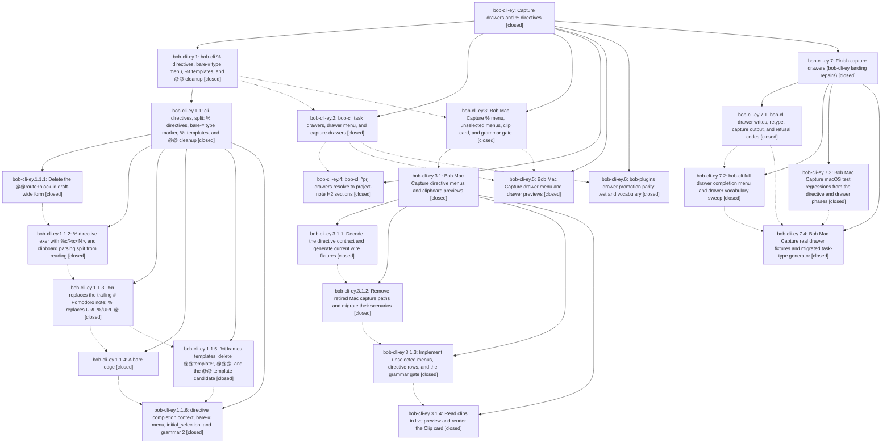

# Bead: bob-cli-ey — Capture drawers and % directives

[Bead Pages](../README.md) / bob-cli-ey

**Status:** ✓ closed · **Resolution:** done · **Type:** ▸ plan · **Tier:** epic
**Owner:** `bryanbugyi34@gmail.com` · **Created by:** [bbugyi200.apollo.research.2x.linker.w0](https://github.com/bobs-org/bob-cli--agents/blob/main/sessions/bbugyi200.apollo.research.2x.linker.w0.md) · **Assignee:** `bob-cli-ey.land`
**Created:** 2026-10-31 12:52:03 EDT · **Closed:** 2026-11-01 09:20:35 EST
**Plan:** [202610/capture\_drawers\_and\_directives.md](https://github.com/bobs-org/bob-cli--plans/blob/main/202610/capture_drawers_and_directives.md)

<!-- sase:links:start -->

## Links

| Relation | Artifact | Why |
| --- | --- | --- |
| implemented-by | [plan:202610/capture_drawers_and_directives.md][1] | derived from the plan's `bead_id:` frontmatter field |

_Plus 4 automatic references — see [Referenced By](#referenced-by)._

[1]: https://github.com/bobs-org/bob-cli--plans/blob/main/202610/capture_drawers_and_directives.md

<!-- sase:links:end -->

## Description

Bob's capture language reads as three rules: @ says where, # names a place or a type, and % says how. `Text @note+id#drawer [#type]` files a note in a task drawer, creating the drawer when it is missing and optionally retyping the task in the same transaction. `%c`, `%n`, `%t`, and `%l` replace trailing `#`, `%`, `@@template:`, and `URL %`. Typing `#`, `%`, or `@note+id#` in Bob Mac Capture opens a bob-described menu with nothing preselected. Every retired form is deleted outright, with no aliases.

## Notes

[2026-11-01T02:34:28Z · bob-cli-ey.1.1.land] DISCOVERED ISSUE (from bob-cli-ey.1.1.2 PROPOSED FOLLOW-UP, triaged by the bob-cli-ey.1.1 land agent; belongs to phase bob-cli-ey.3 mac-directives, 'update the Mac docs'): bob-mac-capture's live-preview docs (capture-panel.md) still describe the retired URL % listen marker and %N/%header clipboard markers. After cli-directives they must teach URL %l listen, %c/%c<N>, and clip.status not_read under --no-clip (the panel's live preview runs bob capture --dry-run --no-clip unless bob reports a %c directive, per glossary:capture).

[2026-11-01T08:47:09Z · bob-cli-ey.land] LAND TRIAGE (bob-cli-ey.land) of PROPOSED FOLLOW-UPs. Every proposal is remaining epic work or already resolved, so no new task beads were filed. (1) bob-cli-ey.2 #1 and bob-cli-ey.5 #2: capture JSON has no per-item drawer {title,key,created} object, and drawer spans carry no title/key. Plan §3.3/§3.7 scope, so remaining epic work. (2) bob-cli-ey.2 #2: the mounted Mac protocol/task-pickers docs named task_section. Already resolved by bob-cli-ey.5 (9a1876d); the Mac task_section grep is clean. Declined: no work left. (3) bob-cli-ey.5 #1: the drawer menu has no recent/new/refused/detail/consequence rows, initial_selection none, or #-covering replacement. Plan §3.6, remaining epic work. (4) bob-cli-ey.5 #3: a separate #type beside an @route+id body (drawer or plain child) is still refused with type_marker_not_applicable, and that copy names the retired @<route>+<block-id>#<type>. Plan §2 headline example, remaining epic work. (5) bob-cli-ey.5 #4: the Mac targets were unverified on macOS. Mac CI 41289488292 on 9a1876d builds and lints, but Test fails with 28 assertions in 19 methods. Seven are the pre-existing bob-cli-f3 baseline (not epic-caused, left with f3). Twelve are epic regressions (CaptureOpenHintTests x2, CapturePanelModelTests explicit-completion-submit x5, CaptureSavedTemplateShelfTests refresh, CaptureTaskTypeHostedTests unselected Tab/Up, CaptureTemplateShelfModelTests delete and non-template refusal copy). Remaining epic work. (6) bob-cli-ey.5 #5: generate-task-type-fixtures.sh still drives the retired attached forms. Caused by cli-drawers, so remaining epic work. (7) bob-cli-ey.1.1.2 and bob-cli-ey.1.1.6 proposals were already triaged by the bob-cli-ey.1.1 land agent. Further land-agent smoke findings, also epic work: creating a new drawer writes a stray blank line between the drawer title and its first entry; drawer refusals emit no JSON code (ambiguous_drawer, reserved_drawer, drawer_near_duplicate, invalid_drawer); drawer_near_catalog is never emitted; the zsh drawer group is still 'task sections' (capture_complete/shell.rs, completion/providers.rs, docs/completion.md). Integration: no non-epic commits landed in bob-cli after a1dcb64e, in bob-mac-capture after 91a5d2b, or in bob-plugins touching capture; the earlier drift was integrated by the bob-cli-ey.1.1 and bob-cli-ey.3.1 landers. epic-symbols: none.

[2026-11-01T14:20:35Z · bob-cli-ey.7.land--1] Parent capture drawers + directives complete; retype closeout rechecked. All direct children closed: phases .1-.6 plus child epic .7 (just closed with three repairs). Nested .1.1 (cli-directives split) and .3.1 (mac-directives) closed; linked plans plan:202610/cli_directives_split.md and plan:202610/mac_directives.md already done. Repairs re-verified: (1) ID-less --task-ref retype without minting ID/link/lane change, stale/ambiguous preserved, atomic batch; (2) bare-# existing subject via SubBullet spans in Incomplete mode, new ^id stays new; (3) near-duplicate refuse teaches requested REQ override; plus table-driven retype_closeout regressions. Verification: sase tool run check ToolRun 7432c6e6cf416c9d2f669749877f67a6 exit 0; epic-symbols empty for ey and ey.7; just symvision absent per plan. Drift: bob-cli origin/master adds only 81b3b5a4 Keep footer docs (no capture integration); no Mac/plugin source changes this turn; Mac CI 41308048455 and plugin 68-test evidence stand. No Cargo.toml/CHANGELOG edits; grammar 3 schema 1; prior wire-break !+BREAKING CHANGE footers stand, no new wire breaks; no docs/help changes. Follow-ups: ey.land triage stands (remaining-epic items shipped by .7); ey.7 triage stands (cache-write declined, historical link errors to bob-cli-y corroboration + bob-cli-f4, 1v/dg declined). Parent plan 202610/capture_drawers_and_directives.md marked done; no further parent (stop).

## Phases

| Bead | Title | Status | Size | Created | Agents | Commits |
|---|---|---|---|---|---:|---:|
| [bob-cli-ey.1](bob-cli-ey.1.md) | bob-cli % directives, bare-# type menu, %t templates, and @@ cleanup | ✓ closed | large | 2026-10-31 | 1 | 0 |
| [bob-cli-ey.2](bob-cli-ey.2.md) | bob-cli task drawers, drawer menu, and capture-drawers | ✓ closed | large | 2026-10-31 | 1 | 1 |
| [bob-cli-ey.3](bob-cli-ey.3.md) | Bob Mac Capture % menu, unselected menus, clip card, and grammar gate | ✓ closed | large | 2026-10-31 | 1 | 0 |
| [bob-cli-ey.4](bob-cli-ey.4.md) | bob-cli ^prj drawers resolve to project-note H2 sections | ✓ closed | medium | 2026-10-31 | 1 | 1 |
| [bob-cli-ey.5](bob-cli-ey.5.md) | Bob Mac Capture drawer menu and drawer previews | ✓ closed | medium | 2026-10-31 | 1 | 1 |
| [bob-cli-ey.6](bob-cli-ey.6.md) | bob-plugins drawer promotion parity test and vocabulary | ✓ closed | small | 2026-10-31 | 1 | 1 |

## Lineage

## Agents

| Agent | Bead | Commits |
|---|---|---:|
| [bbugyi200.apollo.bob-cli-ey.1](https://github.com/bobs-org/bob-cli--agents/blob/main/sessions/bbugyi200.apollo.bob-cli-ey.1.md) | [bob-cli-ey.1](bob-cli-ey.1.md) | 0 |
| [bbugyi200.apollo.bob-cli-ey.1.1.1](https://github.com/bobs-org/bob-cli--agents/blob/main/sessions/bbugyi200.apollo.bob-cli-ey.1.1.1.md) | [bob-cli-ey.1.1.1](bob-cli-ey.1.1.1.md) | 0 |
| [bbugyi200.apollo.bob-cli-ey.1.1.2](https://github.com/bobs-org/bob-cli--agents/blob/main/sessions/bbugyi200.apollo.bob-cli-ey.1.1.2.md) | [bob-cli-ey.1.1.2](bob-cli-ey.1.1.2.md) | 1 |
| [bbugyi200.apollo.bob-cli-ey.1.1.3](https://github.com/bobs-org/bob-cli--agents/blob/main/agents/bbugyi200.apollo.bob-cli-ey.1.1.3/README.md) | [bob-cli-ey.1.1.3](bob-cli-ey.1.1.3.md) | 1 |
| [bbugyi200.apollo.bob-cli-ey.1.1.4](https://github.com/bobs-org/bob-cli--agents/blob/main/sessions/bbugyi200.apollo.bob-cli-ey.1.1.4.md) | [bob-cli-ey.1.1.4](bob-cli-ey.1.1.4.md) | 1 |
| [bbugyi200.apollo.bob-cli-ey.1.1.5](https://github.com/bobs-org/bob-cli--agents/blob/main/agents/bbugyi200.apollo.bob-cli-ey.1.1.5/README.md) | [bob-cli-ey.1.1.5](bob-cli-ey.1.1.5.md) | 1 |
| [bbugyi200.apollo.bob-cli-ey.1.1.6](https://github.com/bobs-org/bob-cli--agents/blob/main/sessions/bbugyi200.apollo.bob-cli-ey.1.1.6.md) | [bob-cli-ey.1.1.6](bob-cli-ey.1.1.6.md) | 1 |
| [bbugyi200.apollo.bob-cli-ey.1.1.land](https://github.com/bobs-org/bob-cli--agents/blob/main/sessions/bbugyi200.apollo.bob-cli-ey.1.1.land.md) | [bob-cli-ey.1.1](bob-cli-ey.1.1.md) | 2 |
| [bbugyi200.apollo.bob-cli-ey.2](https://github.com/bobs-org/bob-cli--agents/blob/main/sessions/bbugyi200.apollo.bob-cli-ey.2.md) | [bob-cli-ey.2](bob-cli-ey.2.md) | 1 |
| [bbugyi200.apollo.bob-cli-ey.3](https://github.com/bobs-org/bob-cli--agents/blob/main/sessions/bbugyi200.apollo.bob-cli-ey.3.md) | [bob-cli-ey.3](bob-cli-ey.3.md) | 0 |
| [bbugyi200.apollo.bob-cli-ey.3.1.1](https://github.com/bobs-org/bob-cli--agents/blob/main/agents/bbugyi200.apollo.bob-cli-ey.3.1.1/README.md) | [bob-cli-ey.3.1.1](bob-cli-ey.3.1.1.md) | 1 |
| [bbugyi200.apollo.bob-cli-ey.3.1.2](https://github.com/bobs-org/bob-cli--agents/blob/main/sessions/bbugyi200.apollo.bob-cli-ey.3.1.2.md) | [bob-cli-ey.3.1.2](bob-cli-ey.3.1.2.md) | 1 |
| [bbugyi200.apollo.bob-cli-ey.3.1.3](https://github.com/bobs-org/bob-cli--agents/blob/main/agents/bbugyi200.apollo.bob-cli-ey.3.1.3/README.md) | [bob-cli-ey.3.1.3](bob-cli-ey.3.1.3.md) | 1 |
| [bbugyi200.apollo.bob-cli-ey.3.1.4](https://github.com/bobs-org/bob-cli--agents/blob/main/agents/bbugyi200.apollo.bob-cli-ey.3.1.4/README.md) | [bob-cli-ey.3.1.4](bob-cli-ey.3.1.4.md) | 1 |
| [bbugyi200.apollo.bob-cli-ey.3.1.land](https://github.com/bobs-org/bob-cli--agents/blob/main/sessions/bbugyi200.apollo.bob-cli-ey.3.1.land.md) | [bob-cli-ey.3.1](bob-cli-ey.3.1.md) | 2 |
| [bbugyi200.apollo.bob-cli-ey.4](https://github.com/bobs-org/bob-cli--agents/blob/main/agents/bbugyi200.apollo.bob-cli-ey.4/README.md) | [bob-cli-ey.4](bob-cli-ey.4.md) | 1 |
| [bbugyi200.apollo.bob-cli-ey.5](https://github.com/bobs-org/bob-cli--agents/blob/main/agents/bbugyi200.apollo.bob-cli-ey.5/README.md) | [bob-cli-ey.5](bob-cli-ey.5.md) | 1 |
| [bbugyi200.apollo.bob-cli-ey.6](https://github.com/bobs-org/bob-cli--agents/blob/main/agents/bbugyi200.apollo.bob-cli-ey.6/README.md) | [bob-cli-ey.6](bob-cli-ey.6.md) | 1 |
| [bbugyi200.apollo.bob-cli-ey.7.1](https://github.com/bobs-org/bob-cli--agents/blob/main/agents/bbugyi200.apollo.bob-cli-ey.7.1/README.md) | [bob-cli-ey.7.1](bob-cli-ey.7.1.md) | 1 |
| [bbugyi200.apollo.bob-cli-ey.7.2](https://github.com/bobs-org/bob-cli--agents/blob/main/agents/bbugyi200.apollo.bob-cli-ey.7.2/README.md) | [bob-cli-ey.7.2](bob-cli-ey.7.2.md) | 1 |
| [bbugyi200.apollo.bob-cli-ey.7.3](https://github.com/bobs-org/bob-cli--agents/blob/main/sessions/bbugyi200.apollo.bob-cli-ey.7.3.md) | [bob-cli-ey.7.3](bob-cli-ey.7.3.md) | 1 |
| [bbugyi200.apollo.bob-cli-ey.7.4](https://github.com/bobs-org/bob-cli--agents/blob/main/sessions/bbugyi200.apollo.bob-cli-ey.7.4.md) | [bob-cli-ey.7.4](bob-cli-ey.7.4.md) | 1 |
| [bbugyi200.apollo.bob-cli-ey.7.land](https://github.com/bobs-org/bob-cli--agents/blob/main/sessions/bbugyi200.apollo.bob-cli-ey.7.land.md) | [bob-cli-ey.7](bob-cli-ey.7.md) | 1 |
| [bbugyi200.apollo.bob-cli-ey.land](https://github.com/bobs-org/bob-cli--agents/blob/main/sessions/bbugyi200.apollo.bob-cli-ey.land.md) | [bob-cli-ey](README.md) | 0 |

## Commits

| Repo | Commit | Subject | Bead | Committed |
|---|---|---|---|---|
| bob-cli | [`36c4807`](https://github.com/bobs-org/bob-cli/commit/36c48075510ff202a5d717fdf1a13e8bea7b37a8) | feat(capture)!: remove @@route+block-id | [bob-cli-ey.1.1.1](bob-cli-ey.1.1.1.md) | 2026-10-31 15:10:07 EDT |
| bob-cli | [`6ae5df0`](https://github.com/bobs-org/bob-cli/commit/6ae5df0033a4082b8a09a4406bbb16e70c436a05) | feat(capture)!: add %c/%c\<N\> directive lexer and split clipboard reading | [bob-cli-ey.1.1.2](bob-cli-ey.1.1.2.md) | 2026-10-31 18:23:34 EDT |
| bob-cli | [`4c011cd`](https://github.com/bobs-org/bob-cli/commit/4c011cd788f3953a90e9251ee67a985a824871b6) | feat(capture)!: teach %n and %l directives, retire trailing # and URL %/@ | [bob-cli-ey.1.1.3](bob-cli-ey.1.1.3.md) | 2026-10-31 19:47:59 EDT |
| bob-cli | [`d7f683a`](https://github.com/bobs-org/bob-cli/commit/d7f683a1e59da7391384d5d46559ba09d056d3dd) | feat(capture)!: treat a bare edge # as an incomplete type marker | [bob-cli-ey.1.1.4](bob-cli-ey.1.1.4.md) | 2026-10-31 20:50:29 EDT |
| bob-cli | [`9527893`](https://github.com/bobs-org/bob-cli/commit/952789343172946aebc67a03c724f9e6c767ae46) | feat(capture)!: frame %t templates, retire @@template:, @@@, and the @@ template candidate | [bob-cli-ey.1.1.5](bob-cli-ey.1.1.5.md) | 2026-10-31 21:00:14 EDT |
| bob-cli | [`b290d83`](https://github.com/bobs-org/bob-cli/commit/b290d833008347581c121f72cf70b6edb3e38810) | feat(capture): add directive completion and grammar revision | [bob-cli-ey.1.1.6](bob-cli-ey.1.1.6.md) | 2026-10-31 22:12:08 EDT |
| bob-cli | [`a1dcb64`](https://github.com/bobs-org/bob-cli/commit/a1dcb64eee30a3e7f45b0555be8cf60b940d85e1) | refactor(capture): finish cli-directives cleanup | [bob-cli-ey.1.1](bob-cli-ey.1.1.md) | 2026-10-31 23:28:06 EDT |
| bob-cli--plans | [`bob-cli--plans@6e89ba2`](https://github.com/bobs-org/bob-cli--plans/commit/6e89ba2b1d938dd658b77c2805d6795497f62ca7) | docs(plan): mark cli-directives split done | [bob-cli-ey.1.1](bob-cli-ey.1.1.md) | 2026-10-31 23:28:53 EDT |
| bob-mac-capture | [`bob-mac-capture@04904ee`](https://github.com/bobs-org/bob-mac-capture/commit/04904eed3b98544e5d75add5b1d0e0121e1d665a) | feat(mac-capture)!: decode grammar-2 directive wire and generate real fixtures | [bob-cli-ey.3.1.1](bob-cli-ey.3.1.1.md) | 2026-10-31 23:59:03 EDT |
| bob-mac-capture | [`bob-mac-capture@a580c0d`](https://github.com/bobs-org/bob-mac-capture/commit/a580c0d9c342debdef4e94d2df623c207411128d) | refactor(mac-capture)!: retire template-start and global-parent paths, migrate scenarios to percent directives | [bob-cli-ey.3.1.2](bob-cli-ey.3.1.2.md) | 2026-11-01 01:14:09 EDT |
| bob-mac-capture | [`bob-mac-capture@cea18c1`](https://github.com/bobs-org/bob-mac-capture/commit/cea18c1f0e3d340d270353c2b557e523e6428a36) | feat(mac-capture)!: open unselected directive menus and gate capture on grammar 2 | [bob-cli-ey.3.1.3](bob-cli-ey.3.1.3.md) | 2026-11-01 01:17:42 EST |
| bob-mac-capture | [`bob-mac-capture@a8e2ab6`](https://github.com/bobs-org/bob-mac-capture/commit/a8e2ab656a12f69fe929d10ab3ab879f42e31e98) | feat(mac-capture)!: read clips in live preview and render the Clip card | [bob-cli-ey.3.1.4](bob-cli-ey.3.1.4.md) | 2026-11-01 01:45:00 EST |
| bob-cli | [`e660c8d`](https://github.com/bobs-org/bob-cli/commit/e660c8d8844df3542f701a4b83cd1fc6826bf5f3) | feat(capture)!: glued #drawer capture with exact matching, on-demand creation, drawer menu, and capture-drawers | [bob-cli-ey.2](bob-cli-ey.2.md) | 2026-11-01 02:44:01 EST |
| bob-plugins | [`bob-plugins@bff0345`](https://github.com/bobs-org/bob-plugins/commit/bff0345d521fe864797b492d9e45e0f606e96651) | test(bob-navigation-hotkeys): pin drawer promotion parity | [bob-cli-ey.6](bob-cli-ey.6.md) | 2026-11-01 02:53:50 EST |
| bob-mac-capture | [`bob-mac-capture@f6c4100`](https://github.com/bobs-org/bob-mac-capture/commit/f6c4100fbd9a97c18fad31b00bac814e60754a41) | fix(mac-capture): complete directive landing repairs | [bob-cli-ey.3.1](bob-cli-ey.3.1.md) | 2026-11-01 02:54:33 EST |
| bob-cli--plans | [`bob-cli--plans@86a4e8d`](https://github.com/bobs-org/bob-cli--plans/commit/86a4e8d7ea552df90a833b1b274565e1c23c4a14) | docs(plan): mark Mac directives landing done | [bob-cli-ey.3.1](bob-cli-ey.3.1.md) | 2026-11-01 02:55:08 EST |
| bob-cli | [`ffc5f1f`](https://github.com/bobs-org/bob-cli/commit/ffc5f1f99fe5c25f0d660e4e1d3c63c054b3e406) | feat(capture): resolve ^prj drawers against project-note H2 sections | [bob-cli-ey.4](bob-cli-ey.4.md) | 2026-11-01 03:29:31 EST |
| bob-mac-capture | [`bob-mac-capture@9a1876d`](https://github.com/bobs-org/bob-mac-capture/commit/9a1876d88223352f4ec8e440dd6b2df6dcc20b25) | feat(mac-capture)!: add the drawer menu and drawer previews, require grammar 3 | [bob-cli-ey.5](bob-cli-ey.5.md) | 2026-11-01 03:35:07 EST |
| bob-cli | [`f2b599c`](https://github.com/bobs-org/bob-cli/commit/f2b599c4a26ce49a5fc525d32c5a7975003de9aa) | feat(capture)!: drawer writes, retype, and drawer JSON contract | [bob-cli-ey.7.1](bob-cli-ey.7.1.md) | 2026-11-01 04:47:00 EST |
| bob-mac-capture | [`bob-mac-capture@b48d1b4`](https://github.com/bobs-org/bob-mac-capture/commit/b48d1b4dcd8aaf8dacfd1f21517b2708f23e01d7) | fix(mac-capture): restore Open Hint chip and hosted XCTest contracts | [bob-cli-ey.7.3](bob-cli-ey.7.3.md) | 2026-11-01 04:49:20 EST |
| bob-cli | [`c7afa6d`](https://github.com/bobs-org/bob-cli/commit/c7afa6d0a11609a23c4b6d6e1341a967f01e4bc3) | feat(capture)!: full drawer completion menu and drawer vocabulary sweep | [bob-cli-ey.7.2](bob-cli-ey.7.2.md) | 2026-11-01 05:48:12 EST |
| bob-mac-capture | [`bob-mac-capture@361e929`](https://github.com/bobs-org/bob-mac-capture/commit/361e9293446796f79c9d01ae19e41d9b5b015c33) | feat(capture): migrate Mac Capture fixtures to grammar 3 | [bob-cli-ey.7.4](bob-cli-ey.7.4.md) | 2026-11-01 08:09:54 EST |
| bob-cli | [`12078cc`](https://github.com/bobs-org/bob-cli/commit/12078cc59ffdf66155dc3a519f711fb99b4be20f) | fix(capture): retype ID-less picker refs, bare-marker existing subject, near-duplicate override | [bob-cli-ey.7](bob-cli-ey.7.md) | 2026-11-01 09:21:54 EST |

<!-- sase:referenced-by:start -->

## Referenced By

| Relation | Artifact | Why | Uses |
| --- | --- | --- | ---: |
| read-by | [agent:bob-cli-ey.3.1.land--3][1] | Need containing epic status to preserve its open state | 4 |
| read-by | [agent:bob-cli-ey.4][2] | Need epic scope, decisions, child phase status | 1 |
| read-by | [agent:bob-cli-ey.5][3] | Need epic phase list and notes | 1 |
| read-by | [agent:bob-cli-ey.7.1][4] | Need parent epic DECISIONS | 1 |

[1]: https://github.com/bobs-org/bob-cli--agents/blob/main/sessions/bbugyi200.apollo.bob-cli-ey.3.1.land.md
[2]: https://github.com/bobs-org/bob-cli--agents/blob/main/agents/bbugyi200.apollo.bob-cli-ey.4/README.md
[3]: https://github.com/bobs-org/bob-cli--agents/blob/main/agents/bbugyi200.apollo.bob-cli-ey.5/README.md
[4]: https://github.com/bobs-org/bob-cli--agents/blob/main/agents/bbugyi200.apollo.bob-cli-ey.7.1/README.md

<!-- sase:referenced-by:end -->
