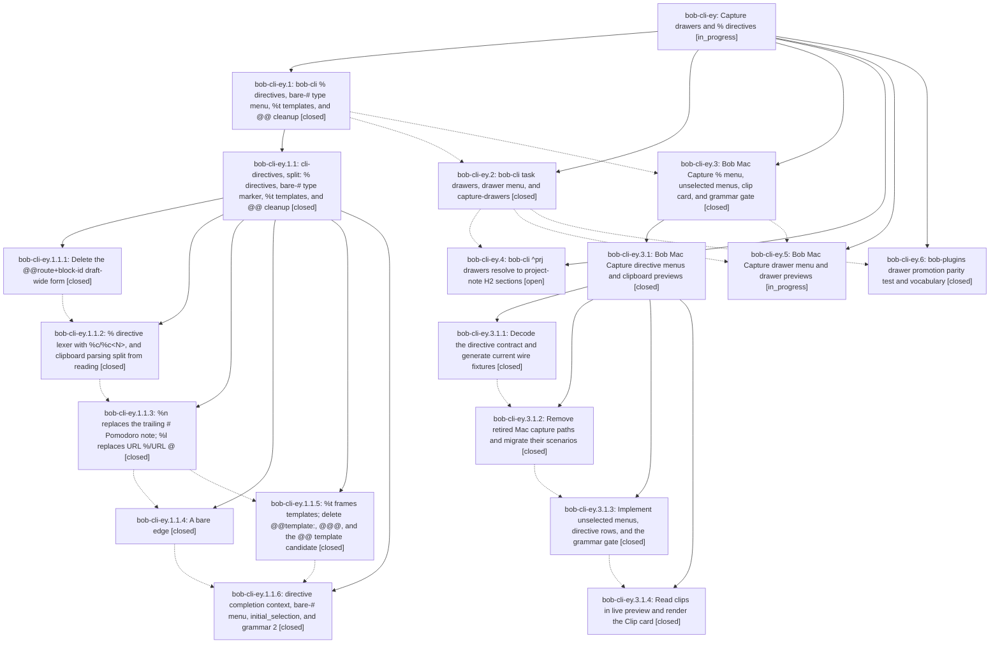

# Bead: bob-cli-ey — Capture drawers and % directives

[Bead Pages](../README.md) / bob-cli-ey

**Status:** ◐ in_progress · **Type:** ▸ plan · **Tier:** epic
**Owner:** `bryanbugyi34@gmail.com` · **Created by:** [bbugyi200.apollo.research.2x.linker.w0](https://github.com/bobs-org/bob-cli--agents/blob/main/sessions/bbugyi200.apollo.research.2x.linker.w0.md) · **Assignee:** `bob-cli-ey.land`
**Created:** 2026-10-31 12:52:03 EDT
**Plan:** [202610/capture\_drawers\_and\_directives.md](https://github.com/bobs-org/bob-cli--plans/blob/main/202610/capture_drawers_and_directives.md)

<!-- sase:links:start -->

## Links

| Relation | Artifact | Why |
| --- | --- | --- |
| implemented-by | [plan:202610/capture_drawers_and_directives.md][1] | derived from the plan's `bead_id:` frontmatter field |

[1]: https://github.com/bobs-org/bob-cli--plans/blob/main/202610/capture_drawers_and_directives.md

<!-- sase:links:end -->

## Description

Bob's capture language reads as three rules: @ says where, # names a place or a type, and % says how. `Text @note+id#drawer [#type]` files a note in a task drawer, creating the drawer when it is missing and optionally retyping the task in the same transaction. `%c`, `%n`, `%t`, and `%l` replace trailing `#`, `%`, `@@template:`, and `URL %`. Typing `#`, `%`, or `@note+id#` in Bob Mac Capture opens a bob-described menu with nothing preselected. Every retired form is deleted outright, with no aliases.

## Notes

[2026-11-01T02:34:28Z · bob-cli-ey.1.1.land] DISCOVERED ISSUE (from bob-cli-ey.1.1.2 PROPOSED FOLLOW-UP, triaged by the bob-cli-ey.1.1 land agent; belongs to phase bob-cli-ey.3 mac-directives, 'update the Mac docs'): bob-mac-capture's live-preview docs (capture-panel.md) still describe the retired URL % listen marker and %N/%header clipboard markers. After cli-directives they must teach URL %l listen, %c/%c<N>, and clip.status not_read under --no-clip (the panel's live preview runs bob capture --dry-run --no-clip unless bob reports a %c directive, per glossary:capture).

## Phases

| Bead | Title | Status | Size | Created | Agents | Commits |
|---|---|---|---|---|---:|---:|
| [bob-cli-ey.1](bob-cli-ey.1.md) | bob-cli % directives, bare-# type menu, %t templates, and @@ cleanup | ✓ closed | large | 2026-10-31 | 1 | 0 |
| [bob-cli-ey.2](bob-cli-ey.2.md) | bob-cli task drawers, drawer menu, and capture-drawers | ✓ closed | large | 2026-10-31 | 1 | 0 |
| [bob-cli-ey.3](bob-cli-ey.3.md) | Bob Mac Capture % menu, unselected menus, clip card, and grammar gate | ✓ closed | large | 2026-10-31 | 1 | 0 |
| [bob-cli-ey.4](bob-cli-ey.4.md) | bob-cli ^prj drawers resolve to project-note H2 sections | ○ open | medium | 2026-10-31 | 1 | 0 |
| [bob-cli-ey.5](bob-cli-ey.5.md) | Bob Mac Capture drawer menu and drawer previews | ◐ in_progress | medium | 2026-10-31 | 1 | 0 |
| [bob-cli-ey.6](bob-cli-ey.6.md) | bob-plugins drawer promotion parity test and vocabulary | ✓ closed | small | 2026-10-31 | 1 | 0 |

## Lineage

## Agents

| Agent | Bead | Commits |
|---|---|---:|
| [bbugyi200.apollo.bob-cli-ey.1](https://github.com/bobs-org/bob-cli--agents/blob/main/sessions/bbugyi200.apollo.bob-cli-ey.1.md) | [bob-cli-ey.1](bob-cli-ey.1.md) | 0 |
| [bbugyi200.apollo.bob-cli-ey.1.1.1](https://github.com/bobs-org/bob-cli--agents/blob/main/sessions/bbugyi200.apollo.bob-cli-ey.1.1.1.md) | [bob-cli-ey.1.1.1](bob-cli-ey.1.1.1.md) | 0 |
| [bbugyi200.apollo.bob-cli-ey.1.1.2](https://github.com/bobs-org/bob-cli--agents/blob/main/sessions/bbugyi200.apollo.bob-cli-ey.1.1.2.md) | [bob-cli-ey.1.1.2](bob-cli-ey.1.1.2.md) | 1 |
| [bbugyi200.apollo.bob-cli-ey.1.1.3](https://github.com/bobs-org/bob-cli--agents/blob/main/agents/bbugyi200.apollo.bob-cli-ey.1.1.3/README.md) | [bob-cli-ey.1.1.3](bob-cli-ey.1.1.3.md) | 1 |
| [bbugyi200.apollo.bob-cli-ey.1.1.4](https://github.com/bobs-org/bob-cli--agents/blob/main/sessions/bbugyi200.apollo.bob-cli-ey.1.1.4.md) | [bob-cli-ey.1.1.4](bob-cli-ey.1.1.4.md) | 1 |
| [bbugyi200.apollo.bob-cli-ey.1.1.5](https://github.com/bobs-org/bob-cli--agents/blob/main/agents/bbugyi200.apollo.bob-cli-ey.1.1.5/README.md) | [bob-cli-ey.1.1.5](bob-cli-ey.1.1.5.md) | 1 |
| [bbugyi200.apollo.bob-cli-ey.1.1.6](https://github.com/bobs-org/bob-cli--agents/blob/main/sessions/bbugyi200.apollo.bob-cli-ey.1.1.6.md) | [bob-cli-ey.1.1.6](bob-cli-ey.1.1.6.md) | 1 |
| [bbugyi200.apollo.bob-cli-ey.1.1.land](https://github.com/bobs-org/bob-cli--agents/blob/main/sessions/bbugyi200.apollo.bob-cli-ey.1.1.land.md) | [bob-cli-ey.1.1](bob-cli-ey.1.1.md) | 2 |
| [bbugyi200.apollo.bob-cli-ey.2](https://github.com/bobs-org/bob-cli--agents/blob/main/sessions/bbugyi200.apollo.bob-cli-ey.2.md) | [bob-cli-ey.2](bob-cli-ey.2.md) | 0 |
| [bbugyi200.apollo.bob-cli-ey.3](https://github.com/bobs-org/bob-cli--agents/blob/main/sessions/bbugyi200.apollo.bob-cli-ey.3.md) | [bob-cli-ey.3](bob-cli-ey.3.md) | 0 |
| [bbugyi200.apollo.bob-cli-ey.3.1.1](https://github.com/bobs-org/bob-cli--agents/blob/main/agents/bbugyi200.apollo.bob-cli-ey.3.1.1/README.md) | [bob-cli-ey.3.1.1](bob-cli-ey.3.1.1.md) | 1 |
| [bbugyi200.apollo.bob-cli-ey.3.1.2](https://github.com/bobs-org/bob-cli--agents/blob/main/sessions/bbugyi200.apollo.bob-cli-ey.3.1.2.md) | [bob-cli-ey.3.1.2](bob-cli-ey.3.1.2.md) | 1 |
| [bbugyi200.apollo.bob-cli-ey.3.1.3](https://github.com/bobs-org/bob-cli--agents/blob/main/agents/bbugyi200.apollo.bob-cli-ey.3.1.3/README.md) | [bob-cli-ey.3.1.3](bob-cli-ey.3.1.3.md) | 1 |
| [bbugyi200.apollo.bob-cli-ey.3.1.4](https://github.com/bobs-org/bob-cli--agents/blob/main/agents/bbugyi200.apollo.bob-cli-ey.3.1.4/README.md) | [bob-cli-ey.3.1.4](bob-cli-ey.3.1.4.md) | 1 |
| [bbugyi200.apollo.bob-cli-ey.3.1.land](https://github.com/bobs-org/bob-cli--agents/blob/main/sessions/bbugyi200.apollo.bob-cli-ey.3.1.land.md) | [bob-cli-ey.3.1](bob-cli-ey.3.1.md) | 2 |
| [bbugyi200.apollo.bob-cli-ey.4](https://github.com/bobs-org/bob-cli--agents/blob/main/agents/bbugyi200.apollo.bob-cli-ey.4/README.md) | [bob-cli-ey.4](bob-cli-ey.4.md) | 0 |
| [bbugyi200.apollo.bob-cli-ey.5](https://github.com/bobs-org/bob-cli--agents/blob/main/agents/bbugyi200.apollo.bob-cli-ey.5/README.md) | [bob-cli-ey.5](bob-cli-ey.5.md) | 0 |
| [bbugyi200.apollo.bob-cli-ey.6](https://github.com/bobs-org/bob-cli--agents/blob/main/agents/bbugyi200.apollo.bob-cli-ey.6/README.md) | [bob-cli-ey.6](bob-cli-ey.6.md) | 0 |
| [bbugyi200.apollo.bob-cli-ey.land](https://github.com/bobs-org/bob-cli--agents/blob/main/agents/bbugyi200.apollo.bob-cli-ey.land/README.md) | [bob-cli-ey](README.md) | 0 |

## Commits

| Repo | Commit | Subject | Bead | Committed |
|---|---|---|---|---|
| bob-cli | [`36c4807`](https://github.com/bobs-org/bob-cli/commit/36c48075510ff202a5d717fdf1a13e8bea7b37a8) | feat(capture)!: remove @@route+block-id | [bob-cli-ey.1.1.1](bob-cli-ey.1.1.1.md) | 2026-10-31 15:10:07 EDT |
| bob-cli | [`6ae5df0`](https://github.com/bobs-org/bob-cli/commit/6ae5df0033a4082b8a09a4406bbb16e70c436a05) | feat(capture)!: add %c/%c\<N\> directive lexer and split clipboard reading | [bob-cli-ey.1.1.2](bob-cli-ey.1.1.2.md) | 2026-10-31 18:23:34 EDT |
| bob-cli | [`4c011cd`](https://github.com/bobs-org/bob-cli/commit/4c011cd788f3953a90e9251ee67a985a824871b6) | feat(capture)!: teach %n and %l directives, retire trailing # and URL %/@ | [bob-cli-ey.1.1.3](bob-cli-ey.1.1.3.md) | 2026-10-31 19:47:59 EDT |
| bob-cli | [`d7f683a`](https://github.com/bobs-org/bob-cli/commit/d7f683a1e59da7391384d5d46559ba09d056d3dd) | feat(capture)!: treat a bare edge # as an incomplete type marker | [bob-cli-ey.1.1.4](bob-cli-ey.1.1.4.md) | 2026-10-31 20:50:29 EDT |
| bob-cli | [`9527893`](https://github.com/bobs-org/bob-cli/commit/952789343172946aebc67a03c724f9e6c767ae46) | feat(capture)!: frame %t templates, retire @@template:, @@@, and the @@ template candidate | [bob-cli-ey.1.1.5](bob-cli-ey.1.1.5.md) | 2026-10-31 21:00:14 EDT |
| bob-cli | [`b290d83`](https://github.com/bobs-org/bob-cli/commit/b290d833008347581c121f72cf70b6edb3e38810) | feat(capture): add directive completion and grammar revision | [bob-cli-ey.1.1.6](bob-cli-ey.1.1.6.md) | 2026-10-31 22:12:08 EDT |
| bob-cli | [`a1dcb64`](https://github.com/bobs-org/bob-cli/commit/a1dcb64eee30a3e7f45b0555be8cf60b940d85e1) | refactor(capture): finish cli-directives cleanup | [bob-cli-ey.1.1](bob-cli-ey.1.1.md) | 2026-10-31 23:28:06 EDT |
| bob-cli--plans | [`bob-cli--plans@6e89ba2`](https://github.com/bobs-org/bob-cli--plans/commit/6e89ba2b1d938dd658b77c2805d6795497f62ca7) | docs(plan): mark cli-directives split done | [bob-cli-ey.1.1](bob-cli-ey.1.1.md) | 2026-10-31 23:28:53 EDT |
| bob-mac-capture | [`bob-mac-capture@04904ee`](https://github.com/bobs-org/bob-mac-capture/commit/04904eed3b98544e5d75add5b1d0e0121e1d665a) | feat(mac-capture)!: decode grammar-2 directive wire and generate real fixtures | [bob-cli-ey.3.1.1](bob-cli-ey.3.1.1.md) | 2026-10-31 23:59:03 EDT |
| bob-mac-capture | [`bob-mac-capture@a580c0d`](https://github.com/bobs-org/bob-mac-capture/commit/a580c0d9c342debdef4e94d2df623c207411128d) | refactor(mac-capture)!: retire template-start and global-parent paths, migrate scenarios to percent directives | [bob-cli-ey.3.1.2](bob-cli-ey.3.1.2.md) | 2026-11-01 01:14:09 EDT |
| bob-mac-capture | [`bob-mac-capture@cea18c1`](https://github.com/bobs-org/bob-mac-capture/commit/cea18c1f0e3d340d270353c2b557e523e6428a36) | feat(mac-capture)!: open unselected directive menus and gate capture on grammar 2 | [bob-cli-ey.3.1.3](bob-cli-ey.3.1.3.md) | 2026-11-01 01:17:42 EST |
| bob-mac-capture | [`bob-mac-capture@a8e2ab6`](https://github.com/bobs-org/bob-mac-capture/commit/a8e2ab656a12f69fe929d10ab3ab879f42e31e98) | feat(mac-capture)!: read clips in live preview and render the Clip card | [bob-cli-ey.3.1.4](bob-cli-ey.3.1.4.md) | 2026-11-01 01:45:00 EST |
| bob-mac-capture | [`bob-mac-capture@f6c4100`](https://github.com/bobs-org/bob-mac-capture/commit/f6c4100fbd9a97c18fad31b00bac814e60754a41) | fix(mac-capture): complete directive landing repairs | [bob-cli-ey.3.1](bob-cli-ey.3.1.md) | 2026-11-01 02:54:33 EST |
| bob-cli--plans | [`bob-cli--plans@86a4e8d`](https://github.com/bobs-org/bob-cli--plans/commit/86a4e8d7ea552df90a833b1b274565e1c23c4a14) | docs(plan): mark Mac directives landing done | [bob-cli-ey.3.1](bob-cli-ey.3.1.md) | 2026-11-01 02:55:08 EST |
