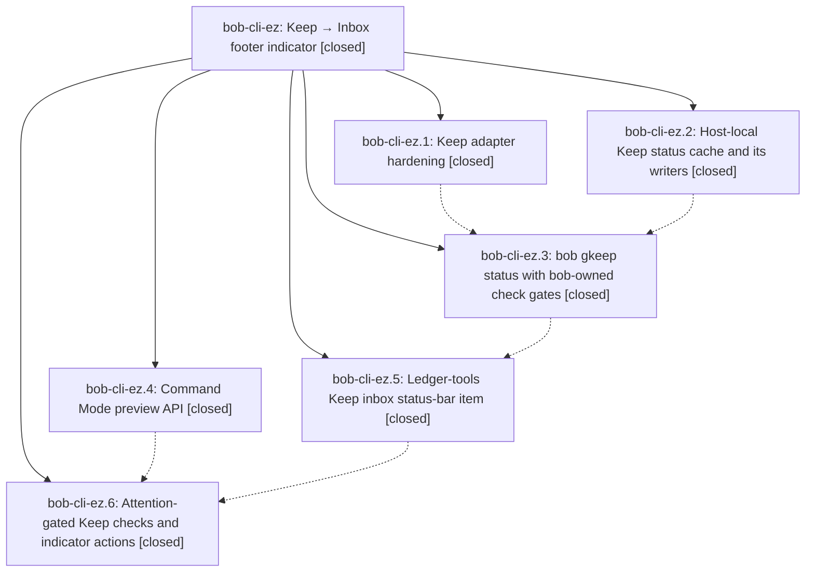

# Bead: bob-cli-ez — Keep → Inbox footer indicator

[Bead Pages](../README.md) / bob-cli-ez

**Status:** ✓ closed · **Resolution:** done · **Type:** ▸ plan · **Tier:** epic
**Owner:** `bryanbugyi34@gmail.com` · **Created by:** [bbugyi200.apollo.research.2y.linker.w0](https://github.com/bobs-org/bob-cli--agents/blob/main/sessions/bbugyi200.apollo.research.2y.linker.w0.md) · **Assignee:** `bob-cli-ez.land`
**Created:** 2026-10-31 13:32:41 EDT · **Closed:** 2026-10-31 16:49:17 EDT
**Plan:** [202610/gkeep\_footer\_indicator.md](https://github.com/bobs-org/bob-cli--plans/blob/main/202610/gkeep_footer_indicator.md)

<!-- sase:links:start -->

## Links

| Relation | Artifact | Why |
| --- | --- | --- |
| implemented-by | [plan:202610/gkeep_footer_indicator.md][1] | derived from the plan's `bead_id:` frontmatter field |

[1]: https://github.com/bobs-org/bob-cli--plans/blob/main/202610/gkeep_footer_indicator.md

<!-- sase:links:end -->

## Description

Obsidian's desktop status bar shows, beside the review footer, a gold bulb pill counting the Google Keep notes a default `bob gkeep pull` would act on (only once Keep has verifiably worked on this host) and a plain inbox-tray count of open top-level tasks in gkeep_inbox.md. bob owns the Keep count, its cache, and its check budget; the footer is a calm, attention-gated client.

## Notes

[2026-10-31T20:38:12Z · bob-cli-ez.land] LAND TRIAGE (bob-cli-ez.land): PROPOSED FOLLOW-UP outcomes — (1) decisions-web record 'Keep Count Is bob-Owned And Attention-Gated' (ez.1#1, ez.2#1, ez.3#1, ez.4#2, ez.5#1, ez.6#1): filed as memory task bob-cli-f0 (small, ready) so Bryan decides at triage; the epic's auto decision_record=no forbade editing memory here. (2) bob-plugins test-command-mode-sheet-sequence-dom 'production sheet render and clicks use real DOM APIs' (ez.4#1): not epic-caused (findChromium throws on Chromium-less apollo; fails at pre-epic 2ebd58c); filed ci task bob-cli-f1 (small, ready), related to bob-cli-er. (3) note-ready startup storm + relation-index layout-ready (ez.4#1, ez.5#2, ez.6#2): duplicate of bob-cli-eh, +1 recorded. (4) gcal create-listener + freshness-namespace due-key reload (ez.4#1, ez.6#2): duplicate of bob-cli-et, +1 recorded. (5) freshness status-bar failures (ez.6#2: footer '0-1-0 transitions', 'quickRoll hint slot', 'quickRoll namespaces'; namespace 'clicks through, falling back to rotten'): CAUSED by this epic (pass at 2ebd58c, fail from 38b9114 because the tests stub addStatusBarItem to return one shared fake element, which the Keep item then empties) -> remaining epic work, planned in the landing tale.

[2026-10-31T20:49:17Z · bob-cli-ez.land] Verified all six phases against plan:202610/gkeep_footer_indicator.md: bob-cli bb3a2f41/ecffd6fa/efe2ebe0/17702dca (adapter hardening, status cache, bob gkeep status gates/backoff/JSON/human/catalog/docs) and bob-plugins b0db27a/38b9114/48672ee (commandMode.preview, Keep inbox item, attention-gated actions). Landing fixed the epic-caused freshness status-bar harness bug, the >24h ok-to-unknown transition, focus cache re-reads including configured:false, invalid doctor fallback copy, and stale floor Notice age. bob-plugins commit 8d1686a adds these fixes; build/build:check/docs:check pass, focused tests pass except the tracked bob-cli-et reload-date test, and full npm test has only the five planned failures (Chromium unavailable, bob-cli-et, bob-cli-eh). Deployed bob-ledger-tools successfully. Follow-ups bob-cli-f0 and bob-cli-f1 plus +1 on bob-cli-eh and bob-cli-et remain recorded. No epic symbols. just symvision is unavailable because this checkout has no such recipe. Installed bob 0.4.0 lacks gkeep status until the release train ships it; the plugin hides the Keep segment meanwhile.

## Phases

| Bead | Title | Status | Size | Created | Agents | Commits |
|---|---|---|---|---|---:|---:|
| [bob-cli-ez.1](bob-cli-ez.1.md) | Keep adapter hardening | ✓ closed | small | 2026-10-31 | 1 | 1 |
| [bob-cli-ez.2](bob-cli-ez.2.md) | Host-local Keep status cache and its writers | ✓ closed | medium | 2026-10-31 | 1 | 1 |
| [bob-cli-ez.3](bob-cli-ez.3.md) | bob gkeep status with bob-owned check gates | ✓ closed | medium | 2026-10-31 | 1 | 1 |
| [bob-cli-ez.4](bob-cli-ez.4.md) | Command Mode preview API | ✓ closed | small | 2026-10-31 | 1 | 1 |
| [bob-cli-ez.5](bob-cli-ez.5.md) | Ledger-tools Keep inbox status-bar item | ✓ closed | medium | 2026-10-31 | 1 | 1 |
| [bob-cli-ez.6](bob-cli-ez.6.md) | Attention-gated Keep checks and indicator actions | ✓ closed | medium | 2026-10-31 | 1 | 2 |

## Lineage

## Agents

| Agent | Bead | Commits |
|---|---|---:|
| [bbugyi200.apollo.bob-cli-ez.1](https://github.com/bobs-org/bob-cli--agents/blob/main/agents/bbugyi200.apollo.bob-cli-ez.1/README.md) | [bob-cli-ez.1](bob-cli-ez.1.md) | 1 |
| [bbugyi200.apollo.bob-cli-ez.2](https://github.com/bobs-org/bob-cli--agents/blob/main/sessions/bbugyi200.apollo.bob-cli-ez.2.md) | [bob-cli-ez.2](bob-cli-ez.2.md) | 1 |
| [bbugyi200.apollo.bob-cli-ez.3](https://github.com/bobs-org/bob-cli--agents/blob/main/agents/bbugyi200.apollo.bob-cli-ez.3/README.md) | [bob-cli-ez.3](bob-cli-ez.3.md) | 1 |
| [bbugyi200.apollo.bob-cli-ez.4](https://github.com/bobs-org/bob-cli--agents/blob/main/agents/bbugyi200.apollo.bob-cli-ez.4/README.md) | [bob-cli-ez.4](bob-cli-ez.4.md) | 1 |
| [bbugyi200.apollo.bob-cli-ez.5](https://github.com/bobs-org/bob-cli--agents/blob/main/agents/bbugyi200.apollo.bob-cli-ez.5/README.md) | [bob-cli-ez.5](bob-cli-ez.5.md) | 1 |
| [bbugyi200.apollo.bob-cli-ez.6](https://github.com/bobs-org/bob-cli--agents/blob/main/agents/bbugyi200.apollo.bob-cli-ez.6/README.md) | [bob-cli-ez.6](bob-cli-ez.6.md) | 2 |
| [bbugyi200.apollo.bob-cli-ez.land](https://github.com/bobs-org/bob-cli--agents/blob/main/sessions/bbugyi200.apollo.bob-cli-ez.land.md) | [bob-cli-ez](README.md) | 2 |

## Commits

| Repo | Commit | Subject | Bead | Committed |
|---|---|---|---|---|
| bob-cli | [`bb3a2f4`](https://github.com/bobs-org/bob-cli/commit/bb3a2f4166d0366232cbe0b05b6916de6f4afc00) | fix(gkeep): bound adapter 429 retries and classify rate-limit 403s | [bob-cli-ez.1](bob-cli-ez.1.md) | 2026-10-31 13:46:52 EDT |
| bob-plugins | [`bob-plugins@b0db27a`](https://github.com/bobs-org/bob-plugins/commit/b0db27a60f92dca1f1769de7d510986a173e84d2) | feat(command-mode): add api.commandMode.preview | [bob-cli-ez.4](bob-cli-ez.4.md) | 2026-10-31 13:47:55 EDT |
| bob-cli | [`ecffd6f`](https://github.com/bobs-org/bob-cli/commit/ecffd6fa8fa8fbc444d276a434cac43b3b4df75b) | feat(gkeep): persist host-local Keep status cache | [bob-cli-ez.2](bob-cli-ez.2.md) | 2026-10-31 14:28:03 EDT |
| bob-cli | [`efe2ebe`](https://github.com/bobs-org/bob-cli/commit/efe2ebe066d0df87736b8af2eeef52e152bf5e3e) | feat(gkeep): add bob gkeep status with bob-owned check gates | [bob-cli-ez.3](bob-cli-ez.3.md) | 2026-10-31 15:38:28 EDT |
| bob-plugins | [`bob-plugins@38b9114`](https://github.com/bobs-org/bob-plugins/commit/38b91140a987e1a8c99d015944f5dcc176a726bc) | feat(ledger-tools): add the Keep inbox status-bar item | [bob-cli-ez.5](bob-cli-ez.5.md) | 2026-10-31 16:01:21 EDT |
| bob-cli | [`17702dc`](https://github.com/bobs-org/bob-cli/commit/17702dcafea3928c40a6434adf78e21f8f7f19d1) | docs(gkeep): link the Obsidian status indicator guide | [bob-cli-ez.6](bob-cli-ez.6.md) | 2026-10-31 16:20:48 EDT |
| bob-plugins | [`bob-plugins@48672ee`](https://github.com/bobs-org/bob-plugins/commit/48672ee84097327ee4f639010e1d287163d73f2b) | feat(ledger-tools): add attention-gated Keep actions | [bob-cli-ez.6](bob-cli-ez.6.md) | 2026-10-31 16:21:13 EDT |
| bob-plugins | [`bob-plugins@8d1686a`](https://github.com/bobs-org/bob-plugins/commit/8d1686a6ed4e1858e70f8d6df342a488301dd63b) | fix(ledger-tools): finish the Keep inbox indicator landing | [bob-cli-ez](README.md) | 2026-10-31 16:48:32 EDT |
| bob-cli--plans | [`bob-cli--plans@f5587e3`](https://github.com/bobs-org/bob-cli--plans/commit/f5587e37ff4e18f718386b7670fa7df61b7d4e68) | docs(plan): mark Keep inbox indicator plan done | [bob-cli-ez](README.md) | 2026-10-31 16:50:09 EDT |
