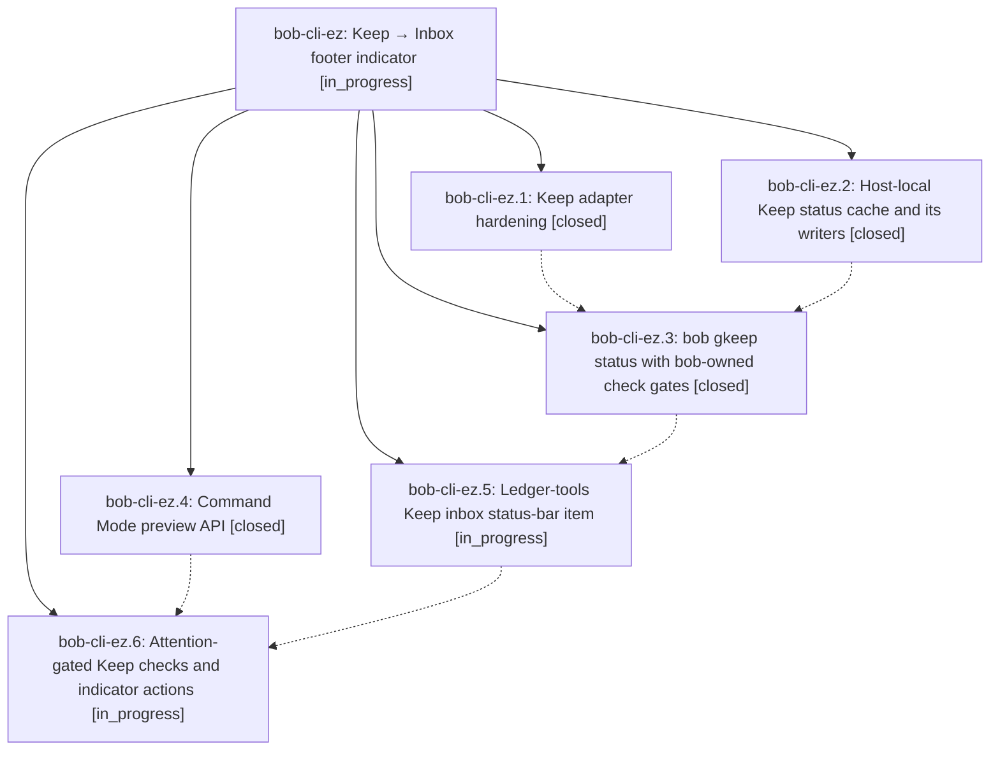

# Bead: bob-cli-ez — Keep → Inbox footer indicator

[Bead Pages](../README.md) / bob-cli-ez

**Status:** ◐ in_progress · **Type:** ▸ plan · **Tier:** epic
**Owner:** `bryanbugyi34@gmail.com` · **Created by:** [bbugyi200.apollo.research.2y.linker.w0](https://github.com/bobs-org/bob-cli--agents/blob/main/sessions/bbugyi200.apollo.research.2y.linker.w0.md) · **Assignee:** `bob-cli-ez.land`
**Created:** 2026-10-31 13:32:41 EDT
**Plan:** [202610/gkeep\_footer\_indicator.md](https://github.com/bobs-org/bob-cli--plans/blob/main/202610/gkeep_footer_indicator.md)

<!-- sase:links:start -->

## Links

| Relation | Artifact | Why |
| --- | --- | --- |
| implemented-by | [plan:202610/gkeep_footer_indicator.md][1] | derived from the plan's `bead_id:` frontmatter field |

[1]: https://github.com/bobs-org/bob-cli--plans/blob/main/202610/gkeep_footer_indicator.md

<!-- sase:links:end -->

## Description

Obsidian's desktop status bar shows, beside the review footer, a gold bulb pill counting the Google Keep notes a default `bob gkeep pull` would act on (only once Keep has verifiably worked on this host) and a plain inbox-tray count of open top-level tasks in gkeep_inbox.md. bob owns the Keep count, its cache, and its check budget; the footer is a calm, attention-gated client.

## Phases

| Bead | Title | Status | Size | Created | Agents | Commits |
|---|---|---|---|---|---:|---:|
| [bob-cli-ez.1](bob-cli-ez.1.md) | Keep adapter hardening | ✓ closed | small | 2026-10-31 | 1 | 1 |
| [bob-cli-ez.2](bob-cli-ez.2.md) | Host-local Keep status cache and its writers | ✓ closed | medium | 2026-10-31 | 1 | 1 |
| [bob-cli-ez.3](bob-cli-ez.3.md) | bob gkeep status with bob-owned check gates | ✓ closed | medium | 2026-10-31 | 1 | 1 |
| [bob-cli-ez.4](bob-cli-ez.4.md) | Command Mode preview API | ✓ closed | small | 2026-10-31 | 1 | 0 |
| [bob-cli-ez.5](bob-cli-ez.5.md) | Ledger-tools Keep inbox status-bar item | ◐ in_progress | medium | 2026-10-31 | 1 | 0 |
| [bob-cli-ez.6](bob-cli-ez.6.md) | Attention-gated Keep checks and indicator actions | ◐ in_progress | medium | 2026-10-31 | 1 | 0 |

## Lineage

## Agents

| Agent | Bead | Commits |
|---|---|---:|
| [bbugyi200.apollo.bob-cli-ez.1](https://github.com/bobs-org/bob-cli--agents/blob/main/agents/bbugyi200.apollo.bob-cli-ez.1/README.md) | [bob-cli-ez.1](bob-cli-ez.1.md) | 1 |
| [bbugyi200.apollo.bob-cli-ez.2](https://github.com/bobs-org/bob-cli--agents/blob/main/sessions/bbugyi200.apollo.bob-cli-ez.2.md) | [bob-cli-ez.2](bob-cli-ez.2.md) | 1 |
| [bbugyi200.apollo.bob-cli-ez.3](https://github.com/bobs-org/bob-cli--agents/blob/main/agents/bbugyi200.apollo.bob-cli-ez.3/README.md) | [bob-cli-ez.3](bob-cli-ez.3.md) | 1 |
| [bbugyi200.apollo.bob-cli-ez.4](https://github.com/bobs-org/bob-cli--agents/blob/main/agents/bbugyi200.apollo.bob-cli-ez.4/README.md) | [bob-cli-ez.4](bob-cli-ez.4.md) | 0 |
| [bbugyi200.apollo.bob-cli-ez.5](https://github.com/bobs-org/bob-cli--agents/blob/main/agents/bbugyi200.apollo.bob-cli-ez.5/README.md) | [bob-cli-ez.5](bob-cli-ez.5.md) | 0 |
| [bbugyi200.apollo.bob-cli-ez.6](https://github.com/bobs-org/bob-cli--agents/blob/main/agents/bbugyi200.apollo.bob-cli-ez.6/README.md) | [bob-cli-ez.6](bob-cli-ez.6.md) | 0 |
| [bbugyi200.apollo.bob-cli-ez.land](https://github.com/bobs-org/bob-cli--agents/blob/main/agents/bbugyi200.apollo.bob-cli-ez.land/README.md) | [bob-cli-ez](README.md) | 0 |

## Commits

| Repo | Commit | Subject | Bead | Committed |
|---|---|---|---|---|
| bob-cli | [`bb3a2f4`](https://github.com/bobs-org/bob-cli/commit/bb3a2f4166d0366232cbe0b05b6916de6f4afc00) | fix(gkeep): bound adapter 429 retries and classify rate-limit 403s | [bob-cli-ez.1](bob-cli-ez.1.md) | 2026-10-31 13:46:52 EDT |
| bob-cli | [`ecffd6f`](https://github.com/bobs-org/bob-cli/commit/ecffd6fa8fa8fbc444d276a434cac43b3b4df75b) | feat(gkeep): persist host-local Keep status cache | [bob-cli-ez.2](bob-cli-ez.2.md) | 2026-10-31 14:28:03 EDT |
| bob-cli | [`efe2ebe`](https://github.com/bobs-org/bob-cli/commit/efe2ebe066d0df87736b8af2eeef52e152bf5e3e) | feat(gkeep): add bob gkeep status with bob-owned check gates | [bob-cli-ez.3](bob-cli-ez.3.md) | 2026-10-31 15:38:28 EDT |
