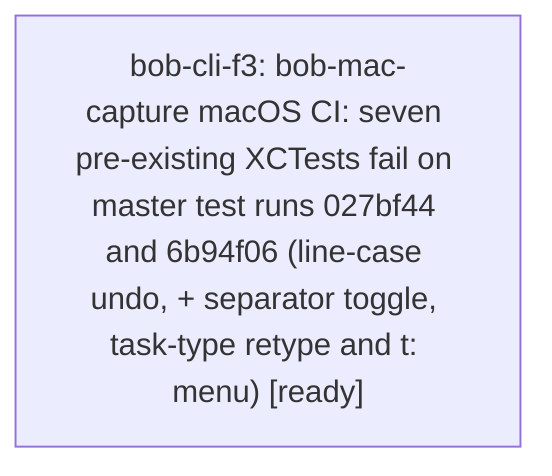

# Bead: bob-cli-f3 — bob-mac-capture macOS CI: seven pre-existing XCTests fail on master test runs 027bf44 and 6b94f06 (line-case undo, + separator toggle, task-type retype and t: menu)

[Bead Pages](../README.md) / bob-cli-f3

**Status:** ◇ ready · **Type:** ◆ task · **Task type:** ⚙ ci · **+1 reports:** +1
**Owner:** `bryanbugyi34@gmail.com` · **Created by:** [bbugyi200.apollo.bob-cli-ex.land--2](https://github.com/bobs-org/bob-cli--agents/blob/main/sessions/bbugyi200.apollo.bob-cli-ex.land.md) · **Size:** large
**Created:** 2026-10-31 20:57:17 EDT

<!-- sase:links:start -->

## Links

| Relation | Artifact | Why |
| --- | --- | --- |
| related | [bead:bob-cli-ee][1] | ee's land note recorded 11 CaptureTaskTypeHostedTests assertion failures on Mac CI 41098433632 as a limitation and never filed a bead; the t: type-marker tests here descend from that work |
| related | [bead:bob-cli-ex][2] | Found by bob-cli-ex's landing-repair snapshot run 41257836794; the repair fixed the compile break that masked these seven and is not their cause |

_Plus 1 automatic references — see [Referenced By](#referenced-by)._

[1]: https://github.com/bobs-org/bob-cli--beads/blob/main/pages/bob-cli-ee/README.md
[2]: https://github.com/bobs-org/bob-cli--beads/blob/main/pages/bob-cli-ex/README.md

<!-- sase:links:end -->

## Description

Repo: bob-mac-capture (linked). Master macOS CI ("macOS 26 SwiftPM", Test step) fails seven XCTests that have nothing to do with any in-flight change, so master has no green Test step and the Bundle, Verify plist and signature, Launch smoke test and Install and reinstall steps are skipped on every run.

Failing tests (assertion messages from the 6b94f06 master run 41228541365 and the bob-cli-ex precommit snapshot run 41257836794; identical in both):

- `CaptureEditorLeaderTests.testToggleLineCaseUndoRestoresOriginalLine` (CaptureEditorLeaderTests.swift:49): selection `{5, 0}` is not equal to `{2, 0}` after undo.
- `CapturePanelModelTests.testTaskTypeRetypeMoveKeepsDraftAndUsesEnsureNextAction` (CapturePanelModelTests.swift:4471-4472): got "Ensured Next and created" / "Moved LATER → FIX (created FIX)", expected "Ensured Next and moved" / "Moved LATER → FIX".
- `CaptureSeparatorToggleTests.testPlusAfterCaretIDSwitchesToSubBulletInOneUndoStep` (CaptureSeparatorToggleTests.swift:399-405): got "Do work @file+id", expected "Do work @file^id+". On 027bf44 this same test is still named testPlusAfterCaretProjectNoteMarkerStaysLiteral (renamed by 6b94f06) and fails at line 389.
- `CaptureSeparatorToggleTests.testPlusToggleUndoRestoresLiteralPostKeyDraftOnce` (lines 497-503): got "Do work @file+id", expected "Do work @file:id+".
- `CaptureSeparatorToggleTests.testTypedPlusAsWholeItemOpensActiveTaskPickerThroughKeyIntent` (line 719): footer "Ready", expected "Pick an active task — press Tab to browse".
- `CaptureTaskTypeHostedTests.testBareLeadingTrailingAndChildMarkersOpenTaskTypeMenu` (CaptureTaskTypeHostedTests.swift:17-26): "Condition not met before timeout" on every sub-case (20 s), the t: menu never opens.
- `CaptureTaskTypeHostedTests.testTypedRowDoesNotWriteVisibility` (line 227): XCTAssertFalse failed.

Runs (all Test step failure, same seven tests):

- 41218430244 on master 027bf44 (2026-10-31 16:11Z, "add Ctrl-G U draft line-case toggle").
- 41228541365 on master 6b94f06 (2026-10-31 18:15Z, "seal project notes with @ and paint the project chip").
- 41257836794 on the bob-cli-ex landing-repair precommit snapshot fa3170d, where these seven are the only failures left.
- Master 891fe11 (run 41251130345) fails earlier, at test compile (NotificationServiceTests used a missing blockLink); the bob-cli-ex landing repair fixes that, which is what unmasked these seven.

Not caused by the bob-cli-ex repair: all seven fail on 027bf44, before any bob-cli-ex Mac commit (one of them under its pre-rename name). The repair touches only CaptureCore/CaptureProjectNotePresentation.swift, four test files, fake-bob, three new fixtures, the generator script and two docs.

Origins (suspected from git history only, not bisected): the `+` separator tests arrived in ec3fff5 (standalone agent bp) and the line-case test in 027bf44 (standalone agent bq), both red on their first CI run; the t: / task-type tests belong to the closed type-marker work (bob-cli-ee, bob-cli-ep). bob-cli-ee's land note already recorded "11 assertion failures in CaptureTaskTypeHostedTests" on run 41098433632 (68aa63a) as a limitation and never filed a bead. bob-cli-eo is a different Mac test from the same family. No in-progress epic owns these.

Done when: the Test step passes on a master push (or a precommit snapshot from `Scripts/macos-ci-check`) with all seven tests passing and no assertion weakened or test removed, and the Bundle, Verify plist and signature, Launch smoke test and Install and reinstall steps then run and pass. Fix each root cause separately where they differ (the `+` toggle, line-case undo selection, task-type retype/menu); do not assume one cause.

---

\## CI failure

- **Node:** `BobMacCaptureTests.CaptureEditorLeaderTests/testToggleLineCaseUndoRestoresOriginalLine, BobMacCaptureTests.CapturePanelModelTests/testTaskTypeRetypeMoveKeepsDraftAndUsesEnsureNextAction, BobMacCaptureTests.CaptureSeparatorToggleTests/testPlusAfterCaretIDSwitchesToSubBulletInOneUndoStep, BobMacCaptureTests.CaptureSeparatorToggleTests/testPlusToggleUndoRestoresLiteralPostKeyDraftOnce, BobMacCaptureTests.CaptureSeparatorToggleTests/testTypedPlusAsWholeItemOpensActiveTaskPickerThroughKeyIntent, BobMacCaptureTests.CaptureTaskTypeHostedTests/testBareLeadingTrailingAndChildMarkersOpenTaskTypeMenu, BobMacCaptureTests.CaptureTaskTypeHostedTests/testTypedRowDoesNotWriteVisibility`

Deterministic assertion mismatches, not intermittent: the same seven tests fail in every Test step recorded on three different SHAs (master runs 41218430244 at 027bf44 and 41228541365 at 6b94f06, and precommit snapshot run 41257836794 at fa3170d). A rerun-on-same-tree passed none of them, and the assertion values are identical across runs.

## Notes

[2026-11-01T07:40:59Z · bob-cli-ey.3.1.land--2] Overlap addressed by bob-cli-ey.3.1: the new testTypingAfterAnUnselectedMenuRanksAFreshSelection shares the fake-bob typed-hash parse/completion path with CaptureTaskTypeHostedTests.testBareLeadingTrailingAndChildMarkersOpenTaskTypeMenu and testTypedRowDoesNotWriteVisibility. Fake-bob now serves current-wire parse and completion fixtures for leading, trailing, and child typed markers, including required body/spans/needs, so filtering and menu visibility exercise valid Bob responses. This is the fixture-side overlap only; the other baseline nodes remain, and hosted macOS execution was unavailable (macOS targets unverified).

## +1 Evidence

> **+1** by `bob-cli-ey.3.1.land` · 2026-11-01 01:52:01 EST
> **Observed since:** 2026-11-01 01:45:56 EST
>
> Independent land audit by bob-cli-ey.3.1.land: inspected macOS CI 41260240529 (pre-directive base 91a5d2b) and 41280243768 (menus phase cea18c1), jobs 124711823950 and 124770529844. The seven named nodes still fail with the same line-case selection, plus-toggle undo/footer, task-type retype strings, typed menu timeouts and visibility assertions; base has 19 assertion failures in 3463 tests. No new task: this is the existing report. The directive epic adds distinct accept-and-submit, Open Hint test setup, shelf fixture migration, new filtering-test, and clip-suite path/crash problems; these remain bob-cli-ey.3.1 work. Its new filtering acceptance may repair the overlapping typed-menu fixture defect while preserving this task for remaining baseline nodes. No active epic caused the baseline set: traced their introducing commits to standalone Ctrl-G/plus work and the closed type-marker work, and reviewed active epic scopes. Evidence: https://github.com/bobs-org/bob-mac-capture/actions/runs/41260240529 and https://github.com/bobs-org/bob-mac-capture/actions/runs/41280243768

## Lineage

<!-- sase:referenced-by:start -->

## Referenced By

| Relation | Artifact | Why | Uses |
| --- | --- | --- | ---: |
| read-by | [agent:bob-cli-ex.land--2][1] | Verify the new ci bead links and fields before marking ready | 1 |

[1]: https://github.com/bobs-org/bob-cli--agents/blob/main/sessions/bbugyi200.apollo.bob-cli-ex.land.md

<!-- sase:referenced-by:end -->
