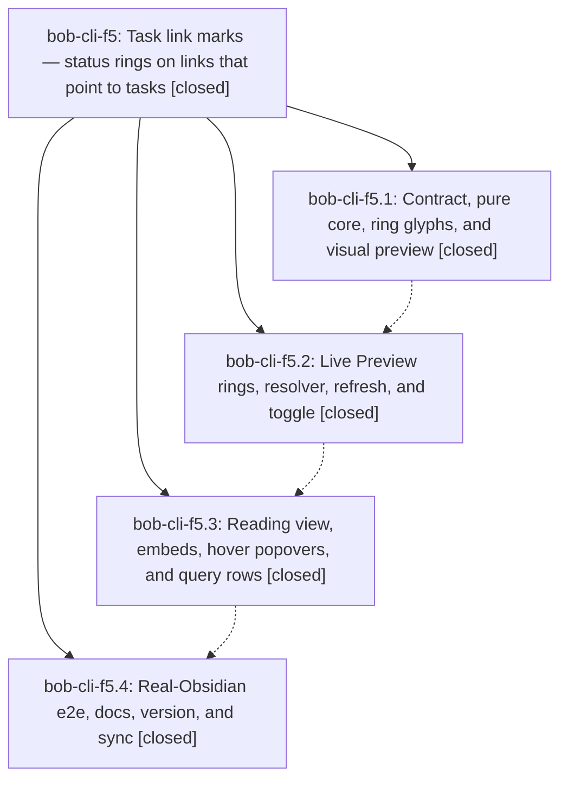

# Bead: bob-cli-f5 — Task link marks — status rings on links that point to tasks

[Bead Pages](../README.md) / bob-cli-f5

**Status:** ✓ closed · **Resolution:** done · **Type:** ▸ plan · **Tier:** epic
**Owner:** `bryanbugyi34@gmail.com` · **Created by:** [bbugyi200.athena.16q](https://github.com/bobs-org/bob-cli--agents/blob/main/sessions/bbugyi200.athena.16q.md) · **Assignee:** `bob-cli-f5.land`
**Created:** 2026-11-01 09:24:20 EST · **Closed:** 2026-11-01 12:35:14 EST
**Plan:** [202611/task\_link\_marks.md](https://github.com/bobs-org/bob-cli--plans/blob/main/202611/task_link_marks.md)

<!-- sase:links:start -->

## Links

| Relation | Artifact | Why |
| --- | --- | --- |
| implemented-by | [plan:202611/task_link_marks.md][1] | derived from the plan's `bead_id:` frontmatter field |
| related | file:explicit:1e940b6823e6b8558799f791 | attached via sase artifact create --bead |
| related | file:explicit:37dfcb3fc28aee3da970819d | attached via sase artifact create --bead |
| related | file:explicit:3f28f3367c36f04929e7f6a0 | attached via sase artifact create --bead |
| related | file:explicit:59db89a083d8355365b792e0 | attached via sase artifact create --bead |
| related | file:explicit:5ab36c6dd1efb1640e7d51be | attached via sase artifact create --bead |
| related | file:explicit:5eaf8ebfe79cb1b562ac52b1 | attached via sase artifact create --bead |
| related | file:explicit:6cace65f553d056827a89500 | attached via sase artifact create --bead |
| related | file:explicit:8bfd22089e260383c11301f7 | attached via sase artifact create --bead |
| related | file:explicit:bb831eb0037472bbaee6798e | attached via sase artifact create --bead |
| related | file:explicit:be7ba1208ebb2e69d16e7648 | attached via sase artifact create --bead |
| related | file:explicit:e2d6e77a67e959ecb6b61bdb | attached via sase artifact create --bead |

_Plus 4 automatic references — see [Referenced By](#referenced-by)._

[1]: https://github.com/bobs-org/bob-cli--plans/blob/main/202611/task_link_marks.md

<!-- sase:links:end -->

## Description

Every rendered link whose target is a `#task` line wears a small status ring (Ready, Next, In Progress, Blocked, Done, Cancelled) in Live Preview and rendered views, so Bryan can tell at a glance which links point to tasks and what state those tasks are in. Links to notes, headings, and non-task blocks stay exactly as they are, nothing is ever written to the vault, and a session toggle restores plain links.

## Notes

[2026-11-01T16:33:50Z · bt--1] DISCOVERED ISSUE: On the integrated bob-plugins tree, the second full npm test run failed scripts/test-ledger-tools-task-link-marks-live.cjs::a viewport-limited build over a 1,000-line note stays fast with 'warm viewport build took 29.6ms'. Running that file alone on the unchanged tree passed 36/36. Impact: the task-link-marks performance guard can make the full npm test gate fail under suite load; review the threshold or benchmark isolation before closing this epic.

[2026-11-01T16:45:07Z · bob-cli-f5.land] LAND AUDIT / FOLLOW-UP TRIAGE before remaining-work tale: Read bob-cli-f5 and every note on f5.1-.4, the approved plan, bob-cli commits a1233eb8/4ea4c330, plugin commits a67b8cd/13d40ac/bedc7e2/32c9e03, and actual core/resolver/live/reading/CSS/e2e source. Decisions ledger_rows=skip and dim_closed_links=no are retained. Core, resolver precedence, widgets, rendered views, toggle, docs registration, manifest 1.81.0, and deployment machinery are present; f5.1 initial refused sync was followed by successful f5.2/.3/.4 sync reports. The feature is NOT ready to close: independently reproduced fence-length handling (four-backtick fence closed by three), inline-code %% corrupting later comment context, ordinary Reading bullet 'Links worth reading' suppressed as a managed row, and reduced-motion animation still active in Chromium due to CSS specificity. The e2e also calls runTaskLinkMarksRefresh(true) itself and labels a boolean sawSwap as 'once', so it does not prove natural liveness or a single swap. Keep these as epic work in a medium tale whose coder must finish this epic landing.

Integration audit: bob-cli f4112320 only changes incomplete capture offers; 5546ed1a adds Next keep docs and retains ring links. Plugins 2c70724 changes Task Card Schedule defaults; fetched origin/master 9c40ce2 adds Next keep log parsing/docs and preserves the ring source and manifest description. No direct conflicting integration change found. Recheck newer drift in the tale. Focused Node run: 162 tests, 155 pass, seven known failures; all task-link tests pass. npm run validate passes generated builds, current docs inventory, and 8/8 manifests. No --epic-symbol entries; no symvision recipe in inspected checkouts. Parent link audit: no parent_bead.

Every PROPOSED FOLLOW-UP note #1 from f5.1/f5.2/f5.3/f5.4 was triaged with sase_new_task, same-type and all-type duplicate searches, last-week sweeps, and all 12 active epic scopes: (1) gcal create + freshness due-key date failures -> independently reproduced and +1 on bob-cli-et; (2) note-ready startup + relationIndex layout-ready failures -> independently reproduced and +1 on bob-cli-eh; (3) Keep rate-limited notice 12:30 vs 16:30 -> new small CI task bob-cli-f7, deterministic America/New_York mismatch with unchanged UTC control 33/33; (4) f5.3 warm snapshot/rank and f5.4 rank proposals -> new large CI investigation bob-cli-f8, both nodes fail all three unchanged runs including two isolated runs, already CPU-timed/warmed/best-of. The additional intermittent cold-chunk miss is recorded with f8 evidence. Closed bob-cli-3w was read and declined as a duplicate: different navigation ranker/file and already-fixed cold wall-clock measurement. No proposal declined as obsolete and no extra duplicate task created. f7 is related to et; f8 is related to 3w for methodology only. None is caused by f5 or another currently active epic.

Evidence refs: file:explicit:3f28f3367c36f04929e7f6a0 (focused run), file:explicit:e2d6e77a67e959ecb6b61bdb and file:explicit:59db89a083d8355365b792e0 (isolated CPU failures), file:explicit:bb831eb0037472bbaee6798e (UTC Keep control). Remaining-work tale is sase_plan_task_link_marks_closeout.md; do not close f5 or mark plan:202611/task_link_marks.md done until its repairs and same-turn closeout are complete. No just check-full was run.

Detailed reproduced blockers: file:explicit:be7ba1208ebb2e69d16e7648.

[2026-11-01T17:35:14Z · bob-cli-f5.land] CLOSEOUT VERIFIED (bob-cli-f5 closeout tale; landed in the tale's host commit after this turn, bob-plugins + bob-cli docs + plans sidecar).

REPAIRED DEFECTS. (1) Context: 148-task-link-marks.js now has one document walk (taskLinkMarkDocWalk + taskLinkMarkScanLine): a fence closes only on the opener's own character, at least as long, nothing after (four-backtick fence no longer closed by three; tilde, shorter-run, info-string and fence-like content covered); %% or backticks in inline code or fences can no longer open or corrupt comments, backticks inside a comment are comment text, and a real multi-line comment excludes only the comment (text before the opener and after the closer is prose; only wholly-inside lines are inert). The builder passes ctx.excluded(index) to taskLinkMarkSpans. (2) Managed rows: the source fallback taskLinkMarkIsManagedRowText is anchored at the row start (list marker/checkbox/glyph + bold label, labels case-sensitive; glyph required without a marker), and Reading taskLinkMarkReadingOwnRowIsEdge now recognises a bold managed label (structure, incl. checkbox/loose-list p) or flattened uppercase label+colon after a glyph/bullet; 'Links worth reading:' gets its ring, actual DEPENDS ON/BLOCKS/LINKS/LINKED FROM/Sub-projects rows (malformed included) stay unmarked. (3) Reduced motion: the reduced-motion reset now repeats the swap selector's specificity; computed animation-name is none and transitions 0s under reduced motion, normal motion keeps bob-task-link-mark-swap 180ms. Tests: core, live-builder and Reading-DOM regressions (all fail on the unfixed build), TS16-17 and TC14-20 vectors added to docs/task-link-marks.md without changing approved behaviour or existing vectors; computed-style regression in scripts/preview-task-link-marks.cjs (normal vs --force-prefers-reduced-motion Chromium) wrapped by scripts/test-task-link-marks-motion.cjs (in npm test) and a real-Obsidian CDP emulation check.

NEW PRODUCTION BUG FOUND BY THE STRONGER E2E AND FIXED. Obsidian post-processes every Reading section at open but keeps off-screen sections detached; the document sweep never reached them, so a ring far down a long note reappeared stale (Ready) after its task was completed elsewhere. Fix in 285-plugin-task-link-marks-reading.js: stamped anchors are tracked weakly (bounded ~2,000) and each refresh reconciles detached ones in place and quietly (state recorded, no swap, so nothing animates on scroll-in); no render-time file reads; no selection rebuilds. Focused regressions added; contract Liveness section updated.

NATURAL REFRESH AND SINGLE SWAP (real Obsidian 1.x Electron via xvfb-run -a, isolated scratch vault+profile, short TMPDIR; never the live vault). scripts/obsidian-task-link-marks-e2e.cjs no longer calls runTaskLinkMarksRefresh; it edits the target task with a normal vault.modify while swap-live.md is open in Live Preview and swap-reading.md in Reading view. Both already-open surfaces showed the target rings Done ~140-150ms after the edit through normal Tasks/metadata events (bound 3000ms; coalesced refresh scheduled 3x, ran 1x). Real CSS animationstart records: exactly 2 swap starts on 2 distinct elements for 2 rendered instances per surface, 0 on the unrelated Done/Ready controls; 0 swaps on first paint, on an unchanged refresh (before and after), on scrolling the tail instances into view, and on rerender (LP source<->LP, Reading rerender); tail ring Done after scroll. Offline self-test judges counted starts and rejects a boolean sawSwap, an unrelated Done ring, a double swap, missing rings, and any forced-refresh call. Ran twice: 63 cases, 0 skipped, 0 failed each (six states LP+Reading, ledger and managed exclusions, hover popover, Tasks query rows, toggle, line-height 24/24, reduced-motion emulation). Screenshots inspected (light/dark six states; light/dark swapped LP+Reading split).

DRIFT REVIEW. Rechecked at close: bob-cli base 5546ed1a -> origin 2bcb141f (capture Work Log '- *' bullets; capture/close-log code and docs only); bob-plugins origin == 9c40ce2 (no newer commits). f4112320, 5546ed1a, 2c70724, 9c40ce2 preserve the ring contract; Rotten Log parsing, manifest description and generated build changes preserved. No adaptation needed.

GATES. bob-plugins: npm run build / build:check / validate (8/8 manifests) / docs:check pass; focused task-link suites 64/64 plus e2e self-test and motion test pass; npm test twice: 4735 tests, 6-7 failures, all the triaged baseline and none in task-link code (each reproduced on a pristine stash of HEAD or by TZ control): freshness-namespace 'reload event fires only when the due key set changes' and gcal-events 'create listener runs once' (-> bob-cli-et); note-ready 'startup storm is linear' and relation-index 'registers after layout-ready' (-> bob-cli-eh); keep-inbox 'forced check feedback' (America/New_York vs UTC, 33/33 with TZ=UTC -> bob-cli-f7); wikilink 'warm snapshot plus order <=50ms' / 'one keystroke rank <=12ms' (-> bob-cli-f8; intermittent, failed 2/1 of the two runs, 0 on pristine in a third). bob-cli: just docs-check and just check pass (exit 0); check-full not run. bt--1 note #1 (task-link perf guard flaked at 29.6ms under suite load): the viewport guard now measures CPU time with warm-up and best-of samples (same 25ms/100ms bounds); 8/8 pass under 128 busy loops on 64 CPUs, where the old wall-clock guard failed. Hardened the e2e executable probe to use a throwaway profile (a bare --help launches the app).

DEPLOYED BUILD. bob-ledger-tools 1.81.1 (patch bump, docs inventory regenerated) deployed with 'bob plugins sync --plugin bob-ledger-tools --repo <checkout> --no-pull' (backup 20261101-122736); vault files byte-identical to the build; toggle-task-link-marks present; vault git clean. A full sync refuses because bob-navigation-hotkeys in the vault is a protected deploy from another workspace's uncommitted build (bob-cli_15, df9dd9a, 2026-10-30); not mine and not forced.

ARTIFACTS (audited, attached to this epic). repor

… and 1045 more characters

## Phases

| Bead | Title | Status | Size | Created | Agents | Commits |
|---|---|---|---|---|---:|---:|
| [bob-cli-f5.1](bob-cli-f5.1.md) | Contract, pure core, ring glyphs, and visual preview | ✓ closed | medium | 2026-11-01 | 1 | 2 |
| [bob-cli-f5.2](bob-cli-f5.2.md) | Live Preview rings, resolver, refresh, and toggle | ✓ closed | medium | 2026-11-01 | 1 | 2 |
| [bob-cli-f5.3](bob-cli-f5.3.md) | Reading view, embeds, hover popovers, and query rows | ✓ closed | medium | 2026-11-01 | 1 | 1 |
| [bob-cli-f5.4](bob-cli-f5.4.md) | Real-Obsidian e2e, docs, version, and sync | ✓ closed | medium | 2026-11-01 | 1 | 1 |

## Lineage

## Agents

| Agent | Bead | Commits |
|---|---|---:|
| [bbugyi200.athena.bob-cli-f5.1](https://github.com/bobs-org/bob-cli--agents/blob/main/agents/bbugyi200.athena.bob-cli-f5.1/README.md) | [bob-cli-f5.1](bob-cli-f5.1.md) | 2 |
| [bbugyi200.athena.bob-cli-f5.2](https://github.com/bobs-org/bob-cli--agents/blob/main/agents/bbugyi200.athena.bob-cli-f5.2/README.md) | [bob-cli-f5.2](bob-cli-f5.2.md) | 2 |
| [bbugyi200.athena.bob-cli-f5.3](https://github.com/bobs-org/bob-cli--agents/blob/main/sessions/bbugyi200.athena.bob-cli-f5.3.md) | [bob-cli-f5.3](bob-cli-f5.3.md) | 1 |
| [bbugyi200.athena.bob-cli-f5.4](https://github.com/bobs-org/bob-cli--agents/blob/main/agents/bbugyi200.athena.bob-cli-f5.4/README.md) | [bob-cli-f5.4](bob-cli-f5.4.md) | 1 |
| [bbugyi200.athena.bob-cli-f5.land](https://github.com/bobs-org/bob-cli--agents/blob/main/sessions/bbugyi200.athena.bob-cli-f5.land.md) | [bob-cli-f5](README.md) | 1 |

## Commits

| Repo | Commit | Subject | Bead | Committed |
|---|---|---|---|---|
| bob-cli | [`a1233eb`](https://github.com/bobs-org/bob-cli/commit/a1233eb8f4fa3bded9df99d3f289328b15e1681f) | feat(task-link-marks): display contract, registry, and docs links | [bob-cli-f5.1](bob-cli-f5.1.md) | 2026-11-01 09:49:06 EST |
| bob-plugins | [`bob-plugins@a67b8cd`](https://github.com/bobs-org/bob-plugins/commit/a67b8cddff9b4638e4b4c2342642063ef176c77b) | feat(task-link-marks): pure core, ring CSS, preview, and conformance tests | [bob-cli-f5.1](bob-cli-f5.1.md) | 2026-11-01 09:49:22 EST |
| bob-cli | [`4ea4c33`](https://github.com/bobs-org/bob-cli/commit/4ea4c330df72b32c20bb91ec4a5440f8edab6a72) | docs(task-link-marks): name the Live Preview fragments and swap class | [bob-cli-f5.2](bob-cli-f5.2.md) | 2026-11-01 10:11:12 EST |
| bob-plugins | [`bob-plugins@13d40ac`](https://github.com/bobs-org/bob-plugins/commit/13d40ac4ec851f0f60cae581a21d581157fc0d07) | feat(task-link-marks): Live Preview rings, resolver, refresh, and toggle | [bob-cli-f5.2](bob-cli-f5.2.md) | 2026-11-01 10:11:28 EST |
| bob-plugins | [`bob-plugins@bedc7e2`](https://github.com/bobs-org/bob-plugins/commit/bedc7e2a7cb16257b48bc3b26241d663a2f161db) | feat(bob-ledger-tools): mark task links in reading views | [bob-cli-f5.3](bob-cli-f5.3.md) | 2026-11-01 10:42:18 EST |
| bob-plugins | [`bob-plugins@32c9e03`](https://github.com/bobs-org/bob-plugins/commit/32c9e03248a03c1570f4dea6a29e7c8f6c15f130) | feat(task-link-marks): land rings in real Obsidian and bump 1.81.0 | [bob-cli-f5.4](bob-cli-f5.4.md) | 2026-11-01 11:23:08 EST |
| bob-cli | [`f1ead7b`](https://github.com/bobs-org/bob-cli/commit/f1ead7bf6499b69c03265af2d6a5e8265d647307) | docs(task-link-marks): add fence, comment, and managed-row vectors and liveness rules | [bob-cli-f5](README.md) | 2026-11-01 12:37:36 EST |

<!-- sase:referenced-by:start -->

## Referenced By

| Relation | Artifact | Why | Uses |
| --- | --- | --- | ---: |
| read-by | [agent:bob-cli-f5.1][1] | Need epic context for phase f5.1 | 1 |
| read-by | [agent:bob-cli-f5.2][2] | Epic context and phase notes | 1 |
| read-by | [agent:bob-cli-f5.4][3] | Need parent epic DECISIONS and phase status | 1 |
| read-by | [agent:bt--1][4] | Assess whether the task-link-mark performance threshold failure belongs on this active epic | 1 |

[1]: https://github.com/bobs-org/bob-cli--agents/blob/main/agents/bbugyi200.athena.bob-cli-f5.1/README.md
[2]: https://github.com/bobs-org/bob-cli--agents/blob/main/agents/bbugyi200.athena.bob-cli-f5.2/README.md
[3]: https://github.com/bobs-org/bob-cli--agents/blob/main/agents/bbugyi200.athena.bob-cli-f5.4/README.md
[4]: https://github.com/bobs-org/bob-cli--agents/blob/main/sessions/bbugyi200.athena.bt.md

<!-- sase:referenced-by:end -->
