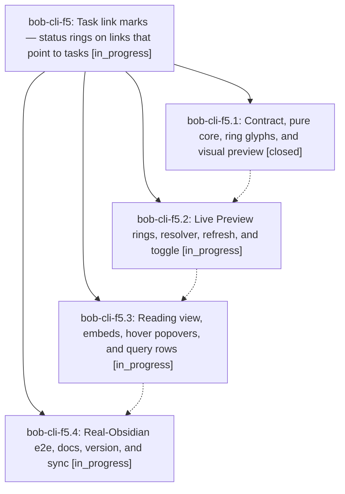

# Bead: bob-cli-f5 — Task link marks — status rings on links that point to tasks

[Bead Pages](../README.md) / bob-cli-f5

**Status:** ◐ in_progress · **Type:** ▸ plan · **Tier:** epic
**Owner:** `bryanbugyi34@gmail.com` · **Created by:** [bbugyi200.athena.16q](https://github.com/bobs-org/bob-cli--agents/blob/main/sessions/bbugyi200.athena.16q.md) · **Assignee:** `bob-cli-f5.land`
**Created:** 2026-11-01 09:24:20 EST
**Plan:** [202611/task\_link\_marks.md](https://github.com/bobs-org/bob-cli--plans/blob/main/202611/task_link_marks.md)

<!-- sase:links:start -->

## Links

| Relation | Artifact | Why |
| --- | --- | --- |
| implemented-by | [plan:202611/task_link_marks.md][1] | derived from the plan's `bead_id:` frontmatter field |

[1]: https://github.com/bobs-org/bob-cli--plans/blob/main/202611/task_link_marks.md

<!-- sase:links:end -->

## Description

Every rendered link whose target is a `#task` line wears a small status ring (Ready, Next, In Progress, Blocked, Done, Cancelled) in Live Preview and rendered views, so Bryan can tell at a glance which links point to tasks and what state those tasks are in. Links to notes, headings, and non-task blocks stay exactly as they are, nothing is ever written to the vault, and a session toggle restores plain links.

## Phases

| Bead | Title | Status | Size | Created | Agents | Commits |
|---|---|---|---|---|---:|---:|
| [bob-cli-f5.1](bob-cli-f5.1.md) | Contract, pure core, ring glyphs, and visual preview | ✓ closed | medium | 2026-11-01 | 1 | 2 |
| [bob-cli-f5.2](bob-cli-f5.2.md) | Live Preview rings, resolver, refresh, and toggle | ◐ in_progress | medium | 2026-11-01 | 1 | 0 |
| [bob-cli-f5.3](bob-cli-f5.3.md) | Reading view, embeds, hover popovers, and query rows | ◐ in_progress | medium | 2026-11-01 | 1 | 0 |
| [bob-cli-f5.4](bob-cli-f5.4.md) | Real-Obsidian e2e, docs, version, and sync | ◐ in_progress | medium | 2026-11-01 | 1 | 0 |

## Lineage

## Agents

| Agent | Bead | Commits |
|---|---|---:|
| [bbugyi200.athena.bob-cli-f5.1](https://github.com/bobs-org/bob-cli--agents/blob/main/agents/bbugyi200.athena.bob-cli-f5.1/README.md) | [bob-cli-f5.1](bob-cli-f5.1.md) | 2 |
| [bbugyi200.athena.bob-cli-f5.2](https://github.com/bobs-org/bob-cli--agents/blob/main/agents/bbugyi200.athena.bob-cli-f5.2/README.md) | [bob-cli-f5.2](bob-cli-f5.2.md) | 0 |
| [bbugyi200.athena.bob-cli-f5.3](https://github.com/bobs-org/bob-cli--agents/blob/main/agents/bbugyi200.athena.bob-cli-f5.3/README.md) | [bob-cli-f5.3](bob-cli-f5.3.md) | 0 |
| [bbugyi200.athena.bob-cli-f5.4](https://github.com/bobs-org/bob-cli--agents/blob/main/agents/bbugyi200.athena.bob-cli-f5.4/README.md) | [bob-cli-f5.4](bob-cli-f5.4.md) | 0 |
| [bbugyi200.athena.bob-cli-f5.land](https://github.com/bobs-org/bob-cli--agents/blob/main/agents/bbugyi200.athena.bob-cli-f5.land/README.md) | [bob-cli-f5](README.md) | 0 |

## Commits

| Repo | Commit | Subject | Bead | Committed |
|---|---|---|---|---|
| bob-cli | [`a1233eb`](https://github.com/bobs-org/bob-cli/commit/a1233eb8f4fa3bded9df99d3f289328b15e1681f) | feat(task-link-marks): display contract, registry, and docs links | [bob-cli-f5.1](bob-cli-f5.1.md) | 2026-11-01 09:49:06 EST |
| bob-plugins | [`bob-plugins@a67b8cd`](https://github.com/bobs-org/bob-plugins/commit/a67b8cddff9b4638e4b4c2342642063ef176c77b) | feat(task-link-marks): pure core, ring CSS, preview, and conformance tests | [bob-cli-f5.1](bob-cli-f5.1.md) | 2026-11-01 09:49:22 EST |
