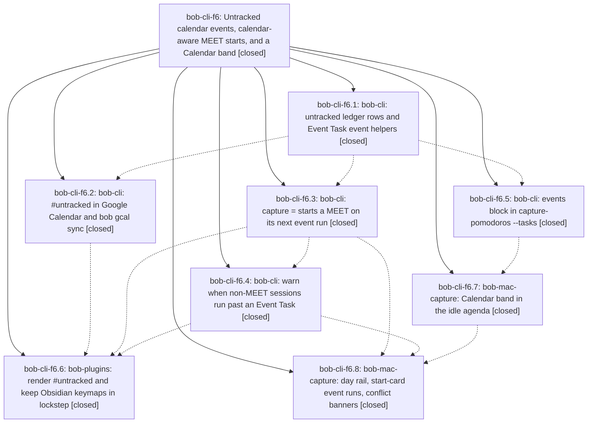

# Bead: bob-cli-f6 — Untracked calendar events, calendar-aware MEET starts, and a Calendar band

[Bead Pages](../README.md) / bob-cli-f6

**Status:** ✓ closed · **Resolution:** done · **Type:** ▸ plan · **Tier:** epic
**Owner:** `bryanbugyi34@gmail.com` · **Created by:** [bbugyi200.apollo.bv](https://github.com/bobs-org/bob-cli--agents/blob/main/sessions/bbugyi200.apollo.bv.md) · **Assignee:** `bob-cli-f6.land`
**Created:** 2026-11-01 11:24:13 EST · **Closed:** 2026-11-01 21:20:50 EST
**Plan:** [202611/untracked\_calendar\_events.md](https://github.com/bobs-org/bob-cli--plans/blob/main/202611/untracked_calendar_events.md)

<!-- sase:links:start -->

## Links

| Relation | Artifact | Why |
| --- | --- | --- |
| implemented-by | [plan:202611/untracked_calendar_events.md][1] | derived from the plan's `bead_id:` frontmatter field |

_Plus 7 automatic references — see [Referenced By](#referenced-by)._

[1]: https://github.com/bobs-org/bob-cli--plans/blob/main/202611/untracked_calendar_events.md

<!-- sase:links:end -->

## Description

A Google Calendar event tagged #untracked becomes an #untracked Event Task that is still linked under a MEET Pomodoro but never counted as tracked time; = starts a MEET on the real span of its next back-to-back events; non-MEET sessions warn before running into an event; and Bob Mac Capture's idle view shows a glanceable, beautiful Calendar band.

## Notes

[2026-11-02T02:00:22Z · bob-cli-f6.land] LAND TRIAGE (bob-cli-f6.land, 2026-11-02) of every PROPOSED FOLLOW-UP plus landing-review findings: (1) f6.4 #1 clippy::filter_map_bool_then in capture_pomodoros_agenda.rs — DECLINED, already fixed by f490d88f (bob-cli-fc.1); just check fmt+clippy pass on master. (2) f6.6 #1 five pre-existing bob-plugins test failures — duplicates, +1 recorded on bob-cli-f1 (command-mode-sheet-sequence-dom), bob-cli-et (gcal-events + freshness-namespace real date), bob-cli-eh (note-ready + relation-index startup). (3) f6.8 #1 strict Swift format diagnostics on the clean base — DECLINED: CI's Lint Swift formatting step is non-strict and passes; the strict warnings are a pre-existing whole-repo baseline (f6.7 saw 2134 on pristine HEAD) and a repo-wide reformat conflicts with bob-mac-capture's format-only-changed-lines rule. (4) f6.8 #2 import the agenda-events render into docs — NEW TASK bob-cli-fg (depends on bob-cli-f3, master CI green). (5) Landing review: 7 baseline Mac XCTest failures — +1 on bob-cli-f3. (6) Landing review: bob-plugins keep-moving tests pinned to 2026-11-01 — DISCOVERED ISSUE note on active epic bob-cli-fb (caused by fb.4). (7) Landing review: schedule-work-log test pinned to 2026-11-02 — NEW TASK bob-cli-ff (closed bob-cli-fd.2 origin). (8) Declined as advisory: Obsidian se<X> restart can re-warn for an already-crossed event (Notice only); vault task-status-cycler main.js deploy drift is unrelated to f6 (next bob plugins sync fixes it). Unverified risk noted, no bead: #untracked Live Preview mark may draw a nested second dashed outline (styles.css also outlines .bob-calendar-event-untracked .cm-hashtag); no DOM-level Live Preview test exists. Epic-caused remaining work (bob-mac-capture CI compile error, wrong Control-J assertion, boundary-refresh respawn loop, fixture drift, far-run banner polish) goes to a landing tale.

[2026-11-02T02:20:50Z · bob-cli-f6.land--1] Landing fixes: Calendar clear bands retain all-day entries; boundary refresh fires once per distinct event boundary and resets on panel hide/day/snapshot; event-run warnings render inline Markdown with plain accessible copy; updated Control-J expectation, appearance-test environment key, and untracked-session fixture; clarified idle-agenda docs. Verification: just portable-check passed on Linux Athena (1,926 tests, 0 failures); just docs-check passed (447 passed, 1 skipped; all implemented gates passed). macOS targets remain unverified because the Mac host was unreachable. The bob-cli checkout has no just symvision recipe.

## Phases

| Bead | Title | Status | Size | Created | Agents | Commits |
|---|---|---|---|---|---:|---:|
| [bob-cli-f6.1](bob-cli-f6.1.md) | bob-cli: untracked ledger rows and Event Task event helpers | ✓ closed | medium | 2026-11-01 | 1 | 1 |
| [bob-cli-f6.2](bob-cli-f6.2.md) | bob-cli: #untracked in Google Calendar and bob gcal sync | ✓ closed | medium | 2026-11-01 | 1 | 1 |
| [bob-cli-f6.3](bob-cli-f6.3.md) | bob-cli: capture = starts a MEET on its next event run | ✓ closed | medium | 2026-11-01 | 1 | 1 |
| [bob-cli-f6.4](bob-cli-f6.4.md) | bob-cli: warn when non-MEET sessions run past an Event Task | ✓ closed | medium | 2026-11-01 | 1 | 2 |
| [bob-cli-f6.5](bob-cli-f6.5.md) | bob-cli: events block in capture-pomodoros --tasks | ✓ closed | medium | 2026-11-01 | 1 | 1 |
| [bob-cli-f6.6](bob-cli-f6.6.md) | bob-plugins: render #untracked and keep Obsidian keymaps in lockstep | ✓ closed | medium | 2026-11-01 | 1 | 2 |
| [bob-cli-f6.7](bob-cli-f6.7.md) | bob-mac-capture: Calendar band in the idle agenda | ✓ closed | medium | 2026-11-01 | 1 | 1 |
| [bob-cli-f6.8](bob-cli-f6.8.md) | bob-mac-capture: day rail, start-card event runs, conflict banners | ✓ closed | medium | 2026-11-01 | 1 | 1 |

## Lineage

## Agents

| Agent | Bead | Commits |
|---|---|---:|
| [bbugyi200.apollo.bob-cli-f6.1](https://github.com/bobs-org/bob-cli--agents/blob/main/sessions/bbugyi200.apollo.bob-cli-f6.1.md) | [bob-cli-f6.1](bob-cli-f6.1.md) | 1 |
| [bbugyi200.apollo.bob-cli-f6.2](https://github.com/bobs-org/bob-cli--agents/blob/main/agents/bbugyi200.apollo.bob-cli-f6.2/README.md) | [bob-cli-f6.2](bob-cli-f6.2.md) | 1 |
| [bbugyi200.apollo.bob-cli-f6.3](https://github.com/bobs-org/bob-cli--agents/blob/main/agents/bbugyi200.apollo.bob-cli-f6.3/README.md) | [bob-cli-f6.3](bob-cli-f6.3.md) | 1 |
| [bbugyi200.apollo.bob-cli-f6.4](https://github.com/bobs-org/bob-cli--agents/blob/main/agents/bbugyi200.apollo.bob-cli-f6.4/README.md) | [bob-cli-f6.4](bob-cli-f6.4.md) | 2 |
| [bbugyi200.apollo.bob-cli-f6.5](https://github.com/bobs-org/bob-cli--agents/blob/main/agents/bbugyi200.apollo.bob-cli-f6.5/README.md) | [bob-cli-f6.5](bob-cli-f6.5.md) | 1 |
| [bbugyi200.apollo.bob-cli-f6.6](https://github.com/bobs-org/bob-cli--agents/blob/main/agents/bbugyi200.apollo.bob-cli-f6.6/README.md) | [bob-cli-f6.6](bob-cli-f6.6.md) | 2 |
| [bbugyi200.apollo.bob-cli-f6.7](https://github.com/bobs-org/bob-cli--agents/blob/main/agents/bbugyi200.apollo.bob-cli-f6.7/README.md) | [bob-cli-f6.7](bob-cli-f6.7.md) | 1 |
| [bbugyi200.apollo.bob-cli-f6.8](https://github.com/bobs-org/bob-cli--agents/blob/main/sessions/bbugyi200.apollo.bob-cli-f6.8.md) | [bob-cli-f6.8](bob-cli-f6.8.md) | 1 |
| [bbugyi200.apollo.bob-cli-f6.land](https://github.com/bobs-org/bob-cli--agents/blob/main/sessions/bbugyi200.apollo.bob-cli-f6.land.md) | [bob-cli-f6](README.md) | 2 |

## Commits

| Repo | Commit | Subject | Bead | Committed |
|---|---|---|---|---|
| bob-cli | [`6d39305`](https://github.com/bobs-org/bob-cli/commit/6d39305a8cc4d39b2c2213c8b9e702cfacb648b4) | feat(pomodoro)!: omit untracked sessions from clocks and counts | [bob-cli-f6.1](bob-cli-f6.1.md) | 2026-11-01 13:19:50 EST |
| bob-cli | [`a6671b2`](https://github.com/bobs-org/bob-cli/commit/a6671b249fb2ec50c58f1b8fb6b6a0e1d7402a78) | feat(gcal)!: support #untracked calendar events end to end | [bob-cli-f6.2](bob-cli-f6.2.md) | 2026-11-01 14:04:46 EST |
| bob-cli | [`83e1196`](https://github.com/bobs-org/bob-cli/commit/83e11967fd9290816a09c422eccb4cd1af98f458) | feat(capture): add events to pomodoro task agenda | [bob-cli-f6.5](bob-cli-f6.5.md) | 2026-11-01 14:31:01 EST |
| bob-cli | [`eda4dfc`](https://github.com/bobs-org/bob-cli/commit/eda4dfc30245469287f17b796531e7cc98893a17) | feat(capture): start a MEET on its next event run | [bob-cli-f6.3](bob-cli-f6.3.md) | 2026-11-01 15:06:28 EST |
| bob-mac-capture | [`bob-mac-capture@28293b2`](https://github.com/bobs-org/bob-mac-capture/commit/28293b25350e7a20bdb03604a6c931851692434d) | feat(mac-capture): add the Calendar band to the idle agenda | [bob-cli-f6.7](bob-cli-f6.7.md) | 2026-11-01 15:12:45 EST |
| bob-cli | [`273e09a`](https://github.com/bobs-org/bob-cli/commit/273e09a7fd870f235c4cbe9ff6483b0909b5f778) | feat(capture): warn when a non-MEET session runs past an Event Task | [bob-cli-f6.4](bob-cli-f6.4.md) | 2026-11-01 16:38:31 EST |
| bob-cli | [`3980489`](https://github.com/bobs-org/bob-cli/commit/39804896ce402ae95e807badc03fc228c2a151ed) | fix(capture): keep keep-moving goldens and clippy green | [bob-cli-f6.4](bob-cli-f6.4.md) | 2026-11-01 16:40:42 EST |
| bob-cli | [`96155ed`](https://github.com/bobs-org/bob-cli/commit/96155ed5a81959c2414652fb50965ec658a4f050) | docs(fixtures): point meet\_event\_run mirror at bob-ledger-tools | [bob-cli-f6.6](bob-cli-f6.6.md) | 2026-11-01 17:41:43 EST |
| bob-plugins | [`bob-plugins@7dbbb6d`](https://github.com/bobs-org/bob-plugins/commit/7dbbb6debde93028654342eedeed4ae1deefc71b) | feat(ledger-tools): render #untracked and mirror calendar-aware MEET starts | [bob-cli-f6.6](bob-cli-f6.6.md) | 2026-11-01 17:42:24 EST |
| bob-mac-capture | [`bob-mac-capture@f520515`](https://github.com/bobs-org/bob-mac-capture/commit/f5205151da4da2ca1643eef3df2c8c16c2f33d37) | fix(mac-capture): restore the conflict JSON brace in the event-conflict decode test | [bob-cli-f6.8](bob-cli-f6.8.md) | 2026-11-01 19:58:22 EST |
| bob-mac-capture | [`bob-mac-capture@6f13e48`](https://github.com/bobs-org/bob-mac-capture/commit/6f13e48266c8a69f2774bc47769c2e4aad89022e) | fix(mac-capture): resolve Calendar band landing issues | [bob-cli-f6](README.md) | 2026-11-01 21:22:12 EST |
| bob-cli--plans | [`bob-cli--plans@f12d148`](https://github.com/bobs-org/bob-cli--plans/commit/f12d14820251d93c77e183185c464801945bdc2c) | docs(plans): mark untracked calendar plan complete | [bob-cli-f6](README.md) | 2026-11-01 21:22:44 EST |

<!-- sase:referenced-by:start -->

## Referenced By

| Relation | Artifact | Why | Uses |
| --- | --- | --- | ---: |
| read-by | [agent:bob-cli-f6.3][1] | epic overview | 1 |
| read-by | [agent:research.2z.cdx][2] | Understand accepted untracked calendar epic scope and progress | 1 |
| read-by | [agent:research.2z.cld][3] | Context for untracked pomodoro research (epic plan) | 1 |
| read-by | [agent:research.2z.final][4] | Check f6 untracked-events epic phase state for the consolidated research report | 1 |
| read-by | [agent:research.2z.gem][5] | Understand untracked calendar events epic context | 1 |
| read-by | [agent:research.2z.grk][6] | Need epic context for untracked calendar events and the original skip-stats plan | 1 |
| read-by | [agent:research.2z.mus][7] | research untracked pomodoro design context | 1 |

[1]: https://github.com/bobs-org/bob-cli--agents/blob/main/agents/bbugyi200.apollo.bob-cli-f6.3/README.md
[2]: https://github.com/bobs-org/bob-cli--agents/blob/main/agents/bbugyi200.apollo.research.2z.cdx/README.md
[3]: https://github.com/bobs-org/bob-cli--agents/blob/main/agents/bbugyi200.apollo.research.2z.cld/README.md
[4]: https://github.com/bobs-org/bob-cli--agents/blob/main/agents/bbugyi200.apollo.research.2z.final/README.md
[5]: https://github.com/bobs-org/bob-cli--agents/blob/main/agents/bbugyi200.apollo.research.2z.gem/README.md
[6]: https://github.com/bobs-org/bob-cli--agents/blob/main/agents/bbugyi200.apollo.research.2z.grk/README.md
[7]: https://github.com/bobs-org/bob-cli--agents/blob/main/agents/bbugyi200.apollo.research.2z.mus/README.md

<!-- sase:referenced-by:end -->
