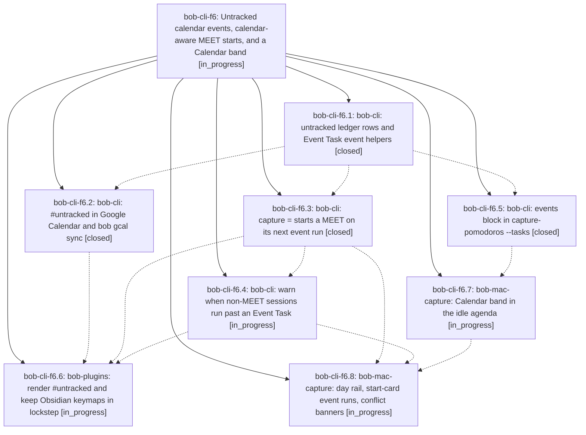

# Bead: bob-cli-f6 — Untracked calendar events, calendar-aware MEET starts, and a Calendar band

[Bead Pages](../README.md) / bob-cli-f6

**Status:** ◐ in_progress · **Type:** ▸ plan · **Tier:** epic
**Owner:** `bryanbugyi34@gmail.com` · **Created by:** [bbugyi200.apollo.bv](https://github.com/bobs-org/bob-cli--agents/blob/main/sessions/bbugyi200.apollo.bv.md) · **Assignee:** `bob-cli-f6.land`
**Created:** 2026-11-01 11:24:13 EST
**Plan:** [202611/untracked\_calendar\_events.md](https://github.com/bobs-org/bob-cli--plans/blob/main/202611/untracked_calendar_events.md)

<!-- sase:links:start -->

## Links

| Relation | Artifact | Why |
| --- | --- | --- |
| implemented-by | [plan:202611/untracked_calendar_events.md][1] | derived from the plan's `bead_id:` frontmatter field |

[1]: https://github.com/bobs-org/bob-cli--plans/blob/main/202611/untracked_calendar_events.md

<!-- sase:links:end -->

## Description

A Google Calendar event tagged #untracked becomes an #untracked Event Task that is still linked under a MEET Pomodoro but never counted as tracked time; = starts a MEET on the real span of its next back-to-back events; non-MEET sessions warn before running into an event; and Bob Mac Capture's idle view shows a glanceable, beautiful Calendar band.

## Phases

| Bead | Title | Status | Size | Created | Agents | Commits |
|---|---|---|---|---|---:|---:|
| [bob-cli-f6.1](bob-cli-f6.1.md) | bob-cli: untracked ledger rows and Event Task event helpers | ✓ closed | medium | 2026-11-01 | 1 | 1 |
| [bob-cli-f6.2](bob-cli-f6.2.md) | bob-cli: #untracked in Google Calendar and bob gcal sync | ✓ closed | medium | 2026-11-01 | 1 | 1 |
| [bob-cli-f6.3](bob-cli-f6.3.md) | bob-cli: capture = starts a MEET on its next event run | ✓ closed | medium | 2026-11-01 | 1 | 1 |
| [bob-cli-f6.4](bob-cli-f6.4.md) | bob-cli: warn when non-MEET sessions run past an Event Task | ◐ in_progress | medium | 2026-11-01 | 1 | 0 |
| [bob-cli-f6.5](bob-cli-f6.5.md) | bob-cli: events block in capture-pomodoros --tasks | ✓ closed | medium | 2026-11-01 | 1 | 1 |
| [bob-cli-f6.6](bob-cli-f6.6.md) | bob-plugins: render #untracked and keep Obsidian keymaps in lockstep | ◐ in_progress | medium | 2026-11-01 | 1 | 0 |
| [bob-cli-f6.7](bob-cli-f6.7.md) | bob-mac-capture: Calendar band in the idle agenda | ◐ in_progress | medium | 2026-11-01 | 1 | 0 |
| [bob-cli-f6.8](bob-cli-f6.8.md) | bob-mac-capture: day rail, start-card event runs, conflict banners | ◐ in_progress | medium | 2026-11-01 | 1 | 0 |

## Lineage

## Agents

| Agent | Bead | Commits |
|---|---|---:|
| [bbugyi200.apollo.bob-cli-f6.1](https://github.com/bobs-org/bob-cli--agents/blob/main/sessions/bbugyi200.apollo.bob-cli-f6.1.md) | [bob-cli-f6.1](bob-cli-f6.1.md) | 1 |
| [bbugyi200.apollo.bob-cli-f6.2](https://github.com/bobs-org/bob-cli--agents/blob/main/agents/bbugyi200.apollo.bob-cli-f6.2/README.md) | [bob-cli-f6.2](bob-cli-f6.2.md) | 1 |
| [bbugyi200.apollo.bob-cli-f6.3](https://github.com/bobs-org/bob-cli--agents/blob/main/agents/bbugyi200.apollo.bob-cli-f6.3/README.md) | [bob-cli-f6.3](bob-cli-f6.3.md) | 1 |
| [bbugyi200.apollo.bob-cli-f6.4](https://github.com/bobs-org/bob-cli--agents/blob/main/agents/bbugyi200.apollo.bob-cli-f6.4/README.md) | [bob-cli-f6.4](bob-cli-f6.4.md) | 0 |
| [bbugyi200.apollo.bob-cli-f6.5](https://github.com/bobs-org/bob-cli--agents/blob/main/agents/bbugyi200.apollo.bob-cli-f6.5/README.md) | [bob-cli-f6.5](bob-cli-f6.5.md) | 1 |
| [bbugyi200.apollo.bob-cli-f6.6](https://github.com/bobs-org/bob-cli--agents/blob/main/agents/bbugyi200.apollo.bob-cli-f6.6/README.md) | [bob-cli-f6.6](bob-cli-f6.6.md) | 0 |
| [bbugyi200.apollo.bob-cli-f6.7](https://github.com/bobs-org/bob-cli--agents/blob/main/agents/bbugyi200.apollo.bob-cli-f6.7/README.md) | [bob-cli-f6.7](bob-cli-f6.7.md) | 0 |
| [bbugyi200.apollo.bob-cli-f6.8](https://github.com/bobs-org/bob-cli--agents/blob/main/agents/bbugyi200.apollo.bob-cli-f6.8/README.md) | [bob-cli-f6.8](bob-cli-f6.8.md) | 0 |
| [bbugyi200.apollo.bob-cli-f6.land](https://github.com/bobs-org/bob-cli--agents/blob/main/agents/bbugyi200.apollo.bob-cli-f6.land/README.md) | [bob-cli-f6](README.md) | 0 |

## Commits

| Repo | Commit | Subject | Bead | Committed |
|---|---|---|---|---|
| bob-cli | [`6d39305`](https://github.com/bobs-org/bob-cli/commit/6d39305a8cc4d39b2c2213c8b9e702cfacb648b4) | feat(pomodoro)!: omit untracked sessions from clocks and counts | [bob-cli-f6.1](bob-cli-f6.1.md) | 2026-11-01 13:19:50 EST |
| bob-cli | [`a6671b2`](https://github.com/bobs-org/bob-cli/commit/a6671b249fb2ec50c58f1b8fb6b6a0e1d7402a78) | feat(gcal)!: support #untracked calendar events end to end | [bob-cli-f6.2](bob-cli-f6.2.md) | 2026-11-01 14:04:46 EST |
| bob-cli | [`83e1196`](https://github.com/bobs-org/bob-cli/commit/83e11967fd9290816a09c422eccb4cd1af98f458) | feat(capture): add events to pomodoro task agenda | [bob-cli-f6.5](bob-cli-f6.5.md) | 2026-11-01 14:31:01 EST |
| bob-cli | [`eda4dfc`](https://github.com/bobs-org/bob-cli/commit/eda4dfc30245469287f17b796531e7cc98893a17) | feat(capture): start a MEET on its next event run | [bob-cli-f6.3](bob-cli-f6.3.md) | 2026-11-01 15:06:28 EST |
