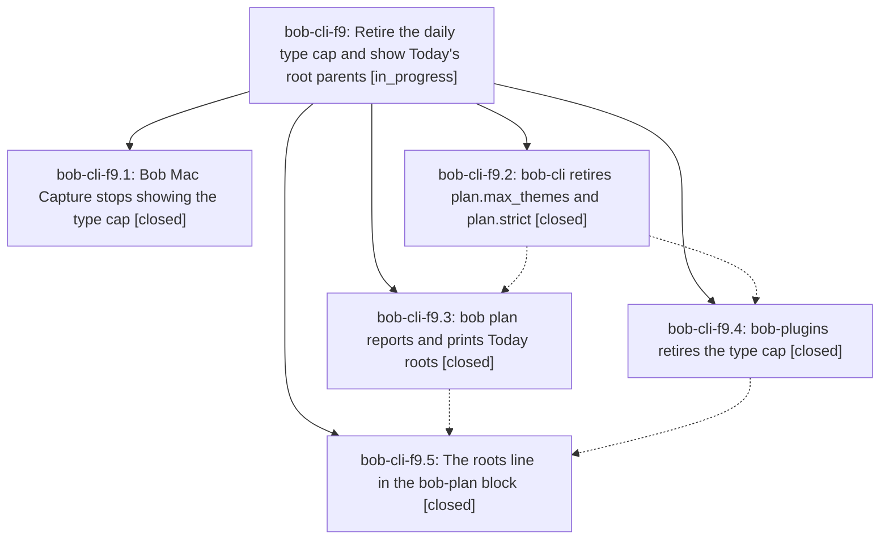

# Bead: bob-cli-f9 — Retire the daily type cap and show Today's root parents

[Bead Pages](../README.md) / bob-cli-f9

**Status:** ◐ in_progress · **Type:** ▸ plan · **Tier:** epic
**Owner:** `bryanbugyi34@gmail.com` · **Created by:** [bbugyi200.apollo.by](https://github.com/bobs-org/bob-cli--agents/blob/main/sessions/bbugyi200.apollo.by.md) · **Assignee:** `bob-cli-f9.land`
**Created:** 2026-11-01 12:12:35 EST
**Plan:** [202611/retire\_type\_cap\_today\_roots.md](https://github.com/bobs-org/bob-cli--plans/blob/main/202611/retire_type_cap_today_roots.md)

<!-- sase:links:start -->

## Links

| Relation | Artifact | Why |
| --- | --- | --- |
| implemented-by | [plan:202611/retire_type_cap_today_roots.md][1] | derived from the plan's `bead_id:` frontmatter field |

[1]: https://github.com/bobs-org/bob-cli--plans/blob/main/202611/retire_type_cap_today_roots.md

<!-- sase:links:end -->

## Description

No Bob surface counts, caps, warns about, or refuses daily task types any more (plan.max_themes and plan.strict are gone; the Task Link cap stays), and the daily bob-plan block plus `bob plan` show which root parents today's planned work goes to, as a concise, hue-ringed line after the ★ type line.

## Phases

| Bead | Title | Status | Size | Created | Agents | Commits |
|---|---|---|---|---|---:|---:|
| [bob-cli-f9.1](bob-cli-f9.1.md) | Bob Mac Capture stops showing the type cap | ✓ closed | small | 2026-11-01 | 1 | 0 |
| [bob-cli-f9.2](bob-cli-f9.2.md) | bob-cli retires plan.max\_themes and plan.strict | ✓ closed | medium | 2026-11-01 | 1 | 1 |
| [bob-cli-f9.3](bob-cli-f9.3.md) | bob plan reports and prints Today roots | ✓ closed | medium | 2026-11-01 | 1 | 1 |
| [bob-cli-f9.4](bob-cli-f9.4.md) | bob-plugins retires the type cap | ✓ closed | medium | 2026-11-01 | 1 | 1 |
| [bob-cli-f9.5](bob-cli-f9.5.md) | The roots line in the bob-plan block | ✓ closed | medium | 2026-11-01 | 1 | 1 |

## Lineage

## Agents

| Agent | Bead | Commits |
|---|---|---:|
| [bbugyi200.apollo.bob-cli-f9.1](https://github.com/bobs-org/bob-cli--agents/blob/main/agents/bbugyi200.apollo.bob-cli-f9.1/README.md) | [bob-cli-f9.1](bob-cli-f9.1.md) | 0 |
| [bbugyi200.apollo.bob-cli-f9.2](https://github.com/bobs-org/bob-cli--agents/blob/main/agents/bbugyi200.apollo.bob-cli-f9.2/README.md) | [bob-cli-f9.2](bob-cli-f9.2.md) | 1 |
| [bbugyi200.apollo.bob-cli-f9.3](https://github.com/bobs-org/bob-cli--agents/blob/main/agents/bbugyi200.apollo.bob-cli-f9.3/README.md) | [bob-cli-f9.3](bob-cli-f9.3.md) | 1 |
| [bbugyi200.apollo.bob-cli-f9.4](https://github.com/bobs-org/bob-cli--agents/blob/main/sessions/bbugyi200.apollo.bob-cli-f9.4.md) | [bob-cli-f9.4](bob-cli-f9.4.md) | 1 |
| [bbugyi200.apollo.bob-cli-f9.5](https://github.com/bobs-org/bob-cli--agents/blob/main/agents/bbugyi200.apollo.bob-cli-f9.5/README.md) | [bob-cli-f9.5](bob-cli-f9.5.md) | 1 |
| [bbugyi200.apollo.bob-cli-f9.land](https://github.com/bobs-org/bob-cli--agents/blob/main/agents/bbugyi200.apollo.bob-cli-f9.land/README.md) | [bob-cli-f9](README.md) | 0 |

## Commits

| Repo | Commit | Subject | Bead | Committed |
|---|---|---|---|---|
| bob-cli | [`3de72bf`](https://github.com/bobs-org/bob-cli/commit/3de72bfd844248d30b3c9aa0eaa01454fa6b0cc5) | feat(plan)!: retire the daily type cap and plan.strict | [bob-cli-f9.2](bob-cli-f9.2.md) | 2026-11-01 13:47:14 EST |
| bob-cli | [`b71a6c1`](https://github.com/bobs-org/bob-cli/commit/b71a6c15b80b449b01c86edd5e193c6f805bce7e) | feat(plan): report and print Today roots | [bob-cli-f9.3](bob-cli-f9.3.md) | 2026-11-01 14:32:30 EST |
| bob-plugins | [`bob-plugins@270b19b`](https://github.com/bobs-org/bob-plugins/commit/270b19bd0212b95c6413566fe8e379e90fbd85d7) | feat(plan)!: retire the daily type cap from plugins | [bob-cli-f9.4](bob-cli-f9.4.md) | 2026-11-01 15:30:28 EST |
| bob-plugins | [`bob-plugins@1d66ffd`](https://github.com/bobs-org/bob-plugins/commit/1d66ffd67e31728031216b45a52dc0a9a34c7045) | feat(plan): show Today's root parents on the bob-plan block | [bob-cli-f9.5](bob-cli-f9.5.md) | 2026-11-01 16:11:49 EST |
