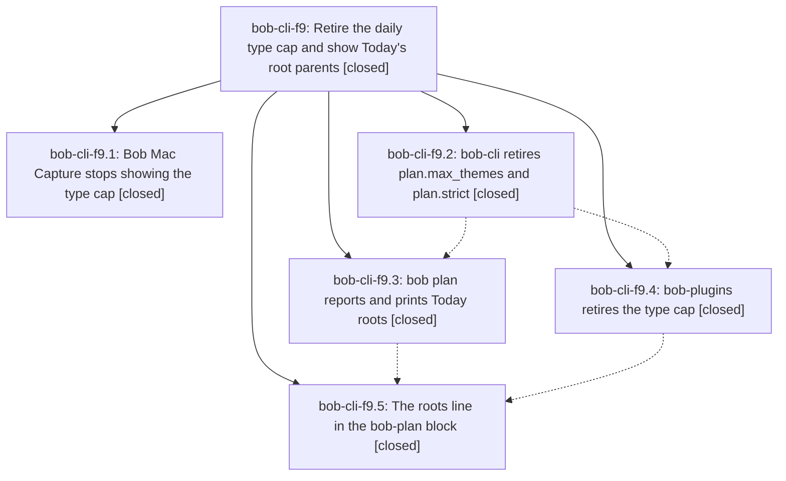

# Bead: bob-cli-f9 — Retire the daily type cap and show Today's root parents

[Bead Pages](../README.md) / bob-cli-f9

**Status:** ✓ closed · **Resolution:** done · **Type:** ▸ plan · **Tier:** epic
**Owner:** `bryanbugyi34@gmail.com` · **Created by:** [bbugyi200.apollo.by](https://github.com/bobs-org/bob-cli--agents/blob/main/sessions/bbugyi200.apollo.by.md) · **Assignee:** `bob-cli-f9.land`
**Created:** 2026-11-01 12:12:35 EST · **Closed:** 2026-11-01 18:10:02 EST
**Plan:** [202611/retire\_type\_cap\_today\_roots.md](https://github.com/bobs-org/bob-cli--plans/blob/main/202611/retire_type_cap_today_roots.md)

<!-- sase:links:start -->

## Links

| Relation | Artifact | Why |
| --- | --- | --- |
| implemented-by | [plan:202611/retire_type_cap_today_roots.md][1] | derived from the plan's `bead_id:` frontmatter field |

_Plus 1 automatic references — see [Referenced By](#referenced-by)._

[1]: https://github.com/bobs-org/bob-cli--plans/blob/main/202611/retire_type_cap_today_roots.md

<!-- sase:links:end -->

## Description

No Bob surface counts, caps, warns about, or refuses daily task types any more (plan.max_themes and plan.strict are gone; the Task Link cap stays), and the daily bob-plan block plus `bob plan` show which root parents today's planned work goes to, as a concise, hue-ringed line after the ★ type line.

## Notes

[2026-11-01T21:15:55Z · bryanbugyi34@gmail.com] The today badge in the stats dash isn't working right. See the 🔒 20261101\_161445.png screenshot for context. The epic lander agent should fix this before landing.

[2026-11-01T21:31:00Z · bryanbugyi34@gmail.com] Also, can we start grouping the root parent indicators with the types they correspond with in that daily file?

[2026-11-01T22:01:20Z · bryanbugyi34@gmail.com] Disregard the last comment, which wouldn't work like I was originally thinking.

[2026-11-01T23:10:02Z · bob-cli-f9.land] Land verification. Phases: read all 5 children and their notes. f9.1 (Mac): no Types capsule, delta chip, or cap badge remains in bob-mac-capture Sources/Tests/docs, and its later commits (28293b2, 01c753b) re-add none. f9.2 (CLI cap removal): the plan's rg gate leaves only the stale-key comment and tests, negative assertions in tests, and the mounted Mac protocol notes about ignoring old fields; the chezmoi config is cleaned (aa844572). f9.3 (roots): the release build's bob plan against ~/bob prints 'PLAN 4/13 links' and 'ROOTS bob 1 / sase 1 / sase_blog 1 / love 1', which sums to TODAY 4; JSON is schema 3 with no themes or caps.max_themes/strict, and today_roots carries the area hues (root_counts=counts and root_ring_hue=area honored; no memory edits per memory_decision_record=no). f9.4 and f9.5 (plugins): pomodoro_homes vectors are byte-identical to bob-cli; the pomodoro_themes copy matches 3de72bfd, and only fe.1's later 675330dd additions differ, which bob-cli-fe owns; targeted tests on 053a82c pass (today-roots 18, plan-budget 33, work-badge-tone 16, home-chips 31, dashboard-parity 21, block-id plan-budget 21, pomodoro-themes 29); the deployed vault plugins carry the roots line. Epic notes: #1 (dash TODAY badge showed '–') was caused by this epic. The vault's dash.md dataviewjs still required budget.themes, which the plugin API no longer returns. Fixed: dash.md now reads only the link meter (TODAY L/Lc, tone from links), node --check passes, and vault-sync committed it (142d7fdf). #2 was withdrawn by #3. Integration: reviewed bob-cli 6d39305a through 675330dd, bob-plugins 524ffc8 through 053a82c, and bob-mac-capture; none reintroduce a type cap. f9.5 already folded in 6d39305a's untracked-session rule. Fixed the missed docs/_templates/tutorial.md 'PLAN 0/5 themes' sample. just docs-check passes. just check fails 5 capture tests (named-Pomodoro links no longer write [type::] on untyped tasks), caused by 675330dd (bob-cli-fe.1: routing::land returns Consistent when effective_key is None), not this epic; recorded as DISCOVERED ISSUE on bob-cli-fe. Follow-ups: f9.4 #1 and f9.5 #2 map to bob-cli-et, f9.4 #1 and f9.5 #3 to bob-cli-eh, and f9.5 #1 to bob-cli-f1. All are existing READY ci tasks, reproduced on 053a82c, and this land agent's +1 is already recorded on each, so no new tasks. f9.2 proposed none. sase bead epic-symbols: none.

## Attachments

- 🔒 20261101\_161445.png · image/png · 2854×1686 · 270.808 KiB (private attachment)

## Phases

| Bead | Title | Status | Size | Created | Agents | Commits |
|---|---|---|---|---|---:|---:|
| [bob-cli-f9.1](bob-cli-f9.1.md) | Bob Mac Capture stops showing the type cap | ✓ closed | small | 2026-11-01 | 1 | 1 |
| [bob-cli-f9.2](bob-cli-f9.2.md) | bob-cli retires plan.max\_themes and plan.strict | ✓ closed | medium | 2026-11-01 | 1 | 2 |
| [bob-cli-f9.3](bob-cli-f9.3.md) | bob plan reports and prints Today roots | ✓ closed | medium | 2026-11-01 | 1 | 1 |
| [bob-cli-f9.4](bob-cli-f9.4.md) | bob-plugins retires the type cap | ✓ closed | medium | 2026-11-01 | 1 | 1 |
| [bob-cli-f9.5](bob-cli-f9.5.md) | The roots line in the bob-plan block | ✓ closed | medium | 2026-11-01 | 1 | 1 |

## Lineage

## Agents

| Agent | Bead | Commits |
|---|---|---:|
| [bbugyi200.apollo.bob-cli-f9.1](https://github.com/bobs-org/bob-cli--agents/blob/main/agents/bbugyi200.apollo.bob-cli-f9.1/README.md) | [bob-cli-f9.1](bob-cli-f9.1.md) | 1 |
| [bbugyi200.apollo.bob-cli-f9.2](https://github.com/bobs-org/bob-cli--agents/blob/main/agents/bbugyi200.apollo.bob-cli-f9.2/README.md) | [bob-cli-f9.2](bob-cli-f9.2.md) | 2 |
| [bbugyi200.apollo.bob-cli-f9.3](https://github.com/bobs-org/bob-cli--agents/blob/main/agents/bbugyi200.apollo.bob-cli-f9.3/README.md) | [bob-cli-f9.3](bob-cli-f9.3.md) | 1 |
| [bbugyi200.apollo.bob-cli-f9.4](https://github.com/bobs-org/bob-cli--agents/blob/main/sessions/bbugyi200.apollo.bob-cli-f9.4.md) | [bob-cli-f9.4](bob-cli-f9.4.md) | 1 |
| [bbugyi200.apollo.bob-cli-f9.5](https://github.com/bobs-org/bob-cli--agents/blob/main/agents/bbugyi200.apollo.bob-cli-f9.5/README.md) | [bob-cli-f9.5](bob-cli-f9.5.md) | 1 |
| [bbugyi200.apollo.bob-cli-f9.land](https://github.com/bobs-org/bob-cli--agents/blob/main/agents/bbugyi200.apollo.bob-cli-f9.land/README.md) | [bob-cli-f9](README.md) | 2 |

## Commits

| Repo | Commit | Subject | Bead | Committed |
|---|---|---|---|---|
| bob-mac-capture | [`bob-mac-capture@f4face9`](https://github.com/bobs-org/bob-mac-capture/commit/f4face9fe8ea965cfa12bb4b3a88dad1c5403b29) | feat(capture)!: stop showing the daily type cap | [bob-cli-f9.1](bob-cli-f9.1.md) | 2026-11-01 12:32:55 EST |
| bob-cli | [`3de72bf`](https://github.com/bobs-org/bob-cli/commit/3de72bfd844248d30b3c9aa0eaa01454fa6b0cc5) | feat(plan)!: retire the daily type cap and plan.strict | [bob-cli-f9.2](bob-cli-f9.2.md) | 2026-11-01 13:47:14 EST |
| chezmoi | [`chezmoi@aa84457`](https://github.com/bbugyi200/dotfiles/commit/aa844572a19e9bede2dce7f025c637762b23aa49) | chore: drop retired plan.max\_themes and plan.strict from bob config | [bob-cli-f9.2](bob-cli-f9.2.md) | 2026-11-01 13:50:00 EST |
| bob-cli | [`b71a6c1`](https://github.com/bobs-org/bob-cli/commit/b71a6c15b80b449b01c86edd5e193c6f805bce7e) | feat(plan): report and print Today roots | [bob-cli-f9.3](bob-cli-f9.3.md) | 2026-11-01 14:32:30 EST |
| bob-plugins | [`bob-plugins@270b19b`](https://github.com/bobs-org/bob-plugins/commit/270b19bd0212b95c6413566fe8e379e90fbd85d7) | feat(plan)!: retire the daily type cap from plugins | [bob-cli-f9.4](bob-cli-f9.4.md) | 2026-11-01 15:30:28 EST |
| bob-plugins | [`bob-plugins@1d66ffd`](https://github.com/bobs-org/bob-plugins/commit/1d66ffd67e31728031216b45a52dc0a9a34c7045) | feat(plan): show Today's root parents on the bob-plan block | [bob-cli-f9.5](bob-cli-f9.5.md) | 2026-11-01 16:11:49 EST |
| bob-cli | [`2898158`](https://github.com/bobs-org/bob-cli/commit/289815830e48eb041585f3298820405f0748193a) | docs(plan): drop the retired types meter from the tutorial template | [bob-cli-f9](README.md) | 2026-11-01 18:11:19 EST |
| bob-cli--plans | [`bob-cli--plans@0b73a8d`](https://github.com/bobs-org/bob-cli--plans/commit/0b73a8d884af768368504fe4c845dd77eba24e51) | chore(plans): mark retire\_type\_cap\_today\_roots done after bob-cli-f9 landed | [bob-cli-f9](README.md) | 2026-11-01 18:11:53 EST |

<!-- sase:referenced-by:start -->

## Referenced By

| Relation | Artifact | Why | Uses |
| --- | --- | --- | ---: |
| read-by | [agent:bob-cli-f9.5][1] | Need epic DECISIONS, phase sequence, and remaining work | 1 |

[1]: https://github.com/bobs-org/bob-cli--agents/blob/main/agents/bbugyi200.apollo.bob-cli-f9.5/README.md

<!-- sase:referenced-by:end -->
