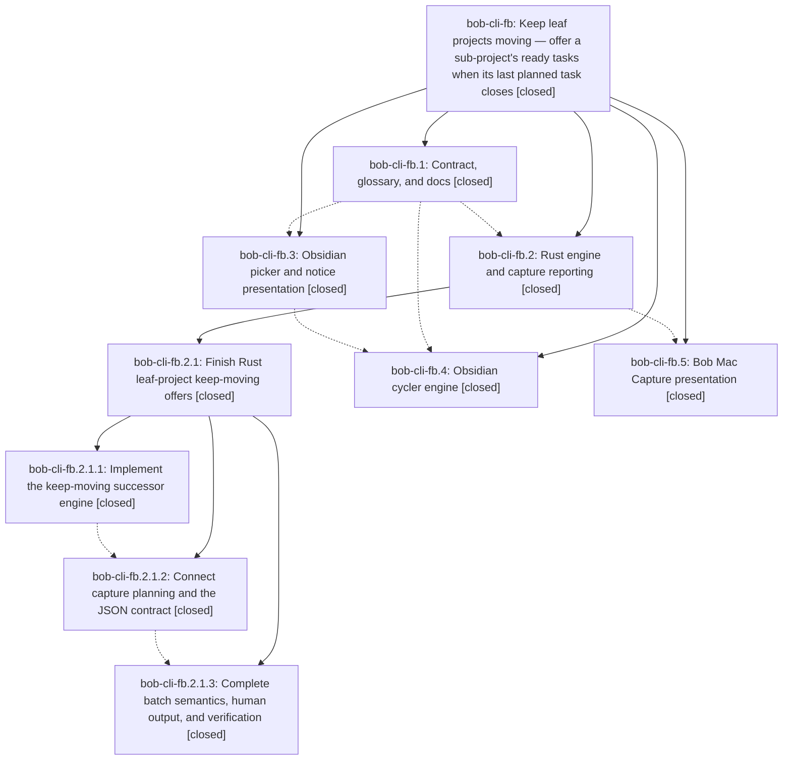

# Bead: bob-cli-fb — Keep leaf projects moving — offer a sub-project's ready tasks when its last planned task closes

[Bead Pages](../README.md) / bob-cli-fb

**Status:** ✓ closed · **Resolution:** done · **Type:** ▸ plan · **Tier:** epic
**Owner:** `bryanbugyi34@gmail.com` · **Created by:** [bbugyi200.apollo.bz](https://github.com/bobs-org/bob-cli--agents/blob/main/sessions/bbugyi200.apollo.bz.md) · **Assignee:** `bob-cli-fb.land`
**Created:** 2026-11-01 12:29:36 EST · **Closed:** 2026-11-01 23:52:15 EST
**Plan:** [202611/leaf\_project\_keep\_moving\_offers.md](https://github.com/bobs-org/bob-cli--plans/blob/main/202611/leaf_project_keep_moving_offers.md)

<!-- sase:links:start -->

## Links

| Relation | Artifact | Why |
| --- | --- | --- |
| implemented-by | [plan:202611/leaf_project_keep_moving_offers.md][1] | derived from the plan's `bead_id:` frontmatter field |
| related | [bead:bob-cli-fm][2] | Keep-moving (KM22) reuses the same comparator; the proposal came from bob-cli-fb.4 note #2 |

_Plus 3 automatic references — see [Referenced By](#referenced-by)._

[1]: https://github.com/bobs-org/bob-cli--plans/blob/main/202611/leaf_project_keep_moving_offers.md
[2]: https://github.com/bobs-org/bob-cli--beads/blob/main/pages/bob-cli-fm/README.md

<!-- sase:links:end -->

## Description

When any managed Done gesture, on any surface, closes the task behind a leaf project's last live Task Link in today's Pomodoros, Bob offers that project's ready tasks in one picker. The picker says plainly why it appeared and that the rows are not dependents. Rust and the JS cycler apply one rule, pinned by shared vectors. Obsidian, `bob capture`, and Bob Mac Capture present it with one copy and visual system.

## Notes

[2026-11-02T01:54:08Z · bob-cli-f6.land] DISCOVERED ISSUE: (found by bob-cli-f6.land during landing review, 2026-11-02) bob-plugins scripts/test-task-status-cycler-keep-moving.cjs pins const TODAY = "2026-11-01" (line 19) but the code under test reads the real date, so 5 tests fail from 2026-11-02 at bob-plugins HEAD 885c560: KM1 (daily-note link close offers keep-moving), KM25 (Esc leaves the day byte-identical), KM26 (Alt+] into Done; own-note Ctrl+Enter), KM27 (walk landing awaits the picker). Repro: node scripts/test-task-status-cycler-keep-moving.cjs (fail 5). Introduced by bob-cli-fb.4 commits 99333a5/053a82c (they fail at 053a82c itself, before bob-cli-f6's 7dbbb6d). Keeps bob-plugins npm test red; freeze the clock in the harness.

[2026-11-02T03:45:43Z · bob-cli-fc.land] DISCOVERED ISSUE (from the bob-cli-fc land tale): flake in src/native/task_complete/tests/keep_moving_tests.rs::routing_is_lazy_and_narrow_with_shared_destination (added by bob-cli-fb.2.1 in 39866275). It resets the process-global statics ROUTING_LOAD_COUNT and FULL_ROOT_SCAN_COUNT (keep_moving_tests.rs:1257-1258) and later asserts FULL_ROOT_SCAN_COUNT == 0 (line 1366: left 1, right 0). FULL_ROOT_SCAN_COUNT is bumped by every full scan_root_areas in src/native/pomodoro_themes/scan.rs:180 under cfg(test), so any other unit test running in the same cargo test process that does a full-root scan between the reset and the assertion fails it. Evidence it is a flake on an unchanged tree: pristine ccd1ada1 (git stash -u, nothing from the fc tale applied) failed cargo test --lib in 4 of 6 consecutive runs, each time with only this test failing (4375 pass, 1 fail, 1 ignored) and passed the other 2 (4376 pass); cargo test --lib routing_is_lazy_and_narrow_with_shared_destination alone passed 5 of 5. It also flipped between two identical full-workspace runs on the fc tree. None of the fc changes touch task_complete, pomodoro_themes, or these counters. Because the rate is high it will intermittently fail just check for every landing agent, even after the fmt and clippy drift is fixed. Fix direction: make the counters per-vault or per-thread (thread_local or keyed by the temp vault path) instead of process-global, or serialize the tests that read them behind one shared mutex.

[2026-11-02T04:22:23Z · bob-cli-fb.land] LAND TRIAGE (bob-cli-fb.land, 2026-11-02). Every PROPOSED FOLLOW-UP was routed through /sase_new_task. (a) fb.3 #1 and fb.4 #1, bob-plugins baseline npm test failures: reproduced at bob-plugins 885c560 and +1'd onto the existing tasks bob-cli-f1 (command-mode DOM, no Chromium), bob-cli-et (gcal-events create listener, freshness-namespace reload) and bob-cli-eh (note-ready startup storm, relation-index layout-ready). No new task. The fb.3 test-task-link-marks-motion item is declined because it now passes (2/2 in 3.4 s at 885c560). (b) fb.4 #3, the Live Preview perf bound that fails only under suite load: +1'd onto bob-cli-ej. (c) fb.4 #2, cycler localeCompare vs Rust PathBuf byte ordering: pre-existing since bob-cli-7c.4 (closed), so no duplicate and no causal active epic. Filed new task bob-cli-fm (bug, small, ready) with a related link to this epic. (d) fb.2.1.2 #1, fb.2.1.3 #1 and fb.2.1.3 #2 were already resolved by the bob-cli-fb.2.1 landing: lint fixed by f490d88f, the epic-added routing cost repaired in 39866275 with the remaining floor routed to bob-cli-5w, and the CLI mock repaired. No action needed. Epic notes #1 (KM cycler test pins TODAY=2026-11-01; 5 failures reproduced at 885c560) and #2 (routing_is_lazy_and_narrow flake from process-global counters, still present in scan.rs:25 and successors.rs:1972) were caused by this epic and stay epic work, so a closeout tale will fix them.

[2026-11-02T04:52:15Z · bob-cli-fb.land] VERIFICATION: All five phases (contract, rust incl. nested epic bob-cli-fb.2.1, nav, cycler, mac) are closed. Epic DECISIONS hold (offer_lanes=open; glossary-only memory edits leaf-project/successor-offer/task-successor; no decision record; no Cargo.toml version or CHANGELOG.md edits). Code and tests exist in bob-cli, bob-plugins, and bob-mac-capture. cargo fmt --check and just lint pass on master; sase bead epic-symbols bob-cli-fb reports none; symvision unavailable (no just recipe).
INTEGRATION REVIEW: Commits after epic start need no rewiring: =/ split and =* merge (ccd1ada1, bb92fb1c) close no tasks and the KM21 net pass diffs day text generically; 50a39221 already composes multi-note relation closes with keep-moving; gcal buffers (2e49a561) are unrelated; bob-plugins commits after 053a82c do not touch the successor code.
FOLLOW-UP TRIAGE: See the earlier LAND TRIAGE note on bob-cli-fb: +1s on bob-cli-f1, bob-cli-et, bob-cli-eh, bob-cli-ej; new task bob-cli-fm for cycler localeCompare vs Rust byte ordering; task-link-marks-motion item declined (now passes); fb.2.1 proposals already resolved by that landing.
FIXES FROM THIS TALE: (bob-cli) 'test(keep-moving): count routing and root scans per vault so the routing test is deterministic' - ROUTING_LOAD_COUNT/FULL_ROOT_SCAN_COUNT/NARROW_ROOT_SCAN_COUNT are now per-vault VaultCounters; routing_is_lazy_and_narrow_with_shared_destination passes in 4/4 consecutive full cargo test --lib runs (4398 passed, 0 failed each); just check passes. (bob-plugins) 'test(task-status-cycler): derive keep-moving test dates from the clock' - scripts/test-task-status-cycler-keep-moving.cjs now 18/18 on the real date and 18/18 under a shifted clock (2027-03-15, Date-override preload; faketime not installed), where the old file fails 5; build:check passes; npm test left only 6 failures that fail identically on the clean tree (command-mode DOM bob-cli-f1, freshness-namespace and gcal-events bob-cli-et, note-ready and relation-index bob-cli-eh, plus nav-hotkeys schedule-work-log future-scheduling Pending test); docs:check stalled in the tutorial build of a cached bob-cli clone, unrelated. bob plugins sync: 0 to copy, 3 plugins protected by other checkouts' dirty deploys, not forced.

## Phases

| Bead | Title | Status | Size | Created | Agents | Commits |
|---|---|---|---|---|---:|---:|
| [bob-cli-fb.1](bob-cli-fb.1.md) | Contract, glossary, and docs | ✓ closed | medium | 2026-11-01 | 1 | 1 |
| [bob-cli-fb.2](bob-cli-fb.2.md) | Rust engine and capture reporting | ✓ closed | large | 2026-11-01 | 1 | 0 |
| [bob-cli-fb.3](bob-cli-fb.3.md) | Obsidian picker and notice presentation | ✓ closed | medium | 2026-11-01 | 1 | 1 |
| [bob-cli-fb.4](bob-cli-fb.4.md) | Obsidian cycler engine | ✓ closed | large | 2026-11-01 | 1 | 2 |
| [bob-cli-fb.5](bob-cli-fb.5.md) | Bob Mac Capture presentation | ✓ closed | medium | 2026-11-01 | 1 | 1 |

## Lineage

## Agents

| Agent | Bead | Commits |
|---|---|---:|
| [bbugyi200.apollo.bob-cli-fb.1](https://github.com/bobs-org/bob-cli--agents/blob/main/agents/bbugyi200.apollo.bob-cli-fb.1/README.md) | [bob-cli-fb.1](bob-cli-fb.1.md) | 1 |
| [bbugyi200.apollo.bob-cli-fb.2](https://github.com/bobs-org/bob-cli--agents/blob/main/sessions/bbugyi200.apollo.bob-cli-fb.2.md) | [bob-cli-fb.2](bob-cli-fb.2.md) | 0 |
| [bbugyi200.apollo.bob-cli-fb.2.1.1](https://github.com/bobs-org/bob-cli--agents/blob/main/sessions/bbugyi200.apollo.bob-cli-fb.2.1.1.md) | [bob-cli-fb.2.1.1](bob-cli-fb.2.1.1.md) | 1 |
| [bbugyi200.apollo.bob-cli-fb.2.1.2](https://github.com/bobs-org/bob-cli--agents/blob/main/agents/bbugyi200.apollo.bob-cli-fb.2.1.2/README.md) | [bob-cli-fb.2.1.2](bob-cli-fb.2.1.2.md) | 1 |
| [bbugyi200.apollo.bob-cli-fb.2.1.3](https://github.com/bobs-org/bob-cli--agents/blob/main/agents/bbugyi200.apollo.bob-cli-fb.2.1.3/README.md) | [bob-cli-fb.2.1.3](bob-cli-fb.2.1.3.md) | 1 |
| [bbugyi200.apollo.bob-cli-fb.2.1.land](https://github.com/bobs-org/bob-cli--agents/blob/main/sessions/bbugyi200.apollo.bob-cli-fb.2.1.land.md) | [bob-cli-fb.2.1](bob-cli-fb.2.1.md) | 2 |
| [bbugyi200.apollo.bob-cli-fb.3](https://github.com/bobs-org/bob-cli--agents/blob/main/agents/bbugyi200.apollo.bob-cli-fb.3/README.md) | [bob-cli-fb.3](bob-cli-fb.3.md) | 1 |
| [bbugyi200.apollo.bob-cli-fb.4](https://github.com/bobs-org/bob-cli--agents/blob/main/sessions/bbugyi200.apollo.bob-cli-fb.4.md) | [bob-cli-fb.4](bob-cli-fb.4.md) | 2 |
| [bbugyi200.apollo.bob-cli-fb.5](https://github.com/bobs-org/bob-cli--agents/blob/main/sessions/bbugyi200.apollo.bob-cli-fb.5.md) | [bob-cli-fb.5](bob-cli-fb.5.md) | 1 |
| [bbugyi200.apollo.bob-cli-fb.land](https://github.com/bobs-org/bob-cli--agents/blob/main/sessions/bbugyi200.apollo.bob-cli-fb.land.md) | [bob-cli-fb](README.md) | 2 |

## Commits

| Repo | Commit | Subject | Bead | Committed |
|---|---|---|---|---|
| bob-cli | [`d6b16f4`](https://github.com/bobs-org/bob-cli/commit/d6b16f4f42553ec186a1846537e655714d11839f) | docs(keep-moving): pin leaf-project contract, copy, and vectors | [bob-cli-fb.1](bob-cli-fb.1.md) | 2026-11-01 12:49:50 EST |
| bob-plugins | [`bob-plugins@524ffc8`](https://github.com/bobs-org/bob-plugins/commit/524ffc85b2caed0b50a8853eca59a88f0bee9f57) | feat(navigation): render keep-moving offers in successor picker v2 and notice v2 | [bob-cli-fb.3](bob-cli-fb.3.md) | 2026-11-01 13:13:36 EST |
| bob-cli | [`f6d3084`](https://github.com/bobs-org/bob-cli/commit/f6d3084bb7796b56292f820f62b0cea5bedab472) | feat(task-complete): add leaf-project keep-moving successor engine | [bob-cli-fb.2.1.1](bob-cli-fb.2.1.1.md) | 2026-11-01 14:31:46 EST |
| bob-plugins | [`bob-plugins@99333a5`](https://github.com/bobs-org/bob-plugins/commit/99333a5b81f500a306499d88c514a082d4fb6764) | feat(task-status-cycler): offer keep-moving leaf project tasks | [bob-cli-fb.4](bob-cli-fb.4.md) | 2026-11-01 14:44:33 EST |
| bob-cli | [`ab32d58`](https://github.com/bobs-org/bob-cli/commit/ab32d58aac5a838edf405eb0a34dfb1955041d1f) | feat(capture): connect keep-moving planning and JSON contract | [bob-cli-fb.2.1.2](bob-cli-fb.2.1.2.md) | 2026-11-01 15:35:44 EST |
| bob-plugins | [`bob-plugins@053a82c`](https://github.com/bobs-org/bob-plugins/commit/053a82cefa3162071be7198837eea9284a5c3d1e) | feat(task-status-cycler): offer keep-moving leaf project tasks | [bob-cli-fb.4](bob-cli-fb.4.md) | 2026-11-01 17:14:01 EST |
| bob-cli | [`8347a46`](https://github.com/bobs-org/bob-cli/commit/8347a46d949c31078dbea284c0ed1d869e3bb952) | feat(capture): net keep-moving batches, render human copy, and gate snapshot work | [bob-cli-fb.2.1.3](bob-cli-fb.2.1.3.md) | 2026-11-01 18:23:20 EST |
| bob-cli | [`3986627`](https://github.com/bobs-org/bob-cli/commit/39866275931de4d7364fa4a4f7cb3f10cc37ce41) | feat(capture): land keep-moving repairs with lazy routing and lane names | [bob-cli-fb.2.1](bob-cli-fb.2.1.md) | 2026-11-01 21:10:59 EST |
| bob-cli--plans | [`bob-cli--plans@f703061`](https://github.com/bobs-org/bob-cli--plans/commit/f703061c6b4be2630f24a7b29afac68aa1eab2c4) | docs(plans): mark leaf\_keep\_moving\_rust done for fb.2.1 closeout | [bob-cli-fb.2.1](bob-cli-fb.2.1.md) | 2026-11-01 21:11:37 EST |
| bob-mac-capture | [`bob-mac-capture@90bd9ba`](https://github.com/bobs-org/bob-mac-capture/commit/90bd9ba5235cda78c6e5e56d45c0176bb85a6574) | feat(capture): add block presentation and pull-in choices | [bob-cli-fb.5](bob-cli-fb.5.md) | 2026-11-01 22:37:40 EST |
| bob-cli | [`37e68c0`](https://github.com/bobs-org/bob-cli/commit/37e68c095f7b1b68d9e10fc7f14553f75aee0848) | test(keep-moving): count routing and root scans per vault so the routing test is deterministic | [bob-cli-fb](README.md) | 2026-11-01 23:52:58 EST |
| bob-plugins | [`bob-plugins@c772728`](https://github.com/bobs-org/bob-plugins/commit/c77272811e40879fac3d2f14926082d256fd98e1) | test(task-status-cycler): derive keep-moving test dates from the clock | [bob-cli-fb](README.md) | 2026-11-01 23:53:36 EST |

<!-- sase:referenced-by:start -->

## Referenced By

| Relation | Artifact | Why | Uses |
| --- | --- | --- | ---: |
| read-by | [agent:bob-cli-fb.1][1] | need epic scope | 1 |
| read-by | [agent:bob-cli-fb.2.1.land--1][2] | Verify epic left open for land agent | 2 |
| read-by | [agent:research.5m.final][3] | Check keep-moving rollout state (Mac/plugin phases) since starts-after would add a fifth successor group on the same surfaces | 1 |

[1]: https://github.com/bobs-org/bob-cli--agents/blob/main/agents/bbugyi200.apollo.bob-cli-fb.1/README.md
[2]: https://github.com/bobs-org/bob-cli--agents/blob/main/sessions/bbugyi200.apollo.bob-cli-fb.2.1.land.md
[3]: https://github.com/bobs-org/bob-cli--agents/blob/main/agents/bbugyi200.apollo.research.5m.final/README.md

<!-- sase:referenced-by:end -->
