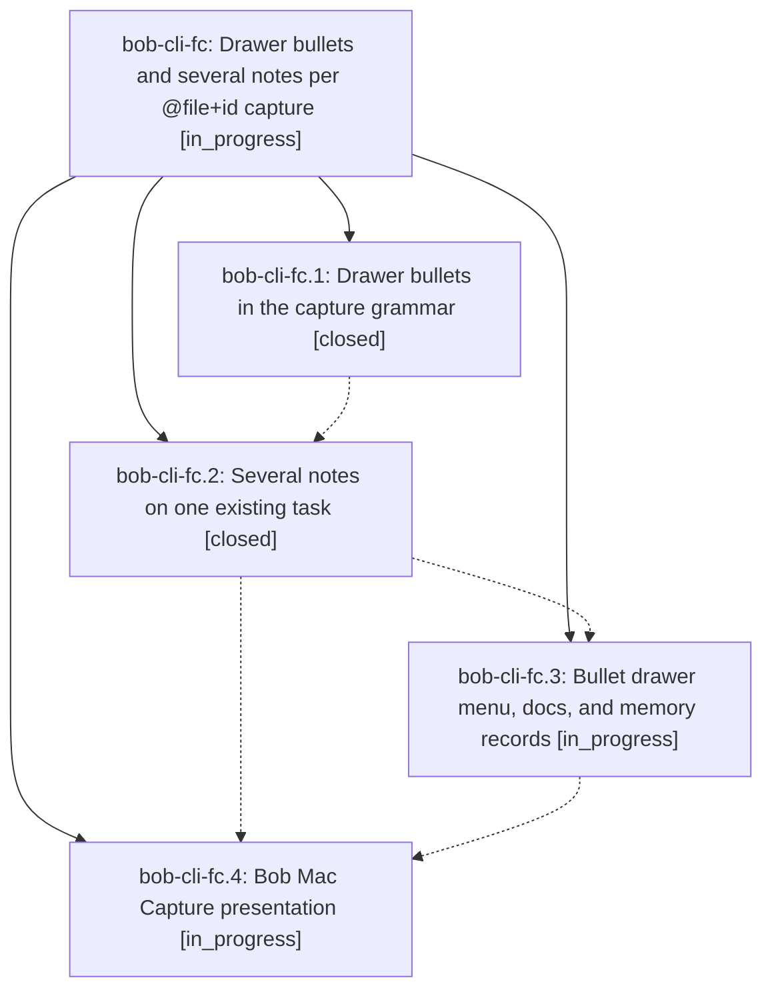

# Bead: bob-cli-fc — Drawer bullets and several notes per @file+id capture

[Bead Pages](../README.md) / bob-cli-fc

**Status:** ◐ in_progress · **Type:** ▸ plan · **Tier:** epic
**Owner:** `bryanbugyi34@gmail.com` · **Created by:** [bbugyi200.apollo.c0](https://github.com/bobs-org/bob-cli--agents/blob/main/sessions/bbugyi200.apollo.c0.md) · **Assignee:** `bob-cli-fc.land`
**Created:** 2026-11-01 12:53:08 EST
**Plan:** [202611/capture\_drawer\_bullets.md](https://github.com/bobs-org/bob-cli--plans/blob/main/202611/capture_drawer_bullets.md)

<!-- sase:links:start -->

## Links

| Relation | Artifact | Why |
| --- | --- | --- |
| implemented-by | [plan:202611/capture_drawer_bullets.md][1] | derived from the plan's `bead_id:` frontmatter field |

[1]: https://github.com/bobs-org/bob-cli--plans/blob/main/202611/capture_drawer_bullets.md

<!-- sase:links:end -->

## Description

In Bob capture, a `#` typed right after a top-level bullet's `- ` opens a drawer menu that expands to the drawer's ALL-CAPS title, and `@file+id` with no note text on its line files every top-level bullet as its own note, with drawer bullets merging into that task's drawers. Completion, `capture-parse`, preview, and commit always agree.

## Phases

| Bead | Title | Status | Size | Created | Agents | Commits |
|---|---|---|---|---|---:|---:|
| [bob-cli-fc.1](bob-cli-fc.1.md) | Drawer bullets in the capture grammar | ✓ closed | medium | 2026-11-01 | 1 | 2 |
| [bob-cli-fc.2](bob-cli-fc.2.md) | Several notes on one existing task | ✓ closed | medium | 2026-11-01 | 1 | 1 |
| [bob-cli-fc.3](bob-cli-fc.3.md) | Bullet drawer menu, docs, and memory records | ◐ in_progress | medium | 2026-11-01 | 1 | 0 |
| [bob-cli-fc.4](bob-cli-fc.4.md) | Bob Mac Capture presentation | ◐ in_progress | medium | 2026-11-01 | 1 | 0 |

## Lineage

## Agents

| Agent | Bead | Commits |
|---|---|---:|
| [bbugyi200.apollo.bob-cli-fc.1](https://github.com/bobs-org/bob-cli--agents/blob/main/agents/bbugyi200.apollo.bob-cli-fc.1/README.md) | [bob-cli-fc.1](bob-cli-fc.1.md) | 2 |
| [bbugyi200.apollo.bob-cli-fc.2](https://github.com/bobs-org/bob-cli--agents/blob/main/agents/bbugyi200.apollo.bob-cli-fc.2/README.md) | [bob-cli-fc.2](bob-cli-fc.2.md) | 1 |
| [bbugyi200.apollo.bob-cli-fc.3](https://github.com/bobs-org/bob-cli--agents/blob/main/agents/bbugyi200.apollo.bob-cli-fc.3/README.md) | [bob-cli-fc.3](bob-cli-fc.3.md) | 0 |
| [bbugyi200.apollo.bob-cli-fc.4](https://github.com/bobs-org/bob-cli--agents/blob/main/agents/bbugyi200.apollo.bob-cli-fc.4/README.md) | [bob-cli-fc.4](bob-cli-fc.4.md) | 0 |
| [bbugyi200.apollo.bob-cli-fc.land](https://github.com/bobs-org/bob-cli--agents/blob/main/agents/bbugyi200.apollo.bob-cli-fc.land/README.md) | [bob-cli-fc](README.md) | 0 |

## Commits

| Repo | Commit | Subject | Bead | Committed |
|---|---|---|---|---|
| bob-cli | [`bbd26d9`](https://github.com/bobs-org/bob-cli/commit/bbd26d97ccf24217b20896c8275f4f5bbaa67ce2) | feat(capture)!: first-level \`- #…\` is a drawer shortcut (grammar 4) | [bob-cli-fc.1](bob-cli-fc.1.md) | 2026-11-01 15:29:36 EST |
| bob-cli | [`f490d88`](https://github.com/bobs-org/bob-cli/commit/f490d88f2d6ce87e5b05cf6aec2a5b46fdcb22de) | fix(capture): keep agenda clippy, goldens, and gcal checks green | [bob-cli-fc.1](bob-cli-fc.1.md) | 2026-11-01 15:31:38 EST |
| bob-cli | [`5ac2fbc`](https://github.com/bobs-org/bob-cli/commit/5ac2fbc223ae01e6e4554edf0ddf1485e077eddd) | feat(capture): several notes on one existing task | [bob-cli-fc.2](bob-cli-fc.2.md) | 2026-11-01 18:46:17 EST |
