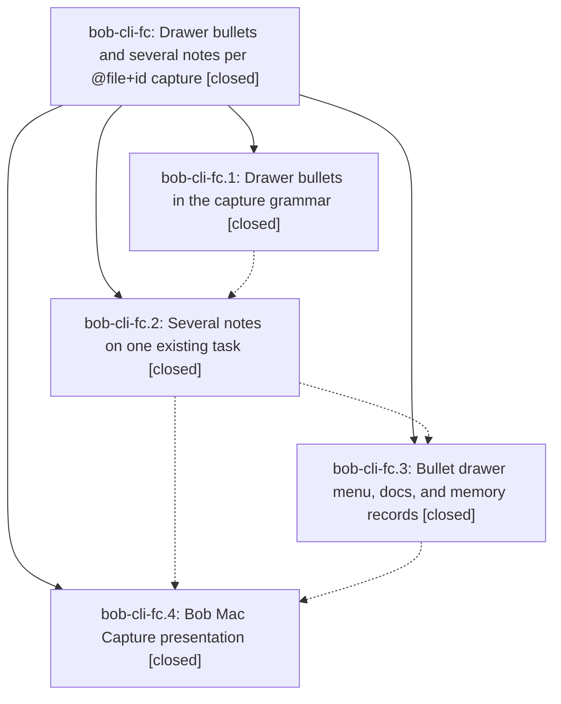

# Bead: bob-cli-fc — Drawer bullets and several notes per @file+id capture

[Bead Pages](../README.md) / bob-cli-fc

**Status:** ✓ closed · **Resolution:** done · **Type:** ▸ plan · **Tier:** epic
**Owner:** `bryanbugyi34@gmail.com` · **Created by:** [bbugyi200.apollo.c0](https://github.com/bobs-org/bob-cli--agents/blob/main/sessions/bbugyi200.apollo.c0.md) · **Assignee:** `bob-cli-fc.land`
**Created:** 2026-11-01 12:53:08 EST · **Closed:** 2026-11-01 23:00:12 EST
**Plan:** [202611/capture\_drawer\_bullets.md](https://github.com/bobs-org/bob-cli--plans/blob/main/202611/capture_drawer_bullets.md)

<!-- sase:links:start -->

## Links

| Relation | Artifact | Why |
| --- | --- | --- |
| implemented-by | [plan:202611/capture_drawer_bullets.md][1] | derived from the plan's `bead_id:` frontmatter field |

_Plus 2 automatic references — see [Referenced By](#referenced-by)._

[1]: https://github.com/bobs-org/bob-cli--plans/blob/main/202611/capture_drawer_bullets.md

<!-- sase:links:end -->

## Description

In Bob capture, a `#` typed right after a top-level bullet's `- ` opens a drawer menu that expands to the drawer's ALL-CAPS title, and `@file+id` with no note text on its line files every top-level bullet as its own note, with drawer bullets merging into that task's drawers. Completion, `capture-parse`, preview, and commit always agree.

## Notes

[2026-11-02T02:38:58Z · bob-cli-fc.land] FOLLOW-UP TRIAGE (all phase proposals reviewed): fc.1 #1, fc.3 #2, and fc.4 #2 are one explicit non-goal, third-level authored bullets; created sized feature bob-cli-fi (large) after all-status duplicate searches, recent-task sweep, and active-epic review. fc.2 #1 useless_format in keep_moving.rs is already fixed by 39804896; declined a new task because no work remains for that report. fc.3 #1 five named-Pomodoro type-write test failures were tracked on causal epic bob-cli-fe and their expectations were updated by d712168f to its accepted merge behavior; declined a duplicate task. fc.4 #3 CaptureAgendaDesignTests.swift colorSchemeContrast compile error was fixed by bob-mac-capture 6f13e48 (uses the writable _colorSchemeContrast key path), already included in linked HEAD 1b196f4; declined a new task. fc.4 #1/#4 report portable-check 1922/0 and macOS Build success but failed Test on the old snapshot; that limitation is retained, not described as green CI. Epic has no parent_id and epic-symbols currently reports no entries. Remaining fc-owned integration gaps are being reproduced for a medium tale; epic remains open.

[2026-11-02T02:43:04Z · bob-cli-fc.land] Additional integration evidence: latest linked Mac CI 41378013621 (1b196f4) fails Build at CapturePanelView.swift:4688 in eventWarningBanner. Clean-base 41377358537 (6f13e48) fails identically. The Calendar landing added local displayHeadline setup but omitted return before VStack. This is distinct from fc.4 note 3 (colorSchemeContrast, now fixed), outside fc, and f6 is closed. Created small CI task bob-cli-fj after duplicate and active-epic review. No fc Swift source changes are currently needed; record this limitation in closeout unless the task lands first.

[2026-11-02T02:44:06Z · bob-cli-fc.land] LAND AUDIT: Read every note on fc.1-.4 and the approved plan, audited Rust commits bbd26d97/f490d88f/5ac2fbc2/971d864f and Mac 1b196f4, plus intervening event agenda/warnings, Work Log stamps, keep-moving, merged-type routing/close names, and split syntax through ccd1ada1. Fresh origin/master fetch has no newer commits. Accepted continuation and authorized memory decisions are implemented. Built current head successfully with cargo build --bin bob (Cargo metadata target directory, not the stale local target/debug/bob). Three fc-owned gaps reproduced in isolated dry runs: note-less @foo+parent plus notes and a configured implemented-by or duplicate-of relation only writes the relation, skipping shared complete/cancel effects; ampersand dependency writes Blocked in file/task_blocks while parent_status_symbol/name stays Todo; capture-parse reports no diagnostic for new-task #tasks or literal TASKS drawer bullets while capture refuses reserved_drawer. These remain epic work. Validated medium tale sase_plan_drawer_capture_closeout.md covers only shared effect composition, final parent metadata, lexical reserved diagnostics, focused regression coverage, just check/docs-check, and same-turn epic closeout. No just check or green latest macOS CI is claimed. epic-symbols has no entries; parent_id is null. All proposed follow-up outcomes are recorded in prior triage notes (fi and fj are distinct out-of-scope tasks).

[2026-11-02T03:59:48Z · bob-cli-fc.land] CLOSEOUT TALE (drawer_capture_closeout): fixed the three fc-owned gaps from the land audit. (1) Multi-note relation close: plan_multi_note_sub_bullet_item now stages relations through a new shared plan_item_relations (relations_close.rs) that the ordinary item path also uses, so configured complete/cancel labels act on the owner (~) or the picked source (~~) beside several notes; the result carries relation_cancels, relation_completes, warnings, day_file, Pomodoro refs and task-block refs, and the existing conflict, recurring-task and batch-rollback refusals apply unchanged. (2) Final parent state: after all staged effects the multi-note item re-reads its parent from the staged text by block id, so parent_line, parent_text, parent_status_symbol/name and the task block agree with dependency_update and the file bytes for &, *, relation closes, and same-note mirrors that shift the parent's line. (3) Editor diagnostics: capture-parse now reports reserved_drawer on the bullet's UTF-8 byte range for reserved shortcuts (#tasks, #schedule-log, quoted literals) and nested ALL-CAPS literals (TASKS) under a new task or an existing target, using one shared rule (capture_drawers::reserved_selector_key) that the commit-time resolver also uses, so code and copy match; childless literals stay plain notes, a childless reserved shortcut keeps its drawer_notes need, new project notes keep TASKS as a structural merge, and vault-dependent ^prj structural/near-duplicate cases stay commit-time. No memory, CLI option, or grammar-version change (grammar stays 5, =/ intact). Docs: docs/capture.md. Tests added: capture::note_bullets_compose (12), keep_moving km21_multi_note_complete_label_matches_the_single_note_group, drawer_bullets parse/preview/commit agreement (4), and 7 capture_language unit tests. Verification actually run: cargo test --workspace --no-fail-fast on the final tree passed everything except routing_is_lazy_and_narrow_with_shared_destination (a pre-existing flake: pristine ccd1ada1 fails it in 4 of 6 lib runs; recorded on epic bob-cli-fb); just docs-check passed (447 passed, 1 skipped for absent font deps); the clippy gate (same rustc_gate and clippy_gate) exits 0 workspace-wide with needless_return and collapsible_if demoted to warn and none of those warnings in files this tale touched; the scratch-vault pass covered the worked example, completion acceptance into an existing task, an existing ^prj, a new task and a new project note, every original refusal, and the repaired compositions, with no repo or live-vault changes. just check itself is NOT green and was not claimed: its first step cargo fmt --all -- --check fails on clean HEAD (11 files / 47 hunks from ccd1ada1) and just lint fails with 9 denied errors on clean HEAD (6 are bob-cli-fh in task_theme.rs, 3 are from ccd1ada1 in completion.rs, item.rs, editor_pomodoro.rs); the fmt and clippy drift are recorded as DISCOVERED ISSUE notes on epic bob-cli-fe, which owns ccd1ada1, and are not fixed here.

[2026-11-02T04:00:12Z · bob-cli-fc.land] Landed. PHASE AND DRIFT AUDIT: fc.1 (grammar), fc.2 (several notes), fc.3 (completion menu, docs, authorized memory records) and fc.4 (Mac presentation) were all closed; the audit re-read every phase note, the plan and commits bbd26d97, f490d88f, 5ac2fbc2, 971d864f (Mac 1b196f4) and found drift against later commits (event agenda/start warnings, stamped Work Logs, keep-moving offers, merged-Pomodoro routing and close names, =/ split): the multi-note early return duplicated the ordinary item post-processing and omitted parts of it. THREE FIXES (tale drawer_capture_closeout): (1) multi-note items now run the shared relation write-then-close sequence (plan_item_relations), so configured complete/cancel labels act on the owner (~) or picked source (~~) with warnings, day file, Pomodoro and task-block refs, successors and keep-moving; refusals and rollback unchanged. (2) the reported parent (line, text, status, task block) is re-read from the final staged text after &, *, relation closes and same-note mirrors. (3) capture-parse reports reserved_drawer on reserved shortcuts and nested ALL-CAPS literals under new tasks and existing targets, via the same key rule and copy as the commit resolver; childless literals, new-project TASKS merges, and vault-dependent ^prj/near-duplicate cases are unchanged. Grammar stays 5; no memory, option or grammar change. VERIFICATION ACTUALLY RUN: cargo test --workspace --no-fail-fast on the final tree passed all but one pre-existing flake (routing_is_lazy_and_narrow_with_shared_destination, which fails on pristine ccd1ada1 in 4 of 6 lib runs); docs-check passed; the clippy gate exits 0 workspace-wide with the two pre-existing lint classes demoted and no hits in files this tale touched; scratch-vault checks covered the worked example, completion acceptance into an existing task, existing ^prj, new task and new project note, every original refusal and the repaired compositions, with no repo or live-vault changes. just check was NOT green and is not claimed: it fails on clean HEAD at cargo fmt --check (11 files / 47 hunks from ccd1ada1) and just lint (9 denied clippy errors: 6 are bob-cli-fh, 3 from ccd1ada1); the fmt, clippy and flake findings are recorded as DISCOVERED ISSUE notes on epics bob-cli-fe and bob-cli-fb, not fixed here. epic-symbols: no entries; no parent bead; no just symvision recipe. FOLLOW-UP OUTCOMES: fc.1 #1 / fc.3 #2 / fc.4 #2 became bob-cli-fi (large feature, third authored nesting); fc.2 #1 declined, already fixed by 39804896; fc.3 #1 declined, covered by bob-cli-fe and fixed by d712168f's accepted merge expectations; fc.4 #3 declined, fixed by Mac 6f13e48 (writable _colorSchemeContrast key path); the Calendar banner compile error is small CI task bob-cli-fj (Mac runs 41377358537 and 41378013621 fail at CapturePanelView.swift:4688, eventWarningBanner omits return), still READY and unrelated to the drawer phase. One unfiled observation: capture-parse does not report multi_note_marker (s:/dollar/%c on a multi-note item) lexically though docs/reference/json-outputs.md lists that code among drawer diagnostics; bob capture refuses it correctly. MAC CI LIMITATION: fc.4 portable-check passed 1,922 tests and its snapshot Build passed, but its Test was blocked by the old contrast-key compile failure; current Mac master 1b196f4 CI (run 41378013621) fails at Build because of bob-cli-fj, so no green macOS CI is claimed. This tale was Rust-only and made no Swift change.

## Phases

| Bead | Title | Status | Size | Created | Agents | Commits |
|---|---|---|---|---|---:|---:|
| [bob-cli-fc.1](bob-cli-fc.1.md) | Drawer bullets in the capture grammar | ✓ closed | medium | 2026-11-01 | 1 | 2 |
| [bob-cli-fc.2](bob-cli-fc.2.md) | Several notes on one existing task | ✓ closed | medium | 2026-11-01 | 1 | 1 |
| [bob-cli-fc.3](bob-cli-fc.3.md) | Bullet drawer menu, docs, and memory records | ✓ closed | medium | 2026-11-01 | 1 | 1 |
| [bob-cli-fc.4](bob-cli-fc.4.md) | Bob Mac Capture presentation | ✓ closed | medium | 2026-11-01 | 1 | 1 |

## Lineage

## Agents

| Agent | Bead | Commits |
|---|---|---:|
| [bbugyi200.apollo.bob-cli-fc.1](https://github.com/bobs-org/bob-cli--agents/blob/main/agents/bbugyi200.apollo.bob-cli-fc.1/README.md) | [bob-cli-fc.1](bob-cli-fc.1.md) | 2 |
| [bbugyi200.apollo.bob-cli-fc.2](https://github.com/bobs-org/bob-cli--agents/blob/main/agents/bbugyi200.apollo.bob-cli-fc.2/README.md) | [bob-cli-fc.2](bob-cli-fc.2.md) | 1 |
| [bbugyi200.apollo.bob-cli-fc.3](https://github.com/bobs-org/bob-cli--agents/blob/main/agents/bbugyi200.apollo.bob-cli-fc.3/README.md) | [bob-cli-fc.3](bob-cli-fc.3.md) | 1 |
| [bbugyi200.apollo.bob-cli-fc.4](https://github.com/bobs-org/bob-cli--agents/blob/main/sessions/bbugyi200.apollo.bob-cli-fc.4.md) | [bob-cli-fc.4](bob-cli-fc.4.md) | 1 |
| [bbugyi200.apollo.bob-cli-fc.land](https://github.com/bobs-org/bob-cli--agents/blob/main/sessions/bbugyi200.apollo.bob-cli-fc.land.md) | [bob-cli-fc](README.md) | 2 |

## Commits

| Repo | Commit | Subject | Bead | Committed |
|---|---|---|---|---|
| bob-cli | [`bbd26d9`](https://github.com/bobs-org/bob-cli/commit/bbd26d97ccf24217b20896c8275f4f5bbaa67ce2) | feat(capture)!: first-level \`- #…\` is a drawer shortcut (grammar 4) | [bob-cli-fc.1](bob-cli-fc.1.md) | 2026-11-01 15:29:36 EST |
| bob-cli | [`f490d88`](https://github.com/bobs-org/bob-cli/commit/f490d88f2d6ce87e5b05cf6aec2a5b46fdcb22de) | fix(capture): keep agenda clippy, goldens, and gcal checks green | [bob-cli-fc.1](bob-cli-fc.1.md) | 2026-11-01 15:31:38 EST |
| bob-cli | [`5ac2fbc`](https://github.com/bobs-org/bob-cli/commit/5ac2fbc223ae01e6e4554edf0ddf1485e077eddd) | feat(capture): several notes on one existing task | [bob-cli-fc.2](bob-cli-fc.2.md) | 2026-11-01 18:46:17 EST |
| bob-cli | [`971d864`](https://github.com/bobs-org/bob-cli/commit/971d864f6c8ca91ed78f01aca41c0f4d93643efa) | feat(capture): bullet drawer completion menu, docs, and memory records | [bob-cli-fc.3](bob-cli-fc.3.md) | 2026-11-01 20:54:25 EST |
| bob-mac-capture | [`bob-mac-capture@1b196f4`](https://github.com/bobs-org/bob-mac-capture/commit/1b196f47d518e860e0b673984c0aa015ad629ade) | feat(capture): present drawer bullet completion | [bob-cli-fc.4](bob-cli-fc.4.md) | 2026-11-01 21:29:30 EST |
| bob-cli | [`50a3922`](https://github.com/bobs-org/bob-cli/commit/50a39221291b7a08b64efd0082582f2e4e9cf9f2) | fix(capture): compose multi-note captures with relation closes and report the final parent | [bob-cli-fc](README.md) | 2026-11-01 23:02:20 EST |
| bob-cli--plans | [`bob-cli--plans@a455dd4`](https://github.com/bobs-org/bob-cli--plans/commit/a455dd428b1f348336272d26c357a50f6f687ea7) | chore(plans): mark capture\_drawer\_bullets done | [bob-cli-fc](README.md) | 2026-11-01 23:03:17 EST |

<!-- sase:referenced-by:start -->

## Referenced By

| Relation | Artifact | Why | Uses |
| --- | --- | --- | ---: |
| read-by | [agent:bob-cli-fc.2][1] | Need parent epic scope and decisions | 1 |
| read-by | [agent:bob-cli-fc.3][2] | Check existing PROPOSED FOLLOW-UP notes before adding mine | 1 |

[1]: https://github.com/bobs-org/bob-cli--agents/blob/main/agents/bbugyi200.apollo.bob-cli-fc.2/README.md
[2]: https://github.com/bobs-org/bob-cli--agents/blob/main/agents/bbugyi200.apollo.bob-cli-fc.3/README.md

<!-- sase:referenced-by:end -->
