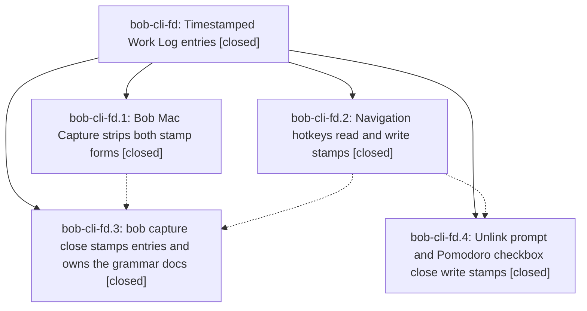

# Bead: bob-cli-fd — Timestamped Work Log entries

[Bead Pages](../README.md) / bob-cli-fd

**Status:** ✓ closed · **Resolution:** done · **Type:** ▸ plan · **Tier:** epic
**Owner:** `bryanbugyi34@gmail.com` · **Created by:** [bbugyi200.apollo.c3](https://github.com/bobs-org/bob-cli--agents/blob/main/sessions/bbugyi200.apollo.c3.md) · **Assignee:** `bob-cli-fd.land`
**Created:** 2026-11-01 15:12:25 EST · **Closed:** 2026-11-01 18:40:46 EST
**Plan:** [202611/work\_log\_timestamps.md](https://github.com/bobs-org/bob-cli--plans/blob/main/202611/work_log_timestamps.md)

<!-- sase:links:start -->

## Links

| Relation | Artifact | Why |
| --- | --- | --- |
| implemented-by | [plan:202611/work_log_timestamps.md][1] | derived from the plan's `bead_id:` frontmatter field |
| related | file:explicit:844e735243fe4ec95a86291a | attached via sase artifact create --bead |

_Plus 3 automatic references — see [Referenced By](#referenced-by)._

[1]: https://github.com/bobs-org/bob-cli--plans/blob/main/202611/work_log_timestamps.md

<!-- sase:links:end -->

## Description

Every new Work Log entry, from any of Bob's four writers, opens with one italic `*YYYY-MM-DD HH:MM*` stamp of the minute it was written. Older date-only entries stay valid and untouched, and every reader handles both forms the same way.

## Notes

[2026-11-01T22:58:37Z · bob-cli-fd.land] LAND AUDIT: Read this epic and all notes on fd.1, fd.2, fd.3, and fd.4, the approved plan, actual sources and tests, and phase commits: Mac 01c753b, plugins 74ad555 and 072b25f, CLI 50df0e41. ISO stamps were chosen; no epic commit edited memory; CLI subject has the required !. Mac strict stamp stripping, Rust shared close-now stamp and unchanged completion dates, and unlink/checkbox formatters and shared target stamps are present. Phase reports for Mac portable-check/docs and CLI just check/docs are supported by their tests and implementation. Independently passed plugin build:check and 14 focused suites covering navigation Work Logs, readers, unlink, checkbox close, keep-moving, and inbox-link runtime. Integration audit since epic creation through CLI 96155ed5, plugins 7dbbb6d, Mac 01c753b reviewed capture keep-moving/event warnings/drawer grammar/merged planners, inbox route-before-type, roots, and MEET calendar changes. They add no writer/parser and preserve timestamp paths; navigation sources have no later changes. No parent bead. epic-symbols reports no entries; main justfile has no symvision recipe. Remaining epic work is real: global adjustable-Date harness reproductions opening 2026-11-01 23:59 and submitting 2026-11-02 00:01 made Alt+N release, Move to Next, and Task Card release all write the old 23:59 stamp. 510/520/525 compute before awaited summary; 380 reuses pending opening stamp. Rendering both lane-release and scheduling summary previews after advancing clock also still shows 23:59 (380/370). Date-only writer fallbacks remain in 220/230/245 and old newly-written-entry expectations remain in lane-toggle tests. Validated medium tale sase_plan_work_log_stamp_closeout.md covers only these clock/stamp repairs, regressions, fd.2 targeted deployment, verification, and this epic closeout in the coder turn. Do not close fd until repaired.

[2026-11-01T22:58:50Z · bob-cli-fd.land] FOLLOW-UP TRIAGE COMPLETE before repair proposal: fd.4 note #1 contains five failures, also mentioned by fd.2 note #1. Following sase_new_task, searched all matching CI tasks, swept the last week, read plausible tasks, and inspected active epic scopes; no active epic credibly owns the old causes. Independently reproduced all five on clean plugins 7dbbb6d: missing Chromium -> corroborated bob-cli-f1; gcal create-listener 0!==1 and freshness reload [] -> corroborated bob-cli-et; startup scans 1!==2 and relationIndex layout-ready timeout -> corroborated bob-cli-eh. Snapshot file:explicit:844e735243fe4ec95a86291a is attached to fd. No new tasks: the proposals duplicate these three root causes. The extra wikilink performance failure in fd.2 is tracked by bob-cli-f8; its isolated five-test suite passed here, so recorded that observation on f8 without claiming a new failure/+1. No other PROPOSED FOLLOW-UP entries were present. fd.4 deployment note documents its two targeted forced syncs; fd.2 navigation sync was refused and remains explicitly in the repair tale. Carry all these outcomes into the eventual close note.

[2026-11-01T23:40:46Z · bob-cli-fd.land] Closeout tale verified and deployed. Audited phases: fd.1 Mac 01c753b, fd.2 plugins 74ad555, fd.3 CLI 50df0e41, fd.4 plugins 072b25f, with child notes (fd.2 note1 nav-stamp done, fd.4 notes1-3 triage/deploy/done). Repaired 4 clock defects: 510/520/525 sampled before prompts now sample once post-input/post-route (commit 00:01 not 23:59), 380 Task Card reuses no opening stamp (samples in write callback post-route), 196/370/380 previews sample render-time clock. Regression: new scripts/test-navigation-hotkeys-work-log-stamp-closeout.cjs (7 tests: Alt+N, linked share, Move-to-Next prompt live, Task Card live, scheduling preview live, route-gate midnight, blank/cancel) passes; updated lane-toggle date-only expectation to stamp and roll-decay frozen-date to write-stamp. Integration: reviewed plugins through 7dbbb6d and bob-cli through 96155ed5; no new Work Log writers/parsers; later plugin commits preserve stamps. Deploy: bob plugins sync -p bob-navigation-hotkeys -F (targeted, backup 20261101-183947 + 20261101-closeout), deployed main.js md5 matches built 06ba6ecf. Verification: npm run build + build:check pass, focused nav/Work Log suites pass (lane-toggle/task-link-lane/schedule-work-log/lane-walk/rotten-keep/schedule-review/project-subtree/refresh-modal 190 pass; work-log/unlink/task-card 94 pass; roll-decay 60 pass; closeout 7 pass), npm test 4839/4845 with only known 6 (freshness-namespace, gcal, note-ready, relation-index, command-mode DOM Chromium, wikilink perf). Follow-ups retained: fd.4 note1 five failures corroborate bob-cli-f1 (Chromium), bob-cli-et (gcal/freshness), bob-cli-eh (note-ready/relation-index), log file:explicit:844e735243fe4ec95a86291a; fd.2 wikilink perf tracked by bob-cli-f8; no new tasks. just symvision: no such recipe in bob-cli. Linked plan 202611/work_log_timestamps.md set done.

## Phases

| Bead | Title | Status | Size | Created | Agents | Commits |
|---|---|---|---|---|---:|---:|
| [bob-cli-fd.1](bob-cli-fd.1.md) | Bob Mac Capture strips both stamp forms | ✓ closed | small | 2026-11-01 | 1 | 1 |
| [bob-cli-fd.2](bob-cli-fd.2.md) | Navigation hotkeys read and write stamps | ✓ closed | medium | 2026-11-01 | 1 | 1 |
| [bob-cli-fd.3](bob-cli-fd.3.md) | bob capture close stamps entries and owns the grammar docs | ✓ closed | medium | 2026-11-01 | 1 | 1 |
| [bob-cli-fd.4](bob-cli-fd.4.md) | Unlink prompt and Pomodoro checkbox close write stamps | ✓ closed | medium | 2026-11-01 | 1 | 1 |

## Lineage

## Agents

| Agent | Bead | Commits |
|---|---|---:|
| [bbugyi200.apollo.bob-cli-fd.1](https://github.com/bobs-org/bob-cli--agents/blob/main/agents/bbugyi200.apollo.bob-cli-fd.1/README.md) | [bob-cli-fd.1](bob-cli-fd.1.md) | 1 |
| [bbugyi200.apollo.bob-cli-fd.2](https://github.com/bobs-org/bob-cli--agents/blob/main/agents/bbugyi200.apollo.bob-cli-fd.2/README.md) | [bob-cli-fd.2](bob-cli-fd.2.md) | 1 |
| [bbugyi200.apollo.bob-cli-fd.3](https://github.com/bobs-org/bob-cli--agents/blob/main/agents/bbugyi200.apollo.bob-cli-fd.3/README.md) | [bob-cli-fd.3](bob-cli-fd.3.md) | 1 |
| [bbugyi200.apollo.bob-cli-fd.4](https://github.com/bobs-org/bob-cli--agents/blob/main/agents/bbugyi200.apollo.bob-cli-fd.4/README.md) | [bob-cli-fd.4](bob-cli-fd.4.md) | 1 |
| [bbugyi200.apollo.bob-cli-fd.land](https://github.com/bobs-org/bob-cli--agents/blob/main/sessions/bbugyi200.apollo.bob-cli-fd.land.md) | [bob-cli-fd](README.md) | 1 |

## Commits

| Repo | Commit | Subject | Bead | Committed |
|---|---|---|---|---|
| bob-mac-capture | [`bob-mac-capture@01c753b`](https://github.com/bobs-org/bob-mac-capture/commit/01c753b0e6e045a0cc69b3d3f51302b8423b7e55) | feat(mac-capture): strip stamped Work Log dates on the close card | [bob-cli-fd.1](bob-cli-fd.1.md) | 2026-11-01 15:43:29 EST |
| bob-plugins | [`bob-plugins@74ad555`](https://github.com/bobs-org/bob-plugins/commit/74ad5556c79d5a80910e25131014c00b32a28806) | feat(nav-hotkeys): implement nav-stamp with shared label helper and single clock read | [bob-cli-fd.2](bob-cli-fd.2.md) | 2026-11-01 15:57:44 EST |
| bob-plugins | [`bob-plugins@072b25f`](https://github.com/bobs-org/bob-plugins/commit/072b25fe6e8e2ade05079ad13055809fa6422b8a) | feat(work-log): stamp unlink and Pomodoro close entries with the write instant | [bob-cli-fd.4](bob-cli-fd.4.md) | 2026-11-01 16:48:07 EST |
| bob-cli | [`50df0e4`](https://github.com/bobs-org/bob-cli/commit/50df0e41e9786e9912d00e5a77e98c2c4204c35b) | feat(capture)!: stamp close Work Log entries | [bob-cli-fd.3](bob-cli-fd.3.md) | 2026-11-01 17:22:08 EST |
| bob-plugins | [`bob-plugins@885c560`](https://github.com/bobs-org/bob-plugins/commit/885c560f66be3879a8599afcb7e015eaf5f6b1fb) | fix(nav-hotkeys)!: sample Work Log stamps at commit/render time | [bob-cli-fd](README.md) | 2026-11-01 18:44:17 EST |

<!-- sase:referenced-by:start -->

## Referenced By

| Relation | Artifact | Why | Uses |
| --- | --- | --- | ---: |
| read-by | [agent:bob-cli-fd.1][1] | Need epic plan, notes, and remaining work | 1 |
| read-by | [agent:bob-cli-fd.2][2] | Need epic scope for phase fd.2 | 1 |
| read-by | [agent:bob-cli-fd.4][3] | Need epic notes | 1 |

[1]: https://github.com/bobs-org/bob-cli--agents/blob/main/agents/bbugyi200.apollo.bob-cli-fd.1/README.md
[2]: https://github.com/bobs-org/bob-cli--agents/blob/main/agents/bbugyi200.apollo.bob-cli-fd.2/README.md
[3]: https://github.com/bobs-org/bob-cli--agents/blob/main/agents/bbugyi200.apollo.bob-cli-fd.4/README.md

<!-- sase:referenced-by:end -->
