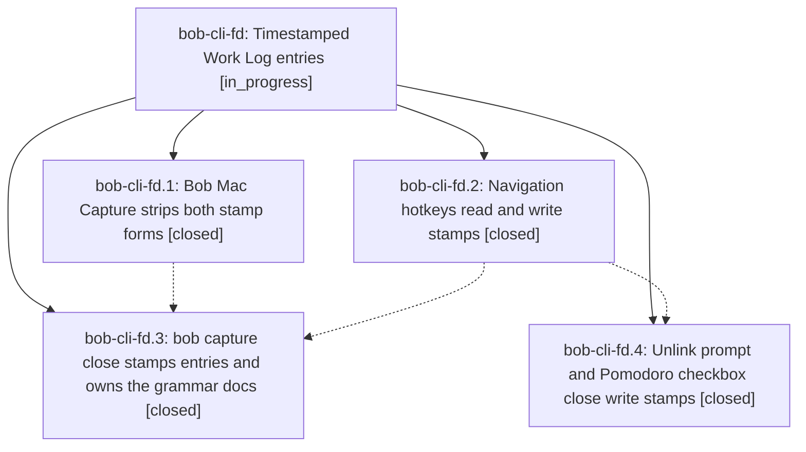

# Bead: bob-cli-fd — Timestamped Work Log entries

[Bead Pages](../README.md) / bob-cli-fd

**Status:** ◐ in_progress · **Type:** ▸ plan · **Tier:** epic
**Owner:** `bryanbugyi34@gmail.com` · **Created by:** [bbugyi200.apollo.c3](https://github.com/bobs-org/bob-cli--agents/blob/main/sessions/bbugyi200.apollo.c3.md) · **Assignee:** `bob-cli-fd.land`
**Created:** 2026-11-01 15:12:25 EST
**Plan:** [202611/work\_log\_timestamps.md](https://github.com/bobs-org/bob-cli--plans/blob/main/202611/work_log_timestamps.md)

<!-- sase:links:start -->

## Links

| Relation | Artifact | Why |
| --- | --- | --- |
| implemented-by | [plan:202611/work_log_timestamps.md][1] | derived from the plan's `bead_id:` frontmatter field |

_Plus 3 automatic references — see [Referenced By](#referenced-by)._

[1]: https://github.com/bobs-org/bob-cli--plans/blob/main/202611/work_log_timestamps.md

<!-- sase:links:end -->

## Description

Every new Work Log entry, from any of Bob's four writers, opens with one italic `*YYYY-MM-DD HH:MM*` stamp of the minute it was written. Older date-only entries stay valid and untouched, and every reader handles both forms the same way.

## Phases

| Bead | Title | Status | Size | Created | Agents | Commits |
|---|---|---|---|---|---:|---:|
| [bob-cli-fd.1](bob-cli-fd.1.md) | Bob Mac Capture strips both stamp forms | ✓ closed | small | 2026-11-01 | 1 | 0 |
| [bob-cli-fd.2](bob-cli-fd.2.md) | Navigation hotkeys read and write stamps | ✓ closed | medium | 2026-11-01 | 1 | 0 |
| [bob-cli-fd.3](bob-cli-fd.3.md) | bob capture close stamps entries and owns the grammar docs | ✓ closed | medium | 2026-11-01 | 1 | 1 |
| [bob-cli-fd.4](bob-cli-fd.4.md) | Unlink prompt and Pomodoro checkbox close write stamps | ✓ closed | medium | 2026-11-01 | 1 | 0 |

## Lineage

## Agents

| Agent | Bead | Commits |
|---|---|---:|
| [bbugyi200.apollo.bob-cli-fd.1](https://github.com/bobs-org/bob-cli--agents/blob/main/agents/bbugyi200.apollo.bob-cli-fd.1/README.md) | [bob-cli-fd.1](bob-cli-fd.1.md) | 0 |
| [bbugyi200.apollo.bob-cli-fd.2](https://github.com/bobs-org/bob-cli--agents/blob/main/agents/bbugyi200.apollo.bob-cli-fd.2/README.md) | [bob-cli-fd.2](bob-cli-fd.2.md) | 0 |
| [bbugyi200.apollo.bob-cli-fd.3](https://github.com/bobs-org/bob-cli--agents/blob/main/agents/bbugyi200.apollo.bob-cli-fd.3/README.md) | [bob-cli-fd.3](bob-cli-fd.3.md) | 1 |
| [bbugyi200.apollo.bob-cli-fd.4](https://github.com/bobs-org/bob-cli--agents/blob/main/agents/bbugyi200.apollo.bob-cli-fd.4/README.md) | [bob-cli-fd.4](bob-cli-fd.4.md) | 0 |
| [bbugyi200.apollo.bob-cli-fd.land](https://github.com/bobs-org/bob-cli--agents/blob/main/agents/bbugyi200.apollo.bob-cli-fd.land/README.md) | [bob-cli-fd](README.md) | 0 |

## Commits

| Repo | Commit | Subject | Bead | Committed |
|---|---|---|---|---|
| bob-cli | [`50df0e4`](https://github.com/bobs-org/bob-cli/commit/50df0e41e9786e9912d00e5a77e98c2c4204c35b) | feat(capture)!: stamp close Work Log entries | [bob-cli-fd.3](bob-cli-fd.3.md) | 2026-11-01 17:22:08 EST |

<!-- sase:referenced-by:start -->

## Referenced By

| Relation | Artifact | Why | Uses |
| --- | --- | --- | ---: |
| read-by | [agent:bob-cli-fd.1][1] | Need epic plan, notes, and remaining work | 1 |
| read-by | [agent:bob-cli-fd.2][2] | Need epic scope for phase fd.2 | 1 |
| read-by | [agent:bob-cli-fd.4][3] | Need epic notes | 1 |

[1]: https://github.com/bobs-org/bob-cli--agents/blob/main/agents/bbugyi200.apollo.bob-cli-fd.1/README.md
[2]: https://github.com/bobs-org/bob-cli--agents/blob/main/agents/bbugyi200.apollo.bob-cli-fd.2/README.md
[3]: https://github.com/bobs-org/bob-cli--agents/blob/main/agents/bbugyi200.apollo.bob-cli-fd.4/README.md

<!-- sase:referenced-by:end -->
