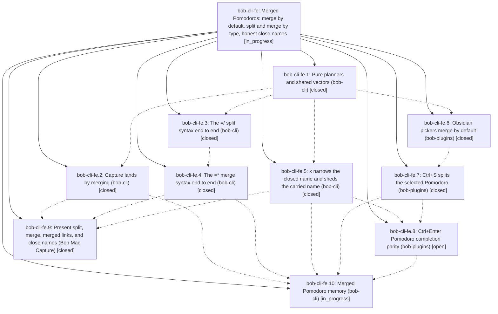

# Bead: bob-cli-fe — Merged Pomodoros: merge by default, split and merge by type, honest close names

[Bead Pages](../README.md) / bob-cli-fe

**Status:** ◐ in_progress · **Type:** ▸ plan · **Tier:** epic
**Owner:** `bryanbugyi34@gmail.com` · **Created by:** [bbugyi200.apollo.c4](https://github.com/bobs-org/bob-cli--agents/blob/main/sessions/bbugyi200.apollo.c4.md) · **Assignee:** `bob-cli-fe.land`
**Created:** 2026-11-01 16:00:42 EST
**Plan:** [202611/merged\_pomodoros.md](https://github.com/bobs-org/bob-cli--plans/blob/main/202611/merged_pomodoros.md)

<!-- sase:links:start -->

## Links

| Relation | Artifact | Why |
| --- | --- | --- |
| implemented-by | [plan:202611/merged_pomodoros.md][1] | derived from the plan's `bead_id:` frontmatter field |

_Plus 4 automatic references — see [Referenced By](#referenced-by)._

[1]: https://github.com/bobs-org/bob-cli--plans/blob/main/202611/merged_pomodoros.md

<!-- sase:links:end -->

## Description

A Pomodoro that holds several task types is a first-class merged Pomodoro. Linking or moving a task into another type's Pomodoro merges that type into the name instead of retyping the task. Capture `=*` and `=/` merge and split Pomodoros by type, and so does Obsidian Ctrl+S. `x` names the closed and carried sessions after the work that was actually done and is still planned. bob-cli, bob-plugins, and Bob Mac Capture all agree, through shared vectors.

## Notes

[2026-11-01T23:09:32Z · bob-cli-f9.land] DISCOVERED ISSUE (from the bob-cli-f9 land agent): on master 675330dd, `just check` fails 5 tests in `-p bob-obsidian --test cli`: capture::pomodoro_link::capture_named_pomodoro_updates_both_notes_and_skips_current, capture::pomodoro_link::capture_named_pomodoro_dry_run_and_failures_leave_notes_untouched, capture::project_note::capture_project_note_task_links_write_the_worked_example, capture::project_note_offer::offer_named_pomodoro_is_created_only_when_a_pick_lands_there, capture::task_theme_writes::named_capture_writes_a_type_without_a_shown_suggestion. Each expects an untyped task linked into a named Pomodoro to gain [type:: <NAME>] (e.g. expected '- [*] #task Some foobar task. [type:: BUGS] ...', got no type field). Cause: 675330dd (bob-cli-fe.1) replaced routing::retype with routing::land; land() returns LandOutcome::Consistent as soon as effective_key is None (src/native/pomodoro_themes/routing.rs:131), whereas the old retype() only short-circuited when an effective key matched and otherwise fell through to choose/Set the destination type. Callers in src/native/capture/task_theme.rs and src/native/capture_pomodoro_name.rs pass retype: true, so typeless tasks no longer get typed on landing. Either restore the typeless fall-through in land() or update the five tests if dropping the write is intended by the merged-Pomodoro contract; fe.2 (capture-link-merge) looks like the natural owner.

[2026-11-02T03:10:25Z · bob-cli-fc.land] DISCOVERED ISSUE (from the bob-cli-fc land tale): ccd1ada1 (bob-cli-fe.3, =/ split) was committed rustfmt-dirty, so the first step of just check (cargo fmt --all -- --check) fails on clean HEAD and no later step runs. Reproduce on a clean ccd1ada1 checkout: cargo fmt --all -- --check lists 11 files / 47 hunks: src/native/capture/mod.rs (6: mod/use order for pomodoro_split, pub(crate) use task_theme order, a >80-col use line), src/native/capture/output.rs (2: print_human_pomodoro_split_success call args and an if/else one-liner), src/native/capture/pomodoro_split.rs (16), src/native/capture_complete/pomodoros.rs (9), src/native/capture_language/completion.rs (2), editor_parse.rs (1: the dependency_owner_mode_word match arm), editor_pomodoro.rs (3), item.rs (2), markers.rs (1), src/native/capture_parse.rs (2), tests/cli/capture/pomodoro_split.rs (3). The repo's rustfmt.toml (max_width = 80, style_edition = 2021, from bob-cli-24) is unchanged, so this is new drift, not the old repo-wide drift. Fix is mechanical: cargo fmt --all. The fc tale deliberately did not fold it into its diff; fe.4 (=* merge) is in progress in the same files, so fixing it there avoids a conflict.

[2026-11-02T03:19:29Z · bob-cli-fc.land] DISCOVERED ISSUE (from the bob-cli-fc land tale, second clippy gate failure on clean ccd1ada1, beyond bob-cli-fh): just lint (cargo clippy --workspace --all-targets --all-features with the justfile rustc_gate and clippy_gate) fails with 9 deny errors on a tree with no fc changes applied. Six are bob-cli-fh (needless_return in src/native/capture/task_theme.rs, from b5c7ef0f/d712168f). Three are new from ccd1ada1 (bob-cli-fe.3): clippy::needless_return at src/native/capture_language/completion.rs:1079 (trailing return None;), clippy::needless_return at src/native/capture_language/item.rs:2529 (trailing return Ok(Some(parsed_capture_item_outcome(...)))), and clippy::collapsible_if at src/native/capture_language/editor_pomodoro.rs:1519 (the if let Some(lex) = lex_exact_name_after_hash(...) inside if selector.literal). git blame attributes all three lines to ccd1ada1. A lib clippy failure also stops clippy from checking the integration-test targets, so with these in place no later fe or landing agent gets a real lint verdict for tests/. Repro on the tree: bash -c 'cargo clippy --workspace --all-targets --all-features -- -D unused -A unused_extern_crates -A unused_macro_rules -D private_interfaces -D clippy::bind_instead_of_map -D clippy::bool_assert_comparison -D clippy::bool_comparison -D clippy::chars_next_cmp -D clippy::clone_on_copy -D clippy::cmp_owned -D clippy::collapsible_else_if -D clippy::collapsible_if -D clippy::collapsible_match -D clippy::collapsible_str_replace -D clippy::comparison_to_empty -D clippy::derivable_impls -D clippy::double_comparisons -D clippy::explicit_auto_deref -D clippy::extend_with_drain -D clippy::filter_map_bool_then -D clippy::for_kv_map -D clippy::items_after_test_module -D clippy::iter_cloned_collect -D clippy::len_zero -D clippy::let_and_return -D clippy::manual_contains -D clippy::manual_ignore_case_cmp -D clippy::manual_is_multiple_of -D clippy::manual_pattern_char_comparison -D clippy::manual_range_patterns -D clippy::manual_rem_euclid -D clippy::manual_unwrap_or -D clippy::map_identity -D clippy::needless_as_bytes -D clippy::needless_borrow -D clippy::needless_borrows_for_generic_args -D clippy::needless_option_as_deref -D clippy::needless_return -D clippy::op_ref -D clippy::print_literal -D clippy::question_mark -D clippy::redundant_closure -D clippy::single_char_add_str -D clippy::single_element_loop -D clippy::single_match -D clippy::unnecessary_lazy_evaluations -D clippy::unnecessary_map_or -D clippy::unnecessary_to_owned -D clippy::useless_concat -D clippy::useless_conversion -D clippy::useless_format -D clippy::while_let_on_iterator' exits 101 with 9 errors; adding -W clippy::needless_return -W clippy::collapsible_if exits 0, so these are the only denied findings. Fix is mechanical (drop the trailing returns, collapse the if). Not folded into the fc diff.

## Phases

| Bead | Title | Status | Size | Created | Agents | Commits |
|---|---|---|---|---|---:|---:|
| [bob-cli-fe.1](bob-cli-fe.1.md) | Pure planners and shared vectors (bob-cli) | ✓ closed | medium | 2026-11-01 | 1 | 1 |
| [bob-cli-fe.10](bob-cli-fe.10.md) | Merged Pomodoro memory (bob-cli) | ◐ in_progress | small | 2026-11-01 | 1 | 0 |
| [bob-cli-fe.2](bob-cli-fe.2.md) | Capture lands by merging (bob-cli) | ✓ closed | medium | 2026-11-01 | 1 | 1 |
| [bob-cli-fe.3](bob-cli-fe.3.md) | The =/ split syntax end to end (bob-cli) | ✓ closed | large | 2026-11-01 | 1 | 1 |
| [bob-cli-fe.4](bob-cli-fe.4.md) | The =\* merge syntax end to end (bob-cli) | ✓ closed | medium | 2026-11-01 | 1 | 1 |
| [bob-cli-fe.5](bob-cli-fe.5.md) | x narrows the closed name and sheds the carried name (bob-cli) | ✓ closed | medium | 2026-11-01 | 1 | 1 |
| [bob-cli-fe.6](bob-cli-fe.6.md) | Obsidian pickers merge by default (bob-plugins) | ✓ closed | medium | 2026-11-01 | 1 | 0 |
| [bob-cli-fe.7](bob-cli-fe.7.md) | Ctrl+S splits the selected Pomodoro (bob-plugins) | ✓ closed | medium | 2026-11-01 | 1 | 1 |
| [bob-cli-fe.8](bob-cli-fe.8.md) | Ctrl+Enter Pomodoro completion parity (bob-plugins) | ○ open | medium | 2026-11-01 | 1 | 1 |
| [bob-cli-fe.9](bob-cli-fe.9.md) | Present split, merge, merged links, and close names (Bob Mac Capture) | ✓ closed | medium | 2026-11-01 | 1 | 0 |

## Lineage

## Agents

| Agent | Bead | Commits |
|---|---|---:|
| [bbugyi200.apollo.bob-cli-fe.1](https://github.com/bobs-org/bob-cli--agents/blob/main/agents/bbugyi200.apollo.bob-cli-fe.1/README.md) | [bob-cli-fe.1](bob-cli-fe.1.md) | 1 |
| [bbugyi200.apollo.bob-cli-fe.10](https://github.com/bobs-org/bob-cli--agents/blob/main/agents/bbugyi200.apollo.bob-cli-fe.10/README.md) | [bob-cli-fe.10](bob-cli-fe.10.md) | 0 |
| [bbugyi200.apollo.bob-cli-fe.2](https://github.com/bobs-org/bob-cli--agents/blob/main/agents/bbugyi200.apollo.bob-cli-fe.2/README.md) | [bob-cli-fe.2](bob-cli-fe.2.md) | 1 |
| [bbugyi200.apollo.bob-cli-fe.3](https://github.com/bobs-org/bob-cli--agents/blob/main/sessions/bbugyi200.apollo.bob-cli-fe.3.md) | [bob-cli-fe.3](bob-cli-fe.3.md) | 1 |
| [bbugyi200.apollo.bob-cli-fe.4](https://github.com/bobs-org/bob-cli--agents/blob/main/agents/bbugyi200.apollo.bob-cli-fe.4/README.md) | [bob-cli-fe.4](bob-cli-fe.4.md) | 1 |
| [bbugyi200.apollo.bob-cli-fe.5](https://github.com/bobs-org/bob-cli--agents/blob/main/agents/bbugyi200.apollo.bob-cli-fe.5/README.md) | [bob-cli-fe.5](bob-cli-fe.5.md) | 1 |
| [bbugyi200.apollo.bob-cli-fe.6](https://github.com/bobs-org/bob-cli--agents/blob/main/sessions/bbugyi200.apollo.bob-cli-fe.6.md) | [bob-cli-fe.6](bob-cli-fe.6.md) | 0 |
| [bbugyi200.apollo.bob-cli-fe.7](https://github.com/bobs-org/bob-cli--agents/blob/main/agents/bbugyi200.apollo.bob-cli-fe.7/README.md) | [bob-cli-fe.7](bob-cli-fe.7.md) | 1 |
| [bbugyi200.apollo.bob-cli-fe.8](https://github.com/bobs-org/bob-cli--agents/blob/main/agents/bbugyi200.apollo.bob-cli-fe.8/README.md) | [bob-cli-fe.8](bob-cli-fe.8.md) | 1 |
| [bbugyi200.apollo.bob-cli-fe.9](https://github.com/bobs-org/bob-cli--agents/blob/main/agents/bbugyi200.apollo.bob-cli-fe.9/README.md) | [bob-cli-fe.9](bob-cli-fe.9.md) | 0 |
| [bbugyi200.apollo.bob-cli-fe.land](https://github.com/bobs-org/bob-cli--agents/blob/main/agents/bbugyi200.apollo.bob-cli-fe.land/README.md) | [bob-cli-fe](README.md) | 0 |

## Commits

| Repo | Commit | Subject | Bead | Committed |
|---|---|---|---|---|
| bob-cli | [`675330d`](https://github.com/bobs-org/bob-cli/commit/675330dd5e4be39ebe920931b28a01b852bf78d5) | feat(types): add merged-Pomodoro routing planners | [bob-cli-fe.1](bob-cli-fe.1.md) | 2026-11-01 17:35:55 EST |
| bob-cli | [`3e21e99`](https://github.com/bobs-org/bob-cli/commit/3e21e990d7c1bd73f14db46f13367b339f5d179b) | feat(capture): narrow the closed Pomodoro name and shed the carried one on x | [bob-cli-fe.5](bob-cli-fe.5.md) | 2026-11-01 19:15:55 EST |
| bob-cli | [`d712168`](https://github.com/bobs-org/bob-cli/commit/d712168f88c4240340115d61f45d424c7f45c066) | feat(capture)!: land named captures by merging types | [bob-cli-fe.2](bob-cli-fe.2.md) | 2026-11-01 20:22:41 EST |
| bob-cli | [`ccd1ada`](https://github.com/bobs-org/bob-cli/commit/ccd1ada109a634bf58b2261b5f3c0a2a84daa5ef) | feat(capture)!: add =/ split syntax end to end | [bob-cli-fe.3](bob-cli-fe.3.md) | 2026-11-01 21:20:36 EST |
| bob-cli | [`bb92fb1`](https://github.com/bobs-org/bob-cli/commit/bb92fb1c07fadeb9117bb23f93f6e09fd60bf340) | feat(capture)!: add =\* merge syntax end to end | [bob-cli-fe.4](bob-cli-fe.4.md) | 2026-11-01 22:35:11 EST |
| bob-plugins | [`bob-plugins@3bab3c0`](https://github.com/bobs-org/bob-plugins/commit/3bab3c0345f589455c7a9b81f009e51535e7967e) | feat(bob-plugins): Ctrl+S splits the selected Pomodoro by type | [bob-cli-fe.7](bob-cli-fe.7.md) | 2026-11-02 06:16:16 EST |
| bob-plugins | [`bob-plugins@7a647e8`](https://github.com/bobs-org/bob-plugins/commit/7a647e821406caf09dfe8a7d124cdc5e55609fcd) | feat(pomodoro): mirror close-name shedding in cycler | [bob-cli-fe.8](bob-cli-fe.8.md) | 2026-11-02 06:40:16 EST |

<!-- sase:referenced-by:start -->

## Referenced By

| Relation | Artifact | Why | Uses |
| --- | --- | --- | ---: |
| read-by | [agent:bob-cli-f9.land][1] | Check whether the active bob-cli-fe epic owns the five capture test failures from 675330dd | 2 |
| read-by | [agent:bob-cli-fe.2][2] | Need epic DECISIONS and plan context | 1 |
| read-by | [agent:bob-cli-fe.7][3] | Need epic scope for phase work | 1 |
| read-by | [agent:bob-cli-fl.1--5][4] | Verify the existing beads cited by the phase's baseline lint follow-up | 1 |

[1]: https://github.com/bobs-org/bob-cli--agents/blob/main/agents/bbugyi200.apollo.bob-cli-f9.land/README.md
[2]: https://github.com/bobs-org/bob-cli--agents/blob/main/agents/bbugyi200.apollo.bob-cli-fe.2/README.md
[3]: https://github.com/bobs-org/bob-cli--agents/blob/main/agents/bbugyi200.apollo.bob-cli-fe.7/README.md
[4]: https://github.com/bobs-org/bob-cli--agents/blob/main/sessions/bbugyi200.apollo.bob-cli-fl.1.md

<!-- sase:referenced-by:end -->
