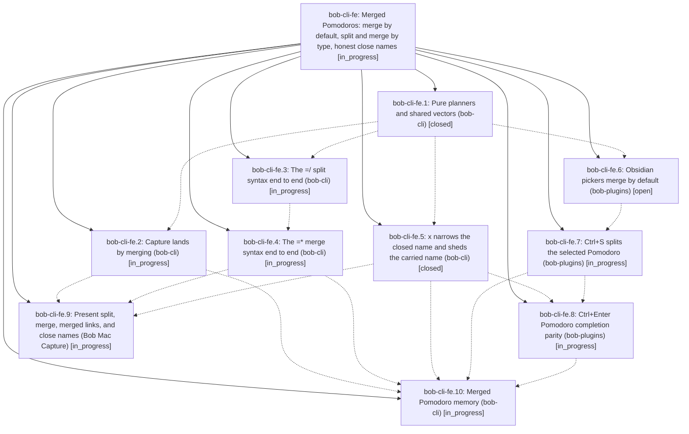

# Bead: bob-cli-fe — Merged Pomodoros: merge by default, split and merge by type, honest close names

[Bead Pages](../README.md) / bob-cli-fe

**Status:** ◐ in_progress · **Type:** ▸ plan · **Tier:** epic
**Owner:** `bryanbugyi34@gmail.com` · **Created by:** [bbugyi200.apollo.c4](https://github.com/bobs-org/bob-cli--agents/blob/main/sessions/bbugyi200.apollo.c4.md) · **Assignee:** `bob-cli-fe.land`
**Created:** 2026-11-01 16:00:42 EST
**Plan:** [202611/merged\_pomodoros.md](https://github.com/bobs-org/bob-cli--plans/blob/main/202611/merged_pomodoros.md)

<!-- sase:links:start -->

## Links

| Relation | Artifact | Why |
| --- | --- | --- |
| implemented-by | [plan:202611/merged_pomodoros.md][1] | derived from the plan's `bead_id:` frontmatter field |

_Plus 1 automatic references — see [Referenced By](#referenced-by)._

[1]: https://github.com/bobs-org/bob-cli--plans/blob/main/202611/merged_pomodoros.md

<!-- sase:links:end -->

## Description

A Pomodoro that holds several task types is a first-class merged Pomodoro. Linking or moving a task into another type's Pomodoro merges that type into the name instead of retyping the task. Capture `=*` and `=/` merge and split Pomodoros by type, and so does Obsidian Ctrl+S. `x` names the closed and carried sessions after the work that was actually done and is still planned. bob-cli, bob-plugins, and Bob Mac Capture all agree, through shared vectors.

## Notes

[2026-11-01T23:09:32Z · bob-cli-f9.land] DISCOVERED ISSUE (from the bob-cli-f9 land agent): on master 675330dd, `just check` fails 5 tests in `-p bob-obsidian --test cli`: capture::pomodoro_link::capture_named_pomodoro_updates_both_notes_and_skips_current, capture::pomodoro_link::capture_named_pomodoro_dry_run_and_failures_leave_notes_untouched, capture::project_note::capture_project_note_task_links_write_the_worked_example, capture::project_note_offer::offer_named_pomodoro_is_created_only_when_a_pick_lands_there, capture::task_theme_writes::named_capture_writes_a_type_without_a_shown_suggestion. Each expects an untyped task linked into a named Pomodoro to gain [type:: <NAME>] (e.g. expected '- [*] #task Some foobar task. [type:: BUGS] ...', got no type field). Cause: 675330dd (bob-cli-fe.1) replaced routing::retype with routing::land; land() returns LandOutcome::Consistent as soon as effective_key is None (src/native/pomodoro_themes/routing.rs:131), whereas the old retype() only short-circuited when an effective key matched and otherwise fell through to choose/Set the destination type. Callers in src/native/capture/task_theme.rs and src/native/capture_pomodoro_name.rs pass retype: true, so typeless tasks no longer get typed on landing. Either restore the typeless fall-through in land() or update the five tests if dropping the write is intended by the merged-Pomodoro contract; fe.2 (capture-link-merge) looks like the natural owner.

## Phases

| Bead | Title | Status | Size | Created | Agents | Commits |
|---|---|---|---|---|---:|---:|
| [bob-cli-fe.1](bob-cli-fe.1.md) | Pure planners and shared vectors (bob-cli) | ✓ closed | medium | 2026-11-01 | 1 | 1 |
| [bob-cli-fe.10](bob-cli-fe.10.md) | Merged Pomodoro memory (bob-cli) | ◐ in_progress | small | 2026-11-01 | 1 | 0 |
| [bob-cli-fe.2](bob-cli-fe.2.md) | Capture lands by merging (bob-cli) | ◐ in_progress | medium | 2026-11-01 | 1 | 0 |
| [bob-cli-fe.3](bob-cli-fe.3.md) | The =/ split syntax end to end (bob-cli) | ◐ in_progress | large | 2026-11-01 | 1 | 0 |
| [bob-cli-fe.4](bob-cli-fe.4.md) | The =\* merge syntax end to end (bob-cli) | ◐ in_progress | medium | 2026-11-01 | 1 | 0 |
| [bob-cli-fe.5](bob-cli-fe.5.md) | x narrows the closed name and sheds the carried name (bob-cli) | ✓ closed | medium | 2026-11-01 | 1 | 1 |
| [bob-cli-fe.6](bob-cli-fe.6.md) | Obsidian pickers merge by default (bob-plugins) | ○ open | medium | 2026-11-01 | 1 | 0 |
| [bob-cli-fe.7](bob-cli-fe.7.md) | Ctrl+S splits the selected Pomodoro (bob-plugins) | ◐ in_progress | medium | 2026-11-01 | 1 | 0 |
| [bob-cli-fe.8](bob-cli-fe.8.md) | Ctrl+Enter Pomodoro completion parity (bob-plugins) | ◐ in_progress | medium | 2026-11-01 | 1 | 0 |
| [bob-cli-fe.9](bob-cli-fe.9.md) | Present split, merge, merged links, and close names (Bob Mac Capture) | ◐ in_progress | medium | 2026-11-01 | 1 | 0 |

## Lineage

## Agents

| Agent | Bead | Commits |
|---|---|---:|
| [bbugyi200.apollo.bob-cli-fe.1](https://github.com/bobs-org/bob-cli--agents/blob/main/agents/bbugyi200.apollo.bob-cli-fe.1/README.md) | [bob-cli-fe.1](bob-cli-fe.1.md) | 1 |
| [bbugyi200.apollo.bob-cli-fe.10](https://github.com/bobs-org/bob-cli--agents/blob/main/agents/bbugyi200.apollo.bob-cli-fe.10/README.md) | [bob-cli-fe.10](bob-cli-fe.10.md) | 0 |
| [bbugyi200.apollo.bob-cli-fe.2](https://github.com/bobs-org/bob-cli--agents/blob/main/agents/bbugyi200.apollo.bob-cli-fe.2/README.md) | [bob-cli-fe.2](bob-cli-fe.2.md) | 0 |
| [bbugyi200.apollo.bob-cli-fe.3](https://github.com/bobs-org/bob-cli--agents/blob/main/sessions/bbugyi200.apollo.bob-cli-fe.3.md) | [bob-cli-fe.3](bob-cli-fe.3.md) | 0 |
| [bbugyi200.apollo.bob-cli-fe.4](https://github.com/bobs-org/bob-cli--agents/blob/main/agents/bbugyi200.apollo.bob-cli-fe.4/README.md) | [bob-cli-fe.4](bob-cli-fe.4.md) | 0 |
| [bbugyi200.apollo.bob-cli-fe.5](https://github.com/bobs-org/bob-cli--agents/blob/main/agents/bbugyi200.apollo.bob-cli-fe.5/README.md) | [bob-cli-fe.5](bob-cli-fe.5.md) | 1 |
| [bbugyi200.apollo.bob-cli-fe.6](https://github.com/bobs-org/bob-cli--agents/blob/main/sessions/bbugyi200.apollo.bob-cli-fe.6.md) | [bob-cli-fe.6](bob-cli-fe.6.md) | 0 |
| [bbugyi200.apollo.bob-cli-fe.7](https://github.com/bobs-org/bob-cli--agents/blob/main/agents/bbugyi200.apollo.bob-cli-fe.7/README.md) | [bob-cli-fe.7](bob-cli-fe.7.md) | 0 |
| [bbugyi200.apollo.bob-cli-fe.8](https://github.com/bobs-org/bob-cli--agents/blob/main/agents/bbugyi200.apollo.bob-cli-fe.8/README.md) | [bob-cli-fe.8](bob-cli-fe.8.md) | 0 |
| [bbugyi200.apollo.bob-cli-fe.9](https://github.com/bobs-org/bob-cli--agents/blob/main/agents/bbugyi200.apollo.bob-cli-fe.9/README.md) | [bob-cli-fe.9](bob-cli-fe.9.md) | 0 |
| [bbugyi200.apollo.bob-cli-fe.land](https://github.com/bobs-org/bob-cli--agents/blob/main/agents/bbugyi200.apollo.bob-cli-fe.land/README.md) | [bob-cli-fe](README.md) | 0 |

## Commits

| Repo | Commit | Subject | Bead | Committed |
|---|---|---|---|---|
| bob-cli | [`675330d`](https://github.com/bobs-org/bob-cli/commit/675330dd5e4be39ebe920931b28a01b852bf78d5) | feat(types): add merged-Pomodoro routing planners | [bob-cli-fe.1](bob-cli-fe.1.md) | 2026-11-01 17:35:55 EST |
| bob-cli | [`3e21e99`](https://github.com/bobs-org/bob-cli/commit/3e21e990d7c1bd73f14db46f13367b339f5d179b) | feat(capture): narrow the closed Pomodoro name and shed the carried one on x | [bob-cli-fe.5](bob-cli-fe.5.md) | 2026-11-01 19:15:55 EST |

<!-- sase:referenced-by:start -->

## Referenced By

| Relation | Artifact | Why | Uses |
| --- | --- | --- | ---: |
| read-by | [agent:bob-cli-f9.land][1] | Check whether the active bob-cli-fe epic owns the five capture test failures from 675330dd | 2 |

[1]: https://github.com/bobs-org/bob-cli--agents/blob/main/agents/bbugyi200.apollo.bob-cli-f9.land/README.md

<!-- sase:referenced-by:end -->
