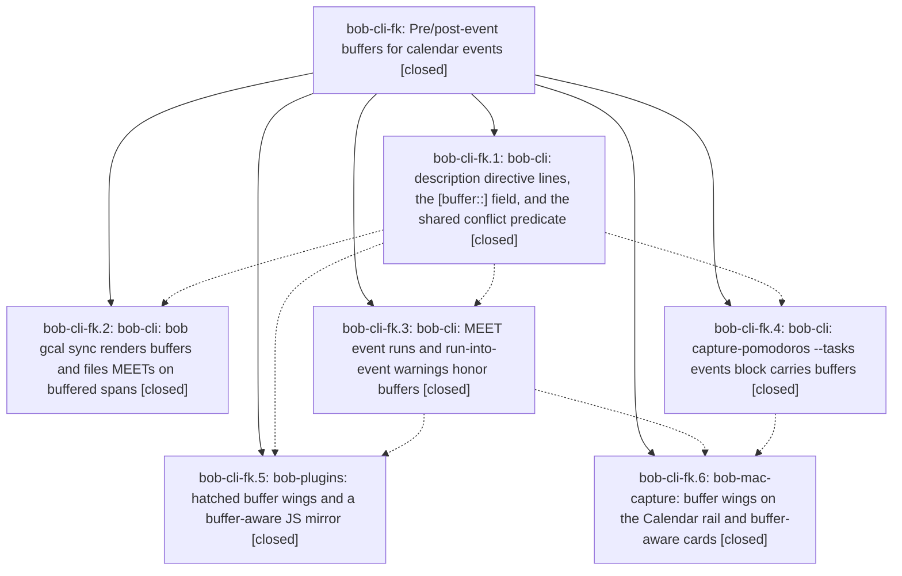

# Bead: bob-cli-fk — Pre/post-event buffers for calendar events

[Bead Pages](../README.md) / bob-cli-fk

**Status:** ✓ closed · **Resolution:** done · **Type:** ▸ plan · **Tier:** epic
**Owner:** `bryanbugyi34@gmail.com` · **Created by:** [bbugyi200.apollo.c5](https://github.com/bobs-org/bob-cli--agents/blob/main/sessions/bbugyi200.apollo.c5.md) · **Assignee:** `bob-cli-fk.land`
**Created:** 2026-11-01 21:42:31 EST · **Closed:** 2026-11-02 01:11:41 EST
**Plan:** [202611/gcal\_event\_buffers.md](https://github.com/bobs-org/bob-cli--plans/blob/main/202611/gcal_event_buffers.md)

<!-- sase:links:start -->

## Links

| Relation | Artifact | Why |
| --- | --- | --- |
| implemented-by | [plan:202611/gcal_event_buffers.md][1] | derived from the plan's `bead_id:` frontmatter field |
| related | [bead:bob-cli-fp][2] | Unblocks macOS verification of bob-cli-fk.6 buffer wings, row capsule, and CaptureAgendaDesignTests buffered renders |
| related | [bead:bob-cli-fq][3] | Proposed by every bob-cli-fk phase; skipped under memory_event_task_glossary=no |

_Plus 1 automatic references — see [Referenced By](#referenced-by)._

[1]: https://github.com/bobs-org/bob-cli--plans/blob/main/202611/gcal_event_buffers.md
[2]: https://github.com/bobs-org/bob-cli--beads/blob/main/pages/bob-cli-fp/README.md
[3]: https://github.com/bobs-org/bob-cli--beads/blob/main/pages/bob-cli-fq/README.md

<!-- sase:links:end -->

## Description

A Google Calendar description line like `@love #untracked -30 +15` gives an Event Task a beautifully rendered buffer that every occupied-time surface honors.

## Notes

[2026-11-02T05:48:57Z · bob-cli-fk.land] LANDING FOLLOW-UP TRIAGE (bob-cli-fk.land): (1) glossary:event-task [buffer::] sentence (fk.1 #1, fk.2 #1, fk.4 #1, fk.5 #1, fk.6 #1) -> filed bob-cli-fq task(memory) xsmall, since the auto decision memory_event_task_glossary=no barred the edit inside the epic. (2) just check fmt/clippy red on clean HEAD (fk.1 #2, fk.3 #2) -> declined: just check fmt+clippy pass on 37e68c09; noted bob-cli-fh as likely resolved. (3) keep_moving routing_is_lazy_and_narrow flake (fk.3 #1, fk.4 #2) -> declined: fixed by 37e68c09 (bob-cli-fb landing); lib suite 4406/4406 green. (4) bob-plugins npm test pre-existing reds (fk.5 #2) -> declined: tracked by open bob-cli-f1/et/eh/ff. (5) task-status-cycler keep-moving TODAY pin (fk.5 #3) -> declined: fixed by bob-plugins c772728. (6) BufferPart::as_str compile break (fk.5 #4, fk.6 #2) -> EPIC-CAUSED (fk.3 a4044f40 deleted as_str while fk.4 1b796cd7 called it); fixed in the landing tale. (7) docs-check test_capture_token_coverage (fk.5 #4 second half) -> filed bob-cli-fo task(ci) small, root cause 42dd9453 docs refresh. (8) macOS targets unverified (fk.6 #3) -> Mac still offline; macOS CI Build on 4f35460 is red only on non-epic errors (bob-cli-fj plus two bob-cli-fb.5 errors) and reports no CaptureAgendaView.swift errors; filed bob-cli-fp task(ci) small for the fb.5 errors including the fk.6 macOS verification checklist.

[2026-11-02T06:11:41Z · bob-cli-fk.land--1] Landing verified all six phases against source and commits 2e49a561, a4044f40, b86fb2d0, 1b796cd7 (bob-cli), 13e63d4 (bob-plugins), 4f35460 (bob-mac-capture). Epic-caused fix: fk.3 removed BufferPart::as_str while fk.4 called it, breaking the bob-cli build; AgendaEventConflict.buffer_part now holds Option<BufferPart> (serde lowercase, JSON byte-identical). Retired the test-only event_starts_crossed/first_event_start_crossed wrappers and two stale dead_code allows. Integration with docs commits 42dd9453/8c0dce81: restored the buffer in docs/gcal.md directive-line example and corrected the Buffers section (sync reads Google; capture/agenda read the vault field). Verified: just check passed; just docs-check had 446 passed, 1 skipped, and only the expected pre-existing bob-cli-fo failure in test_capture_token_coverage.py::test_every_capture_token_has_a_literal_query_at_its_heading; event_buffer/meet_event_run/event_task_close vectors byte-identical in bob-plugins and pinned to master commits; bob-mac-capture agenda-events-buffered fixture byte-identical; plugin buffer tests 58/58; memory record decisions:event-buffers-widen-the-span present with synced-meetings-link-by-phase superseded in part; glossary:event-task untouched per decision. Mac host offline; macOS CI Build on 4f35460 fails only on non-epic errors bob-cli-fj and bob-cli-fp, with no CaptureAgendaView.swift errors. Follow-up triage recorded in epic notes (bob-cli-fo, bob-cli-fp, bob-cli-fq filed; remaining items declined as resolved or already tracked). No epic symbols.

[2026-11-02T06:11:53Z · bob-cli-fk.land--1] Closeout check: this checkout has no just symvision recipe (confirmed in justfile). The epic symbol scan reported no entries.

## Phases

| Bead | Title | Status | Size | Created | Agents | Commits |
|---|---|---|---|---|---:|---:|
| [bob-cli-fk.1](bob-cli-fk.1.md) | bob-cli: description directive lines, the \[buffer::\] field, and the shared conflict predicate | ✓ closed | medium | 2026-11-01 | 1 | 1 |
| [bob-cli-fk.2](bob-cli-fk.2.md) | bob-cli: bob gcal sync renders buffers and files MEETs on buffered spans | ✓ closed | medium | 2026-11-01 | 1 | 1 |
| [bob-cli-fk.3](bob-cli-fk.3.md) | bob-cli: MEET event runs and run-into-event warnings honor buffers | ✓ closed | medium | 2026-11-01 | 1 | 1 |
| [bob-cli-fk.4](bob-cli-fk.4.md) | bob-cli: capture-pomodoros --tasks events block carries buffers | ✓ closed | medium | 2026-11-01 | 1 | 1 |
| [bob-cli-fk.5](bob-cli-fk.5.md) | bob-plugins: hatched buffer wings and a buffer-aware JS mirror | ✓ closed | medium | 2026-11-01 | 1 | 1 |
| [bob-cli-fk.6](bob-cli-fk.6.md) | bob-mac-capture: buffer wings on the Calendar rail and buffer-aware cards | ✓ closed | medium | 2026-11-01 | 1 | 1 |

## Lineage

## Agents

| Agent | Bead | Commits |
|---|---|---:|
| [bbugyi200.apollo.bob-cli-fk.1](https://github.com/bobs-org/bob-cli--agents/blob/main/agents/bbugyi200.apollo.bob-cli-fk.1/README.md) | [bob-cli-fk.1](bob-cli-fk.1.md) | 1 |
| [bbugyi200.apollo.bob-cli-fk.2](https://github.com/bobs-org/bob-cli--agents/blob/main/agents/bbugyi200.apollo.bob-cli-fk.2/README.md) | [bob-cli-fk.2](bob-cli-fk.2.md) | 1 |
| [bbugyi200.apollo.bob-cli-fk.3](https://github.com/bobs-org/bob-cli--agents/blob/main/agents/bbugyi200.apollo.bob-cli-fk.3/README.md) | [bob-cli-fk.3](bob-cli-fk.3.md) | 1 |
| [bbugyi200.apollo.bob-cli-fk.4](https://github.com/bobs-org/bob-cli--agents/blob/main/sessions/bbugyi200.apollo.bob-cli-fk.4.md) | [bob-cli-fk.4](bob-cli-fk.4.md) | 1 |
| [bbugyi200.apollo.bob-cli-fk.5](https://github.com/bobs-org/bob-cli--agents/blob/main/agents/bbugyi200.apollo.bob-cli-fk.5/README.md) | [bob-cli-fk.5](bob-cli-fk.5.md) | 1 |
| [bbugyi200.apollo.bob-cli-fk.6](https://github.com/bobs-org/bob-cli--agents/blob/main/agents/bbugyi200.apollo.bob-cli-fk.6/README.md) | [bob-cli-fk.6](bob-cli-fk.6.md) | 1 |
| [bbugyi200.apollo.bob-cli-fk.land](https://github.com/bobs-org/bob-cli--agents/blob/main/sessions/bbugyi200.apollo.bob-cli-fk.land.md) | [bob-cli-fk](README.md) | 1 |

## Commits

| Repo | Commit | Subject | Bead | Committed |
|---|---|---|---|---|
| bob-cli | [`2e49a56`](https://github.com/bobs-org/bob-cli/commit/2e49a561d08777b6ee8a130202f1bd0621670ef4) | feat(gcal): parse event buffers from HTML-safe directive lines | [bob-cli-fk.1](bob-cli-fk.1.md) | 2026-11-01 22:36:37 EST |
| bob-cli | [`a4044f4`](https://github.com/bobs-org/bob-cli/commit/a4044f40164ce1c89ab1c19b75c2ecd71c1e37e5) | feat(capture): honor event buffers in MEET runs and run-into-event warnings | [bob-cli-fk.3](bob-cli-fk.3.md) | 2026-11-01 23:37:39 EST |
| bob-cli | [`b86fb2d`](https://github.com/bobs-org/bob-cli/commit/b86fb2d0c30296a56baf6c5a0d166d2367ca06fd) | feat(gcal): buffer-aware sync spans, render, and docs | [bob-cli-fk.2](bob-cli-fk.2.md) | 2026-11-01 23:39:23 EST |
| bob-cli | [`1b796cd`](https://github.com/bobs-org/bob-cli/commit/1b796cd7af05917ee9b8dcdee1f3b10693d779ca) | feat(capture): expose buffered calendar event agenda | [bob-cli-fk.4](bob-cli-fk.4.md) | 2026-11-01 23:44:52 EST |
| bob-plugins | [`bob-plugins@13e63d4`](https://github.com/bobs-org/bob-plugins/commit/13e63d42ba013b0e58fb027b5f16e47ec2ac32e4) | feat(ledger-tools): paint hatched \[buffer::\] wings and honor buffered MEET runs | [bob-cli-fk.5](bob-cli-fk.5.md) | 2026-11-02 00:12:06 EST |
| bob-mac-capture | [`bob-mac-capture@4f35460`](https://github.com/bobs-org/bob-mac-capture/commit/4f35460a94e2b52de1f8d8b1d3f52988796f91da) | feat(capture): render buffered event spans on mac agenda | [bob-cli-fk.6](bob-cli-fk.6.md) | 2026-11-02 00:15:18 EST |
| bob-cli | [`2d5ebfc`](https://github.com/bobs-org/bob-cli/commit/2d5ebfc9ba31f28acaba2ed4b8d1422908b14252) | fix(gcal): finish event buffer epic closeout | [bob-cli-fk](README.md) | 2026-11-02 01:32:24 EST |

<!-- sase:referenced-by:start -->

## Referenced By

| Relation | Artifact | Why | Uses |
| --- | --- | --- | ---: |
| read-by | [agent:bob-cli-fk.6][1] | epic context for phase | 1 |

[1]: https://github.com/bobs-org/bob-cli--agents/blob/main/agents/bbugyi200.apollo.bob-cli-fk.6/README.md

<!-- sase:referenced-by:end -->
