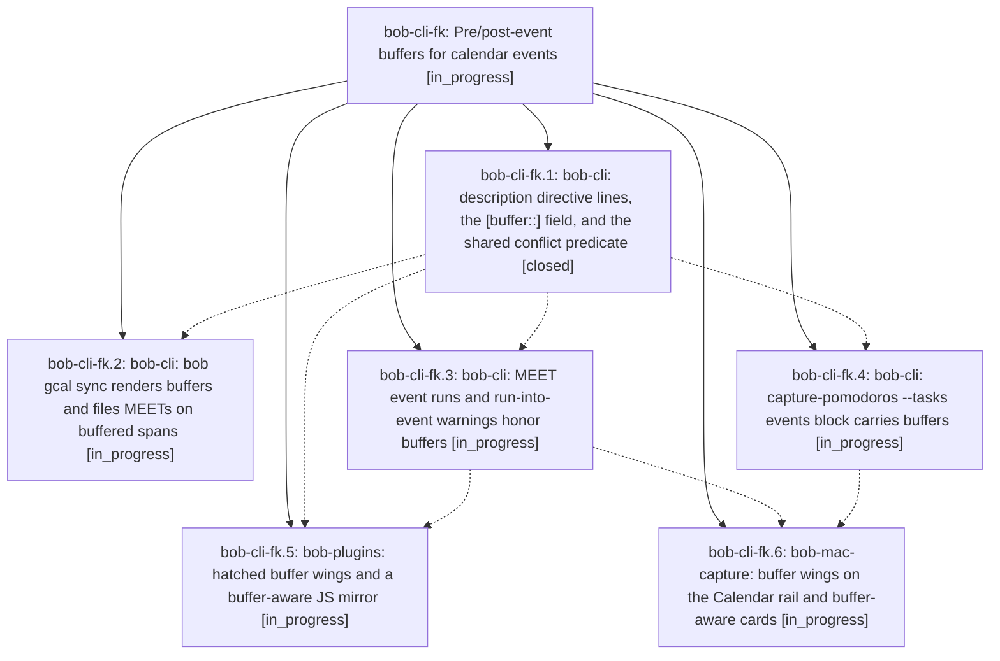

# Bead: bob-cli-fk — Pre/post-event buffers for calendar events

[Bead Pages](../README.md) / bob-cli-fk

**Status:** ◐ in_progress · **Type:** ▸ plan · **Tier:** epic
**Owner:** `bryanbugyi34@gmail.com` · **Created by:** [bbugyi200.apollo.c5](https://github.com/bobs-org/bob-cli--agents/blob/main/sessions/bbugyi200.apollo.c5.md) · **Assignee:** `bob-cli-fk.land`
**Created:** 2026-11-01 21:42:31 EST
**Plan:** [202611/gcal\_event\_buffers.md](https://github.com/bobs-org/bob-cli--plans/blob/main/202611/gcal_event_buffers.md)

<!-- sase:links:start -->

## Links

| Relation | Artifact | Why |
| --- | --- | --- |
| implemented-by | [plan:202611/gcal_event_buffers.md][1] | derived from the plan's `bead_id:` frontmatter field |

[1]: https://github.com/bobs-org/bob-cli--plans/blob/main/202611/gcal_event_buffers.md

<!-- sase:links:end -->

## Description

A Google Calendar description line like `@love #untracked -30 +15` gives an Event Task a beautifully rendered buffer that every occupied-time surface honors.

## Phases

| Bead | Title | Status | Size | Created | Agents | Commits |
|---|---|---|---|---|---:|---:|
| [bob-cli-fk.1](bob-cli-fk.1.md) | bob-cli: description directive lines, the \[buffer::\] field, and the shared conflict predicate | ✓ closed | medium | 2026-11-01 | 1 | 1 |
| [bob-cli-fk.2](bob-cli-fk.2.md) | bob-cli: bob gcal sync renders buffers and files MEETs on buffered spans | ◐ in_progress | medium | 2026-11-01 | 1 | 0 |
| [bob-cli-fk.3](bob-cli-fk.3.md) | bob-cli: MEET event runs and run-into-event warnings honor buffers | ◐ in_progress | medium | 2026-11-01 | 1 | 0 |
| [bob-cli-fk.4](bob-cli-fk.4.md) | bob-cli: capture-pomodoros --tasks events block carries buffers | ◐ in_progress | medium | 2026-11-01 | 1 | 0 |
| [bob-cli-fk.5](bob-cli-fk.5.md) | bob-plugins: hatched buffer wings and a buffer-aware JS mirror | ◐ in_progress | medium | 2026-11-01 | 1 | 0 |
| [bob-cli-fk.6](bob-cli-fk.6.md) | bob-mac-capture: buffer wings on the Calendar rail and buffer-aware cards | ◐ in_progress | medium | 2026-11-01 | 1 | 0 |

## Lineage

## Agents

| Agent | Bead | Commits |
|---|---|---:|
| [bbugyi200.apollo.bob-cli-fk.1](https://github.com/bobs-org/bob-cli--agents/blob/main/agents/bbugyi200.apollo.bob-cli-fk.1/README.md) | [bob-cli-fk.1](bob-cli-fk.1.md) | 1 |
| [bbugyi200.apollo.bob-cli-fk.2](https://github.com/bobs-org/bob-cli--agents/blob/main/agents/bbugyi200.apollo.bob-cli-fk.2/README.md) | [bob-cli-fk.2](bob-cli-fk.2.md) | 0 |
| [bbugyi200.apollo.bob-cli-fk.3](https://github.com/bobs-org/bob-cli--agents/blob/main/agents/bbugyi200.apollo.bob-cli-fk.3/README.md) | [bob-cli-fk.3](bob-cli-fk.3.md) | 0 |
| [bbugyi200.apollo.bob-cli-fk.4](https://github.com/bobs-org/bob-cli--agents/blob/main/agents/bbugyi200.apollo.bob-cli-fk.4/README.md) | [bob-cli-fk.4](bob-cli-fk.4.md) | 0 |
| [bbugyi200.apollo.bob-cli-fk.5](https://github.com/bobs-org/bob-cli--agents/blob/main/agents/bbugyi200.apollo.bob-cli-fk.5/README.md) | [bob-cli-fk.5](bob-cli-fk.5.md) | 0 |
| [bbugyi200.apollo.bob-cli-fk.6](https://github.com/bobs-org/bob-cli--agents/blob/main/agents/bbugyi200.apollo.bob-cli-fk.6/README.md) | [bob-cli-fk.6](bob-cli-fk.6.md) | 0 |
| [bbugyi200.apollo.bob-cli-fk.land](https://github.com/bobs-org/bob-cli--agents/blob/main/agents/bbugyi200.apollo.bob-cli-fk.land/README.md) | [bob-cli-fk](README.md) | 0 |

## Commits

| Repo | Commit | Subject | Bead | Committed |
|---|---|---|---|---|
| bob-cli | [`2e49a56`](https://github.com/bobs-org/bob-cli/commit/2e49a561d08777b6ee8a130202f1bd0621670ef4) | feat(gcal): parse event buffers from HTML-safe directive lines | [bob-cli-fk.1](bob-cli-fk.1.md) | 2026-11-01 22:36:37 EST |
