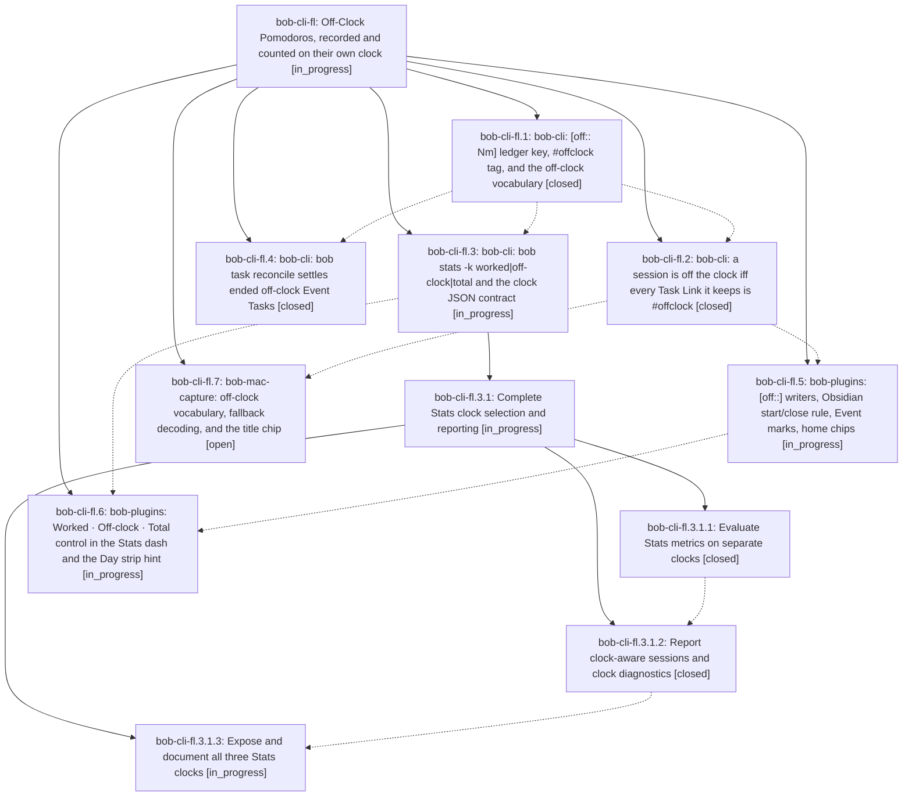

# Bead: bob-cli-fl — Off-Clock Pomodoros, recorded and counted on their own clock

[Bead Pages](../README.md) / bob-cli-fl

**Status:** ◐ in_progress · **Type:** ▸ plan · **Tier:** epic
**Owner:** `bryanbugyi34@gmail.com` · **Created by:** [bbugyi200.apollo.research.2z.linker.w0](https://github.com/bobs-org/bob-cli--agents/blob/main/sessions/bbugyi200.apollo.research.2z.linker.w0.md) · **Assignee:** `bob-cli-fl.land`
**Created:** 2026-11-01 21:46:35 EST
**Plan:** [202611/off\_clock\_pomodoros.md](https://github.com/bobs-org/bob-cli--plans/blob/main/202611/off_clock_pomodoros.md)

<!-- sase:links:start -->

## Links

| Relation | Artifact | Why |
| --- | --- | --- |
| implemented-by | [plan:202611/off_clock_pomodoros.md][1] | derived from the plan's `bead_id:` frontmatter field |

_Plus 2 automatic references — see [Referenced By](#referenced-by)._

[1]: https://github.com/bobs-org/bob-cli--plans/blob/main/202611/off_clock_pomodoros.md

<!-- sase:links:end -->

## Description

Sessions spent on #offclock tasks (lunch, the gym, school pickup) keep their time as [off:: Nm] Off-Clock Pomodoros instead of vanishing; a Pomodoro goes off the clock exactly when every Task Link it keeps targets an #offclock task; bob stats and the Stats dash gain a Worked · Off-clock · Total clock while every glanceable work signal stays Worked; ended off-clock events settle on their own; and one dashed visual language marks off-clock time everywhere.

## Phases

| Bead | Title | Status | Size | Created | Agents | Commits |
|---|---|---|---|---|---:|---:|
| [bob-cli-fl.1](bob-cli-fl.1.md) | bob-cli: \[off:: Nm\] ledger key, #offclock tag, and the off-clock vocabulary | ✓ closed | medium | 2026-11-01 | 1 | 1 |
| [bob-cli-fl.2](bob-cli-fl.2.md) | bob-cli: a session is off the clock iff every Task Link it keeps is #offclock | ✓ closed | medium | 2026-11-01 | 1 | 1 |
| [bob-cli-fl.3](bob-cli-fl.3.md) | bob-cli: bob stats -k worked\|off-clock\|total and the clock JSON contract | ◐ in_progress | large | 2026-11-01 | 1 | 0 |
| [bob-cli-fl.4](bob-cli-fl.4.md) | bob-cli: bob task reconcile settles ended off-clock Event Tasks | ✓ closed | medium | 2026-11-01 | 1 | 1 |
| [bob-cli-fl.5](bob-cli-fl.5.md) | bob-plugins: \[off::\] writers, Obsidian start/close rule, Event marks, home chips | ◐ in_progress | medium | 2026-11-01 | 1 | 0 |
| [bob-cli-fl.6](bob-cli-fl.6.md) | bob-plugins: Worked · Off-clock · Total control in the Stats dash and the Day strip hint | ◐ in_progress | large | 2026-11-01 | 1 | 0 |
| [bob-cli-fl.7](bob-cli-fl.7.md) | bob-mac-capture: off-clock vocabulary, fallback decoding, and the title chip | ○ open | medium | 2026-11-01 | 1 | 0 |

## Lineage

## Agents

| Agent | Bead | Commits |
|---|---|---:|
| [bbugyi200.apollo.bob-cli-fl.1](https://github.com/bobs-org/bob-cli--agents/blob/main/sessions/bbugyi200.apollo.bob-cli-fl.1.md) | [bob-cli-fl.1](bob-cli-fl.1.md) | 1 |
| [bbugyi200.apollo.bob-cli-fl.2](https://github.com/bobs-org/bob-cli--agents/blob/main/sessions/bbugyi200.apollo.bob-cli-fl.2.md) | [bob-cli-fl.2](bob-cli-fl.2.md) | 1 |
| [bbugyi200.apollo.bob-cli-fl.3](https://github.com/bobs-org/bob-cli--agents/blob/main/sessions/bbugyi200.apollo.bob-cli-fl.3.md) | [bob-cli-fl.3](bob-cli-fl.3.md) | 0 |
| [bbugyi200.apollo.bob-cli-fl.3.1.1](https://github.com/bobs-org/bob-cli--agents/blob/main/agents/bbugyi200.apollo.bob-cli-fl.3.1.1/README.md) | [bob-cli-fl.3.1.1](bob-cli-fl.3.1.1.md) | 1 |
| [bbugyi200.apollo.bob-cli-fl.3.1.2](https://github.com/bobs-org/bob-cli--agents/blob/main/agents/bbugyi200.apollo.bob-cli-fl.3.1.2/README.md) | [bob-cli-fl.3.1.2](bob-cli-fl.3.1.2.md) | 1 |
| [bbugyi200.apollo.bob-cli-fl.3.1.3](https://github.com/bobs-org/bob-cli--agents/blob/main/agents/bbugyi200.apollo.bob-cli-fl.3.1.3/README.md) | [bob-cli-fl.3.1.3](bob-cli-fl.3.1.3.md) | 0 |
| [bbugyi200.apollo.bob-cli-fl.3.1.land](https://github.com/bobs-org/bob-cli--agents/blob/main/agents/bbugyi200.apollo.bob-cli-fl.3.1.land/README.md) | [bob-cli-fl.3.1](bob-cli-fl.3.1.md) | 0 |
| [bbugyi200.apollo.bob-cli-fl.4](https://github.com/bobs-org/bob-cli--agents/blob/main/agents/bbugyi200.apollo.bob-cli-fl.4/README.md) | [bob-cli-fl.4](bob-cli-fl.4.md) | 1 |
| [bbugyi200.apollo.bob-cli-fl.5](https://github.com/bobs-org/bob-cli--agents/blob/main/agents/bbugyi200.apollo.bob-cli-fl.5/README.md) | [bob-cli-fl.5](bob-cli-fl.5.md) | 0 |
| [bbugyi200.apollo.bob-cli-fl.6](https://github.com/bobs-org/bob-cli--agents/blob/main/agents/bbugyi200.apollo.bob-cli-fl.6/README.md) | [bob-cli-fl.6](bob-cli-fl.6.md) | 0 |
| [bbugyi200.apollo.bob-cli-fl.7](https://github.com/bobs-org/bob-cli--agents/blob/main/sessions/bbugyi200.apollo.bob-cli-fl.7.md) | [bob-cli-fl.7](bob-cli-fl.7.md) | 0 |
| [bbugyi200.apollo.bob-cli-fl.land](https://github.com/bobs-org/bob-cli--agents/blob/main/agents/bbugyi200.apollo.bob-cli-fl.land/README.md) | [bob-cli-fl](README.md) | 0 |

## Commits

| Repo | Commit | Subject | Bead | Committed |
|---|---|---|---|---|
| bob-cli | [`8a9ec68`](https://github.com/bobs-org/bob-cli/commit/8a9ec685ed9c727a0d7338c9c7072b7e285c975e) | feat(off-clock): add off-clock Pomodoro ledger support | [bob-cli-fl.1](bob-cli-fl.1.md) | 2026-11-02 01:10:48 EST |
| bob-cli | [`f171e3c`](https://github.com/bobs-org/bob-cli/commit/f171e3cc2096ce3e6f3658e550ff3d22b7d5fd84) | feat(task-status-hooks): settle ended off-clock event tasks into closed sessions | [bob-cli-fl.4](bob-cli-fl.4.md) | 2026-11-02 02:17:13 EST |
| bob-cli | [`4d950c5`](https://github.com/bobs-org/bob-cli/commit/4d950c58a5b198fcb89067d6fd6b1fc26c2f09b4) | feat(stats): evaluate Pomodoro metrics on worked, off-clock, and total clocks | [bob-cli-fl.3.1.1](bob-cli-fl.3.1.1.md) | 2026-11-02 02:27:24 EST |
| bob-cli | [`71a65da`](https://github.com/bobs-org/bob-cli/commit/71a65dad49413ba3662098834f01fbecda70fdd9) | feat(capture): stamp session clock from counted Task Links | [bob-cli-fl.2](bob-cli-fl.2.md) | 2026-11-02 02:51:13 EST |
| bob-cli | [`4d2133b`](https://github.com/bobs-org/bob-cli/commit/4d2133b52d6c73118d2b38151a0a288b1edfd487) | feat(stats)!: report clock-aware sessions and clock diagnostics | [bob-cli-fl.3.1.2](bob-cli-fl.3.1.2.md) | 2026-11-02 03:13:58 EST |

<!-- sase:referenced-by:start -->

## Referenced By

| Relation | Artifact | Why | Uses |
| --- | --- | --- | ---: |
| read-by | [agent:bob-cli-fl.3.1.1][1] | Need outer epic DECISIONS that apply to stats clock work | 1 |
| read-by | [agent:bob-cli-fl.4][2] | parent epic context | 1 |

[1]: https://github.com/bobs-org/bob-cli--agents/blob/main/agents/bbugyi200.apollo.bob-cli-fl.3.1.1/README.md
[2]: https://github.com/bobs-org/bob-cli--agents/blob/main/agents/bbugyi200.apollo.bob-cli-fl.4/README.md

<!-- sase:referenced-by:end -->
