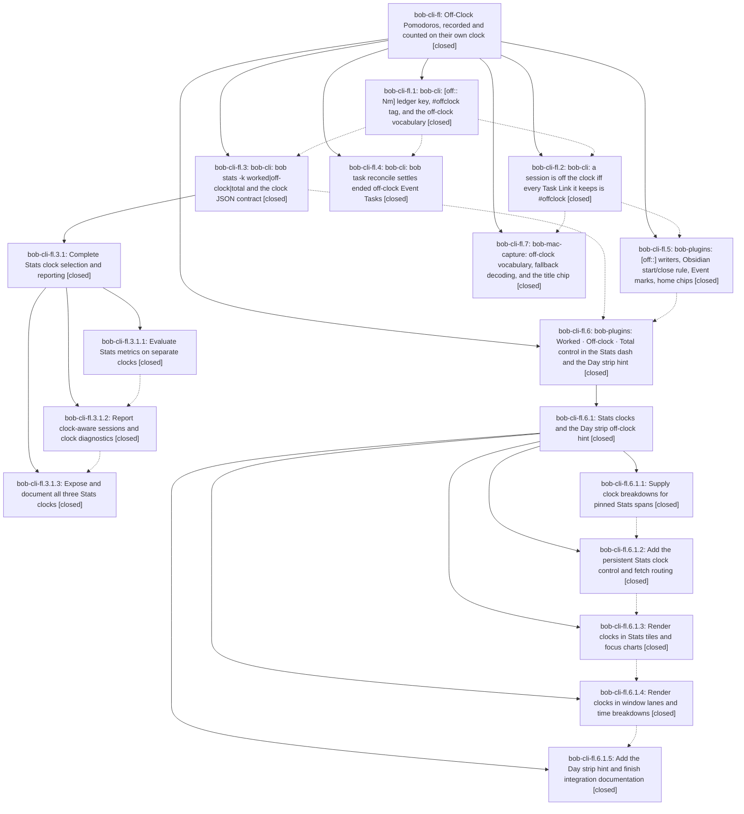

# Bead: bob-cli-fl — Off-Clock Pomodoros, recorded and counted on their own clock

[Bead Pages](../README.md) / bob-cli-fl

**Status:** ✓ closed · **Resolution:** done · **Type:** ▸ plan · **Tier:** epic
**Owner:** `bryanbugyi34@gmail.com` · **Created by:** [bbugyi200.apollo.research.2z.linker.w0](https://github.com/bobs-org/bob-cli--agents/blob/main/sessions/bbugyi200.apollo.research.2z.linker.w0.md) · **Assignee:** `bob-cli-fl.land`
**Created:** 2026-11-01 21:46:35 EST · **Closed:** 2026-11-02 16:56:02 EST
**Plan:** [202611/off\_clock\_pomodoros.md](https://github.com/bobs-org/bob-cli--plans/blob/main/202611/off_clock_pomodoros.md)

<!-- sase:links:start -->

## Links

| Relation | Artifact | Why |
| --- | --- | --- |
| implemented-by | [plan:202611/off_clock_pomodoros.md][1] | derived from the plan's `bead_id:` frontmatter field |

_Plus 12 automatic references — see [Referenced By](#referenced-by)._

[1]: https://github.com/bobs-org/bob-cli--plans/blob/main/202611/off_clock_pomodoros.md

<!-- sase:links:end -->

## Description

Sessions spent on #offclock tasks (lunch, the gym, school pickup) keep their time as [off:: Nm] Off-Clock Pomodoros instead of vanishing; a Pomodoro goes off the clock exactly when every Task Link it keeps targets an #offclock task; bob stats and the Stats dash gain a Worked · Off-clock · Total clock while every glanceable work signal stays Worked; ended off-clock events settle on their own; and one dashed visual language marks off-clock time everywhere.

## Notes

[2026-11-02T18:20:37Z · bob-cli-fl.land] FOLLOW-UP TRIAGE (bob-cli-fl land agent), done before writing the remaining-work tale.

Filed or corroborated:
- NEW bob-cli-g3 (feature, medium): retire the deprecated f6 JSON keys after the first release that contains this epic. The plan mandates this follow-up but no phase recorded it.
- NEW bob-cli-g4 (bug, small), from fl.5 #1: Obsidian Ctrl+Enter deletes a closed timed Pomodoro whose links were all deferred, while bob capture x keeps it. This is pre-existing documented plugin behavior; the fl.5 README records it as a deliberate difference. Related link to bob-cli-7q.
- NEW bob-cli-g5 (feature, small), from fl.5 #2: real-Obsidian check of the Reading-view off-clock home chip. The harness exists, but apollo has no Obsidian or Xvfb.
- +1 bob-cli-e4: the vault task-status-cycler is a dirty bob-cli_21 build at 7dbbb6d, deployed after fl.5 and lacking fl.5's off-clock close code. Not forced.
- DISCOVERED ISSUE on bob-cli-fs: just check fails at cli_reference_is_current because d8b4d4fb (fs.3) drifted capture-complete.md, capture-parse.md and relations.md.

Declined as proposals:
- fl.1 #1 (baseline Clippy blockers): already resolved; today's just check passes the Clippy gate.
- fl.3 #2 (research artifact missing): not missing; the sidecar simply was not cloned in that workspace. 'sase repo open research' plus 'sase artifact read research:202611/off_clock_pomodoro_stats/off_clock_pomodoro_stats.md' prints it.
- fl.5 #3, fl.6.1.2 #1, fl.6.1.3 #1, fl.6.1.4 #1, fl.6.1.5 #1-#3: already triaged by the bob-cli-fl.6.1 land agent (ff, f1, et, eh, ej, e4, fy, fz, g0).
- fl.3.1.3 #1-#3: already triaged by the bob-cli-fl.3.1 land agent (bob-cli-fn notes, bob-cli-fr).

[2026-11-02T19:07:22Z · bob-cli-fe.land] DISCOVERED ISSUE (from the bob-cli-fe land agent): the pomodoro_clock_mixed warning names the pre-merge Pomodoro when a capture link merges a type into the running entry. Repro on aeb9674d in a temp vault: the running entry is '- [ ] (**0920-0950** [t:: 30m]) — FIX + BUILD' with FIX and BUILD links, and BOB_NOW='2026-11-01 09:30'. Run 'bob capture ^a:w1#fix' on an #offclock WALK task. It prints 'warning: ◌ FIX + BUILD stays on the clock: it also links Fix task', while the written headline and the 'Linked under' row both say 'FIX + BUILD + WALK · merged WALK'. Cause: pomodoro_link.rs calls restamp_session_clock (lines ~142 and ~576) right after staging the link, before task_theme's R2 merge rename (bob-cli-fe.2, d712168f) is staged, so the warning reads the old name. The bytes are correct: in the all-offclock variant (running 'FIX' with no links, then ^a:w1#fix), both the rename and the restamp land as '[off:: 30m]) — FIX + WALK'. Only the warning copy is stale. This belongs with the restamp work in the fl landing tale (off_clock_landing_repairs.md): restamp after the merge rename, or name the entry from the staged post-rename headline. Not caused by bob-cli-fe, whose rename predates fl.2's restamp (71a65dad).

[2026-11-02T21:56:02Z · bob-cli-fl.land--i] Completed the off-clock landing repairs. Running timed rows now restamp after task-toggle link insertion/removal, blocked-link consumption, task-completion retirement, Ensure Next relocation, type relocation, Pomodoro merge and split, and Pomodoro link gestures. Pomodoro close gestures close the row and therefore do not leave a changed key on an open timed row. Settled MEET child bullets now use the note's dominant indentation unit, falling back to tabs. Updated capture, gcal, and JSON output documentation.

Red-before: capture::pomodoro_clock::capture_link_restamps_the_running_lineup failed before the task-toggle insertion restamp. Green-after: capture::pomodoro_clock (12 passed, including capture_link_restamps_the_running_lineup, ensure_next_relocation_restamps_the_running_lineup, completing_a_linked_task_restamps_the_running_lineup, merge_recomputes_running_clock_both_directions_and_explicitly, split_recomputes_the_remaining_timed_lineup_clock, and blocked_link_consumption_restamps_the_running_lineup); capture::ensure_next (7 passed); capture::task_complete (35 passed); task_status_hooks::settle (7 passed, including settled_meet_children_follow_the_note_indent_unit); task_status_hooks library tests (102 passed). `just docs-check` and the final `just check` both passed; no failures remain. No `just check-full` was run.

Land-agent verification: all seven phases and nested epics bob-cli-fl.3.1 and bob-cli-fl.6.1 are closed and audited against the plan and DECISIONS. `settled_status=done`; glossary:off-clock-pomodoro, glossary:pomodoro, glossary:event-task, decisions:off-clock-pomodoros-count-apart, and decisions:ended-off-clock-events-settle are present; decisions:untracked-sessions-omit-t-field is superseded. Shared pomodoro_clock, meet_event_run, pomodoro_homes, and event_task_close vectors are byte-identical in bob-plugins. Gcal commits 35c0a39a, cba88d0d, 3d251ba2, db4e8a8a, fa1118c1, and 1562baab were checked with scratch-vault reproductions. Capture commits a67cc79a, d32da8fa, 50887216, 2d45cd02, and 0ebd0714 were checked; the running-lineup gap found in that audit is fixed here. Mac master CI builds; all six off-clock XCTests and pomodoro_clock_mixed presentation tests pass, with 43 unrelated failures tracked by bob-cli-f3 and bob-cli-fu. Plugin focused suites pass and bob-ledger-tools 1.91.0 is live. The stale dirty bob-cli_21 task-status-cycler deploy lacks fl.5 close code; it is tracked by bob-cli-e4 (+1) and was not forced. Follow-up triage for bob-cli-g3, bob-cli-g4, bob-cli-g5, the bob-cli-e4 +1, the bob-cli-fs note, and declined proposals is recorded on this epic. `sase bead epic-symbols bob-cli-fl` reports no entries; this Justfile has no symvision recipe.

## Phases

| Bead | Title | Status | Size | Created | Agents | Commits |
|---|---|---|---|---|---:|---:|
| [bob-cli-fl.1](bob-cli-fl.1.md) | bob-cli: \[off:: Nm\] ledger key, #offclock tag, and the off-clock vocabulary | ✓ closed | medium | 2026-11-01 | 1 | 1 |
| [bob-cli-fl.2](bob-cli-fl.2.md) | bob-cli: a session is off the clock iff every Task Link it keeps is #offclock | ✓ closed | medium | 2026-11-01 | 1 | 1 |
| [bob-cli-fl.3](bob-cli-fl.3.md) | bob-cli: bob stats -k worked\|off-clock\|total and the clock JSON contract | ✓ closed | large | 2026-11-01 | 1 | 0 |
| [bob-cli-fl.4](bob-cli-fl.4.md) | bob-cli: bob task reconcile settles ended off-clock Event Tasks | ✓ closed | medium | 2026-11-01 | 1 | 1 |
| [bob-cli-fl.5](bob-cli-fl.5.md) | bob-plugins: \[off::\] writers, Obsidian start/close rule, Event marks, home chips | ✓ closed | medium | 2026-11-01 | 1 | 1 |
| [bob-cli-fl.6](bob-cli-fl.6.md) | bob-plugins: Worked · Off-clock · Total control in the Stats dash and the Day strip hint | ✓ closed | large | 2026-11-01 | 1 | 0 |
| [bob-cli-fl.7](bob-cli-fl.7.md) | bob-mac-capture: off-clock vocabulary, fallback decoding, and the title chip | ✓ closed | medium | 2026-11-01 | 1 | 1 |

## Lineage

## Agents

| Agent | Bead | Commits |
|---|---|---:|
| [bbugyi200.apollo.bob-cli-fl.1](https://github.com/bobs-org/bob-cli--agents/blob/main/sessions/bbugyi200.apollo.bob-cli-fl.1.md) | [bob-cli-fl.1](bob-cli-fl.1.md) | 1 |
| [bbugyi200.apollo.bob-cli-fl.2](https://github.com/bobs-org/bob-cli--agents/blob/main/sessions/bbugyi200.apollo.bob-cli-fl.2.md) | [bob-cli-fl.2](bob-cli-fl.2.md) | 1 |
| [bbugyi200.apollo.bob-cli-fl.3](https://github.com/bobs-org/bob-cli--agents/blob/main/sessions/bbugyi200.apollo.bob-cli-fl.3.md) | [bob-cli-fl.3](bob-cli-fl.3.md) | 0 |
| [bbugyi200.apollo.bob-cli-fl.3.1.1](https://github.com/bobs-org/bob-cli--agents/blob/main/agents/bbugyi200.apollo.bob-cli-fl.3.1.1/README.md) | [bob-cli-fl.3.1.1](bob-cli-fl.3.1.1.md) | 1 |
| [bbugyi200.apollo.bob-cli-fl.3.1.2](https://github.com/bobs-org/bob-cli--agents/blob/main/agents/bbugyi200.apollo.bob-cli-fl.3.1.2/README.md) | [bob-cli-fl.3.1.2](bob-cli-fl.3.1.2.md) | 1 |
| [bbugyi200.apollo.bob-cli-fl.3.1.3](https://github.com/bobs-org/bob-cli--agents/blob/main/agents/bbugyi200.apollo.bob-cli-fl.3.1.3/README.md) | [bob-cli-fl.3.1.3](bob-cli-fl.3.1.3.md) | 1 |
| [bbugyi200.apollo.bob-cli-fl.3.1.land](https://github.com/bobs-org/bob-cli--agents/blob/main/sessions/bbugyi200.apollo.bob-cli-fl.3.1.land.md) | [bob-cli-fl.3.1](bob-cli-fl.3.1.md) | 2 |
| [bbugyi200.apollo.bob-cli-fl.4](https://github.com/bobs-org/bob-cli--agents/blob/main/agents/bbugyi200.apollo.bob-cli-fl.4/README.md) | [bob-cli-fl.4](bob-cli-fl.4.md) | 1 |
| [bbugyi200.apollo.bob-cli-fl.5](https://github.com/bobs-org/bob-cli--agents/blob/main/agents/bbugyi200.apollo.bob-cli-fl.5/README.md) | [bob-cli-fl.5](bob-cli-fl.5.md) | 1 |
| [bbugyi200.apollo.bob-cli-fl.6](https://github.com/bobs-org/bob-cli--agents/blob/main/sessions/bbugyi200.apollo.bob-cli-fl.6.md) | [bob-cli-fl.6](bob-cli-fl.6.md) | 0 |
| [bbugyi200.apollo.bob-cli-fl.6.1.1](https://github.com/bobs-org/bob-cli--agents/blob/main/agents/bbugyi200.apollo.bob-cli-fl.6.1.1/README.md) | [bob-cli-fl.6.1.1](bob-cli-fl.6.1.1.md) | 1 |
| [bbugyi200.apollo.bob-cli-fl.6.1.2](https://github.com/bobs-org/bob-cli--agents/blob/main/agents/bbugyi200.apollo.bob-cli-fl.6.1.2/README.md) | [bob-cli-fl.6.1.2](bob-cli-fl.6.1.2.md) | 1 |
| [bbugyi200.apollo.bob-cli-fl.6.1.3](https://github.com/bobs-org/bob-cli--agents/blob/main/agents/bbugyi200.apollo.bob-cli-fl.6.1.3/README.md) | [bob-cli-fl.6.1.3](bob-cli-fl.6.1.3.md) | 1 |
| [bbugyi200.apollo.bob-cli-fl.6.1.4](https://github.com/bobs-org/bob-cli--agents/blob/main/agents/bbugyi200.apollo.bob-cli-fl.6.1.4/README.md) | [bob-cli-fl.6.1.4](bob-cli-fl.6.1.4.md) | 1 |
| [bbugyi200.apollo.bob-cli-fl.6.1.5](https://github.com/bobs-org/bob-cli--agents/blob/main/sessions/bbugyi200.apollo.bob-cli-fl.6.1.5.md) | [bob-cli-fl.6.1.5](bob-cli-fl.6.1.5.md) | 2 |
| [bbugyi200.apollo.bob-cli-fl.6.1.land](https://github.com/bobs-org/bob-cli--agents/blob/main/sessions/bbugyi200.apollo.bob-cli-fl.6.1.land.md) | [bob-cli-fl.6.1](bob-cli-fl.6.1.md) | 3 |
| [bbugyi200.apollo.bob-cli-fl.7](https://github.com/bobs-org/bob-cli--agents/blob/main/sessions/bbugyi200.apollo.bob-cli-fl.7.md) | [bob-cli-fl.7](bob-cli-fl.7.md) | 1 |
| [bbugyi200.apollo.bob-cli-fl.land](https://github.com/bobs-org/bob-cli--agents/blob/main/sessions/bbugyi200.apollo.bob-cli-fl.land.md) | [bob-cli-fl](README.md) | 1 |

## Commits

| Repo | Commit | Subject | Bead | Committed |
|---|---|---|---|---|
| bob-cli | [`8a9ec68`](https://github.com/bobs-org/bob-cli/commit/8a9ec685ed9c727a0d7338c9c7072b7e285c975e) | feat(off-clock): add off-clock Pomodoro ledger support | [bob-cli-fl.1](bob-cli-fl.1.md) | 2026-11-02 01:10:48 EST |
| bob-cli | [`f171e3c`](https://github.com/bobs-org/bob-cli/commit/f171e3cc2096ce3e6f3658e550ff3d22b7d5fd84) | feat(task-status-hooks): settle ended off-clock event tasks into closed sessions | [bob-cli-fl.4](bob-cli-fl.4.md) | 2026-11-02 02:17:13 EST |
| bob-cli | [`4d950c5`](https://github.com/bobs-org/bob-cli/commit/4d950c58a5b198fcb89067d6fd6b1fc26c2f09b4) | feat(stats): evaluate Pomodoro metrics on worked, off-clock, and total clocks | [bob-cli-fl.3.1.1](bob-cli-fl.3.1.1.md) | 2026-11-02 02:27:24 EST |
| bob-cli | [`71a65da`](https://github.com/bobs-org/bob-cli/commit/71a65dad49413ba3662098834f01fbecda70fdd9) | feat(capture): stamp session clock from counted Task Links | [bob-cli-fl.2](bob-cli-fl.2.md) | 2026-11-02 02:51:13 EST |
| bob-cli | [`4d2133b`](https://github.com/bobs-org/bob-cli/commit/4d2133b52d6c73118d2b38151a0a288b1edfd487) | feat(stats)!: report clock-aware sessions and clock diagnostics | [bob-cli-fl.3.1.2](bob-cli-fl.3.1.2.md) | 2026-11-02 03:13:58 EST |
| bob-plugins | [`bob-plugins@d39b979`](https://github.com/bobs-org/bob-plugins/commit/d39b979613b0edfc7329020a6c2df8d1e82fbd1a) | feat(ledger-tools): write \[off::\] Off-Clock Pomodoros from counted Task Links | [bob-cli-fl.5](bob-cli-fl.5.md) | 2026-11-02 03:21:33 EST |
| bob-mac-capture | [`bob-mac-capture@2346b80`](https://github.com/bobs-org/bob-mac-capture/commit/2346b80e1aaefb0d6cf8c74032ecb02de8500c76) | feat(mac-capture): add off-clock agenda support | [bob-cli-fl.7](bob-cli-fl.7.md) | 2026-11-02 03:23:39 EST |
| bob-cli | [`daf785b`](https://github.com/bobs-org/bob-cli/commit/daf785b6f44fa71e28af2026f83dde6ad648beee) | feat(stats)!: expose and document the Worked, Off-clock, and Total clocks | [bob-cli-fl.3.1.3](bob-cli-fl.3.1.3.md) | 2026-11-02 03:57:26 EST |
| bob-cli | [`2bf5e75`](https://github.com/bobs-org/bob-cli/commit/2bf5e759cef7c4d4fba364108a29225c01c4c585) | fix(stats): repair clock drift lookup and date-aware overlap | [bob-cli-fl.3.1](bob-cli-fl.3.1.md) | 2026-11-02 04:53:46 EST |
| bob-cli--plans | [`bob-cli--plans@6b53c96`](https://github.com/bobs-org/bob-cli--plans/commit/6b53c963f26c17db6c661c681a72a315ebcb7156) | docs(plans): mark stats\_clock epic and landing repairs done | [bob-cli-fl.3.1](bob-cli-fl.3.1.md) | 2026-11-02 04:54:25 EST |
| bob-cli | [`247440c`](https://github.com/bobs-org/bob-cli/commit/247440cc97349c3ef658b032e281b07b936e531f) | feat(stats): report worked and off-clock clock breakdowns | [bob-cli-fl.6.1.1](bob-cli-fl.6.1.1.md) | 2026-11-02 05:58:33 EST |
| bob-plugins | [`bob-plugins@3a2b03b`](https://github.com/bobs-org/bob-plugins/commit/3a2b03b635a3e81b343f482e502257d00e2fa4b7) | feat(stats): add persistent clock controls and fetch routing | [bob-cli-fl.6.1.2](bob-cli-fl.6.1.2.md) | 2026-11-02 06:45:11 EST |
| bob-plugins | [`bob-plugins@33318e0`](https://github.com/bobs-org/bob-plugins/commit/33318e07cdd1e48c8fc5c8e7771fd41d0ce67bef) | feat(stats): render Off-clock outlines and Total tails in tiles and charts | [bob-cli-fl.6.1.3](bob-cli-fl.6.1.3.md) | 2026-11-02 07:37:03 EST |
| bob-plugins | [`bob-plugins@75e7875`](https://github.com/bobs-org/bob-plugins/commit/75e78759bdd09a737404dc1b8d842db84c63e59f) | feat(stats): render clock breakdowns in Stats lanes and panels | [bob-cli-fl.6.1.4](bob-cli-fl.6.1.4.md) | 2026-11-02 08:05:36 EST |
| bob-cli | [`69c6458`](https://github.com/bobs-org/bob-cli/commit/69c6458cca7839f0981c3d4427829b1d4918bb64) | docs(stats): document day-strip off-clock hint and Stats handoff | [bob-cli-fl.6.1.5](bob-cli-fl.6.1.5.md) | 2026-11-02 10:42:01 EST |
| bob-plugins | [`bob-plugins@806ba69`](https://github.com/bobs-org/bob-plugins/commit/806ba69f2ec0ce9239e7102e63ccbee9b7811e4a) | feat(ledger-tools): add day-strip off-clock hint opening Stats day+Off-clock lens | [bob-cli-fl.6.1.5](bob-cli-fl.6.1.5.md) | 2026-11-02 10:50:28 EST |
| bob-cli | [`99fe1ce`](https://github.com/bobs-org/bob-cli/commit/99fe1ce49a73154a49ffb904e4856a99ce708c79) | docs(stats): finish clock user docs for Obsidian Stats block and window bars | [bob-cli-fl.6.1](bob-cli-fl.6.1.md) | 2026-11-02 12:47:44 EST |
| bob-plugins | [`bob-plugins@af97bcd`](https://github.com/bobs-org/bob-plugins/commit/af97bcde201293c567f005450d47585d16a92bda) | feat(ledger-tools): land Stats clock fixes, preview harness hardening, and clock docs | [bob-cli-fl.6.1](bob-cli-fl.6.1.md) | 2026-11-02 12:48:39 EST |
| bob-cli--plans | [`bob-cli--plans@1bad28f`](https://github.com/bobs-org/bob-cli--plans/commit/1bad28f1e5d632cf4a83f33750f578c471907009) | docs(plans): mark stats\_clock\_ui epic plan done | [bob-cli-fl.6.1](bob-cli-fl.6.1.md) | 2026-11-02 12:49:24 EST |
| bob-cli | [`37b2de6`](https://github.com/bobs-org/bob-cli/commit/37b2de64717c575b1b0a6251eb38aa441a90b21e) | fix(capture): restamp edited pomodoro lineups | [bob-cli-fl](README.md) | 2026-11-02 16:57:19 EST |

<!-- sase:referenced-by:start -->

## Referenced By

| Relation | Artifact | Why | Uses |
| --- | --- | --- | ---: |
| read-by | [agent:bob-cli-fe.land][1] | Confirm the fl landing tale owns =/ and =* restamp | 2 |
| read-by | [agent:bob-cli-fl.3.1.1][2] | Need outer epic DECISIONS that apply to stats clock work | 1 |
| read-by | [agent:bob-cli-fl.4][3] | parent epic context | 1 |
| read-by | [agent:bob-cli-fl.6.1.2][4] | Need final epic decisions governing this implementation | 1 |
| read-by | [agent:bob-cli-fl.6.1.3][5] | Need the epic DECISIONS that this child epic must honor | 1 |
| read-by | [agent:bob-cli-fl.6.1.4][6] | Need the root epic decisions governing this assigned phase | 1 |
| read-by | [agent:research.31.cdx][7] | Independent cdx research on extending the offclock epic with canonical tags and recursive area defaults | 1 |
| read-by | [agent:research.31.cld][8] | Context for researching #off tag and offclock frontmatter design | 1 |
| read-by | [agent:research.31.final][9] | Consolidate research.31: check epic phase state for off/on tag follow-up | 1 |
| read-by | [agent:research.31.gem][10] | Examine epic bead for context on offclock and tag changes | 1 |
| read-by | [agent:research.31.grk][11] | Need the epic context for #off tag and area offclock inheritance research | 2 |
| read-by | [agent:research.31.mus][12] | research offclock tag and frontmatter proposal context | 1 |

[1]: https://github.com/bobs-org/bob-cli--agents/blob/main/agents/bbugyi200.apollo.bob-cli-fe.land/README.md
[2]: https://github.com/bobs-org/bob-cli--agents/blob/main/agents/bbugyi200.apollo.bob-cli-fl.3.1.1/README.md
[3]: https://github.com/bobs-org/bob-cli--agents/blob/main/agents/bbugyi200.apollo.bob-cli-fl.4/README.md
[4]: https://github.com/bobs-org/bob-cli--agents/blob/main/agents/bbugyi200.apollo.bob-cli-fl.6.1.2/README.md
[5]: https://github.com/bobs-org/bob-cli--agents/blob/main/agents/bbugyi200.apollo.bob-cli-fl.6.1.3/README.md
[6]: https://github.com/bobs-org/bob-cli--agents/blob/main/agents/bbugyi200.apollo.bob-cli-fl.6.1.4/README.md
[7]: https://github.com/bobs-org/bob-cli--agents/blob/main/agents/bbugyi200.apollo.research.31.cdx/README.md
[8]: https://github.com/bobs-org/bob-cli--agents/blob/main/agents/bbugyi200.apollo.research.31.cld/README.md
[9]: https://github.com/bobs-org/bob-cli--agents/blob/main/agents/bbugyi200.apollo.research.31.final/README.md
[10]: https://github.com/bobs-org/bob-cli--agents/blob/main/agents/bbugyi200.apollo.research.31.gem/README.md
[11]: https://github.com/bobs-org/bob-cli--agents/blob/main/agents/bbugyi200.apollo.research.31.grk/README.md
[12]: https://github.com/bobs-org/bob-cli--agents/blob/main/agents/bbugyi200.apollo.research.31.mus/README.md

<!-- sase:referenced-by:end -->
