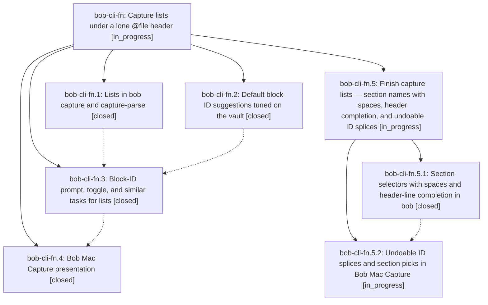

# Bead: bob-cli-fn — Capture lists under a lone @file header

[Bead Pages](../README.md) / bob-cli-fn

**Status:** ◐ in_progress · **Type:** ▸ plan · **Tier:** epic
**Owner:** `bryanbugyi34@gmail.com` · **Created by:** [bbugyi200.apollo.c1](https://github.com/bobs-org/bob-cli--agents/blob/main/sessions/bbugyi200.apollo.c1.md) · **Assignee:** `bob-cli-fn.land`
**Created:** 2026-11-01 23:41:34 EST
**Plan:** [202611/capture\_route\_lists.md](https://github.com/bobs-org/bob-cli--plans/blob/main/202611/capture_route_lists.md)

<!-- sase:links:start -->

## Links

| Relation | Artifact | Why |
| --- | --- | --- |
| implemented-by | [plan:202611/capture_route_lists.md][1] | derived from the plan's `bead_id:` frontmatter field |

_Plus 1 automatic references — see [Referenced By](#referenced-by)._

[1]: https://github.com/bobs-org/bob-cli--plans/blob/main/202611/capture_route_lists.md

<!-- sase:links:end -->

## Description

A capture item whose first line is only `@file` (or `@file#section`) files each bullet below it as its own new task (or section note) in that file. A trailing ` :` or ` ^` on a task bullet, or on one of its nested bullets, opens a block-ID prompt for that task with a default ID Bryan is likely to accept, and ` :<id>` also links the task into today's daily note. Execution, `capture-parse`, `capture-complete`, the dry-run preview, and Bob Mac Capture always agree.

## Notes

[2026-11-02T09:07:25Z · bob-cli-fl.3.1.land] DISCOVERED ISSUE: bob-cli-fl.3.1 land triage of bob-cli-fl.3.1.3 notes #1 and #2 confirms two failures introduced by fn.1 commit 0ebd0714: (1) editor_parse.rs:4286 calls detect_list_header(&line) inside Iterator::find where line is already borrowed, violating the just check needless_borrow deny; (2) GRAMMAR_REVISION is now 6 but complete_drawers.rs:118,431 and complete_relationship_owner.rs:317 still assert grammar 5. fn.1 explicitly owns the grammar-6 contract and parser change. Repair the borrow and update the three assertions in the fn epic; no separate tasks created after all-status searches and last-week task sweep. These were reported as reproducing unchanged without Stats phase 3; the current landing has made no source edits.

[2026-11-02T09:56:00Z · bob-cli-fn.land] FOLLOW-UP TRIAGE (all proposals, before the remaining-work tale): fn.1 #1 BufferPart::as_str is resolved by 2d5ebfc9 (and event_task cleanup in 71a65dad); its citation to bob-cli-fj was incorrect, since fj concerns a Mac banner. No new task. fn.1 #2 and fn.2 #4 are the existing bob-cli-fo search-query issue, fixed by 8a9ec685: both tests in tools/docs/tests/test_capture_token_coverage.py pass on 35c46693. Added resolution evidence to fo rather than a duplicate or false +1. fn.1 #3 and fn.2 #5 routing counter flake are resolved by 37e68c09, which keys both counters to each test vault; no current occurrence established, no flake task. fn.1 #4, fn.2 #3, and fn.3 #1 list decision-record proposals are deliberately declined: memory_list_decision_record=no is final and no new reason to reopen it was provided. Authorized glossary:bulk-capture update is present and was read through sase memory read.

[2026-11-02T09:56:06Z · bob-cli-fn.land] FOLLOW-UP TRIAGE (remaining proposals): fn.1 #5 bare-@ parse/execution disagreement is unfinished epic scope, not a separate task: the approved Header outcomes require refusal while the current test explicitly pins literal capture. fn.2 #6 missed Jaccard acceptance is unfinished epic scope; it must meet baseline+0.03 without relaxing the <=17 length gate. fn.2 #7 proposal to change mounted plugin hold example is declined: the source bob-plugins docs/block-id-defaults.md describes its own JS prompt implementation, whose shared fixture and SB vector still expect hold. Independently ran node --test scripts/test-prompt-block-id-naming.cjs in the opened linked repo: 6 passed. Replacing that value with Rust hold-directive would misdocument the plugin. fn.4 #1 macOS verification now has exact evidence: fn.4 SHA 0f2f46f run 41422994551 failed Build on the same fj eventWarningBanner error and fp ViewBuilder/NotificationService errors. Corroborated both existing tasks with +1 and file:explicit:40ebc33c0a7f0e88e5d9dbd3; AppKit tests remain unrun. fn.4 #2 native Undo after ID-splice acceptance is explicitly required by this epic and remains epic work. fn.4 #3 missing Capture lists link in bob-cli Mac index is now actionable integration because 0f2f46f includes docs/capture-lists.md and nav entry; it remains in the repair tale. Every distinct proposal is resolved, declined with evidence, corroborated, or assigned to remaining epic work; no new task was necessary.

[2026-11-02T09:56:11Z · bob-cli-fn.land] LAND AUDIT: Read all four child beads and all notes, approved plan and DECISIONS, actual implementation/tests, bob-cli phase commits 62a82104/0ebd0714/35c46693 and Mac 0f2f46f. Reviewed all non-fn commits since 62a82104 plus creation-window drift: 37e68c09, 8a9ec685, 2d5ebfc9, 71a65dad, f171e3cc, 4d950c58/4d2133b5/daf785b6; Mac 4f35460/2346b80. Fetched both origins: no newer base commits at audit. Ordinary per-item staged planning already inherits the clock writers, but the tale will pin list/batch off-clock equivalence. Epic note #1 needless_borrow and grammar-5 expectations were fixed in 35c46693. Additional source-confirmed gaps: detect_list_header rejects quoted section names with spaces and list execution drops exactness even for one-word literals; capture_related::discard_range ends at next.start, so removing a bullet before another list also removes that list header and may reroute its survivors. These need regression reproductions/repairs. The approved ID calibration threshold and Mac undo requirement also remain incomplete. Wrote one medium tale, sase_plan_capture_lists_closeout.md, including the concrete epic closeout as its final step. No --epic-symbol entries, no symvision recipe, and no parent_bead at audit. Did not run just check-full, did not claim a fresh just check pass, and did not close the epic or mark its plan done.

[2026-11-02T11:31:02Z · bryanbugyi34@gmail.com] It doesn't look like the new '@file#drawer' bulk capture syntax works for drawers with spaces in their name. See the 🔒 20261102\_062823.png screenshot for context. The epic lander agent should fix us before landing.

[2026-11-02T11:32:11Z · bryanbugyi34@gmail.com] re: the previous note | Think hard about the best way to address this, but my first thought was to transform spaces in drawer names to/from '__' when using the '#drawer' syntax.

[2026-11-02T12:04:50Z · bob-cli-fn.land] LAND AUDIT 2 (after a8f61375): (1) Calibration gate now MET on a paired same-corpus run (~/bob root notes, n=396, ignored block_id_calibration harness; old suggester from a disposable 62a82104^ worktree with the current harness injected): baseline first-Jaccard 0.329630, best3 0.416462, top3 0.164141, mean first len 14.1; HEAD first-Jaccard 0.360290 (>= 0.359630 required), best3 0.454107, top3 0.194444, mean first len 15.7 (<=17). fn.2 note #6 is resolved; any further suggester change must re-measure and keep the gate. (2) just check FAILS at HEAD on one epic-caused CLI test: tests/cli/capture/keep_moving.rs:1349 human_pick_suffix_and_not_pulled_in expects minted ^write-changelog-entry, but a8f61375's 20-byte first-suggestion cap mints ^write-changelog (suggestion change, not behavior change). All other tests pass (lib 4411, cli 2819/2820). just docs-check passes (447 passed, 1 skipped). (3) Bryan's note #5/#6: @sase#Future Work + bullets silently files a bullet 'Work' (child boom) in Future...; root cause is section completion inserting raw 'Future Work' (capture-complete context section replacement), plus @route#future-work silently falling back to the zeroth section because section selectors only prefix-match raw titles. (4) Header-line completion is dead once bullets follow: '@sa\n- boom' cursor 3 and '@sase#Fu\n- boom' cursor 8 return context null (the header line belongs to no list item in completion's item lookup). (5) Partial quoted header '@sase#"Fu\n- boom' parses as a section named '"Fu' with no needs and execution refuses 'task text is required'; partial-literal section completion returns no candidates. (6) Mac CI run 41435470545 on bob-mac-capture 2884ea2: Build passes (fj/fp fixed; notes added there); all 13 CaptureListPanelTests pass; 21 unrelated hosted failures = 7 tracked by bob-cli-f3 + 14 new, filed as bob-cli-fu (task(ci), large, related f3). Still required from the approved plan: Mac undoable block-ID splice accept (fn.4 #2), off-clock list-vs-batch test. No --epic-symbol entries; no symvision recipe; no parent_bead.

[2026-11-02T12:13:52Z · bob-cli-fn.land] FOLLOW-UP TRIAGE (land audit 2, final outcomes for every PROPOSED FOLLOW-UP): fn.1 #1 BufferPart::as_str: resolved by 2d5ebfc9 (no task). fn.1 #2 / fn.2 #4 docs-check token coverage: bob-cli-fo, fixed by 8a9ec685; docs-check passes now (447 passed). fn.1 #3 / fn.2 #5 routing-counter flake: resolved by 37e68c09; full just check lib run green (4411 passed). fn.1 #4 / fn.2 #3 / fn.3 #1 list decisions record: declined, memory_list_decision_record=no is final. fn.1 #5 bare-@ refusal: done in a8f61375 (incomplete_route refusal, tests pass). fn.2 #6 Jaccard gate: resolved, paired n=396 run meets baseline+0.03 (see LAND AUDIT 2). fn.2 #7 plugin hold example: declined (plugin's own JS prompt; 6 prompt-naming tests pass). fn.4 #1 macOS verification: CaptureListPanelTests 13/13 pass on master CI run 41435470545 (2884ea2); 21 unrelated hosted failures = bob-cli-f3 (7, existing) + new bob-cli-fu (14, task(ci), large, related f3, ready); resolution notes added to bob-cli-fj and bob-cli-fp (2884ea2 fixed Build). fn.4 #2 native Undo after splice accept: remaining epic work, child epic phase mac-undo. fn.4 #3 Capture lists link in bob-cli Mac index: done in a8f61375. New from Bryan's notes #5/#6 (spaced section names) and the audit (header-line completion, unterminated quoted section disagreement, off-clock list test): remaining epic work, child epic phase section-selectors; Bryan's '__' spelling considered and declined in favor of Bob's existing hyphen slug rule (drawers/Pomodoro names) plus quoted literals, rationale in the child plan. Lander fixed the only just check failure (epic-caused keep_moving ^write-changelog expectation) in this turn; clippy gate, fmt, and the keep_moving CLI suite pass.

## Attachments

- 🔒 20261102\_062823.png · image/png · 2854×1686 · 1.13864 MiB (private attachment)

## Phases

| Bead | Title | Status | Size | Created | Agents | Commits |
|---|---|---|---|---|---:|---:|
| [bob-cli-fn.1](bob-cli-fn.1.md) | Lists in bob capture and capture-parse | ✓ closed | medium | 2026-11-01 | 1 | 1 |
| [bob-cli-fn.2](bob-cli-fn.2.md) | Default block-ID suggestions tuned on the vault | ✓ closed | medium | 2026-11-01 | 1 | 1 |
| [bob-cli-fn.3](bob-cli-fn.3.md) | Block-ID prompt, toggle, and similar tasks for lists | ✓ closed | medium | 2026-11-01 | 1 | 1 |
| [bob-cli-fn.4](bob-cli-fn.4.md) | Bob Mac Capture presentation | ✓ closed | medium | 2026-11-01 | 1 | 0 |

## Lineage

## Agents

| Agent | Bead | Commits |
|---|---|---:|
| [bbugyi200.apollo.bob-cli-fn.1](https://github.com/bobs-org/bob-cli--agents/blob/main/agents/bbugyi200.apollo.bob-cli-fn.1/README.md) | [bob-cli-fn.1](bob-cli-fn.1.md) | 1 |
| [bbugyi200.apollo.bob-cli-fn.2](https://github.com/bobs-org/bob-cli--agents/blob/main/agents/bbugyi200.apollo.bob-cli-fn.2/README.md) | [bob-cli-fn.2](bob-cli-fn.2.md) | 1 |
| [bbugyi200.apollo.bob-cli-fn.3](https://github.com/bobs-org/bob-cli--agents/blob/main/sessions/bbugyi200.apollo.bob-cli-fn.3.md) | [bob-cli-fn.3](bob-cli-fn.3.md) | 1 |
| [bbugyi200.apollo.bob-cli-fn.4](https://github.com/bobs-org/bob-cli--agents/blob/main/agents/bbugyi200.apollo.bob-cli-fn.4/README.md) | [bob-cli-fn.4](bob-cli-fn.4.md) | 0 |
| [bbugyi200.apollo.bob-cli-fn.5.1](https://github.com/bobs-org/bob-cli--agents/blob/main/sessions/bbugyi200.apollo.bob-cli-fn.5.1.md) | [bob-cli-fn.5.1](bob-cli-fn.5.1.md) | 1 |
| [bbugyi200.apollo.bob-cli-fn.5.2](https://github.com/bobs-org/bob-cli--agents/blob/main/agents/bbugyi200.apollo.bob-cli-fn.5.2/README.md) | [bob-cli-fn.5.2](bob-cli-fn.5.2.md) | 0 |
| [bbugyi200.apollo.bob-cli-fn.5.land](https://github.com/bobs-org/bob-cli--agents/blob/main/agents/bbugyi200.apollo.bob-cli-fn.5.land/README.md) | [bob-cli-fn.5](bob-cli-fn.5.md) | 0 |
| [bbugyi200.apollo.bob-cli-fn.land](https://github.com/bobs-org/bob-cli--agents/blob/main/sessions/bbugyi200.apollo.bob-cli-fn.land.md) | [bob-cli-fn](README.md) | 1 |

## Commits

| Repo | Commit | Subject | Bead | Committed |
|---|---|---|---|---|
| bob-cli | [`62a8210`](https://github.com/bobs-org/bob-cli/commit/62a821044e665bd618b02859f0dd10879987f196) | feat(capture): retune shared block-ID suggestions from vault calibration | [bob-cli-fn.2](bob-cli-fn.2.md) | 2026-11-02 01:50:35 EST |
| bob-cli | [`0ebd071`](https://github.com/bobs-org/bob-cli/commit/0ebd0714f8d90de0b9be7616d7eff2dd305066aa) | feat(capture)!: file each list bullet as its own capture | [bob-cli-fn.1](bob-cli-fn.1.md) | 2026-11-02 02:55:11 EST |
| bob-cli | [`35c4669`](https://github.com/bobs-org/bob-cli/commit/35c46693134d9f5407b0ae61e246ce7ad74767ee) | feat(capture): add list block ID editor assists | [bob-cli-fn.3](bob-cli-fn.3.md) | 2026-11-02 04:11:39 EST |
| bob-cli | [`a8f6137`](https://github.com/bobs-org/bob-cli/commit/a8f6137514819f462b0182ad1081960ae566fc7c) | feat(capture)!: repair list headers, discard ranges, and ID tuning | [bob-cli-fn](README.md) | 2026-11-02 06:23:49 EST |
| bob-cli | [`b483c93`](https://github.com/bobs-org/bob-cli/commit/b483c93b0ec02c5589ef0535d78de10ee31f0afb) | feat(capture): round-trip spaced section selectors | [bob-cli-fn.5.1](bob-cli-fn.5.1.md) | 2026-11-02 08:40:45 EST |

<!-- sase:referenced-by:start -->

## Referenced By

| Relation | Artifact | Why | Uses |
| --- | --- | --- | ---: |
| read-by | [agent:bob-cli-fn.2][1] | Need epic plan context, decisions, and sibling phase status for id-suggester | 1 |

[1]: https://github.com/bobs-org/bob-cli--agents/blob/main/agents/bbugyi200.apollo.bob-cli-fn.2/README.md

<!-- sase:referenced-by:end -->
