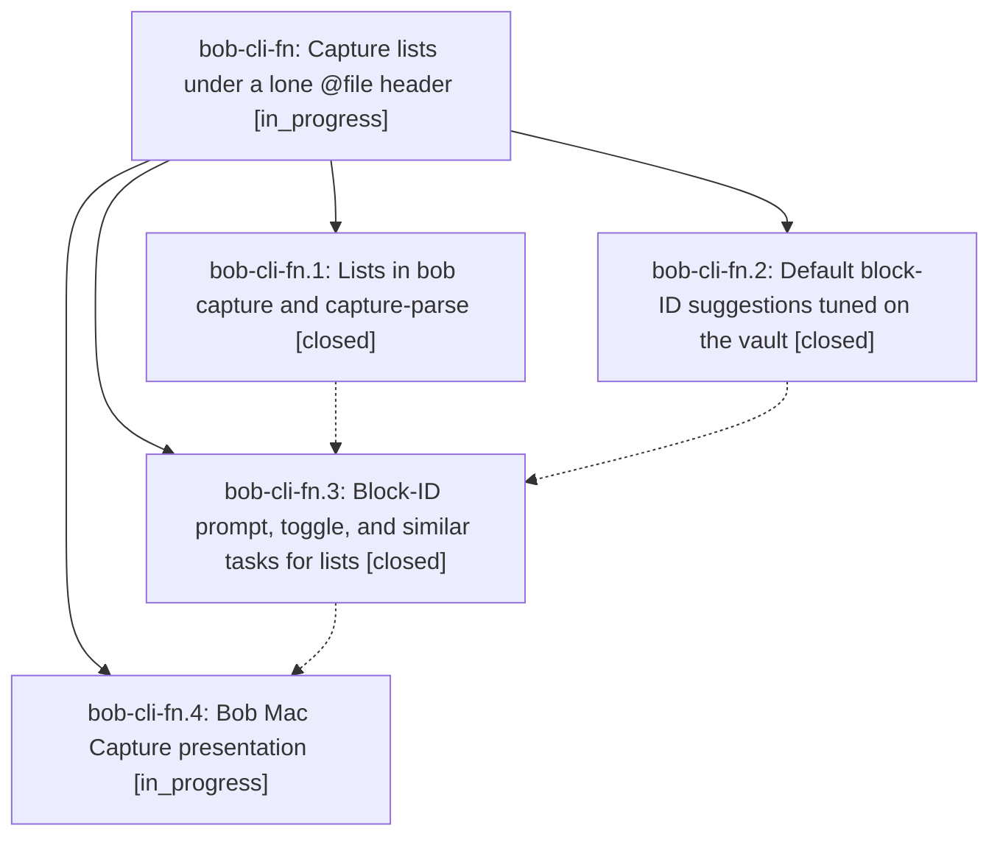

# Bead: bob-cli-fn — Capture lists under a lone @file header

[Bead Pages](../README.md) / bob-cli-fn

**Status:** ◐ in_progress · **Type:** ▸ plan · **Tier:** epic
**Owner:** `bryanbugyi34@gmail.com` · **Created by:** [bbugyi200.apollo.c1](https://github.com/bobs-org/bob-cli--agents/blob/main/sessions/bbugyi200.apollo.c1.md) · **Assignee:** `bob-cli-fn.land`
**Created:** 2026-11-01 23:41:34 EST
**Plan:** [202611/capture\_route\_lists.md](https://github.com/bobs-org/bob-cli--plans/blob/main/202611/capture_route_lists.md)

<!-- sase:links:start -->

## Links

| Relation | Artifact | Why |
| --- | --- | --- |
| implemented-by | [plan:202611/capture_route_lists.md][1] | derived from the plan's `bead_id:` frontmatter field |

_Plus 1 automatic references — see [Referenced By](#referenced-by)._

[1]: https://github.com/bobs-org/bob-cli--plans/blob/main/202611/capture_route_lists.md

<!-- sase:links:end -->

## Description

A capture item whose first line is only `@file` (or `@file#section`) files each bullet below it as its own new task (or section note) in that file. A trailing ` :` or ` ^` on a task bullet, or on one of its nested bullets, opens a block-ID prompt for that task with a default ID Bryan is likely to accept, and ` :<id>` also links the task into today's daily note. Execution, `capture-parse`, `capture-complete`, the dry-run preview, and Bob Mac Capture always agree.

## Notes

[2026-11-02T09:07:25Z · bob-cli-fl.3.1.land] DISCOVERED ISSUE: bob-cli-fl.3.1 land triage of bob-cli-fl.3.1.3 notes #1 and #2 confirms two failures introduced by fn.1 commit 0ebd0714: (1) editor_parse.rs:4286 calls detect_list_header(&line) inside Iterator::find where line is already borrowed, violating the just check needless_borrow deny; (2) GRAMMAR_REVISION is now 6 but complete_drawers.rs:118,431 and complete_relationship_owner.rs:317 still assert grammar 5. fn.1 explicitly owns the grammar-6 contract and parser change. Repair the borrow and update the three assertions in the fn epic; no separate tasks created after all-status searches and last-week task sweep. These were reported as reproducing unchanged without Stats phase 3; the current landing has made no source edits.

## Phases

| Bead | Title | Status | Size | Created | Agents | Commits |
|---|---|---|---|---|---:|---:|
| [bob-cli-fn.1](bob-cli-fn.1.md) | Lists in bob capture and capture-parse | ✓ closed | medium | 2026-11-01 | 1 | 1 |
| [bob-cli-fn.2](bob-cli-fn.2.md) | Default block-ID suggestions tuned on the vault | ✓ closed | medium | 2026-11-01 | 1 | 1 |
| [bob-cli-fn.3](bob-cli-fn.3.md) | Block-ID prompt, toggle, and similar tasks for lists | ✓ closed | medium | 2026-11-01 | 1 | 1 |
| [bob-cli-fn.4](bob-cli-fn.4.md) | Bob Mac Capture presentation | ◐ in_progress | medium | 2026-11-01 | 1 | 0 |

## Lineage

## Agents

| Agent | Bead | Commits |
|---|---|---:|
| [bbugyi200.apollo.bob-cli-fn.1](https://github.com/bobs-org/bob-cli--agents/blob/main/agents/bbugyi200.apollo.bob-cli-fn.1/README.md) | [bob-cli-fn.1](bob-cli-fn.1.md) | 1 |
| [bbugyi200.apollo.bob-cli-fn.2](https://github.com/bobs-org/bob-cli--agents/blob/main/agents/bbugyi200.apollo.bob-cli-fn.2/README.md) | [bob-cli-fn.2](bob-cli-fn.2.md) | 1 |
| [bbugyi200.apollo.bob-cli-fn.3](https://github.com/bobs-org/bob-cli--agents/blob/main/sessions/bbugyi200.apollo.bob-cli-fn.3.md) | [bob-cli-fn.3](bob-cli-fn.3.md) | 1 |
| [bbugyi200.apollo.bob-cli-fn.4](https://github.com/bobs-org/bob-cli--agents/blob/main/agents/bbugyi200.apollo.bob-cli-fn.4/README.md) | [bob-cli-fn.4](bob-cli-fn.4.md) | 0 |
| [bbugyi200.apollo.bob-cli-fn.land](https://github.com/bobs-org/bob-cli--agents/blob/main/agents/bbugyi200.apollo.bob-cli-fn.land/README.md) | [bob-cli-fn](README.md) | 0 |

## Commits

| Repo | Commit | Subject | Bead | Committed |
|---|---|---|---|---|
| bob-cli | [`62a8210`](https://github.com/bobs-org/bob-cli/commit/62a821044e665bd618b02859f0dd10879987f196) | feat(capture): retune shared block-ID suggestions from vault calibration | [bob-cli-fn.2](bob-cli-fn.2.md) | 2026-11-02 01:50:35 EST |
| bob-cli | [`0ebd071`](https://github.com/bobs-org/bob-cli/commit/0ebd0714f8d90de0b9be7616d7eff2dd305066aa) | feat(capture)!: file each list bullet as its own capture | [bob-cli-fn.1](bob-cli-fn.1.md) | 2026-11-02 02:55:11 EST |
| bob-cli | [`35c4669`](https://github.com/bobs-org/bob-cli/commit/35c46693134d9f5407b0ae61e246ce7ad74767ee) | feat(capture): add list block ID editor assists | [bob-cli-fn.3](bob-cli-fn.3.md) | 2026-11-02 04:11:39 EST |

<!-- sase:referenced-by:start -->

## Referenced By

| Relation | Artifact | Why | Uses |
| --- | --- | --- | ---: |
| read-by | [agent:bob-cli-fn.2][1] | Need epic plan context, decisions, and sibling phase status for id-suggester | 1 |

[1]: https://github.com/bobs-org/bob-cli--agents/blob/main/agents/bbugyi200.apollo.bob-cli-fn.2/README.md

<!-- sase:referenced-by:end -->
