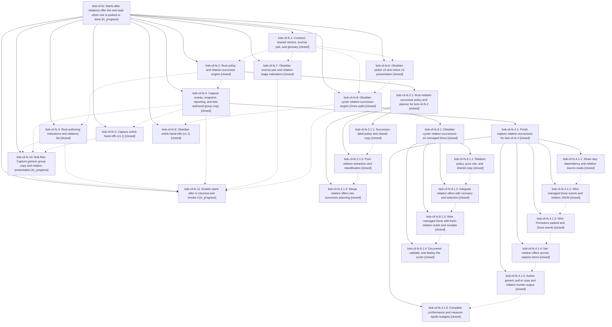

# Bead: bob-cli-fs — Starts-after relations offer the next task when one is parked or done

[Bead Pages](../README.md) / bob-cli-fs

**Status:** ◐ in_progress · **Type:** ▸ plan · **Tier:** epic
**Owner:** `bryanbugyi34@gmail.com` · **Created by:** [bbugyi200.athena.research.5m.linker.w0](https://github.com/bobs-org/bob-cli--agents/blob/main/sessions/bbugyi200.athena.research.5m.linker.w0.md) · **Assignee:** `bob-cli-fs.land`
**Created:** 2026-11-02 05:57:11 EST
**Plan:** [202611/starts\_after\_relation.md](https://github.com/bobs-org/bob-cli--plans/blob/main/202611/starts_after_relation.md)

<!-- sase:links:start -->

## Links

| Relation | Artifact | Why |
| --- | --- | --- |
| implemented-by | [plan:202611/starts_after_relation.md][1] | derived from the plan's `bead_id:` frontmatter field |

[1]: https://github.com/bobs-org/bob-cli--plans/blob/main/202611/starts_after_relation.md

<!-- sase:links:end -->

## Description

A task linked "S starts after T" is offered as a successor (never auto-linked, never blocked) when T is parked (left Pending with no live Task Link today) or done, on every surface, and every surface says plainly which relation and which event fired.

## Notes

[2026-11-02T14:02:41Z · bob-cli-fs.2.1.land] DISCOVERED ISSUE: Landing bob-cli-fs.2.1 verified phase bob-cli-fs.2.1.1 PROPOSED FOLLOW-UP notes #1/#2. At bob-cli cb729a76 and bob-plugins 5f1c23c, cycler relation_successor/vectors.json is byte-identical to bob-cli (SHA256 08ffccedd68489dbfc06c73faf7a1be65df7b49cb48fdee1804f98d748c11cc0), but navigation fixtures still have invalid unquoted SA23 YAML and the 49-character SU-P22 expectation. Navigation src/206b-successor-relation-copy.js also slices 48 UTF-16 code units then appends ellipsis, violating the approved 48-character-inclusive Unicode-safe cap. This is outstanding integration caused by the shared fixture correction, not a new task; the bob-cli-fs.2.1 landing repair tale will sync the navigation fixture and repair/verify its truncation. No changes to other parent phases are requested.

[2026-11-02T18:15:19Z · bob-cli-fl.land] DISCOVERED ISSUE (from bob-cli-fl land agent, 2026-11-02): just check fails on master d8b4d4fb in docs_reference::cli_reference_is_current — docs/reference/cli/capture-complete.md, capture-parse.md, and relations.md are out of date. BOB_UPDATE_GOLDENS=1 cargo test --test cli docs_reference regenerates one line in each: 'Configured cancel and complete labels' becomes 'Configured cancel, complete, and successor labels', adding offers_source / relation_successor wording. That is the help text added by d8b4d4fb feat(relations): surface successor label effects (SASE_BEAD bob-cli-fs.3). Fix: run just docs-gen and commit the three regenerated reference pages. bob-cli-fl did not change them, to avoid colliding with this epic's landing.

## Phases

| Bead | Title | Status | Size | Created | Agents | Commits |
|---|---|---|---|---|---:|---:|
| [bob-cli-fs.1](bob-cli-fs.1.md) | Contract, shared vectors, inverse pair, and glossary | ✓ closed | medium | 2026-11-02 | 1 | 1 |
| [bob-cli-fs.10](bob-cli-fs.10.md) | Bob Mac Capture generic group copy and relation presentation | ◐ in_progress | large | 2026-11-02 | 1 | 0 |
| [bob-cli-fs.11](bob-cli-fs.11.md) | Enable starts after in chezmoi and smoke it | ◐ in_progress | small | 2026-11-02 | 1 | 0 |
| [bob-cli-fs.2](bob-cli-fs.2.md) | Rust policy and relation-successor engine | ✓ closed | large | 2026-11-02 | 1 | 0 |
| [bob-cli-fs.3](bob-cli-fs.3.md) | Rust authoring indications and relations list | ✓ closed | medium | 2026-11-02 | 1 | 1 |
| [bob-cli-fs.4](bob-cli-fs.4.md) | Capture events, snapshot, reporting, and bob-authored group copy | ✓ closed | large | 2026-11-02 | 1 | 0 |
| [bob-cli-fs.5](bob-cli-fs.5.md) | Capture unlink hand-offs (v1.1) | ✓ closed | medium | 2026-11-02 | 1 | 1 |
| [bob-cli-fs.6](bob-cli-fs.6.md) | Obsidian picker v3 and notice v3 presentation | ✓ closed | medium | 2026-11-02 | 1 | 0 |
| [bob-cli-fs.7](bob-cli-fs.7.md) | Obsidian inverse pair and relation-stage indications | ✓ closed | medium | 2026-11-02 | 1 | 0 |
| [bob-cli-fs.8](bob-cli-fs.8.md) | Obsidian cycler relation-successor engine (Done path) | ✓ closed | large | 2026-11-02 | 1 | 0 |
| [bob-cli-fs.9](bob-cli-fs.9.md) | Obsidian unlink hand-offs (v1.1) | ✓ closed | medium | 2026-11-02 | 1 | 0 |

## Lineage

## Agents

| Agent | Bead | Commits |
|---|---|---:|
| [bbugyi200.athena.bob-cli-fs.1](https://github.com/bobs-org/bob-cli--agents/blob/main/sessions/bbugyi200.athena.bob-cli-fs.1.md) | [bob-cli-fs.1](bob-cli-fs.1.md) | 1 |
| [bbugyi200.athena.bob-cli-fs.10](https://github.com/bobs-org/bob-cli--agents/blob/main/agents/bbugyi200.athena.bob-cli-fs.10/README.md) | [bob-cli-fs.10](bob-cli-fs.10.md) | 0 |
| [bbugyi200.athena.bob-cli-fs.11](https://github.com/bobs-org/bob-cli--agents/blob/main/agents/bbugyi200.athena.bob-cli-fs.11/README.md) | [bob-cli-fs.11](bob-cli-fs.11.md) | 0 |
| [bbugyi200.athena.bob-cli-fs.2](https://github.com/bobs-org/bob-cli--agents/blob/main/sessions/bbugyi200.athena.bob-cli-fs.2.md) | [bob-cli-fs.2](bob-cli-fs.2.md) | 0 |
| [bbugyi200.athena.bob-cli-fs.2.1.1](https://github.com/bobs-org/bob-cli--agents/blob/main/agents/bbugyi200.athena.bob-cli-fs.2.1.1/README.md) | [bob-cli-fs.2.1.1](bob-cli-fs.2.1.1.md) | 1 |
| [bbugyi200.athena.bob-cli-fs.2.1.2](https://github.com/bobs-org/bob-cli--agents/blob/main/agents/bbugyi200.athena.bob-cli-fs.2.1.2/README.md) | [bob-cli-fs.2.1.2](bob-cli-fs.2.1.2.md) | 1 |
| [bbugyi200.athena.bob-cli-fs.2.1.3](https://github.com/bobs-org/bob-cli--agents/blob/main/agents/bbugyi200.athena.bob-cli-fs.2.1.3/README.md) | [bob-cli-fs.2.1.3](bob-cli-fs.2.1.3.md) | 1 |
| [bbugyi200.athena.bob-cli-fs.2.1.land](https://github.com/bobs-org/bob-cli--agents/blob/main/sessions/bbugyi200.athena.bob-cli-fs.2.1.land.md) | [bob-cli-fs.2.1](bob-cli-fs.2.1.md) | 3 |
| [bbugyi200.athena.bob-cli-fs.3](https://github.com/bobs-org/bob-cli--agents/blob/main/sessions/bbugyi200.athena.bob-cli-fs.3.md) | [bob-cli-fs.3](bob-cli-fs.3.md) | 1 |
| [bbugyi200.athena.bob-cli-fs.4](https://github.com/bobs-org/bob-cli--agents/blob/main/sessions/bbugyi200.athena.bob-cli-fs.4.md) | [bob-cli-fs.4](bob-cli-fs.4.md) | 0 |
| [bbugyi200.athena.bob-cli-fs.4.1.1](https://github.com/bobs-org/bob-cli--agents/blob/main/sessions/bbugyi200.athena.bob-cli-fs.4.1.1.md) | [bob-cli-fs.4.1.1](bob-cli-fs.4.1.1.md) | 1 |
| [bbugyi200.athena.bob-cli-fs.4.1.2](https://github.com/bobs-org/bob-cli--agents/blob/main/sessions/bbugyi200.athena.bob-cli-fs.4.1.2.md) | [bob-cli-fs.4.1.2](bob-cli-fs.4.1.2.md) | 1 |
| [bbugyi200.athena.bob-cli-fs.4.1.3](https://github.com/bobs-org/bob-cli--agents/blob/main/agents/bbugyi200.athena.bob-cli-fs.4.1.3/README.md) | [bob-cli-fs.4.1.3](bob-cli-fs.4.1.3.md) | 1 |
| [bbugyi200.athena.bob-cli-fs.4.1.4](https://github.com/bobs-org/bob-cli--agents/blob/main/agents/bbugyi200.athena.bob-cli-fs.4.1.4/README.md) | [bob-cli-fs.4.1.4](bob-cli-fs.4.1.4.md) | 1 |
| [bbugyi200.athena.bob-cli-fs.4.1.5](https://github.com/bobs-org/bob-cli--agents/blob/main/agents/bbugyi200.athena.bob-cli-fs.4.1.5/README.md) | [bob-cli-fs.4.1.5](bob-cli-fs.4.1.5.md) | 1 |
| [bbugyi200.athena.bob-cli-fs.4.1.6](https://github.com/bobs-org/bob-cli--agents/blob/main/sessions/bbugyi200.athena.bob-cli-fs.4.1.6.md) | [bob-cli-fs.4.1.6](bob-cli-fs.4.1.6.md) | 1 |
| [bbugyi200.athena.bob-cli-fs.4.1.land](https://github.com/bobs-org/bob-cli--agents/blob/main/sessions/bbugyi200.athena.bob-cli-fs.4.1.land.md) | [bob-cli-fs.4.1](bob-cli-fs.4.1.md) | 1 |
| [bbugyi200.athena.bob-cli-fs.5](https://github.com/bobs-org/bob-cli--agents/blob/main/sessions/bbugyi200.athena.bob-cli-fs.5.md) | [bob-cli-fs.5](bob-cli-fs.5.md) | 1 |
| [bbugyi200.athena.bob-cli-fs.6](https://github.com/bobs-org/bob-cli--agents/blob/main/agents/bbugyi200.athena.bob-cli-fs.6/README.md) | [bob-cli-fs.6](bob-cli-fs.6.md) | 0 |
| [bbugyi200.athena.bob-cli-fs.7](https://github.com/bobs-org/bob-cli--agents/blob/main/agents/bbugyi200.athena.bob-cli-fs.7/README.md) | [bob-cli-fs.7](bob-cli-fs.7.md) | 0 |
| [bbugyi200.athena.bob-cli-fs.8](https://github.com/bobs-org/bob-cli--agents/blob/main/sessions/bbugyi200.athena.bob-cli-fs.8.md) | [bob-cli-fs.8](bob-cli-fs.8.md) | 0 |
| [bbugyi200.athena.bob-cli-fs.8.1.1](https://github.com/bobs-org/bob-cli--agents/blob/main/agents/bbugyi200.athena.bob-cli-fs.8.1.1/README.md) | [bob-cli-fs.8.1.1](bob-cli-fs.8.1.1.md) | 0 |
| [bbugyi200.athena.bob-cli-fs.8.1.2](https://github.com/bobs-org/bob-cli--agents/blob/main/agents/bbugyi200.athena.bob-cli-fs.8.1.2/README.md) | [bob-cli-fs.8.1.2](bob-cli-fs.8.1.2.md) | 0 |
| [bbugyi200.athena.bob-cli-fs.8.1.3](https://github.com/bobs-org/bob-cli--agents/blob/main/sessions/bbugyi200.athena.bob-cli-fs.8.1.3.md) | [bob-cli-fs.8.1.3](bob-cli-fs.8.1.3.md) | 0 |
| [bbugyi200.athena.bob-cli-fs.8.1.4](https://github.com/bobs-org/bob-cli--agents/blob/main/agents/bbugyi200.athena.bob-cli-fs.8.1.4/README.md) | [bob-cli-fs.8.1.4](bob-cli-fs.8.1.4.md) | 0 |
| [bbugyi200.athena.bob-cli-fs.8.1.land](https://github.com/bobs-org/bob-cli--agents/blob/main/agents/bbugyi200.athena.bob-cli-fs.8.1.land/README.md) | [bob-cli-fs.8.1](bob-cli-fs.8.1.md) | 1 |
| [bbugyi200.athena.bob-cli-fs.9](https://github.com/bobs-org/bob-cli--agents/blob/main/agents/bbugyi200.athena.bob-cli-fs.9/README.md) | [bob-cli-fs.9](bob-cli-fs.9.md) | 0 |
| [bbugyi200.athena.bob-cli-fs.land](https://github.com/bobs-org/bob-cli--agents/blob/main/agents/bbugyi200.athena.bob-cli-fs.land/README.md) | [bob-cli-fs](README.md) | 0 |

## Commits

| Repo | Commit | Subject | Bead | Committed |
|---|---|---|---|---|
| bob-cli | [`0095426`](https://github.com/bobs-org/bob-cli/commit/0095426daa386bd9ff3c1006f228e8a33548bf4e) | feat(task-relations): document successor offer contract | [bob-cli-fs.1](bob-cli-fs.1.md) | 2026-11-02 06:20:05 EST |
| bob-cli | [`c3a2e62`](https://github.com/bobs-org/bob-cli/commit/c3a2e62acdec4ca22dc740038862ce5648156461) | feat(task-relations): add successor-label policy and shared copy | [bob-cli-fs.2.1.1](bob-cli-fs.2.1.1.md) | 2026-11-02 07:00:54 EST |
| bob-cli | [`ace86f8`](https://github.com/bobs-org/bob-cli/commit/ace86f8e5d7fc9c2103e7513953548b119b6629c) | feat(task-relations): add pure relation-successor classifier | [bob-cli-fs.2.1.2](bob-cli-fs.2.1.2.md) | 2026-11-02 07:39:55 EST |
| bob-cli | [`cb729a7`](https://github.com/bobs-org/bob-cli/commit/cb729a76190d4c365ebd470e5dac8ee54e9f5705) | feat(task-relations): merge relation offers into successor planning | [bob-cli-fs.2.1.3](bob-cli-fs.2.1.3.md) | 2026-11-02 08:49:32 EST |
| bob-cli | [`98bfec6`](https://github.com/bobs-org/bob-cli/commit/98bfec6aca2a877b9bceccb2ce5c9dbd6aa39267) | feat(task-relations): repair relation-successor ordering, identity, and recovery regressions | [bob-cli-fs.2.1](bob-cli-fs.2.1.md) | 2026-11-02 09:28:30 EST |
| bob-cli--plans | [`bob-cli--plans@e0da4ea`](https://github.com/bobs-org/bob-cli--plans/commit/e0da4ea604146f299ffabfeccfdf7339f5db9785) | chore(plans): mark cycler\_relation\_successors and its closeout done | [bob-cli-fs.8.1](bob-cli-fs.8.1.md) | 2026-11-02 10:22:51 EST |
| bob-cli | [`fdc34de`](https://github.com/bobs-org/bob-cli/commit/fdc34de9bf82600e187ef8f6ebb66473fc4d2bbf) | fix(task-complete): finish relation successor core | [bob-cli-fs.2.1](bob-cli-fs.2.1.md) | 2026-11-02 12:17:57 EST |
| bob-cli--plans | [`bob-cli--plans@07e1151`](https://github.com/bobs-org/bob-cli--plans/commit/07e115192e515d4e1d6db2ab384869ca0ce89030) | docs(plans): mark relation successor core complete | [bob-cli-fs.2.1](bob-cli-fs.2.1.md) | 2026-11-02 12:18:27 EST |
| bob-cli | [`d8b4d4f`](https://github.com/bobs-org/bob-cli/commit/d8b4d4fbdc7b9ec4868798fb40cacb687a10ebaf) | feat(relations): surface successor label effects | [bob-cli-fs.3](bob-cli-fs.3.md) | 2026-11-02 12:49:04 EST |
| bob-cli | [`30ae6ac`](https://github.com/bobs-org/bob-cli/commit/30ae6ac9786b58eeb5086cd1c6fea9ce808d55fe) | feat(capture): share lazy relation source snapshots | [bob-cli-fs.4.1.1](bob-cli-fs.4.1.1.md) | 2026-11-02 13:16:29 EST |
| bob-cli | [`e013169`](https://github.com/bobs-org/bob-cli/commit/e01316937db67b83b5cb9f9824c99748b5043438) | feat(capture): offer relation successors on managed Done | [bob-cli-fs.4.1.2](bob-cli-fs.4.1.2.md) | 2026-11-02 14:29:08 EST |
| bob-cli | [`690f006`](https://github.com/bobs-org/bob-cli/commit/690f006a9ca85cb219b07f05c63f3d0f2644f02b) | feat(capture): plan parked successors on pomodoro close | [bob-cli-fs.4.1.3](bob-cli-fs.4.1.3.md) | 2026-11-02 15:00:11 EST |
| bob-cli | [`d9d070b`](https://github.com/bobs-org/bob-cli/commit/d9d070b7fc1bb51d254b45fd6954bddd47e40ce8) | feat(capture): net relation offers across capture items | [bob-cli-fs.4.1.4](bob-cli-fs.4.1.4.md) | 2026-11-02 15:28:37 EST |
| bob-cli | [`d53756f`](https://github.com/bobs-org/bob-cli/commit/d53756fdd5b33121191130c07a1715f9d7d481e4) | feat(capture): emit ordered pull-in groups and relation human copy | [bob-cli-fs.4.1.5](bob-cli-fs.4.1.5.md) | 2026-11-02 16:18:20 EST |
| bob-cli | [`c20263c`](https://github.com/bobs-org/bob-cli/commit/c20263c6f0f3b4f2a720641a1ae579c5c9b68489) | fix(capture): skip previous-daily relation sources by relative path | [bob-cli-fs.4.1.6](bob-cli-fs.4.1.6.md) | 2026-11-02 17:51:45 EST |
| bob-cli | [`2aec2aa`](https://github.com/bobs-org/bob-cli/commit/2aec2aa472cf90d22ce607d3805dbceb10c92f72) | perf(capture): trim relation-successor overhead and re-measure apollo budgets | [bob-cli-fs.4.1](bob-cli-fs.4.1.md) | 2026-11-02 18:58:22 EST |
| bob-cli | [`71907da`](https://github.com/bobs-org/bob-cli/commit/71907dab7ceb7dab45a401a700e7069cd767bc24) | feat(capture): offer relation successors on Pending unlink | [bob-cli-fs.5](bob-cli-fs.5.md) | 2026-11-02 19:36:19 EST |
