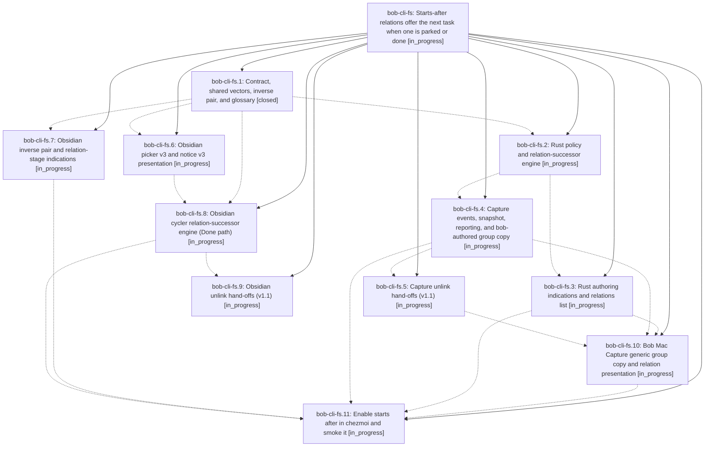

# Bead: bob-cli-fs — Starts-after relations offer the next task when one is parked or done

[Bead Pages](../README.md) / bob-cli-fs

**Status:** ◐ in_progress · **Type:** ▸ plan · **Tier:** epic
**Owner:** `bryanbugyi34@gmail.com` · **Created by:** [bbugyi200.athena.research.5m.linker.w0](https://github.com/bobs-org/bob-cli--agents/blob/main/sessions/bbugyi200.athena.research.5m.linker.w0.md) · **Assignee:** `bob-cli-fs.land`
**Created:** 2026-11-02 05:57:11 EST
**Plan:** [202611/starts\_after\_relation.md](https://github.com/bobs-org/bob-cli--plans/blob/main/202611/starts_after_relation.md)

## Description

A task linked "S starts after T" is offered as a successor (never auto-linked, never blocked) when T is parked (left Pending with no live Task Link today) or done, on every surface, and every surface says plainly which relation and which event fired.

## Phases

| Bead | Title | Status | Size | Created | Agents | Commits |
|---|---|---|---|---|---:|---:|
| [bob-cli-fs.1](bob-cli-fs.1.md) | Contract, shared vectors, inverse pair, and glossary | ✓ closed | medium | 2026-11-02 | 1 | 1 |
| [bob-cli-fs.10](bob-cli-fs.10.md) | Bob Mac Capture generic group copy and relation presentation | ◐ in_progress | large | 2026-11-02 | 1 | 0 |
| [bob-cli-fs.11](bob-cli-fs.11.md) | Enable starts after in chezmoi and smoke it | ◐ in_progress | small | 2026-11-02 | 1 | 0 |
| [bob-cli-fs.2](bob-cli-fs.2.md) | Rust policy and relation-successor engine | ◐ in_progress | large | 2026-11-02 | 1 | 0 |
| [bob-cli-fs.3](bob-cli-fs.3.md) | Rust authoring indications and relations list | ◐ in_progress | medium | 2026-11-02 | 1 | 0 |
| [bob-cli-fs.4](bob-cli-fs.4.md) | Capture events, snapshot, reporting, and bob-authored group copy | ◐ in_progress | large | 2026-11-02 | 1 | 0 |
| [bob-cli-fs.5](bob-cli-fs.5.md) | Capture unlink hand-offs (v1.1) | ◐ in_progress | medium | 2026-11-02 | 1 | 0 |
| [bob-cli-fs.6](bob-cli-fs.6.md) | Obsidian picker v3 and notice v3 presentation | ◐ in_progress | medium | 2026-11-02 | 1 | 0 |
| [bob-cli-fs.7](bob-cli-fs.7.md) | Obsidian inverse pair and relation-stage indications | ◐ in_progress | medium | 2026-11-02 | 1 | 0 |
| [bob-cli-fs.8](bob-cli-fs.8.md) | Obsidian cycler relation-successor engine (Done path) | ◐ in_progress | large | 2026-11-02 | 1 | 0 |
| [bob-cli-fs.9](bob-cli-fs.9.md) | Obsidian unlink hand-offs (v1.1) | ◐ in_progress | medium | 2026-11-02 | 1 | 0 |

## Lineage

## Agents

| Agent | Bead | Commits |
|---|---|---:|
| [bbugyi200.athena.bob-cli-fs.1](https://github.com/bobs-org/bob-cli--agents/blob/main/sessions/bbugyi200.athena.bob-cli-fs.1.md) | [bob-cli-fs.1](bob-cli-fs.1.md) | 1 |
| [bbugyi200.athena.bob-cli-fs.10](https://github.com/bobs-org/bob-cli--agents/blob/main/agents/bbugyi200.athena.bob-cli-fs.10/README.md) | [bob-cli-fs.10](bob-cli-fs.10.md) | 0 |
| [bbugyi200.athena.bob-cli-fs.11](https://github.com/bobs-org/bob-cli--agents/blob/main/agents/bbugyi200.athena.bob-cli-fs.11/README.md) | [bob-cli-fs.11](bob-cli-fs.11.md) | 0 |
| [bbugyi200.athena.bob-cli-fs.2](https://github.com/bobs-org/bob-cli--agents/blob/main/agents/bbugyi200.athena.bob-cli-fs.2/README.md) | [bob-cli-fs.2](bob-cli-fs.2.md) | 0 |
| [bbugyi200.athena.bob-cli-fs.3](https://github.com/bobs-org/bob-cli--agents/blob/main/agents/bbugyi200.athena.bob-cli-fs.3/README.md) | [bob-cli-fs.3](bob-cli-fs.3.md) | 0 |
| [bbugyi200.athena.bob-cli-fs.4](https://github.com/bobs-org/bob-cli--agents/blob/main/agents/bbugyi200.athena.bob-cli-fs.4/README.md) | [bob-cli-fs.4](bob-cli-fs.4.md) | 0 |
| [bbugyi200.athena.bob-cli-fs.5](https://github.com/bobs-org/bob-cli--agents/blob/main/agents/bbugyi200.athena.bob-cli-fs.5/README.md) | [bob-cli-fs.5](bob-cli-fs.5.md) | 0 |
| [bbugyi200.athena.bob-cli-fs.6](https://github.com/bobs-org/bob-cli--agents/blob/main/agents/bbugyi200.athena.bob-cli-fs.6/README.md) | [bob-cli-fs.6](bob-cli-fs.6.md) | 0 |
| [bbugyi200.athena.bob-cli-fs.7](https://github.com/bobs-org/bob-cli--agents/blob/main/agents/bbugyi200.athena.bob-cli-fs.7/README.md) | [bob-cli-fs.7](bob-cli-fs.7.md) | 0 |
| [bbugyi200.athena.bob-cli-fs.8](https://github.com/bobs-org/bob-cli--agents/blob/main/agents/bbugyi200.athena.bob-cli-fs.8/README.md) | [bob-cli-fs.8](bob-cli-fs.8.md) | 0 |
| [bbugyi200.athena.bob-cli-fs.9](https://github.com/bobs-org/bob-cli--agents/blob/main/agents/bbugyi200.athena.bob-cli-fs.9/README.md) | [bob-cli-fs.9](bob-cli-fs.9.md) | 0 |
| [bbugyi200.athena.bob-cli-fs.land](https://github.com/bobs-org/bob-cli--agents/blob/main/agents/bbugyi200.athena.bob-cli-fs.land/README.md) | [bob-cli-fs](README.md) | 0 |

## Commits

| Repo | Commit | Subject | Bead | Committed |
|---|---|---|---|---|
| bob-cli | [`0095426`](https://github.com/bobs-org/bob-cli/commit/0095426daa386bd9ff3c1006f228e8a33548bf4e) | feat(task-relations): document successor offer contract | [bob-cli-fs.1](bob-cli-fs.1.md) | 2026-11-02 06:20:05 EST |
