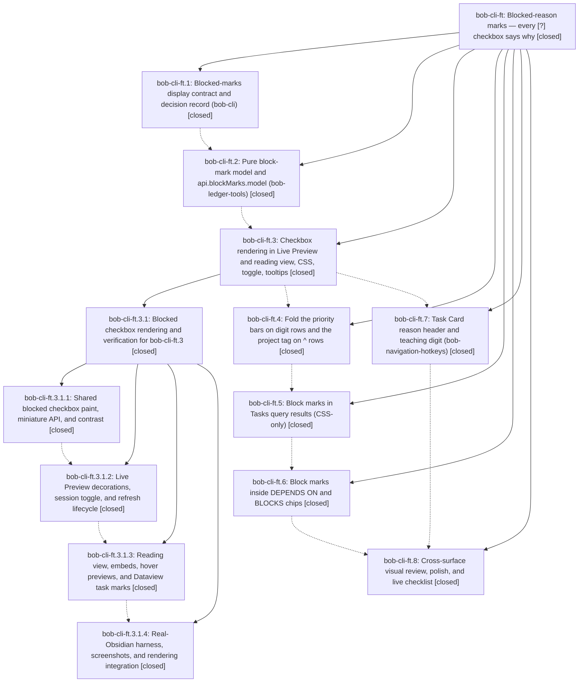

# Bead: bob-cli-ft — Blocked-reason marks — every \[?\] checkbox says why

[Bead Pages](../README.md) / bob-cli-ft

**Status:** ✓ closed · **Resolution:** done · **Type:** ▸ plan · **Tier:** epic
**Owner:** `bryanbugyi34@gmail.com` · **Created by:** [bbugyi200.athena.16w](https://github.com/bobs-org/bob-cli--agents/blob/main/sessions/bbugyi200.athena.16w.md) · **Assignee:** `bob-cli-ft.land`
**Created:** 2026-11-02 06:28:10 EST · **Closed:** 2026-11-02 14:49:42 EST
**Plan:** [202611/blocked\_reason\_marks.md](https://github.com/bobs-org/bob-cli--plans/blob/main/202611/blocked_reason_marks.md)

<!-- sase:links:start -->

## Links

| Relation | Artifact | Why |
| --- | --- | --- |
| implemented-by | [plan:202611/blocked_reason_marks.md][1] | derived from the plan's `bead_id:` frontmatter field |
| related | [bead:bob-cli-g6][2] | Proposing epic: Blocked-reason marks; contract docs/blocked-marks.md holds the BM vectors to move into the fixture |
| related | [bead:bob-cli-g7][3] | Proposing epic: Blocked-reason marks; its CSS must keep winning over the moved status CSS by specificity |

_Plus 2 automatic references — see [Referenced By](#referenced-by)._

[1]: https://github.com/bobs-org/bob-cli--plans/blob/main/202611/blocked_reason_marks.md
[2]: https://github.com/bobs-org/bob-cli--beads/blob/main/pages/bob-cli-g6/README.md
[3]: https://github.com/bobs-org/bob-cli--beads/blob/main/pages/bob-cli-g7/README.md

<!-- sase:links:end -->

## Description

In Obsidian, a Blocked task's checkbox shows why it is blocked. It shows & for its own open prerequisite, ^ for a blocked project, 1–4 for a P1–P4 priority deferral, ⟲ for a recurring rule's next run, ? for a date picked by hand, and a dashed ? when no reason is left. Solid boxes mean held by other work, hollow boxes mean waiting for a date. Stored Markdown, reconcile, and the Tasks registry stay exactly as they are.

## Notes

[2026-11-02T19:05:46Z · bob-cli-ft.land] FOLLOW-UP TRIAGE (land agent): (1) Pre-existing bob-plugins npm test failures proposed by .2 #1, .4 #1, .7 #1, .8 #1 -> corroborated existing ci tasks with an independent reproduction on bob-plugins master 93d3859: bob-cli-et (freshness-namespace not ok 6), bob-cli-f7 (keep-inbox not ok 26), bob-cli-eh (note-ready not ok 39 + relation-index not ok 4), bob-cli-ff (schedule-work-log not ok 6); no new task. bob-cli-f8 (task-wikilink perf budgets, .2 #1) passed 5/5 in isolation this run, so no +1 (already corroborated by bob-cli-ft.3.1.land). (2) .8 #2 Rust BlockReason mark key + shared JSON BM fixture -> new feature task bob-cli-g6 (large; no duplicate, no causal active epic; related link to bob-cli-66). (3) .8 #3 move task-statuses.css into bob-ledger-tools -> new feature task bob-cli-g7 (large; no duplicate). Child-epic bob-cli-ft.3.1 dispositions (reduced-motion declined, cold-chunk on f8) stand as recorded in its close note. No epic-symbol entries; no symvision recipe in bob-cli.

[2026-11-02T19:08:00Z · bob-cli-ft.land] LAND AUDIT: verified phases .1-.8 and child epic .3.1 against source/commits (bob-cli 16f3a28f..8c7e7103; bob-plugins d58b1fa..93d3859). DECISIONS honored: own_first, chevron, quiet, memory_decision_record=no (no decision strand). Post-epic drift (bob-cli gcal/capture/relations/stats/frees-marks b508f0b6; bob-plugins af97bcd, 1f2c1f8) has no block-marks overlap; frees-marks (bob-cli-g1) is independent. Remaining epic-caused gaps in the chips phase (.6): block-marks refresh (toggle/ladder/rollover/resume) never dispatches the dependency-chips refresh; toggling off blanks marked chip boxes (empty span.bob-block-mark, no ? fallback) in Live Preview until next rebuild and in reading view until re-render; chip tooltip appends the whole block-mark tooltip incl. Ctrl+Shift hint lines instead of the reason line; no manifest bump/docs/e2e coverage for chips. Contract live-verification checklist was never finalized (still says pending for the visual-review phase). Proposing medium tale sase_plan_block_marks_chips_landing.md that fixes these and closes this epic in the coder turn. Epic deliberately left open.

[2026-11-02T19:49:42Z · bob-cli-ft.land] Phases .1–.8 and child epic .3.1 were verified against source and commits, and DECISIONS own_first, chevron, quiet, and memory_decision_record=no were honored (no decision strand). Post-epic drift was reviewed with no block-marks conflict; frees-marks (bob-cli-g1) is independent.

Follow-up triage (copied, not redone): bob-cli-et, -f7, -eh, and -ff were corroborated with a reproduction at bob-plugins 93d3859; bob-cli-f8 passed in isolation, so it got no new +1; new feature tasks bob-cli-g6 (Rust BlockReason mark key plus shared JSON fixture) and bob-cli-g7 (move task-statuses.css into bob-ledger-tools).

Chips-landing tale: runBlockMarksRefresh calls refreshDependencyChipEditors; chip boxes keep a CSS fallback ? (clip-path, never !important); tooltip/aria append only blockMarkReasonLine; reading-view chips attach blockMark and map BLOCKS rows among owned candidates. bob-ledger-tools 1.93.0. Real-Obsidian e2e 161/161 (0 failed, 0 skipped), including 27 chip-mark cases; screenshots reviewed. npm test 5145 pass / 6 fail matching et (freshness-namespace), f7 (keep-inbox local time), eh (note-ready + relation-index), ff (schedule-work-log 2026-11-02), and f8 cold-chunk 16.2ms. npm run validate 8/8. docs:gen + bob-cli just check and just docs-check passed. Sync: first dry-run refused bob-cli_18 uncommitted deploy at 289f764; vault then showed a clean canonical 93d3859 stamp, and bob plugins sync --no-pull --repo <this linked checkout> -p bob-ledger-tools copied manifest.json, main.js, and styles.css without --force (backup 20261102-144055). No just symvision recipe. No epic-symbol entries.

## Phases

| Bead | Title | Status | Size | Created | Agents | Commits |
|---|---|---|---|---|---:|---:|
| [bob-cli-ft.1](bob-cli-ft.1.md) | Blocked-marks display contract and decision record (bob-cli) | ✓ closed | medium | 2026-11-02 | 1 | 1 |
| [bob-cli-ft.2](bob-cli-ft.2.md) | Pure block-mark model and api.blockMarks.model (bob-ledger-tools) | ✓ closed | medium | 2026-11-02 | 1 | 1 |
| [bob-cli-ft.3](bob-cli-ft.3.md) | Checkbox rendering in Live Preview and reading view, CSS, toggle, tooltips | ✓ closed | large | 2026-11-02 | 1 | 0 |
| [bob-cli-ft.4](bob-cli-ft.4.md) | Fold the priority bars on digit rows and the project tag on ^ rows | ✓ closed | small | 2026-11-02 | 1 | 1 |
| [bob-cli-ft.5](bob-cli-ft.5.md) | Block marks in Tasks query results (CSS-only) | ✓ closed | medium | 2026-11-02 | 1 | 2 |
| [bob-cli-ft.6](bob-cli-ft.6.md) | Block marks inside DEPENDS ON and BLOCKS chips | ✓ closed | small | 2026-11-02 | 1 | 1 |
| [bob-cli-ft.7](bob-cli-ft.7.md) | Task Card reason header and teaching digit (bob-navigation-hotkeys) | ✓ closed | medium | 2026-11-02 | 1 | 1 |
| [bob-cli-ft.8](bob-cli-ft.8.md) | Cross-surface visual review, polish, and live checklist | ✓ closed | small | 2026-11-02 | 1 | 0 |

## Lineage

## Agents

| Agent | Bead | Commits |
|---|---|---:|
| [bbugyi200.athena.bob-cli-ft.1](https://github.com/bobs-org/bob-cli--agents/blob/main/agents/bbugyi200.athena.bob-cli-ft.1/README.md) | [bob-cli-ft.1](bob-cli-ft.1.md) | 1 |
| [bbugyi200.athena.bob-cli-ft.2](https://github.com/bobs-org/bob-cli--agents/blob/main/agents/bbugyi200.athena.bob-cli-ft.2/README.md) | [bob-cli-ft.2](bob-cli-ft.2.md) | 1 |
| [bbugyi200.athena.bob-cli-ft.3](https://github.com/bobs-org/bob-cli--agents/blob/main/sessions/bbugyi200.athena.bob-cli-ft.3.md) | [bob-cli-ft.3](bob-cli-ft.3.md) | 0 |
| [bbugyi200.athena.bob-cli-ft.3.1.1](https://github.com/bobs-org/bob-cli--agents/blob/main/agents/bbugyi200.athena.bob-cli-ft.3.1.1/README.md) | [bob-cli-ft.3.1.1](bob-cli-ft.3.1.1.md) | 2 |
| [bbugyi200.athena.bob-cli-ft.3.1.2](https://github.com/bobs-org/bob-cli--agents/blob/main/sessions/bbugyi200.athena.bob-cli-ft.3.1.2.md) | [bob-cli-ft.3.1.2](bob-cli-ft.3.1.2.md) | 1 |
| [bbugyi200.athena.bob-cli-ft.3.1.3](https://github.com/bobs-org/bob-cli--agents/blob/main/agents/bbugyi200.athena.bob-cli-ft.3.1.3/README.md) | [bob-cli-ft.3.1.3](bob-cli-ft.3.1.3.md) | 1 |
| [bbugyi200.athena.bob-cli-ft.3.1.4](https://github.com/bobs-org/bob-cli--agents/blob/main/agents/bbugyi200.athena.bob-cli-ft.3.1.4/README.md) | [bob-cli-ft.3.1.4](bob-cli-ft.3.1.4.md) | 2 |
| [bbugyi200.athena.bob-cli-ft.3.1.land](https://github.com/bobs-org/bob-cli--agents/blob/main/sessions/bbugyi200.athena.bob-cli-ft.3.1.land.md) | [bob-cli-ft.3.1](bob-cli-ft.3.1.md) | 3 |
| [bbugyi200.athena.bob-cli-ft.4](https://github.com/bobs-org/bob-cli--agents/blob/main/agents/bbugyi200.athena.bob-cli-ft.4/README.md) | [bob-cli-ft.4](bob-cli-ft.4.md) | 1 |
| [bbugyi200.athena.bob-cli-ft.5](https://github.com/bobs-org/bob-cli--agents/blob/main/agents/bbugyi200.athena.bob-cli-ft.5/README.md) | [bob-cli-ft.5](bob-cli-ft.5.md) | 2 |
| [bbugyi200.athena.bob-cli-ft.6](https://github.com/bobs-org/bob-cli--agents/blob/main/agents/bbugyi200.athena.bob-cli-ft.6/README.md) | [bob-cli-ft.6](bob-cli-ft.6.md) | 1 |
| [bbugyi200.athena.bob-cli-ft.7](https://github.com/bobs-org/bob-cli--agents/blob/main/agents/bbugyi200.athena.bob-cli-ft.7/README.md) | [bob-cli-ft.7](bob-cli-ft.7.md) | 1 |
| [bbugyi200.athena.bob-cli-ft.8](https://github.com/bobs-org/bob-cli--agents/blob/main/agents/bbugyi200.athena.bob-cli-ft.8/README.md) | [bob-cli-ft.8](bob-cli-ft.8.md) | 0 |
| [bbugyi200.athena.bob-cli-ft.land](https://github.com/bobs-org/bob-cli--agents/blob/main/sessions/bbugyi200.athena.bob-cli-ft.land.md) | [bob-cli-ft](README.md) | 2 |

## Commits

| Repo | Commit | Subject | Bead | Committed |
|---|---|---|---|---|
| bob-cli | [`16f3a28`](https://github.com/bobs-org/bob-cli/commit/16f3a28f5d63bfb77ec679d7da86355c0211b68a) | docs(blocked-marks): add blocked-marks contract and register docs contracts | [bob-cli-ft.1](bob-cli-ft.1.md) | 2026-11-02 06:39:58 EST |
| bob-plugins | [`bob-plugins@d58b1fa`](https://github.com/bobs-org/bob-plugins/commit/d58b1faab85ea63dc045158e234cc896f1a9dfd8) | feat(ledger-tools): add api.blockMarks v1 classifier | [bob-cli-ft.2](bob-cli-ft.2.md) | 2026-11-02 07:20:49 EST |
| bob-cli | [`311b151`](https://github.com/bobs-org/bob-cli/commit/311b15142f23f3fcbdfaed97db8ce17a692e5880) | docs(blocked-marks): record paint\_api calibration, tokens, and render contract | [bob-cli-ft.3.1.1](bob-cli-ft.3.1.1.md) | 2026-11-02 08:01:37 EST |
| bob-plugins | [`bob-plugins@89dae58`](https://github.com/bobs-org/bob-plugins/commit/89dae58a7d136e4a9a1bb79156212ecd926e706a) | feat(block-marks): add gated checkbox paint and api.blockMarks.render miniature | [bob-cli-ft.3.1.1](bob-cli-ft.3.1.1.md) | 2026-11-02 08:01:57 EST |
| bob-plugins | [`bob-plugins@257255e`](https://github.com/bobs-org/bob-plugins/commit/257255e429123f38b478442e10b3ab5cb05d3f73) | feat(plugins): add Live Preview blocked mark lifecycle | [bob-cli-ft.3.1.2](bob-cli-ft.3.1.2.md) | 2026-11-02 08:35:22 EST |
| bob-plugins | [`bob-plugins@5f1c23c`](https://github.com/bobs-org/bob-plugins/commit/5f1c23cfe98868561c9f2fe835ba5d0d28964e6a) | feat(plugins): add Reading-view blocked mark lifecycle | [bob-cli-ft.3.1.3](bob-cli-ft.3.1.3.md) | 2026-11-02 08:57:23 EST |
| bob-cli | [`a7931a6`](https://github.com/bobs-org/bob-cli/commit/a7931a649ef2e73e17b44a37bbadd11ae6581664) | docs(blocked-marks): record obsidian\_e2e verification and fence-guard mechanism | [bob-cli-ft.3.1.4](bob-cli-ft.3.1.4.md) | 2026-11-02 10:16:15 EST |
| bob-plugins | [`bob-plugins@bded172`](https://github.com/bobs-org/bob-plugins/commit/bded17231b45afeaf83f0d5b8164fba109f91226) | feat(block-marks): add real-Obsidian e2e harness and fix fenced-code guard | [bob-cli-ft.3.1.4](bob-cli-ft.3.1.4.md) | 2026-11-02 10:16:37 EST |
| bob-cli | [`217341c`](https://github.com/bobs-org/bob-cli/commit/217341c40c6842f824e565dc52e8c42d2e7b76ae) | docs(blocked-marks): record landing-repair live verification | [bob-cli-ft.3.1](bob-cli-ft.3.1.md) | 2026-11-02 11:46:56 EST |
| bob-plugins | [`bob-plugins@de8fb6b`](https://github.com/bobs-org/bob-plugins/commit/de8fb6bf5fae6c7efccdbb26df903c5561293eda) | fix(block-marks): repair reading adapter and editor tooltip landing | [bob-cli-ft.3.1](bob-cli-ft.3.1.md) | 2026-11-02 11:47:18 EST |
| bob-cli--plans | [`bob-cli--plans@f4c0e7d`](https://github.com/bobs-org/bob-cli--plans/commit/f4c0e7d63d5946ca0fa9780d1f7402338c0c931c) | chore(plans): mark block\_marks\_editor epic done | [bob-cli-ft.3.1](bob-cli-ft.3.1.md) | 2026-11-02 11:47:35 EST |
| bob-plugins | [`bob-plugins@31852e6`](https://github.com/bobs-org/bob-plugins/commit/31852e695d7fda4dbd3ead9c58f19eec5268b23d) | feat(nav-hotkeys): show blocked-reason mark and reasons on the Task Card | [bob-cli-ft.7](bob-cli-ft.7.md) | 2026-11-02 12:02:07 EST |
| bob-plugins | [`bob-plugins@b64a433`](https://github.com/bobs-org/bob-plugins/commit/b64a4332a93f2f3fb20a0b13d2cf9021763fdb0e) | feat(ledger-tools): fold digit bars and project-blocked pills | [bob-cli-ft.4](bob-cli-ft.4.md) | 2026-11-02 12:16:04 EST |
| bob-cli | [`8c7e710`](https://github.com/bobs-org/bob-cli/commit/8c7e710306d0e49b52376e5d6d85f52dfd73f722) | docs(blocked-marks): record Tasks query CSS-only marks | [bob-cli-ft.5](bob-cli-ft.5.md) | 2026-11-02 13:07:06 EST |
| bob-plugins | [`bob-plugins@289f764`](https://github.com/bobs-org/bob-plugins/commit/289f764cba40c1f5e26f0c482d14100ff708684e) | feat(ledger-tools): paint CSS-only block marks in Tasks query results | [bob-cli-ft.5](bob-cli-ft.5.md) | 2026-11-02 13:07:28 EST |
| bob-plugins | [`bob-plugins@93d3859`](https://github.com/bobs-org/bob-plugins/commit/93d3859988d3ebf6e03935bd8c541149f5f2f1a4) | feat(ledger-tools): show block reasons in dependency chips | [bob-cli-ft.6](bob-cli-ft.6.md) | 2026-11-02 13:21:23 EST |
| bob-cli | [`8f2f1f1`](https://github.com/bobs-org/bob-cli/commit/8f2f1f1be16857be25fc2c595fd08069c4a2e82f) | docs(blocked-marks): finalize chip marks live-verification checklist | [bob-cli-ft](README.md) | 2026-11-02 14:59:56 EST |
| bob-plugins | [`bob-plugins@d42b951`](https://github.com/bobs-org/bob-plugins/commit/d42b9517093f7f87d6d839a3214eccb91a25b5c8) | feat(ledger-tools): paint blocked-reason miniatures on dependency chips | [bob-cli-ft](README.md) | 2026-11-02 15:12:11 EST |

<!-- sase:referenced-by:start -->

## Referenced By

| Relation | Artifact | Why | Uses |
| --- | --- | --- | ---: |
| read-by | [agent:bob-cli-ft.5][1] | Need epic DECISIONS and full phase list for context | 1 |
| read-by | [agent:bob-cli-ft.7][2] | epic scope for task_card phase | 1 |

[1]: https://github.com/bobs-org/bob-cli--agents/blob/main/agents/bbugyi200.athena.bob-cli-ft.5/README.md
[2]: https://github.com/bobs-org/bob-cli--agents/blob/main/agents/bbugyi200.athena.bob-cli-ft.7/README.md

<!-- sase:referenced-by:end -->
