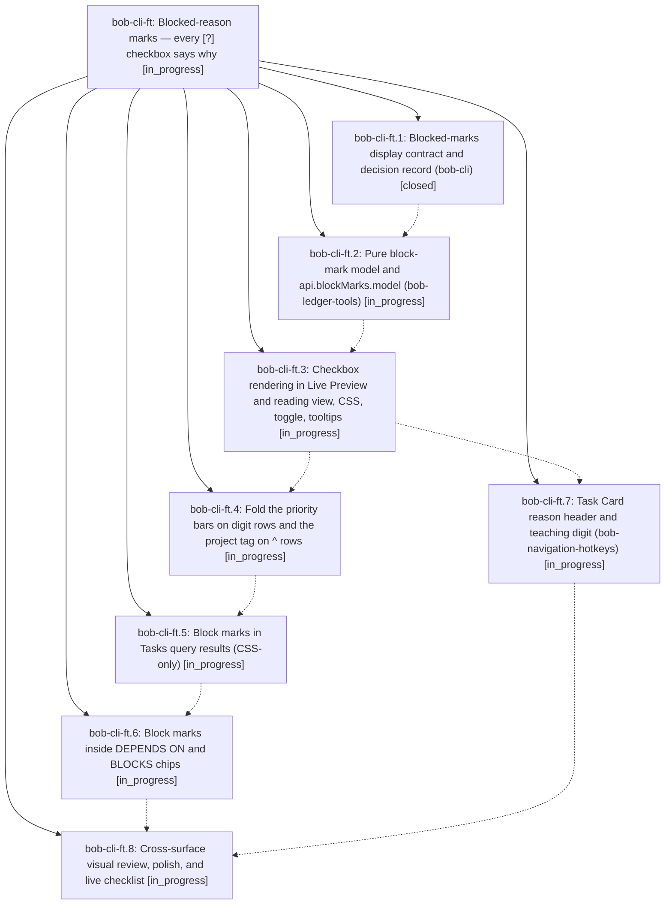

# Bead: bob-cli-ft — Blocked-reason marks — every \[?\] checkbox says why

[Bead Pages](../README.md) / bob-cli-ft

**Status:** ◐ in_progress · **Type:** ▸ plan · **Tier:** epic
**Owner:** `bryanbugyi34@gmail.com` · **Created by:** [bbugyi200.athena.16w](https://github.com/bobs-org/bob-cli--agents/blob/main/sessions/bbugyi200.athena.16w.md) · **Assignee:** `bob-cli-ft.land`
**Created:** 2026-11-02 06:28:10 EST
**Plan:** [202611/blocked\_reason\_marks.md](https://github.com/bobs-org/bob-cli--plans/blob/main/202611/blocked_reason_marks.md)

## Description

In Obsidian, a Blocked task's checkbox shows why it is blocked. It shows & for its own open prerequisite, ^ for a blocked project, 1–4 for a P1–P4 priority deferral, ⟲ for a recurring rule's next run, ? for a date picked by hand, and a dashed ? when no reason is left. Solid boxes mean held by other work, hollow boxes mean waiting for a date. Stored Markdown, reconcile, and the Tasks registry stay exactly as they are.

## Phases

| Bead | Title | Status | Size | Created | Agents | Commits |
|---|---|---|---|---|---:|---:|
| [bob-cli-ft.1](bob-cli-ft.1.md) | Blocked-marks display contract and decision record (bob-cli) | ✓ closed | medium | 2026-11-02 | 1 | 1 |
| [bob-cli-ft.2](bob-cli-ft.2.md) | Pure block-mark model and api.blockMarks.model (bob-ledger-tools) | ◐ in_progress | medium | 2026-11-02 | 1 | 0 |
| [bob-cli-ft.3](bob-cli-ft.3.md) | Checkbox rendering in Live Preview and reading view, CSS, toggle, tooltips | ◐ in_progress | large | 2026-11-02 | 1 | 0 |
| [bob-cli-ft.4](bob-cli-ft.4.md) | Fold the priority bars on digit rows and the project tag on ^ rows | ◐ in_progress | small | 2026-11-02 | 1 | 0 |
| [bob-cli-ft.5](bob-cli-ft.5.md) | Block marks in Tasks query results (CSS-only) | ◐ in_progress | medium | 2026-11-02 | 1 | 0 |
| [bob-cli-ft.6](bob-cli-ft.6.md) | Block marks inside DEPENDS ON and BLOCKS chips | ◐ in_progress | small | 2026-11-02 | 1 | 0 |
| [bob-cli-ft.7](bob-cli-ft.7.md) | Task Card reason header and teaching digit (bob-navigation-hotkeys) | ◐ in_progress | medium | 2026-11-02 | 1 | 0 |
| [bob-cli-ft.8](bob-cli-ft.8.md) | Cross-surface visual review, polish, and live checklist | ◐ in_progress | small | 2026-11-02 | 1 | 0 |

## Lineage

## Agents

| Agent | Bead | Commits |
|---|---|---:|
| [bbugyi200.athena.bob-cli-ft.1](https://github.com/bobs-org/bob-cli--agents/blob/main/agents/bbugyi200.athena.bob-cli-ft.1/README.md) | [bob-cli-ft.1](bob-cli-ft.1.md) | 1 |
| [bbugyi200.athena.bob-cli-ft.2](https://github.com/bobs-org/bob-cli--agents/blob/main/agents/bbugyi200.athena.bob-cli-ft.2/README.md) | [bob-cli-ft.2](bob-cli-ft.2.md) | 0 |
| [bbugyi200.athena.bob-cli-ft.3](https://github.com/bobs-org/bob-cli--agents/blob/main/agents/bbugyi200.athena.bob-cli-ft.3/README.md) | [bob-cli-ft.3](bob-cli-ft.3.md) | 0 |
| [bbugyi200.athena.bob-cli-ft.4](https://github.com/bobs-org/bob-cli--agents/blob/main/agents/bbugyi200.athena.bob-cli-ft.4/README.md) | [bob-cli-ft.4](bob-cli-ft.4.md) | 0 |
| [bbugyi200.athena.bob-cli-ft.5](https://github.com/bobs-org/bob-cli--agents/blob/main/agents/bbugyi200.athena.bob-cli-ft.5/README.md) | [bob-cli-ft.5](bob-cli-ft.5.md) | 0 |
| [bbugyi200.athena.bob-cli-ft.6](https://github.com/bobs-org/bob-cli--agents/blob/main/agents/bbugyi200.athena.bob-cli-ft.6/README.md) | [bob-cli-ft.6](bob-cli-ft.6.md) | 0 |
| [bbugyi200.athena.bob-cli-ft.7](https://github.com/bobs-org/bob-cli--agents/blob/main/agents/bbugyi200.athena.bob-cli-ft.7/README.md) | [bob-cli-ft.7](bob-cli-ft.7.md) | 0 |
| [bbugyi200.athena.bob-cli-ft.8](https://github.com/bobs-org/bob-cli--agents/blob/main/agents/bbugyi200.athena.bob-cli-ft.8/README.md) | [bob-cli-ft.8](bob-cli-ft.8.md) | 0 |
| [bbugyi200.athena.bob-cli-ft.land](https://github.com/bobs-org/bob-cli--agents/blob/main/agents/bbugyi200.athena.bob-cli-ft.land/README.md) | [bob-cli-ft](README.md) | 0 |

## Commits

| Repo | Commit | Subject | Bead | Committed |
|---|---|---|---|---|
| bob-cli | [`16f3a28`](https://github.com/bobs-org/bob-cli/commit/16f3a28f5d63bfb77ec679d7da86355c0211b68a) | docs(blocked-marks): add blocked-marks contract and register docs contracts | [bob-cli-ft.1](bob-cli-ft.1.md) | 2026-11-02 06:39:58 EST |
