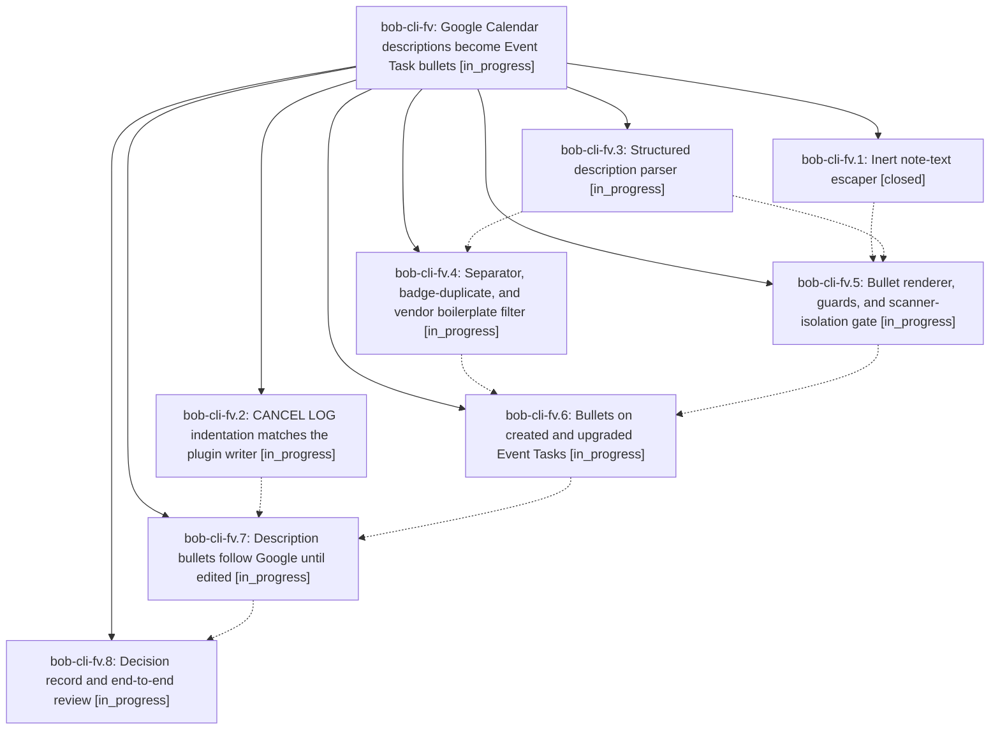

# Bead: bob-cli-fv — Google Calendar descriptions become Event Task bullets

[Bead Pages](../README.md) / bob-cli-fv

**Status:** ◐ in_progress · **Type:** ▸ plan · **Tier:** epic
**Owner:** `bryanbugyi34@gmail.com` · **Created by:** [bbugyi200.athena.research.5o.linker.w0](https://github.com/bobs-org/bob-cli--agents/blob/main/sessions/bbugyi200.athena.research.5o.linker.w0.md) · **Assignee:** `bob-cli-fv.land`
**Created:** 2026-11-02 09:28:50 EST
**Plan:** [202611/gcal\_description\_bullets.md](https://github.com/bobs-org/bob-cli--plans/blob/main/202611/gcal_description_bullets.md)

## Description

`bob gcal sync` writes the human part of each Google Calendar event description as sanitized, capped, flat bullets directly under the Event Task it creates. Directive lines and video-call boilerplate are left out. The bullets follow Google until Bryan edits them, they can never trigger Bob, Dataview, or Tasks behavior, and they read cleanly in Source mode, Live Preview, and Reading view.

## Phases

| Bead | Title | Status | Size | Created | Agents | Commits |
|---|---|---|---|---|---:|---:|
| [bob-cli-fv.1](bob-cli-fv.1.md) | Inert note-text escaper | ✓ closed | small | 2026-11-02 | 1 | 1 |
| [bob-cli-fv.2](bob-cli-fv.2.md) | CANCEL LOG indentation matches the plugin writer | ◐ in_progress | small | 2026-11-02 | 1 | 0 |
| [bob-cli-fv.3](bob-cli-fv.3.md) | Structured description parser | ◐ in_progress | medium | 2026-11-02 | 1 | 0 |
| [bob-cli-fv.4](bob-cli-fv.4.md) | Separator, badge-duplicate, and vendor boilerplate filter | ◐ in_progress | medium | 2026-11-02 | 1 | 0 |
| [bob-cli-fv.5](bob-cli-fv.5.md) | Bullet renderer, guards, and scanner-isolation gate | ◐ in_progress | medium | 2026-11-02 | 1 | 0 |
| [bob-cli-fv.6](bob-cli-fv.6.md) | Bullets on created and upgraded Event Tasks | ◐ in_progress | medium | 2026-11-02 | 1 | 0 |
| [bob-cli-fv.7](bob-cli-fv.7.md) | Description bullets follow Google until edited | ◐ in_progress | medium | 2026-11-02 | 1 | 0 |
| [bob-cli-fv.8](bob-cli-fv.8.md) | Decision record and end-to-end review | ◐ in_progress | small | 2026-11-02 | 1 | 0 |

## Lineage

## Agents

| Agent | Bead | Commits |
|---|---|---:|
| [bbugyi200.athena.bob-cli-fv.1](https://github.com/bobs-org/bob-cli--agents/blob/main/agents/bbugyi200.athena.bob-cli-fv.1/README.md) | [bob-cli-fv.1](bob-cli-fv.1.md) | 1 |
| [bbugyi200.athena.bob-cli-fv.2](https://github.com/bobs-org/bob-cli--agents/blob/main/sessions/bbugyi200.athena.bob-cli-fv.2.md) | [bob-cli-fv.2](bob-cli-fv.2.md) | 0 |
| [bbugyi200.athena.bob-cli-fv.3](https://github.com/bobs-org/bob-cli--agents/blob/main/agents/bbugyi200.athena.bob-cli-fv.3/README.md) | [bob-cli-fv.3](bob-cli-fv.3.md) | 0 |
| [bbugyi200.athena.bob-cli-fv.4](https://github.com/bobs-org/bob-cli--agents/blob/main/agents/bbugyi200.athena.bob-cli-fv.4/README.md) | [bob-cli-fv.4](bob-cli-fv.4.md) | 0 |
| [bbugyi200.athena.bob-cli-fv.5](https://github.com/bobs-org/bob-cli--agents/blob/main/agents/bbugyi200.athena.bob-cli-fv.5/README.md) | [bob-cli-fv.5](bob-cli-fv.5.md) | 0 |
| [bbugyi200.athena.bob-cli-fv.6](https://github.com/bobs-org/bob-cli--agents/blob/main/agents/bbugyi200.athena.bob-cli-fv.6/README.md) | [bob-cli-fv.6](bob-cli-fv.6.md) | 0 |
| [bbugyi200.athena.bob-cli-fv.7](https://github.com/bobs-org/bob-cli--agents/blob/main/agents/bbugyi200.athena.bob-cli-fv.7/README.md) | [bob-cli-fv.7](bob-cli-fv.7.md) | 0 |
| [bbugyi200.athena.bob-cli-fv.8](https://github.com/bobs-org/bob-cli--agents/blob/main/agents/bbugyi200.athena.bob-cli-fv.8/README.md) | [bob-cli-fv.8](bob-cli-fv.8.md) | 0 |
| [bbugyi200.athena.bob-cli-fv.land](https://github.com/bobs-org/bob-cli--agents/blob/main/agents/bbugyi200.athena.bob-cli-fv.land/README.md) | [bob-cli-fv](README.md) | 0 |

## Commits

| Repo | Commit | Subject | Bead | Committed |
|---|---|---|---|---|
| bob-cli | [`0dfaeaa`](https://github.com/bobs-org/bob-cli/commit/0dfaeaa3429af245ac7957df87c1abdeea6a8bc6) | feat(native): add shared task\_text\_escape module for note escaping | [bob-cli-fv.1](bob-cli-fv.1.md) | 2026-11-02 09:49:30 EST |
