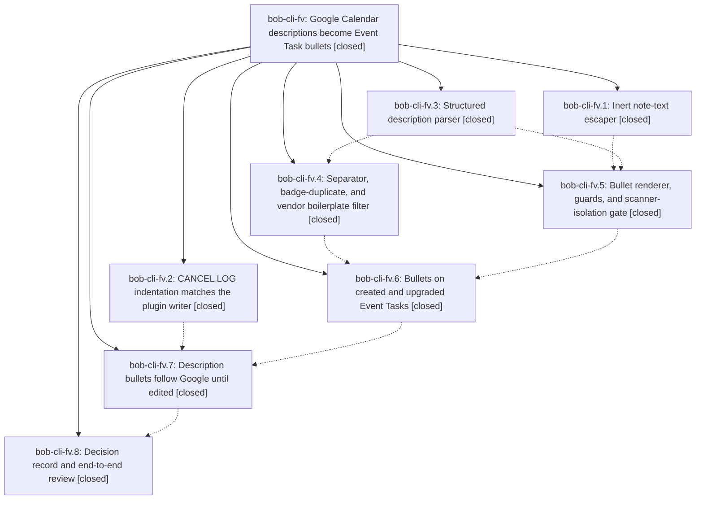

# Bead: bob-cli-fv — Google Calendar descriptions become Event Task bullets

[Bead Pages](../README.md) / bob-cli-fv

**Status:** ✓ closed · **Resolution:** done · **Type:** ▸ plan · **Tier:** epic
**Owner:** `bryanbugyi34@gmail.com` · **Created by:** [bbugyi200.athena.research.5o.linker.w0](https://github.com/bobs-org/bob-cli--agents/blob/main/sessions/bbugyi200.athena.research.5o.linker.w0.md) · **Assignee:** `bob-cli-fv.land`
**Created:** 2026-11-02 09:28:50 EST · **Closed:** 2026-11-02 16:54:10 EST
**Plan:** [202611/gcal\_description\_bullets.md](https://github.com/bobs-org/bob-cli--plans/blob/main/202611/gcal_description_bullets.md)

<!-- sase:links:start -->

## Links

| Relation | Artifact | Why |
| --- | --- | --- |
| implemented-by | [plan:202611/gcal_description_bullets.md][1] | derived from the plan's `bead_id:` frontmatter field |

_Plus 2 automatic references — see [Referenced By](#referenced-by)._

[1]: https://github.com/bobs-org/bob-cli--plans/blob/main/202611/gcal_description_bullets.md

<!-- sase:links:end -->

## Description

`bob gcal sync` writes the human part of each Google Calendar event description as sanitized, capped, flat bullets directly under the Event Task it creates. Directive lines and video-call boilerplate are left out. The bullets follow Google until Bryan edits them, they can never trigger Bob, Dataview, or Tasks behavior, and they read cleanly in Source mode, Live Preview, and Reading view.

## Notes

[2026-11-02T21:54:10Z · bob-cli-fv.land] Landing verification (bob-cli-fv.land). STEP 1: read all 8 phase beads and notes; every note addressed. Reviewed commits 0dfaeaa3 1562baab 35c0a39a cba88d0d 3d251ba2 db4e8a8a 5c749cbb 8c140e43 30d31209 against the plan: escaper lifted byte-identical + escape_note_text/inline; CANCEL LOG reuses first-child indent else TAB; one linear parse feeds directives (event_buffer/vectors.json and task_cancel/vectors.json unchanged) and outline with redacted Debug; boilerplate passes + join-link exception; renderer with guards, cap/overflow, oversize fallback, hash, scanner-isolation gate; config keys, tri-state journal record, top-level-only row matching, ≡ N and description_lines; live three-way update via bullet_block locator, kept_description once, backfill guard, crash adoption. DECISIONS honored: decision_record=no (no new strand); supersede_propose_once=yes applied as a back-link paragraph on decisions:bob-gcal-is-read-only-and-proposes-once only, no dangling superseded_by target since the new record was declined. LANDING FIXES: (1) apply_description_update rewrote bullets even when the row found by block ID no longer parsed as a task row, while apply_span_updates then returned early without a gcal.row record (bullets moved with no journal update, next sync misreported kept_description); now skips unless split_row_spans parses a task row, with regression test unparseable_row_keeps_its_bullets_and_record (failed before, passes after). (2) Removed stale phase-scaffolding allow(dead_code) on DescriptionContext/EventDescription/DescriptionLine/LineMarker/Inline and 8 cfg_attr(not(test), allow(dead_code)) in task_text_escape.rs (all now used in production); description_directives is test-only so it is #[cfg(test)]; refreshed two stale 'future/later phases' comments. STEP 2: 25 non-epic commits since 0dfaeaa3 reviewed. 5fffb82a (title-free badges, Maps-URL location) is consistent with the epic: overflow/fallback links are title-free, docs examples use [📅](…), badge migration rides the span update path that carries the description record forward. Capture/relation/successor commits added no new managed child-line predicates, so bullet_block insertion and renderer guards stay complete. GATES: just check exit 0 (fmt, clippy gate, 26 test binaries ok); gcal lib 195 + gcal_lifecycle 37 + gcal_list 6 + gcal_sync 47 pass. epic-symbols: none. FOLLOW-UPS: bob-cli-fv.8 #3 (unqualified [[task-drawer]]/[[task-type]] in decisions:capture-sigils-say-where-what-how, introduced by e660c8d8, not caused by this epic) -> no duplicate or causal active epic; created bob-cli-ga (task(memory), xsmall, ready). No other PROPOSED FOLLOW-UP entries.

## Phases

| Bead | Title | Status | Size | Created | Agents | Commits |
|---|---|---|---|---|---:|---:|
| [bob-cli-fv.1](bob-cli-fv.1.md) | Inert note-text escaper | ✓ closed | small | 2026-11-02 | 1 | 1 |
| [bob-cli-fv.2](bob-cli-fv.2.md) | CANCEL LOG indentation matches the plugin writer | ✓ closed | small | 2026-11-02 | 1 | 1 |
| [bob-cli-fv.3](bob-cli-fv.3.md) | Structured description parser | ✓ closed | medium | 2026-11-02 | 1 | 1 |
| [bob-cli-fv.4](bob-cli-fv.4.md) | Separator, badge-duplicate, and vendor boilerplate filter | ✓ closed | medium | 2026-11-02 | 1 | 1 |
| [bob-cli-fv.5](bob-cli-fv.5.md) | Bullet renderer, guards, and scanner-isolation gate | ✓ closed | medium | 2026-11-02 | 1 | 1 |
| [bob-cli-fv.6](bob-cli-fv.6.md) | Bullets on created and upgraded Event Tasks | ✓ closed | medium | 2026-11-02 | 1 | 1 |
| [bob-cli-fv.7](bob-cli-fv.7.md) | Description bullets follow Google until edited | ✓ closed | medium | 2026-11-02 | 1 | 1 |
| [bob-cli-fv.8](bob-cli-fv.8.md) | Decision record and end-to-end review | ✓ closed | small | 2026-11-02 | 1 | 2 |

## Lineage

## Agents

| Agent | Bead | Commits |
|---|---|---:|
| [bbugyi200.athena.bob-cli-fv.1](https://github.com/bobs-org/bob-cli--agents/blob/main/agents/bbugyi200.athena.bob-cli-fv.1/README.md) | [bob-cli-fv.1](bob-cli-fv.1.md) | 1 |
| [bbugyi200.athena.bob-cli-fv.2](https://github.com/bobs-org/bob-cli--agents/blob/main/sessions/bbugyi200.athena.bob-cli-fv.2.md) | [bob-cli-fv.2](bob-cli-fv.2.md) | 1 |
| [bbugyi200.athena.bob-cli-fv.3](https://github.com/bobs-org/bob-cli--agents/blob/main/agents/bbugyi200.athena.bob-cli-fv.3/README.md) | [bob-cli-fv.3](bob-cli-fv.3.md) | 1 |
| [bbugyi200.athena.bob-cli-fv.4](https://github.com/bobs-org/bob-cli--agents/blob/main/agents/bbugyi200.athena.bob-cli-fv.4/README.md) | [bob-cli-fv.4](bob-cli-fv.4.md) | 1 |
| [bbugyi200.athena.bob-cli-fv.5](https://github.com/bobs-org/bob-cli--agents/blob/main/sessions/bbugyi200.athena.bob-cli-fv.5.md) | [bob-cli-fv.5](bob-cli-fv.5.md) | 1 |
| [bbugyi200.athena.bob-cli-fv.6](https://github.com/bobs-org/bob-cli--agents/blob/main/agents/bbugyi200.athena.bob-cli-fv.6/README.md) | [bob-cli-fv.6](bob-cli-fv.6.md) | 1 |
| [bbugyi200.athena.bob-cli-fv.7](https://github.com/bobs-org/bob-cli--agents/blob/main/sessions/bbugyi200.athena.bob-cli-fv.7.md) | [bob-cli-fv.7](bob-cli-fv.7.md) | 1 |
| [bbugyi200.athena.bob-cli-fv.8](https://github.com/bobs-org/bob-cli--agents/blob/main/agents/bbugyi200.athena.bob-cli-fv.8/README.md) | [bob-cli-fv.8](bob-cli-fv.8.md) | 2 |
| [bbugyi200.athena.bob-cli-fv.land](https://github.com/bobs-org/bob-cli--agents/blob/main/agents/bbugyi200.athena.bob-cli-fv.land/README.md) | [bob-cli-fv](README.md) | 1 |

## Commits

| Repo | Commit | Subject | Bead | Committed |
|---|---|---|---|---|
| bob-cli | [`0dfaeaa`](https://github.com/bobs-org/bob-cli/commit/0dfaeaa3429af245ac7957df87c1abdeea6a8bc6) | feat(native): add shared task\_text\_escape module for note escaping | [bob-cli-fv.1](bob-cli-fv.1.md) | 2026-11-02 09:49:30 EST |
| bob-cli | [`1562baa`](https://github.com/bobs-org/bob-cli/commit/1562baab267edf7663a178972e96c15baa583671) | feat(gcal): indent CANCEL LOG like the Task Card writer | [bob-cli-fv.2](bob-cli-fv.2.md) | 2026-11-02 09:59:39 EST |
| bob-cli | [`35c0a39`](https://github.com/bobs-org/bob-cli/commit/35c0a39a9f7c5b909db517b4aa94e0d67eff869d) | feat(gcal): parse calendar descriptions into structured lines | [bob-cli-fv.3](bob-cli-fv.3.md) | 2026-11-02 10:31:52 EST |
| bob-cli | [`cba88d0`](https://github.com/bobs-org/bob-cli/commit/cba88d0d785aa47c1ba3720c035f4cab4b7786bb) | feat(gcal): filter vendor boilerplate from event descriptions | [bob-cli-fv.4](bob-cli-fv.4.md) | 2026-11-02 10:54:17 EST |
| bob-cli | [`3d251ba`](https://github.com/bobs-org/bob-cli/commit/3d251ba21e35d421402475c659112cd7fed1228e) | feat(gcal): render calendar description bullets | [bob-cli-fv.5](bob-cli-fv.5.md) | 2026-11-02 11:31:01 EST |
| bob-cli | [`db4e8a8`](https://github.com/bobs-org/bob-cli/commit/db4e8a8aa3aeca27647ff0b36780190317fa895d) | feat(gcal): write event descriptions as Event Task bullets at birth | [bob-cli-fv.6](bob-cli-fv.6.md) | 2026-11-02 12:12:20 EST |
| bob-cli | [`5c749cb`](https://github.com/bobs-org/bob-cli/commit/5c749cbb957112ef94c29cab8c36762e23a6bc47) | feat(gcal): follow Google description bullets until edited | [bob-cli-fv.7](bob-cli-fv.7.md) | 2026-11-02 13:00:02 EST |
| bob-cli | [`8c140e4`](https://github.com/bobs-org/bob-cli/commit/8c140e43d22cf562e063c4a0983cd0c939339c54) | docs(cli): refresh capture and relation contracts | [bob-cli-fv.8](bob-cli-fv.8.md) | 2026-11-02 13:22:59 EST |
| bob-cli | [`30d3120`](https://github.com/bobs-org/bob-cli/commit/30d312095ab2a009e635d2b51fb1697d49885970) | docs(gcal): record description ownership and join-link exception | [bob-cli-fv.8](bob-cli-fv.8.md) | 2026-11-02 16:22:23 EST |
| bob-cli | [`ebe8a44`](https://github.com/bobs-org/bob-cli/commit/ebe8a44c705bf5e3c1ed9043135e69b04ce54899) | fix(gcal): keep description bullets put when the row no longer parses | [bob-cli-fv](README.md) | 2026-11-02 16:55:12 EST |

<!-- sase:referenced-by:start -->

## Referenced By

| Relation | Artifact | Why | Uses |
| --- | --- | --- | ---: |
| read-by | [agent:bob-cli-fv.3][1] | Need parent epic DECISIONS, phases, and design overview | 1 |
| read-by | [agent:bob-cli-fv.6][2] | Need epic DECISIONS and child plan context | 1 |

[1]: https://github.com/bobs-org/bob-cli--agents/blob/main/agents/bbugyi200.athena.bob-cli-fv.3/README.md
[2]: https://github.com/bobs-org/bob-cli--agents/blob/main/agents/bbugyi200.athena.bob-cli-fv.6/README.md

<!-- sase:referenced-by:end -->
