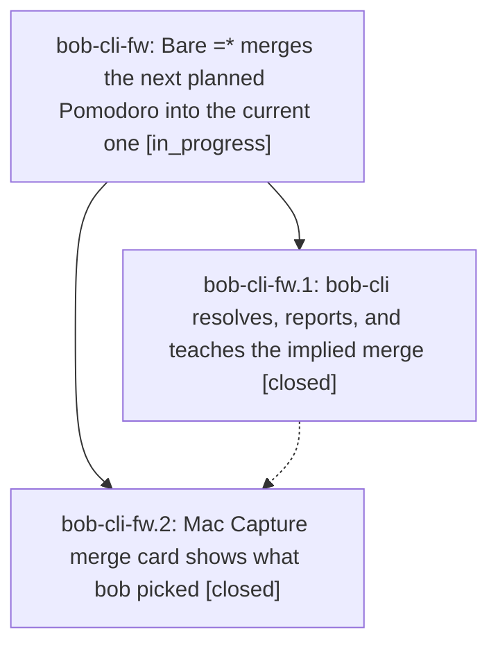

# Bead: bob-cli-fw — Bare =\* merges the next planned Pomodoro into the current one

[Bead Pages](../README.md) / bob-cli-fw

**Status:** ◐ in_progress · **Type:** ▸ plan · **Tier:** epic
**Owner:** `bryanbugyi34@gmail.com` · **Created by:** [bbugyi200.athena.173](https://github.com/bobs-org/bob-cli--agents/blob/main/sessions/bbugyi200.athena.173.md) · **Assignee:** `bob-cli-fw.land`
**Created:** 2026-11-02 09:55:54 EST
**Plan:** [202611/merge\_next\_planned\_default.md](https://github.com/bobs-org/bob-cli--plans/blob/main/202611/merge_next_planned_default.md)

<!-- sase:links:start -->

## Links

| Relation | Artifact | Why |
| --- | --- | --- |
| implemented-by | [plan:202611/merge_next_planned_default.md][1] | derived from the plan's `bead_id:` frontmatter field |

[1]: https://github.com/bobs-org/bob-cli--plans/blob/main/202611/merge_next_planned_default.md

<!-- sase:links:end -->

## Description

`=*` alone merges the next planned Pomodoro into the current one, and `=*build` merges the next planned Pomodoro below BUILD into BUILD. Every surface (live preview card, CLI output, completion menus, docs) shows which Pomodoros bob picked and the explicit spelling it resolved to, so the shortcut never surprises.

## Phases

| Bead | Title | Status | Size | Created | Agents | Commits |
|---|---|---|---|---|---:|---:|
| [bob-cli-fw.1](bob-cli-fw.1.md) | bob-cli resolves, reports, and teaches the implied merge | ✓ closed | medium | 2026-11-02 | 1 | 1 |
| [bob-cli-fw.2](bob-cli-fw.2.md) | Mac Capture merge card shows what bob picked | ✓ closed | small | 2026-11-02 | 1 | 1 |

## Lineage

## Agents

| Agent | Bead | Commits |
|---|---|---:|
| [bbugyi200.athena.bob-cli-fw.1](https://github.com/bobs-org/bob-cli--agents/blob/main/sessions/bbugyi200.athena.bob-cli-fw.1.md) | [bob-cli-fw.1](bob-cli-fw.1.md) | 1 |
| [bbugyi200.athena.bob-cli-fw.2](https://github.com/bobs-org/bob-cli--agents/blob/main/agents/bbugyi200.athena.bob-cli-fw.2/README.md) | [bob-cli-fw.2](bob-cli-fw.2.md) | 1 |
| [bbugyi200.athena.bob-cli-fw.land](https://github.com/bobs-org/bob-cli--agents/blob/main/agents/bbugyi200.athena.bob-cli-fw.land/README.md) | [bob-cli-fw](README.md) | 0 |

## Commits

| Repo | Commit | Subject | Bead | Committed |
|---|---|---|---|---|
| bob-cli | [`5088721`](https://github.com/bobs-org/bob-cli/commit/508872164ecc7f2c71fd4ec03c8fdd69acd9ccce) | feat(capture): merge the next planned Pomodoro by default | [bob-cli-fw.1](bob-cli-fw.1.md) | 2026-11-02 10:53:16 EST |
| bob-mac-capture | [`bob-mac-capture@a58e4f0`](https://github.com/bobs-org/bob-mac-capture/commit/a58e4f09fc987f7e0056336f94870082fc00c2ca) | feat(capture): show implied merge picks on the merge card | [bob-cli-fw.2](bob-cli-fw.2.md) | 2026-11-02 11:11:38 EST |
