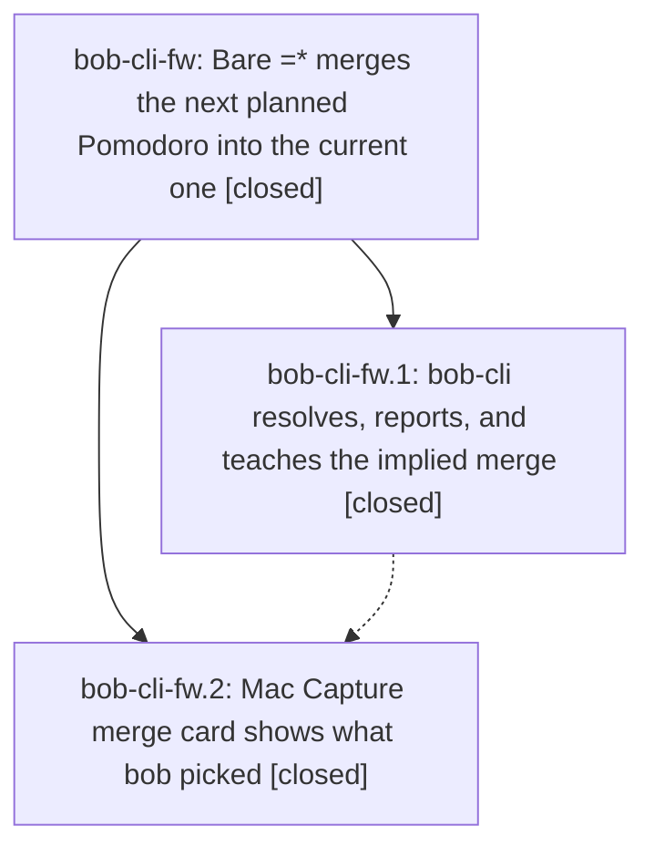

# Bead: bob-cli-fw — Bare =\* merges the next planned Pomodoro into the current one

[Bead Pages](../README.md) / bob-cli-fw

**Status:** ✓ closed · **Resolution:** done · **Type:** ▸ plan · **Tier:** epic
**Owner:** `bryanbugyi34@gmail.com` · **Created by:** [bbugyi200.athena.173](https://github.com/bobs-org/bob-cli--agents/blob/main/sessions/bbugyi200.athena.173.md) · **Assignee:** `bob-cli-fw.land`
**Created:** 2026-11-02 09:55:54 EST · **Closed:** 2026-11-02 11:51:42 EST
**Plan:** [202611/merge\_next\_planned\_default.md](https://github.com/bobs-org/bob-cli--plans/blob/main/202611/merge_next_planned_default.md)

<!-- sase:links:start -->

## Links

| Relation | Artifact | Why |
| --- | --- | --- |
| implemented-by | [plan:202611/merge_next_planned_default.md][1] | derived from the plan's `bead_id:` frontmatter field |

[1]: https://github.com/bobs-org/bob-cli--plans/blob/main/202611/merge_next_planned_default.md

<!-- sase:links:end -->

## Description

`=*` alone merges the next planned Pomodoro into the current one, and `=*build` merges the next planned Pomodoro below BUILD into BUILD. Every surface (live preview card, CLI output, completion menus, docs) shows which Pomodoros bob picked and the explicit spelling it resolved to, so the shortcut never surprises.

## Notes

[2026-11-02T16:18:33Z · bob-cli-fw.land] LANDING AUDIT: Read the epic (no prior notes), both closed children and their sole verification notes, approved plan, bob-cli commit 50887216 and Mac commit a58e4f0. Approved MEET skip/no-memory decisions are implemented; no memory files changed. No PROPOSED FOLLOW-UP entries exist on either child, and no independent out-of-scope proposal requires a task bead. Remaining acceptance defects are retained as epic work: merge application can remove an earlier identically named row instead of the implied row below the source; merge_next_missing drops the MEET explanation when there is no alternative above (and puts it after the example rather than in the first clause otherwise); completion uses resolved selected indices for next-row choice but not candidate exclusion. These require a single-agent remaining-work tale that finishes this landing. Source audit is the evidence; installed bob predates this feature and was not used as current-tree verification. Initial epic-symbol audit found no entries. Parent link is absent.

[2026-11-02T16:20:44Z · bob-cli-fw.land] INTEGRATION AUDIT: Reviewed non-epic changes since creation: CLI 1562baab, a7931a64, 35c0a39a, 69c6458c, d32da8fa, cba88d0d, 876ae775 and Mac f4ed5bb, ac6c3d6. Local CLI 876ae775 and Mac a58e4f0 matched remote master tips. Calendar description/cancel-log, stats, and blocked-mark changes are separate; ID-splice/list picker changes preserve the merge presentation contract. MEET-continuation-last is compatible with the skip decision and supplies a regression shape for the missing-MEET error. No integration rewrite outside merge is indicated. A validated medium tale, sase_plan_merge_default_landing.md, specifies exact-row application, diagnostic and picker repairs, fresh just check, scratch smoke, drift recheck, symbol cleanup, normal epic close, optional symvision, original plan status done, and finalization in its coder turn. No PROPOSED FOLLOW-UP notes exist; no unrelated task was created or declined. Epic remains open until these acceptance gaps are fixed.

[2026-11-02T16:51:42Z · bob-cli-fw.land] Verified landing of bob-cli-fw.

Phases: bob-cli-fw.1 closed at 50887216 with SCCACHE_DISABLE=1 just check && just docs-check plus scratch-vault capture/parse/complete smoke on =*. bob-cli-fw.2 closed at Mac a58e4f0 with portable-check (2017 tests), just docs-check, and Mac scratch bundle.sh + typecheck-tests. Approved MEET-skip and no-memory decisions remain; no memory files were edited.

Repairs in this turn: plan_pomodoro_merge_item keeps resolved source and destination identities as tracked 0-based line indices through each move/remove, so a duplicate FIX above the source stays and only the implied below-source FIX is absorbed (closed duplicate above also stays; child moves that shift later rows still remove only the selected dest; explicit dest above the source and multiple dests share that application path). merge_next_missing now puts "(MEET never merges)" in the first clause, then the optional example. Completion excludes already-resolved dests by entry index while the field being edited stays a candidate.

Focused regressions cover those cases plus carried-MEET-at-end (first =* absorbs FIX; second refuses with the MEET clause and leaves the carried meeting). Dry-run and write describe the same operation. JSON shape is unchanged, so no Mac edit.

Verification: sase tool run check 3be6942480564711960ab7da7b824b4c succeeded in 3m 39s (just check, exit 0). Scratch-vault smoke of this checkout's bob passed for capture human/JSON, capture-parse, and capture-complete on bare =*, the MEET-in-first-clause error, duplicate-FIX identity, and carried-MEET refuse. Docs/help were not rewritten. sase bead epic-symbols bob-cli-fw is empty. This checkout has no just symvision recipe.

Integration drift since the landing audit (bob-cli 876ae775 / Mac a58e4f0): local extra 05b7fb1b (section-completion round-trip) does not touch merge identity; origin/master has 3d251ba2 (gcal description bullets) which is also outside merge and was not pulled. MEET-continuation-last remains the regression ledger shape.

Follow-up triage: neither child recorded PROPOSED FOLLOW-UP; no unrelated task was warranted.

## Phases

| Bead | Title | Status | Size | Created | Agents | Commits |
|---|---|---|---|---|---:|---:|
| [bob-cli-fw.1](bob-cli-fw.1.md) | bob-cli resolves, reports, and teaches the implied merge | ✓ closed | medium | 2026-11-02 | 1 | 1 |
| [bob-cli-fw.2](bob-cli-fw.2.md) | Mac Capture merge card shows what bob picked | ✓ closed | small | 2026-11-02 | 1 | 1 |

## Lineage

## Agents

| Agent | Bead | Commits |
|---|---|---:|
| [bbugyi200.athena.bob-cli-fw.1](https://github.com/bobs-org/bob-cli--agents/blob/main/sessions/bbugyi200.athena.bob-cli-fw.1.md) | [bob-cli-fw.1](bob-cli-fw.1.md) | 1 |
| [bbugyi200.athena.bob-cli-fw.2](https://github.com/bobs-org/bob-cli--agents/blob/main/agents/bbugyi200.athena.bob-cli-fw.2/README.md) | [bob-cli-fw.2](bob-cli-fw.2.md) | 1 |
| [bbugyi200.athena.bob-cli-fw.land](https://github.com/bobs-org/bob-cli--agents/blob/main/sessions/bbugyi200.athena.bob-cli-fw.land.md) | [bob-cli-fw](README.md) | 2 |

## Commits

| Repo | Commit | Subject | Bead | Committed |
|---|---|---|---|---|
| bob-cli | [`5088721`](https://github.com/bobs-org/bob-cli/commit/508872164ecc7f2c71fd4ec03c8fdd69acd9ccce) | feat(capture): merge the next planned Pomodoro by default | [bob-cli-fw.1](bob-cli-fw.1.md) | 2026-11-02 10:53:16 EST |
| bob-mac-capture | [`bob-mac-capture@a58e4f0`](https://github.com/bobs-org/bob-mac-capture/commit/a58e4f09fc987f7e0056336f94870082fc00c2ca) | feat(capture): show implied merge picks on the merge card | [bob-cli-fw.2](bob-cli-fw.2.md) | 2026-11-02 11:11:38 EST |
| bob-cli | [`2d45cd0`](https://github.com/bobs-org/bob-cli/commit/2d45cd02d168ce080d7c5d694a493db83d01288c) | fix(capture): keep implied merge dest identity through ledger edits | [bob-cli-fw](README.md) | 2026-11-02 11:52:52 EST |
| bob-cli--plans | [`bob-cli--plans@d8b1ba0`](https://github.com/bobs-org/bob-cli--plans/commit/d8b1ba0f82f4d1114f099b90d3d65b0eb1889034) | chore(plans): mark merge\_next\_planned\_default done | [bob-cli-fw](README.md) | 2026-11-02 11:53:14 EST |
