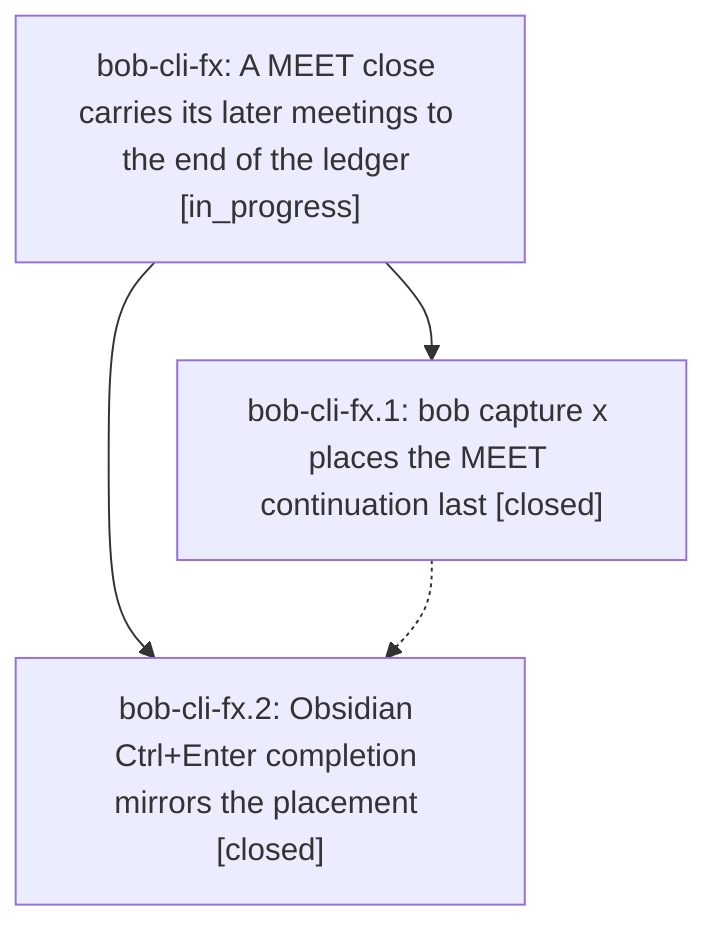

# Bead: bob-cli-fx — A MEET close carries its later meetings to the end of the ledger

[Bead Pages](../README.md) / bob-cli-fx

**Status:** ◐ in_progress · **Type:** ▸ plan · **Tier:** epic
**Owner:** `bryanbugyi34@gmail.com` · **Created by:** [bbugyi200.athena.174](https://github.com/bobs-org/bob-cli--agents/blob/main/sessions/bbugyi200.athena.174.md) · **Assignee:** `bob-cli-fx.land`
**Created:** 2026-11-02 10:05:57 EST
**Plan:** [202611/meet\_continuation\_goes\_last.md](https://github.com/bobs-org/bob-cli--plans/blob/main/202611/meet_continuation_goes_last.md)

## Description

When closing a MEET Pomodoro creates a new MEET placeholder for meetings that have not happened yet, that placeholder becomes the last future Pomodoro, in both capture `x` and Obsidian Ctrl+Enter, so other planned work comes first.

## Phases

| Bead | Title | Status | Size | Created | Agents | Commits |
|---|---|---|---|---|---:|---:|
| [bob-cli-fx.1](bob-cli-fx.1.md) | bob capture x places the MEET continuation last | ✓ closed | medium | 2026-11-02 | 1 | 1 |
| [bob-cli-fx.2](bob-cli-fx.2.md) | Obsidian Ctrl+Enter completion mirrors the placement | ✓ closed | medium | 2026-11-02 | 1 | 2 |

## Lineage

## Agents

| Agent | Bead | Commits |
|---|---|---:|
| [bbugyi200.athena.bob-cli-fx.1](https://github.com/bobs-org/bob-cli--agents/blob/main/agents/bbugyi200.athena.bob-cli-fx.1/README.md) | [bob-cli-fx.1](bob-cli-fx.1.md) | 1 |
| [bbugyi200.athena.bob-cli-fx.2](https://github.com/bobs-org/bob-cli--agents/blob/main/sessions/bbugyi200.athena.bob-cli-fx.2.md) | [bob-cli-fx.2](bob-cli-fx.2.md) | 2 |
| [bbugyi200.athena.bob-cli-fx.land](https://github.com/bobs-org/bob-cli--agents/blob/main/agents/bbugyi200.athena.bob-cli-fx.land/README.md) | [bob-cli-fx](README.md) | 0 |

## Commits

| Repo | Commit | Subject | Bead | Committed |
|---|---|---|---|---|
| bob-cli | [`d32da8f`](https://github.com/bobs-org/bob-cli/commit/d32da8fa072ad162ec7b43d617858067ca260422) | feat(capture): place MEET continuation after last open pomodoro | [bob-cli-fx.1](bob-cli-fx.1.md) | 2026-11-02 10:47:11 EST |
| bob-cli | [`876ae77`](https://github.com/bobs-org/bob-cli/commit/876ae775e2681ad981383278b6fd5b61ab704fe6) | docs(capture): Obsidian Ctrl+Enter mirrors MEET-continuation-last placement | [bob-cli-fx.2](bob-cli-fx.2.md) | 2026-11-02 11:07:38 EST |
| bob-plugins | [`bob-plugins@1115a14`](https://github.com/bobs-org/bob-plugins/commit/1115a14d1e1ff5a286bc963adeadcf6b86b667e2) | feat(task-status-cycler): mirror MEET-continuation-last placement on Pomodoro completion | [bob-cli-fx.2](bob-cli-fx.2.md) | 2026-11-02 11:07:54 EST |
