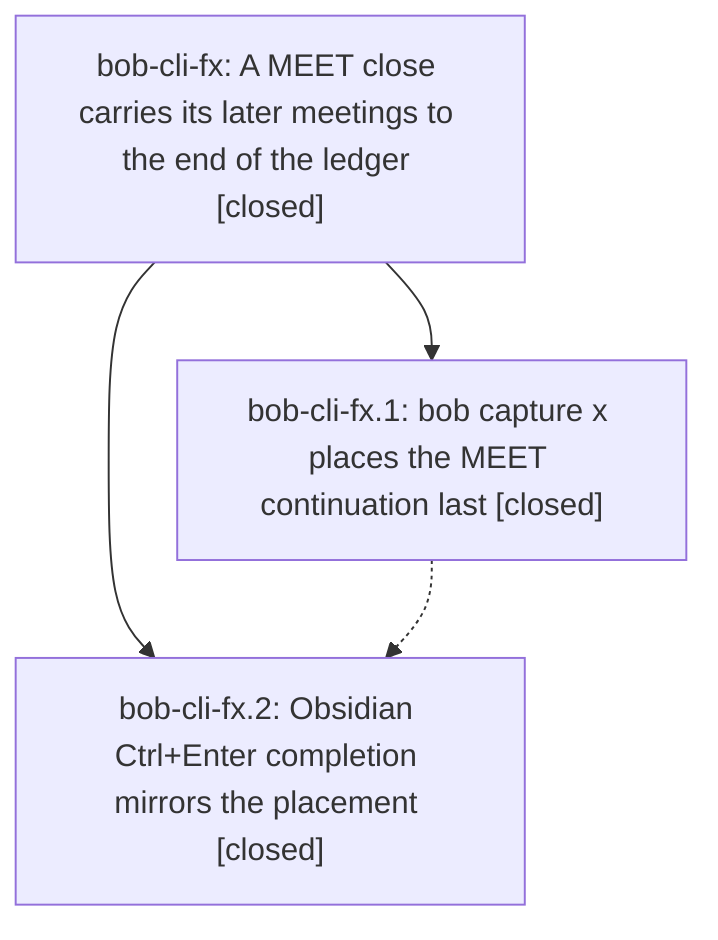

# Bead: bob-cli-fx — A MEET close carries its later meetings to the end of the ledger

[Bead Pages](../README.md) / bob-cli-fx

**Status:** ✓ closed · **Resolution:** done · **Type:** ▸ plan · **Tier:** epic
**Owner:** `bryanbugyi34@gmail.com` · **Created by:** [bbugyi200.athena.174](https://github.com/bobs-org/bob-cli--agents/blob/main/sessions/bbugyi200.athena.174.md) · **Assignee:** `bob-cli-fx.land`
**Created:** 2026-11-02 10:05:57 EST · **Closed:** 2026-11-02 11:48:58 EST
**Plan:** [202611/meet\_continuation\_goes\_last.md](https://github.com/bobs-org/bob-cli--plans/blob/main/202611/meet_continuation_goes_last.md)

<!-- sase:links:start -->

## Links

| Relation | Artifact | Why |
| --- | --- | --- |
| implemented-by | [plan:202611/meet_continuation_goes_last.md][1] | derived from the plan's `bead_id:` frontmatter field |
| related | file:explicit:0201e20ab57a269a1d560ad4 | attached via sase artifact create --bead |
| related | file:explicit:09e9d220720061d1919e7c2e | attached via sase artifact create --bead |
| related | file:explicit:dd79208b8c6d14c0a47fb839 | attached via sase artifact create --bead |

[1]: https://github.com/bobs-org/bob-cli--plans/blob/main/202611/meet_continuation_goes_last.md

<!-- sase:links:end -->

## Description

When closing a MEET Pomodoro creates a new MEET placeholder for meetings that have not happened yet, that placeholder becomes the last future Pomodoro, in both capture `x` and Obsidian Ctrl+Enter, so other planned work comes first.

## Notes

[2026-11-02T16:22:31Z · bob-cli-fx.land] FOLLOW-UP TRIAGE before repair tale: reviewed all six child notes. Used sase_new_task, semantic searches, last-week all-status sweep, and all 22 active-epic scopes; no unrelated new task warranted. fx.1 #1 and fx.2 #2 (capture-previews cap) declined as new tasks because resolved by Mac a58e4f0. Correcting their pre-existing attribution: canonical count_words reports ac6c3d6^ 5999, epic ac6c3d6 6023, current HEAD 5997, so fx caused the old breach and newer default-merge docs fixed it. Current just docs-check passes all implemented gates (447 unit tests, one optional font skip). fx.1 #2 (pomodoro_clock mirror) remains epic work: cmp differs at close-defers-not-started-off-clock.expected_day, while event_task_close copies match. Repair tale must recopy it; no separate task. fx.2 #1 five failures independently reproduced on clean plugins 1115a14 and corroborated existing bob-cli-et (freshness real date), bob-cli-f7 (UTC/local feedback), bob-cli-eh (both startup callback fake failures), bob-cli-ff (expired future date), all with file:explicit:0201e20ab57a269a1d560ad4. fx.2 #3 performance observation corroborated bob-cli-f8: independent same-tree snapshot/order 81.0ms >50 and rank 13.4ms >12, cold chunk passed; file:explicit:dd79208b8c6d14c0a47fb839. A phase standalone pass does not prove a load-only flake. New fence, trailing-blank and duplicate-MEET successor defects stay epic work. Carry every disposition into final close note.

[2026-11-02T16:23:28Z · bob-cli-fx.land] LAND AUDIT: Read epic plus fx.1/fx.2 and every note, approved plan and final close_card_says_last=yes decision, bob-cli commits d32da8fa/876ae775, plugins 1115a14, and Mac ac6c3d6 source/tests. Rust placement and actual next line feed ClosingContinuation, preview/headline resolution and existing log/clock consumers; JSON/human/Mac output implements the decision. Fetched bases match bob-cli 876ae775, plugins 1115a14 and Mac a58e4f0. Reviewed creation-window drift as well as post-first-commit drift: default merge 50887216/Mac a58e4f0 uses current ledger order and skips MEET; gcal descriptions, Stats hint, capture undo and blocked marks are independent. Concurrent relation successor 4502b73/ffe1727 uses the shared plugin successor pass that now needs exact continuation targeting. Reproduced remaining epic gaps (file:explicit:09e9d220720061d1919e7c2e): new getPomodoroContinuationPlacement does not exclude fences and inserts a live MEET inside a fenced fake entry; its full-block end includes trailing blanks unlike Rust/approved rule; deferred-only relocation chooses an older identical MEET at line 1 instead of created line 4, and normal successor createdEntry lookup has the same first-same-name assumption (line 3 instead of 6). Existing 31 completion tests pass but miss these cases. Clock fixture mirror also remains stale. No fresh just check claimed; final repair coder must run just check, never check-full. Epic symbols are currently empty; no symvision recipe; parent_id is null. Validated medium tale sase_plan_meet_continuation_landing_repair.md plans only these repairs, regression/integration verification and concrete same-turn closeout. Epic and original plan deliberately remain open until that coder completes all checks and closes them normally.

[2026-11-02T16:48:58Z · bob-cli-fx.land] Landing repair complete: MEET continuations exclude fenced entries and trim trailing blanks (060a), and created-continuation block identity beats same-name reuse via 060b helpers through 170 hint to 135 deferred and 137 normal paths, preserving dependency/relation offers and case 3 below close. Fixtures: pomodoro_clock vectors recopied byte-identical to both plugin mirrors with provenance notes; event_task_close copies already identical. Tests: task-status-cycler pomodoro-completion 36/36 (5 new: fenced, tilde/indented/only-fenced, trailing deferred+retained, deferred+retained successor wiring with shift, case 3); focused event-clock/vector 66/66; successor-wiring/placement+relation 123/123; npm run build:check pass; plugin npm test 5107 pass 5 fail matching clean-base existing (freshness-namespace reload, keep-inbox UTC feedback, note-ready startup linearity, relation-index startup replay, schedule-work-log future Pending) corroborating bob-cli-et/f7/eh/ff; docs-check 447 pass 1 font skip; bob plugins sync 2 copied; just check pass (fmt, clippy, workspace tests); just docs-check 447 pass 1 skip. Drift rechecked: bob-cli HEAD 05b7fb1b section-completion round-trip independent, just check green. Dispositions: fx.1#1+fx.2#2 docs cap declined (Mac a58e4f0 trim preserved, docs-check green, prior pre-existing attribution corrected); fx.1#2 clock mirror done here, no separate task; fx.2#1 five failures corroborate et/f7/eh/ff (file:explicit:0201e20ab57a269a1d560ad4); fx.2#3 perf corroborates f8 (file:explicit:dd79208b8c6d14c0a47fb839); fence/trailing/duplicate-MEET fixed here. Parent plan 202611/meet_continuation_goes_last.md set status done; close_card_says_last=yes preserved; no Cargo version/CHANGELOG edits.

## Phases

| Bead | Title | Status | Size | Created | Agents | Commits |
|---|---|---|---|---|---:|---:|
| [bob-cli-fx.1](bob-cli-fx.1.md) | bob capture x places the MEET continuation last | ✓ closed | medium | 2026-11-02 | 1 | 2 |
| [bob-cli-fx.2](bob-cli-fx.2.md) | Obsidian Ctrl+Enter completion mirrors the placement | ✓ closed | medium | 2026-11-02 | 1 | 2 |

## Lineage

## Agents

| Agent | Bead | Commits |
|---|---|---:|
| [bbugyi200.athena.bob-cli-fx.1](https://github.com/bobs-org/bob-cli--agents/blob/main/agents/bbugyi200.athena.bob-cli-fx.1/README.md) | [bob-cli-fx.1](bob-cli-fx.1.md) | 2 |
| [bbugyi200.athena.bob-cli-fx.2](https://github.com/bobs-org/bob-cli--agents/blob/main/sessions/bbugyi200.athena.bob-cli-fx.2.md) | [bob-cli-fx.2](bob-cli-fx.2.md) | 2 |
| [bbugyi200.athena.bob-cli-fx.land](https://github.com/bobs-org/bob-cli--agents/blob/main/sessions/bbugyi200.athena.bob-cli-fx.land.md) | [bob-cli-fx](README.md) | 1 |

## Commits

| Repo | Commit | Subject | Bead | Committed |
|---|---|---|---|---|
| bob-cli | [`d32da8f`](https://github.com/bobs-org/bob-cli/commit/d32da8fa072ad162ec7b43d617858067ca260422) | feat(capture): place MEET continuation after last open pomodoro | [bob-cli-fx.1](bob-cli-fx.1.md) | 2026-11-02 10:47:11 EST |
| bob-mac-capture | [`bob-mac-capture@ac6c3d6`](https://github.com/bobs-org/bob-mac-capture/commit/ac6c3d6f5851c66f2e20c5361600ee9e088a83a8) | feat(capture): render placed-last MEET continuation | [bob-cli-fx.1](bob-cli-fx.1.md) | 2026-11-02 10:47:26 EST |
| bob-cli | [`876ae77`](https://github.com/bobs-org/bob-cli/commit/876ae775e2681ad981383278b6fd5b61ab704fe6) | docs(capture): Obsidian Ctrl+Enter mirrors MEET-continuation-last placement | [bob-cli-fx.2](bob-cli-fx.2.md) | 2026-11-02 11:07:38 EST |
| bob-plugins | [`bob-plugins@1115a14`](https://github.com/bobs-org/bob-plugins/commit/1115a14d1e1ff5a286bc963adeadcf6b86b667e2) | feat(task-status-cycler): mirror MEET-continuation-last placement on Pomodoro completion | [bob-cli-fx.2](bob-cli-fx.2.md) | 2026-11-02 11:07:54 EST |
| bob-plugins | [`bob-plugins@1f2c1f8`](https://github.com/bobs-org/bob-plugins/commit/1f2c1f8d58e87182da3cb90e975fbfe2625dcf9d) | fix(task-status-cycler): repair MEET continuation fencing, trailing blanks, and successor targeting | [bob-cli-fx](README.md) | 2026-11-02 11:50:05 EST |
