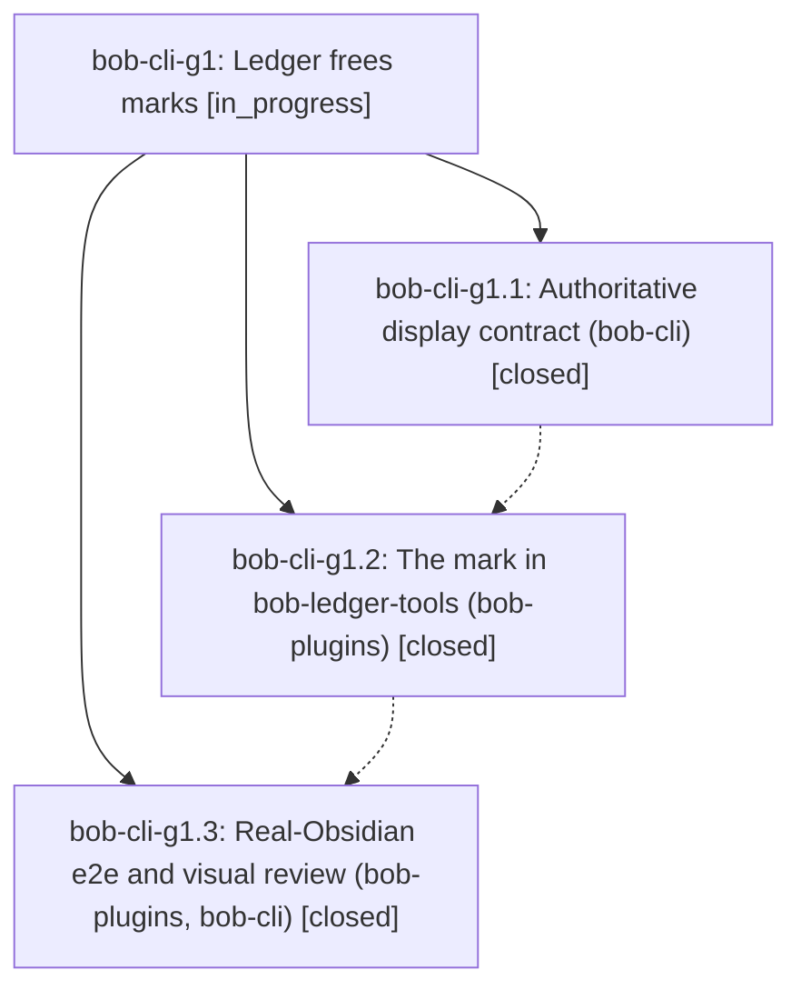

# Bead: bob-cli-g1 — Ledger frees marks

[Bead Pages](../README.md) / bob-cli-g1

**Status:** ◐ in_progress · **Type:** ▸ plan · **Tier:** epic
**Owner:** `bryanbugyi34@gmail.com` · **Created by:** [bbugyi200.athena.176](https://github.com/bobs-org/bob-cli--agents/blob/main/sessions/bbugyi200.athena.176.md) · **Assignee:** `bob-cli-g1.land`
**Created:** 2026-11-02 12:45:29 EST
**Plan:** [202611/ledger\_frees\_marks.md](https://github.com/bobs-org/bob-cli--plans/blob/main/202611/ledger_frees_marks.md)

<!-- sase:links:start -->

## Links

| Relation | Artifact | Why |
| --- | --- | --- |
| implemented-by | [plan:202611/ledger_frees_marks.md][1] | derived from the plan's `bead_id:` frontmatter field |

_Plus 1 automatic references — see [Referenced By](#referenced-by)._

[1]: https://github.com/bobs-org/bob-cli--plans/blob/main/202611/ledger_frees_marks.md

<!-- sase:links:end -->

## Description

In today's daily note, each Task Link under an open Pomodoro whose task is the last blocker of other open tasks wears a quiet "🔑 frees N" mark. N always matches the task's own BLOCKS row, the hover names the freed tasks, and the mark is verified in real Obsidian.

## Phases

| Bead | Title | Status | Size | Created | Agents | Commits |
|---|---|---|---|---|---:|---:|
| [bob-cli-g1.1](bob-cli-g1.1.md) | Authoritative display contract (bob-cli) | ✓ closed | small | 2026-11-02 | 1 | 1 |
| [bob-cli-g1.2](bob-cli-g1.2.md) | The mark in bob-ledger-tools (bob-plugins) | ✓ closed | medium | 2026-11-02 | 1 | 1 |
| [bob-cli-g1.3](bob-cli-g1.3.md) | Real-Obsidian e2e and visual review (bob-plugins, bob-cli) | ✓ closed | medium | 2026-11-02 | 1 | 1 |

## Lineage

## Agents

| Agent | Bead | Commits |
|---|---|---:|
| [bbugyi200.athena.bob-cli-g1.1](https://github.com/bobs-org/bob-cli--agents/blob/main/agents/bbugyi200.athena.bob-cli-g1.1/README.md) | [bob-cli-g1.1](bob-cli-g1.1.md) | 1 |
| [bbugyi200.athena.bob-cli-g1.2](https://github.com/bobs-org/bob-cli--agents/blob/main/sessions/bbugyi200.athena.bob-cli-g1.2.md) | [bob-cli-g1.2](bob-cli-g1.2.md) | 1 |
| [bbugyi200.athena.bob-cli-g1.3](https://github.com/bobs-org/bob-cli--agents/blob/main/agents/bbugyi200.athena.bob-cli-g1.3/README.md) | [bob-cli-g1.3](bob-cli-g1.3.md) | 1 |
| [bbugyi200.athena.bob-cli-g1.land](https://github.com/bobs-org/bob-cli--agents/blob/main/agents/bbugyi200.athena.bob-cli-g1.land/README.md) | [bob-cli-g1](README.md) | 0 |

## Commits

| Repo | Commit | Subject | Bead | Committed |
|---|---|---|---|---|
| bob-cli | [`b508f0b`](https://github.com/bobs-org/bob-cli/commit/b508f0b69dbd5dab08b7e6d1eb7c4c0f2ae1a01a) | docs(frees-marks): add ledger frees-mark display contract | [bob-cli-g1.1](bob-cli-g1.1.md) | 2026-11-02 12:58:52 EST |
| bob-plugins | [`bob-plugins@f824dd1`](https://github.com/bobs-org/bob-plugins/commit/f824dd1c1f32031e02421261c1a269d3ae262026) | feat(ledger-tools): show quiet frees-N marks after last-blocker ledger links | [bob-cli-g1.2](bob-cli-g1.2.md) | 2026-11-02 14:45:02 EST |
| bob-cli | [`07edcdf`](https://github.com/bobs-org/bob-cli/commit/07edcdfa646ec234e2efee28dee7a201801e9f66) | docs(frees-marks): record live verification | [bob-cli-g1.3](bob-cli-g1.3.md) | 2026-11-02 15:30:36 EST |

<!-- sase:referenced-by:start -->

## Referenced By

| Relation | Artifact | Why | Uses |
| --- | --- | --- | ---: |
| read-by | [agent:bob-cli-g1.1][1] | epic decisions | 1 |

[1]: https://github.com/bobs-org/bob-cli--agents/blob/main/agents/bbugyi200.athena.bob-cli-g1.1/README.md

<!-- sase:referenced-by:end -->
