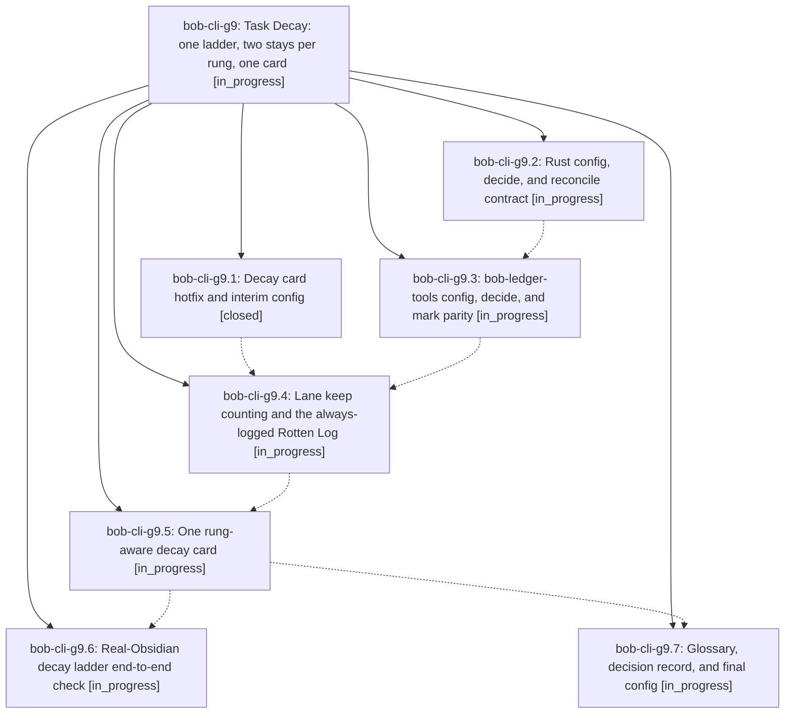

# Bead: bob-cli-g9 — Task Decay: one ladder, two stays per rung, one card

[Bead Pages](../README.md) / bob-cli-g9

**Status:** ◐ in_progress · **Type:** ▸ plan · **Tier:** epic
**Owner:** `bryanbugyi34@gmail.com` · **Created by:** [bbugyi200.apollo.research.32.linker.w0](https://github.com/bobs-org/bob-cli--agents/blob/main/sessions/bbugyi200.apollo.research.32.linker.w0.md) · **Assignee:** `bob-cli-g9.land`
**Created:** 2026-11-02 15:55:42 EST
**Plan:** [202611/task\_decay\_ladder.md](https://github.com/bobs-org/bob-cli--plans/blob/main/202611/task_decay_ladder.md)

<!-- sase:links:start -->

## Links

| Relation | Artifact | Why |
| --- | --- | --- |
| implemented-by | [plan:202611/task_decay_ladder.md][1] | derived from the plan's `bead_id:` frontmatter field |

[1]: https://github.com/bobs-org/bob-cli--plans/blob/main/202611/task_decay_ladder.md

<!-- sase:links:end -->

## Description

Repeated freshness keeps on WIP, Next, Ready, and P-level tasks follow one consent-based decay ladder (WIP → Next → Ready → P1 → … → P4): each rung allows a configured number of due Alt+F keeps (Bryan: 2), then the next due keep opens one rung-aware decay card whose Enter steps the task exactly one rung down and whose Alt+F stays and restarts the count; every keep, stay, step, and drop writes one rung-qualified Rotten Log entry; WIP keeps log to the Rotten Log instead of the Work Log; and the Ready card's "no priority ladder is configured" bug is fixed.

## Phases

| Bead | Title | Status | Size | Created | Agents | Commits |
|---|---|---|---|---|---:|---:|
| [bob-cli-g9.1](bob-cli-g9.1.md) | Decay card hotfix and interim config | ✓ closed | small | 2026-11-02 | 1 | 3 |
| [bob-cli-g9.2](bob-cli-g9.2.md) | Rust config, decide, and reconcile contract | ◐ in_progress | medium | 2026-11-02 | 1 | 0 |
| [bob-cli-g9.3](bob-cli-g9.3.md) | bob-ledger-tools config, decide, and mark parity | ◐ in_progress | medium | 2026-11-02 | 1 | 0 |
| [bob-cli-g9.4](bob-cli-g9.4.md) | Lane keep counting and the always-logged Rotten Log | ◐ in_progress | medium | 2026-11-02 | 1 | 0 |
| [bob-cli-g9.5](bob-cli-g9.5.md) | One rung-aware decay card | ◐ in_progress | medium | 2026-11-02 | 1 | 0 |
| [bob-cli-g9.6](bob-cli-g9.6.md) | Real-Obsidian decay ladder end-to-end check | ◐ in_progress | medium | 2026-11-02 | 1 | 0 |
| [bob-cli-g9.7](bob-cli-g9.7.md) | Glossary, decision record, and final config | ◐ in_progress | small | 2026-11-02 | 1 | 0 |

## Lineage

## Agents

| Agent | Bead | Commits |
|---|---|---:|
| [bbugyi200.apollo.bob-cli-g9.1](https://github.com/bobs-org/bob-cli--agents/blob/main/agents/bbugyi200.apollo.bob-cli-g9.1/README.md) | [bob-cli-g9.1](bob-cli-g9.1.md) | 3 |
| [bbugyi200.apollo.bob-cli-g9.2](https://github.com/bobs-org/bob-cli--agents/blob/main/agents/bbugyi200.apollo.bob-cli-g9.2/README.md) | [bob-cli-g9.2](bob-cli-g9.2.md) | 0 |
| [bbugyi200.apollo.bob-cli-g9.3](https://github.com/bobs-org/bob-cli--agents/blob/main/agents/bbugyi200.apollo.bob-cli-g9.3/README.md) | [bob-cli-g9.3](bob-cli-g9.3.md) | 0 |
| [bbugyi200.apollo.bob-cli-g9.4](https://github.com/bobs-org/bob-cli--agents/blob/main/agents/bbugyi200.apollo.bob-cli-g9.4/README.md) | [bob-cli-g9.4](bob-cli-g9.4.md) | 0 |
| [bbugyi200.apollo.bob-cli-g9.5](https://github.com/bobs-org/bob-cli--agents/blob/main/agents/bbugyi200.apollo.bob-cli-g9.5/README.md) | [bob-cli-g9.5](bob-cli-g9.5.md) | 0 |
| [bbugyi200.apollo.bob-cli-g9.6](https://github.com/bobs-org/bob-cli--agents/blob/main/agents/bbugyi200.apollo.bob-cli-g9.6/README.md) | [bob-cli-g9.6](bob-cli-g9.6.md) | 0 |
| [bbugyi200.apollo.bob-cli-g9.7](https://github.com/bobs-org/bob-cli--agents/blob/main/agents/bbugyi200.apollo.bob-cli-g9.7/README.md) | [bob-cli-g9.7](bob-cli-g9.7.md) | 0 |
| [bbugyi200.apollo.bob-cli-g9.land](https://github.com/bobs-org/bob-cli--agents/blob/main/agents/bbugyi200.apollo.bob-cli-g9.land/README.md) | [bob-cli-g9](README.md) | 0 |

## Commits

| Repo | Commit | Subject | Bead | Committed |
|---|---|---|---|---|
| bob-cli | [`0f8ee84`](https://github.com/bobs-org/bob-cli/commit/0f8ee840f66d53db71fed9b864862f67c44245ca) | docs(freshness): enter P0 at the first level whose min\_days meets the interval | [bob-cli-g9.1](bob-cli-g9.1.md) | 2026-11-02 16:21:20 EST |
| bob-plugins | [`bob-plugins@a541b9c`](https://github.com/bobs-org/bob-plugins/commit/a541b9cc08ce9e76cd42beb5f0ad73ac646dca5c) | fix(nav): load the Ready decay card from the priority ladder | [bob-cli-g9.1](bob-cli-g9.1.md) | 2026-11-02 16:21:52 EST |
| chezmoi | [`chezmoi@44262a0`](https://github.com/bbugyi200/dotfiles/commit/44262a00df9b1a2c6d9b60d88362a486fb2d7ac2) | feat(bob): set interim decay keeps 2, enter P1, and two rolls | [bob-cli-g9.1](bob-cli-g9.1.md) | 2026-11-02 16:22:48 EST |
