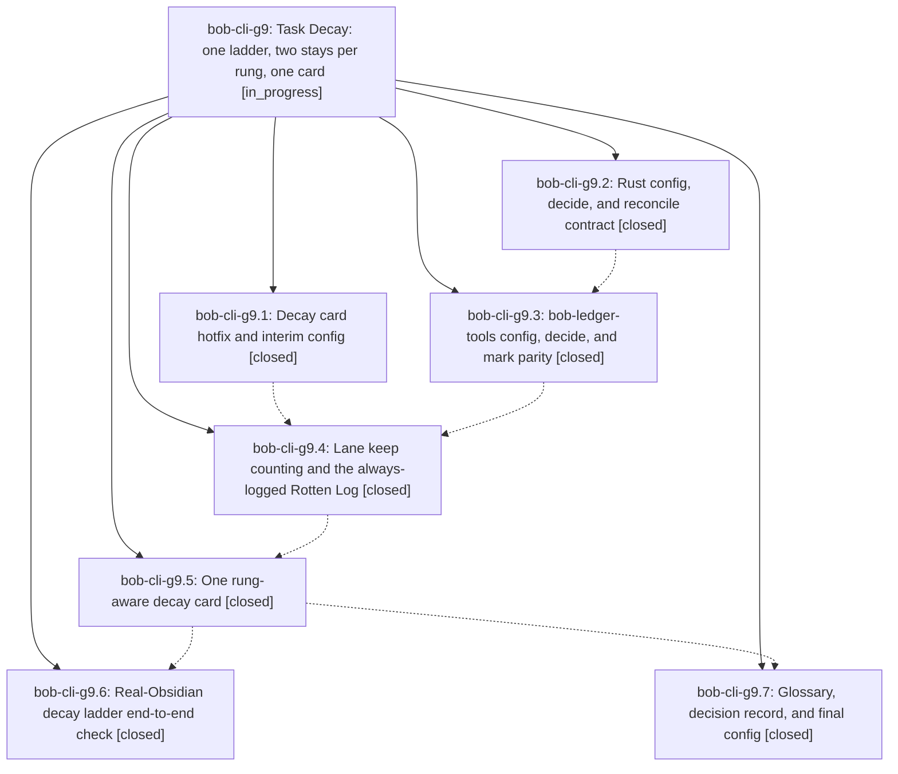

# Bead: bob-cli-g9 — Task Decay: one ladder, two stays per rung, one card

[Bead Pages](../README.md) / bob-cli-g9

**Status:** ◐ in_progress · **Type:** ▸ plan · **Tier:** epic
**Owner:** `bryanbugyi34@gmail.com` · **Created by:** [bbugyi200.apollo.research.32.linker.w0](https://github.com/bobs-org/bob-cli--agents/blob/main/sessions/bbugyi200.apollo.research.32.linker.w0.md) · **Assignee:** `bob-cli-g9.land`
**Created:** 2026-11-02 15:55:42 EST
**Plan:** [202611/task\_decay\_ladder.md](https://github.com/bobs-org/bob-cli--plans/blob/main/202611/task_decay_ladder.md)

<!-- sase:links:start -->

## Links

| Relation | Artifact | Why |
| --- | --- | --- |
| implemented-by | [plan:202611/task_decay_ladder.md][1] | derived from the plan's `bead_id:` frontmatter field |

_Plus 1 automatic references — see [Referenced By](#referenced-by)._

[1]: https://github.com/bobs-org/bob-cli--plans/blob/main/202611/task_decay_ladder.md

<!-- sase:links:end -->

## Description

Repeated freshness keeps on WIP, Next, Ready, and P-level tasks follow one consent-based decay ladder (WIP → Next → Ready → P1 → … → P4): each rung allows a configured number of due Alt+F keeps (Bryan: 2), then the next due keep opens one rung-aware decay card whose Enter steps the task exactly one rung down and whose Alt+F stays and restarts the count; every keep, stay, step, and drop writes one rung-qualified Rotten Log entry; WIP keeps log to the Rotten Log instead of the Work Log; and the Ready card's "no priority ladder is configured" bug is fixed.

## Phases

| Bead | Title | Status | Size | Created | Agents | Commits |
|---|---|---|---|---|---:|---:|
| [bob-cli-g9.1](bob-cli-g9.1.md) | Decay card hotfix and interim config | ✓ closed | small | 2026-11-02 | 1 | 2 |
| [bob-cli-g9.2](bob-cli-g9.2.md) | Rust config, decide, and reconcile contract | ✓ closed | medium | 2026-11-02 | 1 | 1 |
| [bob-cli-g9.3](bob-cli-g9.3.md) | bob-ledger-tools config, decide, and mark parity | ✓ closed | medium | 2026-11-02 | 1 | 2 |
| [bob-cli-g9.4](bob-cli-g9.4.md) | Lane keep counting and the always-logged Rotten Log | ✓ closed | medium | 2026-11-02 | 1 | 2 |
| [bob-cli-g9.5](bob-cli-g9.5.md) | One rung-aware decay card | ✓ closed | medium | 2026-11-02 | 1 | 2 |
| [bob-cli-g9.6](bob-cli-g9.6.md) | Real-Obsidian decay ladder end-to-end check | ✓ closed | medium | 2026-11-02 | 1 | 1 |
| [bob-cli-g9.7](bob-cli-g9.7.md) | Glossary, decision record, and final config | ✓ closed | small | 2026-11-02 | 1 | 1 |

## Lineage

## Agents

| Agent | Bead | Commits |
|---|---|---:|
| [bbugyi200.apollo.bob-cli-g9.1](https://github.com/bobs-org/bob-cli--agents/blob/main/agents/bbugyi200.apollo.bob-cli-g9.1/README.md) | [bob-cli-g9.1](bob-cli-g9.1.md) | 2 |
| [bbugyi200.apollo.bob-cli-g9.2](https://github.com/bobs-org/bob-cli--agents/blob/main/sessions/bbugyi200.apollo.bob-cli-g9.2.md) | [bob-cli-g9.2](bob-cli-g9.2.md) | 1 |
| [bbugyi200.apollo.bob-cli-g9.3](https://github.com/bobs-org/bob-cli--agents/blob/main/agents/bbugyi200.apollo.bob-cli-g9.3/README.md) | [bob-cli-g9.3](bob-cli-g9.3.md) | 2 |
| [bbugyi200.apollo.bob-cli-g9.4](https://github.com/bobs-org/bob-cli--agents/blob/main/agents/bbugyi200.apollo.bob-cli-g9.4/README.md) | [bob-cli-g9.4](bob-cli-g9.4.md) | 2 |
| [bbugyi200.apollo.bob-cli-g9.5](https://github.com/bobs-org/bob-cli--agents/blob/main/sessions/bbugyi200.apollo.bob-cli-g9.5.md) | [bob-cli-g9.5](bob-cli-g9.5.md) | 2 |
| [bbugyi200.apollo.bob-cli-g9.6](https://github.com/bobs-org/bob-cli--agents/blob/main/agents/bbugyi200.apollo.bob-cli-g9.6/README.md) | [bob-cli-g9.6](bob-cli-g9.6.md) | 1 |
| [bbugyi200.apollo.bob-cli-g9.7](https://github.com/bobs-org/bob-cli--agents/blob/main/agents/bbugyi200.apollo.bob-cli-g9.7/README.md) | [bob-cli-g9.7](bob-cli-g9.7.md) | 1 |
| [bbugyi200.apollo.bob-cli-g9.land](https://github.com/bobs-org/bob-cli--agents/blob/main/agents/bbugyi200.apollo.bob-cli-g9.land/README.md) | [bob-cli-g9](README.md) | 0 |

## Commits

| Repo | Commit | Subject | Bead | Committed |
|---|---|---|---|---|
| bob-cli | [`0f8ee84`](https://github.com/bobs-org/bob-cli/commit/0f8ee840f66d53db71fed9b864862f67c44245ca) | docs(freshness): enter P0 at the first level whose min\_days meets the interval | [bob-cli-g9.1](bob-cli-g9.1.md) | 2026-11-02 16:21:20 EST |
| bob-plugins | [`bob-plugins@a541b9c`](https://github.com/bobs-org/bob-plugins/commit/a541b9cc08ce9e76cd42beb5f0ad73ac646dca5c) | fix(nav): load the Ready decay card from the priority ladder | [bob-cli-g9.1](bob-cli-g9.1.md) | 2026-11-02 16:21:52 EST |
| bob-cli | [`6086791`](https://github.com/bobs-org/bob-cli/commit/6086791f76b2564e37bd282bd63ea5ef7d2a07a8) | feat(freshness)!: bump freshness JSON to schema 15 with per-rung decay limits | [bob-cli-g9.2](bob-cli-g9.2.md) | 2026-11-02 17:25:48 EST |
| bob-cli | [`b4a17e8`](https://github.com/bobs-org/bob-cli/commit/b4a17e86622bc3cf6145f7fb105b1f985f6ce621) | docs(freshness): document lane decay marks and per-rung keeps wording | [bob-cli-g9.3](bob-cli-g9.3.md) | 2026-11-02 17:54:03 EST |
| bob-plugins | [`bob-plugins@b008f6e`](https://github.com/bobs-org/bob-plugins/commit/b008f6ebbeba403bd6eddb6bb7dc09806d6b3ee2) | feat(ledger-tools): mirror per-rung decay config, lane decide, and lane marks | [bob-cli-g9.3](bob-cli-g9.3.md) | 2026-11-02 17:54:49 EST |
| bob-cli | [`0bdcea7`](https://github.com/bobs-org/bob-cli/commit/0bdcea7aedc9177b2f318e4aabe6c7383df21670) | docs(freshness): add freshness and vault-format reference docs for nav-keeps | [bob-cli-g9.4](bob-cli-g9.4.md) | 2026-11-02 19:22:49 EST |
| bob-plugins | [`bob-plugins@99940be`](https://github.com/bobs-org/bob-plugins/commit/99940be02e5a94cf514cc584d92f9eb9097df992) | feat(nav-keeps): lane keep counting with rung-aware prompts and always-logged rotten log | [bob-cli-g9.4](bob-cli-g9.4.md) | 2026-11-02 19:23:29 EST |
| bob-cli | [`817ba7d`](https://github.com/bobs-org/bob-cli/commit/817ba7dda9579138fb93a1690177fb5ac20c1bcb) | docs(freshness): add freshness and projects notes for nav-card decay work | [bob-cli-g9.5](bob-cli-g9.5.md) | 2026-11-02 20:51:09 EST |
| bob-plugins | [`bob-plugins@6464cad`](https://github.com/bobs-org/bob-plugins/commit/6464cad318ea87033106b674c4b5019b5131b93a) | fix(nav-hotkeys): restore D/X drop alias and rung-aware decay contract | [bob-cli-g9.5](bob-cli-g9.5.md) | 2026-11-02 20:51:43 EST |
| bob-cli | [`807e181`](https://github.com/bobs-org/bob-cli/commit/807e1816560696672483eeedfbe647fca9dd8898) | docs(memory): task decay ladder glossary, decision record, and regenerated pages | [bob-cli-g9.7](bob-cli-g9.7.md) | 2026-11-02 21:22:11 EST |
| bob-cli | [`0346d82`](https://github.com/bobs-org/bob-cli/commit/0346d828011a5f5a0c4ef4d526fa80583dab7ee6) | docs(decay-ladder): add live-verification page for the task-decay e2e | [bob-cli-g9.6](bob-cli-g9.6.md) | 2026-11-02 21:36:14 EST |

<!-- sase:referenced-by:start -->

## Referenced By

| Relation | Artifact | Why | Uses |
| --- | --- | --- | ---: |
| read-by | [agent:bob-cli-g9.3][1] | Need epic DECISIONS and scope for phase work | 1 |

[1]: https://github.com/bobs-org/bob-cli--agents/blob/main/agents/bbugyi200.apollo.bob-cli-g9.3/README.md

<!-- sase:referenced-by:end -->
