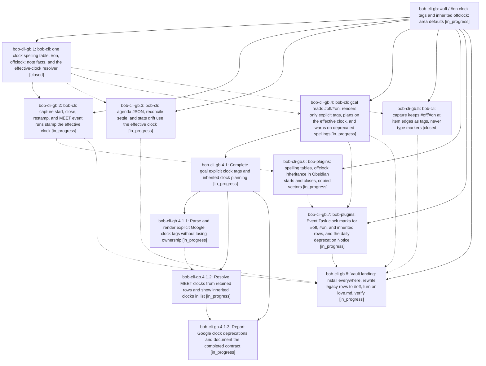

# Bead: bob-cli-gb — #off / #on clock tags and inherited offclock: area defaults

[Bead Pages](../README.md) / bob-cli-gb

**Status:** ◐ in_progress · **Type:** ▸ plan · **Tier:** epic
**Owner:** `bryanbugyi34@gmail.com` · **Created by:** [bbugyi200.apollo.research.31.linker.w0](https://github.com/bobs-org/bob-cli--agents/blob/main/sessions/bbugyi200.apollo.research.31.linker.w0.md) · **Assignee:** `bob-cli-gb.land`
**Created:** 2026-11-02 17:38:44 EST
**Plan:** [202611/off\_on\_tags\_and\_offclock\_areas.md](https://github.com/bobs-org/bob-cli--plans/blob/main/202611/off_on_tags_and_offclock_areas.md)

<!-- sase:links:start -->

## Links

| Relation | Artifact | Why |
| --- | --- | --- |
| implemented-by | [plan:202611/off_on_tags_and_offclock_areas.md][1] | derived from the plan's `bead_id:` frontmatter field |

[1]: https://github.com/bobs-org/bob-cli--plans/blob/main/202611/off_on_tags_and_offclock_areas.md

<!-- sase:links:end -->

## Description

Off-clock life needs no tag: an area or project note's `offclock: true`, inherited down the task's root walk and overridable by a child's `offclock: false` or a task's `#on`, decides the clock of every untagged task and Event Task beneath it; `#off` replaces `#offclock` as the one spelling bob writes in Obsidian and reads from Google Calendar; `#offclock`, `#off-clock`, and `#untracked` keep working while `bob gcal sync` and `bob gcal list` warn about them (with a once-a-day Obsidian Notice); past Event Task rows are rewritten to `#off`; and `love.md` turns on the first area default.

## Phases

| Bead | Title | Status | Size | Created | Agents | Commits |
|---|---|---|---|---|---:|---:|
| [bob-cli-gb.1](bob-cli-gb.1.md) | bob-cli: one clock spelling table, #on, offclock: note facts, and the effective-clock resolver | ✓ closed | medium | 2026-11-02 | 1 | 1 |
| [bob-cli-gb.2](bob-cli-gb.2.md) | bob-cli: capture start, close, restamp, and MEET event runs stamp the effective clock | ◐ in_progress | medium | 2026-11-02 | 1 | 0 |
| [bob-cli-gb.3](bob-cli-gb.3.md) | bob-cli: agenda JSON, reconcile settle, and stats drift use the effective clock | ◐ in_progress | medium | 2026-11-02 | 1 | 0 |
| [bob-cli-gb.4](bob-cli-gb.4.md) | bob-cli: gcal reads #off/#on, renders only explicit tags, plans on the effective clock, and warns on deprecated spellings | ◐ in_progress | large | 2026-11-02 | 1 | 0 |
| [bob-cli-gb.5](bob-cli-gb.5.md) | bob-cli: capture keeps #off/#on at item edges as tags, never type markers | ✓ closed | small | 2026-11-02 | 1 | 1 |
| [bob-cli-gb.6](bob-cli-gb.6.md) | bob-plugins: spelling tables, offclock: inheritance in Obsidian starts and closes, copied vectors | ◐ in_progress | medium | 2026-11-02 | 1 | 0 |
| [bob-cli-gb.7](bob-cli-gb.7.md) | bob-plugins: Event Task clock marks for #off, #on, and inherited rows, and the daily deprecation Notice | ◐ in_progress | medium | 2026-11-02 | 1 | 0 |
| [bob-cli-gb.8](bob-cli-gb.8.md) | Vault landing: install everywhere, rewrite legacy rows to #off, turn on love.md, verify | ◐ in_progress | small | 2026-11-02 | 1 | 0 |

## Lineage

## Agents

| Agent | Bead | Commits |
|---|---|---:|
| [bbugyi200.apollo.bob-cli-gb.1](https://github.com/bobs-org/bob-cli--agents/blob/main/agents/bbugyi200.apollo.bob-cli-gb.1/README.md) | [bob-cli-gb.1](bob-cli-gb.1.md) | 1 |
| [bbugyi200.apollo.bob-cli-gb.2](https://github.com/bobs-org/bob-cli--agents/blob/main/sessions/bbugyi200.apollo.bob-cli-gb.2.md) | [bob-cli-gb.2](bob-cli-gb.2.md) | 0 |
| [bbugyi200.apollo.bob-cli-gb.3](https://github.com/bobs-org/bob-cli--agents/blob/main/sessions/bbugyi200.apollo.bob-cli-gb.3.md) | [bob-cli-gb.3](bob-cli-gb.3.md) | 0 |
| [bbugyi200.apollo.bob-cli-gb.4](https://github.com/bobs-org/bob-cli--agents/blob/main/sessions/bbugyi200.apollo.bob-cli-gb.4.md) | [bob-cli-gb.4](bob-cli-gb.4.md) | 0 |
| [bbugyi200.apollo.bob-cli-gb.4.1.1](https://github.com/bobs-org/bob-cli--agents/blob/main/sessions/bbugyi200.apollo.bob-cli-gb.4.1.1.md) | [bob-cli-gb.4.1.1](bob-cli-gb.4.1.1.md) | 0 |
| [bbugyi200.apollo.bob-cli-gb.4.1.2](https://github.com/bobs-org/bob-cli--agents/blob/main/agents/bbugyi200.apollo.bob-cli-gb.4.1.2/README.md) | [bob-cli-gb.4.1.2](bob-cli-gb.4.1.2.md) | 0 |
| [bbugyi200.apollo.bob-cli-gb.4.1.3](https://github.com/bobs-org/bob-cli--agents/blob/main/agents/bbugyi200.apollo.bob-cli-gb.4.1.3/README.md) | [bob-cli-gb.4.1.3](bob-cli-gb.4.1.3.md) | 0 |
| [bbugyi200.apollo.bob-cli-gb.4.1.land](https://github.com/bobs-org/bob-cli--agents/blob/main/agents/bbugyi200.apollo.bob-cli-gb.4.1.land/README.md) | [bob-cli-gb.4.1](bob-cli-gb.4.1.md) | 0 |
| [bbugyi200.apollo.bob-cli-gb.5](https://github.com/bobs-org/bob-cli--agents/blob/main/agents/bbugyi200.apollo.bob-cli-gb.5/README.md) | [bob-cli-gb.5](bob-cli-gb.5.md) | 1 |
| [bbugyi200.apollo.bob-cli-gb.6](https://github.com/bobs-org/bob-cli--agents/blob/main/agents/bbugyi200.apollo.bob-cli-gb.6/README.md) | [bob-cli-gb.6](bob-cli-gb.6.md) | 0 |
| [bbugyi200.apollo.bob-cli-gb.7](https://github.com/bobs-org/bob-cli--agents/blob/main/agents/bbugyi200.apollo.bob-cli-gb.7/README.md) | [bob-cli-gb.7](bob-cli-gb.7.md) | 0 |
| [bbugyi200.apollo.bob-cli-gb.8](https://github.com/bobs-org/bob-cli--agents/blob/main/agents/bbugyi200.apollo.bob-cli-gb.8/README.md) | [bob-cli-gb.8](bob-cli-gb.8.md) | 0 |
| [bbugyi200.apollo.bob-cli-gb.land](https://github.com/bobs-org/bob-cli--agents/blob/main/agents/bbugyi200.apollo.bob-cli-gb.land/README.md) | [bob-cli-gb](README.md) | 0 |

## Commits

| Repo | Commit | Subject | Bead | Committed |
|---|---|---|---|---|
| bob-cli | [`ab752cc`](https://github.com/bobs-org/bob-cli/commit/ab752cc536d2b1a011fe5aab1e0fc3205d6c3bdf) | feat(pomodoro-clock): resolve off-clock tags and note defaults | [bob-cli-gb.1](bob-cli-gb.1.md) | 2026-11-02 18:42:04 EST |
| bob-cli | [`15d18e9`](https://github.com/bobs-org/bob-cli/commit/15d18e90c46ea3a369998edce44b270d40689f04) | feat(capture): reserve clock tags from type markers | [bob-cli-gb.5](bob-cli-gb.5.md) | 2026-11-02 20:10:29 EST |
