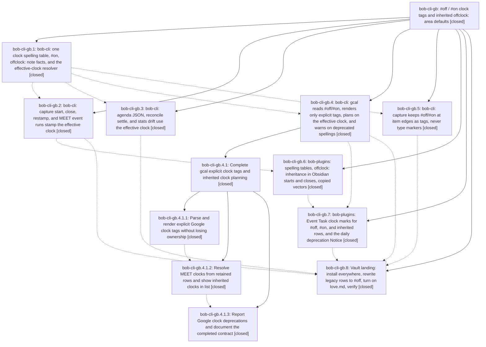

# Bead: bob-cli-gb — #off / #on clock tags and inherited offclock: area defaults

[Bead Pages](../README.md) / bob-cli-gb

**Status:** ✓ closed · **Resolution:** done · **Type:** ▸ plan · **Tier:** epic
**Owner:** `bryanbugyi34@gmail.com` · **Created by:** [bbugyi200.apollo.research.31.linker.w0](https://github.com/bobs-org/bob-cli--agents/blob/main/sessions/bbugyi200.apollo.research.31.linker.w0.md) · **Assignee:** `bob-cli-gb.land`
**Created:** 2026-11-02 17:38:44 EST · **Closed:** 2026-11-03 06:34:17 EST
**Plan:** [202611/off\_on\_tags\_and\_offclock\_areas.md](https://github.com/bobs-org/bob-cli--plans/blob/main/202611/off_on_tags_and_offclock_areas.md)

<!-- sase:links:start -->

## Links

| Relation | Artifact | Why |
| --- | --- | --- |
| implemented-by | [plan:202611/off_on_tags_and_offclock_areas.md][1] | derived from the plan's `bead_id:` frontmatter field |

[1]: https://github.com/bobs-org/bob-cli--plans/blob/main/202611/off_on_tags_and_offclock_areas.md

<!-- sase:links:end -->

## Description

Off-clock life needs no tag: an area or project note's `offclock: true`, inherited down the task's root walk and overridable by a child's `offclock: false` or a task's `#on`, decides the clock of every untagged task and Event Task beneath it; `#off` replaces `#offclock` as the one spelling bob writes in Obsidian and reads from Google Calendar; `#offclock`, `#off-clock`, and `#untracked` keep working while `bob gcal sync` and `bob gcal list` warn about them (with a once-a-day Obsidian Notice); past Event Task rows are rewritten to `#off`; and `love.md` turns on the first area default.

## Notes

[2026-11-03T11:30:34Z · bob-cli-gb.land] LANDING TRIAGE (bob-cli-gb.land). PROPOSED FOLLOW-UP outcomes:
(1) gb.3 #2 completion flakes under suite load (monitor ksba7ad30wkf, 3 nodes): articles::article_note_completion_shows_section_count -> +1 bob-cli-f2; completion::vault::deadline_override_keeps_working (added by bob-cli-3j.5) -> DISCOVERED ISSUE note on active epic bob-cli-3j; stats::completion_includes_worked plus six more unpinned __complete test files -> new task bob-cli-gd (flake, small, related f2/g8).
(2) gb.6 #2 / gb.7 #1 bob-plugins npm test failures on clean master -> +1 bob-cli-f1 (Chromium DOM), bob-cli-et (freshness reload), bob-cli-eh (note-ready storm + relation-index timeout), bob-cli-ff (schedule-work-log date), bob-cli-fz (reduced-motion Chromium). Declined "cycler relation-successor vectors not byte-identical": already fixed by bob-plugins dc319a7, and both plugin copies now byte-match bob-cli tests/fixtures/relation_successor/vectors.json.
(3) gb.8 #5 Mac bob-mac-capture signing failed over SSH (locked login keychain): declined as a task because scripts/install_all:539 already detects this and prints the remedy (security unlock-keychain or a GUI Terminal rerun). bob-mac-capture needed no change for this epic. Bryan still needs one GUI `just install` on the Mac.
(4) gb.8 #6 clock_drift warning copy still said "#offclock tags": caused by this epic, so fixed in the landing (now "the linked tasks' current clocks"), along with the stats docs listing for note_offclock_invalid/ignored.

[2026-11-03T11:34:17Z · bob-cli-gb.land] LANDED. Verified all 8 phases and every note against commits ab752cc5, 15d18e90, a9a499ac, 4d5a61de, beae4dc7, a414c171, and f9f4c706 (bob-cli), 2f172a2 and 9185779 (bob-plugins), and vault 7178580f/d0f324b0. The phases cover: the shared #off/#on/alias spelling table and tri-state ClockTag; NoteFacts offclock parsing with strict true/false; effective_clock over the PT13 root walk with note_offclock_invalid/ignored lints; capture start/close/restamp/MEET stamping plus clock_note and the via copy; agenda clock_source/clock_note; reconcile settle of inherited off-clock events; effective stats drift; gcal tri-state parse, explicit-only render and migration, effective MEET clocks, deprecation warnings, and deprecations[]; and capture reserving the clock tags. Plugin vectors (pomodoro_clock, meet_event_run, event_buffer) are byte-identical to bob-cli; taskEffectiveOffClock is exported and used. The authorized decision and glossary memory are written and superseded-in-part as decided. No other memory was edited.
Landing fixes (epic-caused): the clock_drift warning copy no longer says "#offclock tags" (now "the linked tasks' current clocks"); docs/stats.md lists the note_offclock_invalid/note_offclock_ignored health lists and warning codes; a stale allow(dead_code) on ClockTag::deprecated was removed; and a docs/capture.md example now uses #off.
Integration: reviewed the 10 non-epic commits since ab752cc5 (relation-successor perf 2aec2aa4/65a12f0a, Pending unlink 71907dab, and the freshness, decay, and capture docs). None duplicates or conflicts with the clock contract; 6c3a26d8 already documents inherited off-clock Event Tasks. origin/master == HEAD 05e355ee before the fixes.
Gates: just check passed (fmt, clippy, 7989 tests, 0 failed) and just docs-check passed. No --epic-symbol entries; this repo has no symvision recipe.
Follow-ups (see note): +1 bob-cli-f2/f1/et/eh/ff/fz; new task bob-cli-gd; DISCOVERED ISSUE on bob-cli-3j. Declined: the cycler relation-successor vectors (already fixed by dc319a7) and the Mac keychain signing (install_all already explains it; manual GUI rerun).

## Phases

| Bead | Title | Status | Size | Created | Agents | Commits |
|---|---|---|---|---|---:|---:|
| [bob-cli-gb.1](bob-cli-gb.1.md) | bob-cli: one clock spelling table, #on, offclock: note facts, and the effective-clock resolver | ✓ closed | medium | 2026-11-02 | 1 | 1 |
| [bob-cli-gb.2](bob-cli-gb.2.md) | bob-cli: capture start, close, restamp, and MEET event runs stamp the effective clock | ✓ closed | medium | 2026-11-02 | 1 | 1 |
| [bob-cli-gb.3](bob-cli-gb.3.md) | bob-cli: agenda JSON, reconcile settle, and stats drift use the effective clock | ✓ closed | medium | 2026-11-02 | 1 | 1 |
| [bob-cli-gb.4](bob-cli-gb.4.md) | bob-cli: gcal reads #off/#on, renders only explicit tags, plans on the effective clock, and warns on deprecated spellings | ✓ closed | large | 2026-11-02 | 1 | 0 |
| [bob-cli-gb.5](bob-cli-gb.5.md) | bob-cli: capture keeps #off/#on at item edges as tags, never type markers | ✓ closed | small | 2026-11-02 | 1 | 1 |
| [bob-cli-gb.6](bob-cli-gb.6.md) | bob-plugins: spelling tables, offclock: inheritance in Obsidian starts and closes, copied vectors | ✓ closed | medium | 2026-11-02 | 1 | 1 |
| [bob-cli-gb.7](bob-cli-gb.7.md) | bob-plugins: Event Task clock marks for #off, #on, and inherited rows, and the daily deprecation Notice | ✓ closed | medium | 2026-11-02 | 1 | 1 |
| [bob-cli-gb.8](bob-cli-gb.8.md) | Vault landing: install everywhere, rewrite legacy rows to #off, turn on love.md, verify | ✓ closed | small | 2026-11-02 | 1 | 0 |

## Lineage

## Agents

| Agent | Bead | Commits |
|---|---|---:|
| [bbugyi200.apollo.bob-cli-gb.1](https://github.com/bobs-org/bob-cli--agents/blob/main/agents/bbugyi200.apollo.bob-cli-gb.1/README.md) | [bob-cli-gb.1](bob-cli-gb.1.md) | 1 |
| [bbugyi200.apollo.bob-cli-gb.2](https://github.com/bobs-org/bob-cli--agents/blob/main/sessions/bbugyi200.apollo.bob-cli-gb.2.md) | [bob-cli-gb.2](bob-cli-gb.2.md) | 1 |
| [bbugyi200.apollo.bob-cli-gb.3](https://github.com/bobs-org/bob-cli--agents/blob/main/sessions/bbugyi200.apollo.bob-cli-gb.3.md) | [bob-cli-gb.3](bob-cli-gb.3.md) | 1 |
| [bbugyi200.apollo.bob-cli-gb.4](https://github.com/bobs-org/bob-cli--agents/blob/main/sessions/bbugyi200.apollo.bob-cli-gb.4.md) | [bob-cli-gb.4](bob-cli-gb.4.md) | 0 |
| [bbugyi200.apollo.bob-cli-gb.4.1.1](https://github.com/bobs-org/bob-cli--agents/blob/main/sessions/bbugyi200.apollo.bob-cli-gb.4.1.1.md) | [bob-cli-gb.4.1.1](bob-cli-gb.4.1.1.md) | 1 |
| [bbugyi200.apollo.bob-cli-gb.4.1.2](https://github.com/bobs-org/bob-cli--agents/blob/main/agents/bbugyi200.apollo.bob-cli-gb.4.1.2/README.md) | [bob-cli-gb.4.1.2](bob-cli-gb.4.1.2.md) | 1 |
| [bbugyi200.apollo.bob-cli-gb.4.1.3](https://github.com/bobs-org/bob-cli--agents/blob/main/agents/bbugyi200.apollo.bob-cli-gb.4.1.3/README.md) | [bob-cli-gb.4.1.3](bob-cli-gb.4.1.3.md) | 1 |
| [bbugyi200.apollo.bob-cli-gb.4.1.land](https://github.com/bobs-org/bob-cli--agents/blob/main/agents/bbugyi200.apollo.bob-cli-gb.4.1.land/README.md) | [bob-cli-gb.4.1](bob-cli-gb.4.1.md) | 1 |
| [bbugyi200.apollo.bob-cli-gb.5](https://github.com/bobs-org/bob-cli--agents/blob/main/agents/bbugyi200.apollo.bob-cli-gb.5/README.md) | [bob-cli-gb.5](bob-cli-gb.5.md) | 1 |
| [bbugyi200.apollo.bob-cli-gb.6](https://github.com/bobs-org/bob-cli--agents/blob/main/agents/bbugyi200.apollo.bob-cli-gb.6/README.md) | [bob-cli-gb.6](bob-cli-gb.6.md) | 1 |
| [bbugyi200.apollo.bob-cli-gb.7](https://github.com/bobs-org/bob-cli--agents/blob/main/agents/bbugyi200.apollo.bob-cli-gb.7/README.md) | [bob-cli-gb.7](bob-cli-gb.7.md) | 1 |
| [bbugyi200.apollo.bob-cli-gb.8](https://github.com/bobs-org/bob-cli--agents/blob/main/sessions/bbugyi200.apollo.bob-cli-gb.8.md) | [bob-cli-gb.8](bob-cli-gb.8.md) | 0 |
| [bbugyi200.apollo.bob-cli-gb.land](https://github.com/bobs-org/bob-cli--agents/blob/main/agents/bbugyi200.apollo.bob-cli-gb.land/README.md) | [bob-cli-gb](README.md) | 2 |

## Commits

| Repo | Commit | Subject | Bead | Committed |
|---|---|---|---|---|
| bob-cli | [`ab752cc`](https://github.com/bobs-org/bob-cli/commit/ab752cc536d2b1a011fe5aab1e0fc3205d6c3bdf) | feat(pomodoro-clock): resolve off-clock tags and note defaults | [bob-cli-gb.1](bob-cli-gb.1.md) | 2026-11-02 18:42:04 EST |
| bob-cli | [`15d18e9`](https://github.com/bobs-org/bob-cli/commit/15d18e90c46ea3a369998edce44b270d40689f04) | feat(capture): reserve clock tags from type markers | [bob-cli-gb.5](bob-cli-gb.5.md) | 2026-11-02 20:10:29 EST |
| bob-cli | [`a9a499a`](https://github.com/bobs-org/bob-cli/commit/a9a499ac6ee9a0d0cbc68a8c2bdb3b8bcec39930) | feat(clock-readers): effective clock\_source in agenda, settle, and stats drift | [bob-cli-gb.3](bob-cli-gb.3.md) | 2026-11-02 21:02:32 EST |
| bob-cli | [`4d5a61d`](https://github.com/bobs-org/bob-cli/commit/4d5a61de6a5f2437a5db97a95d444f9d055fb327) | feat(gcal): parse and render explicit clock tags | [bob-cli-gb.4.1.1](bob-cli-gb.4.1.1.md) | 2026-11-02 21:09:07 EST |
| bob-cli | [`beae4dc`](https://github.com/bobs-org/bob-cli/commit/beae4dc79a0593d14d7ce775d1e1702bbbe0e588) | feat(pomodoro-clock): stamp the effective clock on capture writers | [bob-cli-gb.2](bob-cli-gb.2.md) | 2026-11-02 21:44:22 EST |
| bob-plugins | [`bob-plugins@2f172a2`](https://github.com/bobs-org/bob-plugins/commit/2f172a2403c79af47823574fb739e44c9686080b) | feat(clock): inherit offclock defaults on starts and closes | [bob-cli-gb.6](bob-cli-gb.6.md) | 2026-11-02 22:34:28 EST |
| bob-cli | [`a414c17`](https://github.com/bobs-org/bob-cli/commit/a414c1713bbd9608653afdb369d950dbd1e2d614) | feat(gcal): resolve inherited clocks for list and MEET stamps | [bob-cli-gb.4.1.2](bob-cli-gb.4.1.2.md) | 2026-11-02 22:35:28 EST |
| bob-cli | [`f9f4c70`](https://github.com/bobs-org/bob-cli/commit/f9f4c7067f98e4c48c09c981f457f2c635ae8c47) | feat(gcal): report Google clock deprecations and document the completed contract | [bob-cli-gb.4.1.3](bob-cli-gb.4.1.3.md) | 2026-11-02 23:13:36 EST |
| bob-cli--plans | [`bob-cli--plans@4273fe3`](https://github.com/bobs-org/bob-cli--plans/commit/4273fe3cfe302e7e3f2b078bcf58595cbdf3cab2) | chore(plans): mark verified gcal clock epic complete | [bob-cli-gb.4.1](bob-cli-gb.4.1.md) | 2026-11-02 23:35:04 EST |
| bob-plugins | [`bob-plugins@9185779`](https://github.com/bobs-org/bob-plugins/commit/9185779a99250a7a0c3033426efc38238086a5ed) | feat(gcal-events): paint inherited clock marks and daily deprecation Notice | [bob-cli-gb.7](bob-cli-gb.7.md) | 2026-11-03 00:04:14 EST |
| bob-cli | [`a941db2`](https://github.com/bobs-org/bob-cli/commit/a941db21b0550f9c772a426ca1b15fe817eeb9bc) | fix(stats): name effective clocks in drift copy and document offclock lints | [bob-cli-gb](README.md) | 2026-11-03 06:35:37 EST |
| bob-cli--plans | [`bob-cli--plans@5204157`](https://github.com/bobs-org/bob-cli--plans/commit/5204157618bc4b93299a7113a9a2a685526294d7) | chore(plans): mark off\_on\_tags\_and\_offclock\_areas done after bob-cli-gb landed | [bob-cli-gb](README.md) | 2026-11-03 06:36:13 EST |
