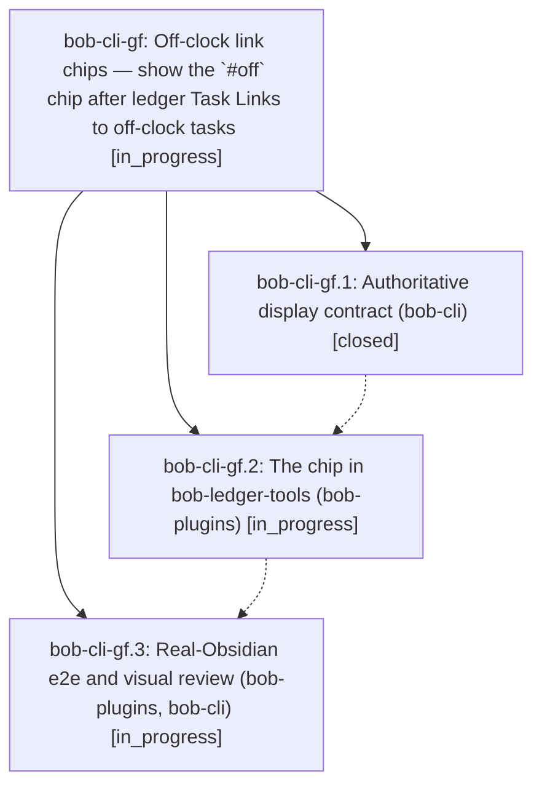

# Bead: bob-cli-gf — Off-clock link chips — show the \`#off\` chip after ledger Task Links to off-clock tasks

[Bead Pages](../README.md) / bob-cli-gf

**Status:** ◐ in_progress · **Type:** ▸ plan · **Tier:** epic
**Owner:** `bryanbugyi34@gmail.com` · **Created by:** [bbugyi200.apollo.c9](https://github.com/bobs-org/bob-cli--agents/blob/main/sessions/bbugyi200.apollo.c9.md) · **Assignee:** `bob-cli-gf.land`
**Created:** 2026-11-03 09:51:50 EST
**Plan:** [202611/off\_clock\_link\_chips.md](https://github.com/bobs-org/bob-cli--plans/blob/main/202611/off_clock_link_chips.md)

## Description

In a daily note's Pomodoro ledger, every Task Link whose task resolves off the clock (an explicit `#off` or alias, or an inherited area/project `offclock: true`) wears the same dashed `timer-off` `off` chip that off-clock Event Tasks already wear, in Live Preview and Reading view, so Bryan can see at a glance which planned or logged work will keep a session off the work clock.

## Phases

| Bead | Title | Status | Size | Created | Agents | Commits |
|---|---|---|---|---|---:|---:|
| [bob-cli-gf.1](bob-cli-gf.1.md) | Authoritative display contract (bob-cli) | ✓ closed | small | 2026-11-03 | 1 | 1 |
| [bob-cli-gf.2](bob-cli-gf.2.md) | The chip in bob-ledger-tools (bob-plugins) | ◐ in_progress | medium | 2026-11-03 | 1 | 0 |
| [bob-cli-gf.3](bob-cli-gf.3.md) | Real-Obsidian e2e and visual review (bob-plugins, bob-cli) | ◐ in_progress | medium | 2026-11-03 | 1 | 0 |

## Lineage

## Agents

| Agent | Bead | Commits |
|---|---|---:|
| [bbugyi200.apollo.bob-cli-gf.1](https://github.com/bobs-org/bob-cli--agents/blob/main/agents/bbugyi200.apollo.bob-cli-gf.1/README.md) | [bob-cli-gf.1](bob-cli-gf.1.md) | 1 |
| [bbugyi200.apollo.bob-cli-gf.2](https://github.com/bobs-org/bob-cli--agents/blob/main/agents/bbugyi200.apollo.bob-cli-gf.2/README.md) | [bob-cli-gf.2](bob-cli-gf.2.md) | 0 |
| [bbugyi200.apollo.bob-cli-gf.3](https://github.com/bobs-org/bob-cli--agents/blob/main/agents/bbugyi200.apollo.bob-cli-gf.3/README.md) | [bob-cli-gf.3](bob-cli-gf.3.md) | 0 |
| [bbugyi200.apollo.bob-cli-gf.land](https://github.com/bobs-org/bob-cli--agents/blob/main/agents/bbugyi200.apollo.bob-cli-gf.land/README.md) | [bob-cli-gf](README.md) | 0 |

## Commits

| Repo | Commit | Subject | Bead | Committed |
|---|---|---|---|---|
| bob-cli | [`5f35f0b`](https://github.com/bobs-org/bob-cli/commit/5f35f0b306de8a8155f7b6ba6ac5932aecc748d8) | docs(off-clock-chips): add ledger off-clock link chip display contract | [bob-cli-gf.1](bob-cli-gf.1.md) | 2026-11-03 10:10:19 EST |
